# Technical Specification – Ramifold

| Feld | Wert |
|---|---|
| Projekt | Ramifold (https://github.com/MarloNET/Ramifold) |
| Dokumenttyp | Technical Specification (Paperclip-Dokument `technical-specification`; v0.1 und v0.2 an MAR-1383, v0.3 an MAR-1392, v0.4 an MAR-1398, v0.5 an MAR-1401, v0.6 an MAR-1404, v0.7 an MAR-1408, v0.8 an MAR-1412, v0.9 an MAR-1414, v0.10 an MAR-1416, v0.11 an MAR-1436, v0.12 an MAR-1455, v0.13 an MAR-1459, v0.14 an MAR-1484, v0.15 an MAR-1495; nach Freigabe `docs/architecture/technical-specification.md`) |
| Version | v0.15 (Klarstellungs-Nachtrag N-10, MAR-1495, Anlass Rückfrage zu Issue #74/#75: Ort von `DomainError` und der Fehlerklassen des Plans, `PlanRegistry.getLoaded` mit Nachladen eines neuen Ordners, Öffnen eines nicht lesbaren Vorhabens zeigt UI-011 über UI-001, Zuordnung zu T-02 und T-04; keine freigegebene Entscheidung geändert, Abschnitt 10). v0.14: Klarstellungs-Nachtrag N-07 bis N-09, MAR-1484, Anlass Code Review PR #174: Dateien eines Agent-Laufs liefert der Adapter über `AgentPort.runFiles`, geschrieben und gelöscht werden sie vom Koordinator über `LocalStateFiles` vor Start und `202`; Fehlerweg im Vertrag von `AgentPort`; Inaktivitätsgrenze und Ursache im Adapter; TERM-004/-005 auf `stderr`; keine freigegebene Entscheidung geändert, Abschnitt 10). v0.13: Klarstellungs-Nachtrag N-05 und N-06, MAR-1459, Anlass Code Review PR #167: Fehlerzeile beim Startabbruch ist der TERM-Text, `startup_failed` nur im Fehlerprotokoll; keine symbolischen Links im Ramifold-Bereich; keine freigegebene Entscheidung geändert, Abschnitt 10). v0.12: Klarstellungs-Nachtrag N-03 und N-04, MAR-1455: Leistungsmessungen in `test/perf` außerhalb des CI-Gates, Zeitmessung zu REQ-054 nach `test/perf`; keine freigegebene Entscheidung geändert, Abschnitt 10). v0.11: Klarstellungs-Nachtrag N-01 und N-02 aus Code Review PR #165, MAR-1436: Antwort auf unbekannte `/api`-Route, Schlüssel gemeinsamer Komponenten in `messages`; keine freigegebene Entscheidung geändert, Abschnitt 10). Inhalt sonst wie v0.10 (Korrekturrunde 5 nach Architecture Review Runde 4: Owner-Entscheidung a vom 2026-11-25 zu TS-R-12, Chat-Fortsetzung und Abzweigung nur, wenn die Sitzung den ganzen Chat kennt, dauerhaft geprüft über das Feld `knownThroughMessageId` in `sessions.json`; FIND-037, FIND-038, FIND-039, H-09 bis H-12). v0.9: Owner-Entscheidung b vom 2026-11-25 (Vorschläge und Zusammenfassungen zweigen die Chat-Sitzung ab, mit Rückfall auf die einmalige Sitzung) |
| Status | approved (Gate „Wie“ Slice 0.1, MAR-1369; Owner-Freigabe 2026-11-25 mit „Stimmt“ bei allen 13 kritischen Annahmen; freigegebene Revision `7f032bb8-8d66-4e12-82bf-ca9517c3cac2`); v0.11 ist ein Klarstellungs-Nachtrag ohne erneutes Gate „Wie“ (Abschnitt 10); Owner-Bestätigung am 2026-11-26 auf Gate: Backlog (Slice 0.1), MAR-1418; veröffentlichte Revision `3cf63d16-e505-4c8f-8aca-4650590d3a26`. v0.12 ist ein Klarstellungs-Nachtrag ohne erneutes Gate „Wie“ (Abschnitt 10); er setzt die Owner-Entscheidung zu Leistungsmessungen auf MAR-1418 technisch um. v0.13 ist ein Klarstellungs-Nachtrag ohne erneutes Gate „Wie“ (Abschnitt 10): er löst einen Widerspruch zwischen 2.1 und 2.14 zugunsten von 2.1 und REQ-063 auf und setzt REQ-052 für symbolische Links um, nur mit vorhandenen Texten, Zuständen und Codes. v0.14 ist ein Klarstellungs-Nachtrag ohne erneutes Gate „Wie“ (Abschnitt 10): er legt eine von 2.6 Schritt 7 und 4.3 offen gelassene Schnittstelle innerhalb der Komponente `agent-gateway` fest und gleicht 4.3 an 2.6 an, nur mit vorhandenen Texten, Zuständen und Codes. v0.15 ist ein Klarstellungs-Nachtrag ohne erneutes Gate „Wie“ (Abschnitt 10): er benennt fehlende Einheiten innerhalb der freigegebenen Komponenten und legt die Aufteilung zwischen zwei Aufgaben-Kandidaten fest, nur mit vorhandenen Endpunkten, Texten, Zuständen und Codes |
| Autor | Software Architect (MarloNET) |
| Datum | 2026-11-27 (v0.15); 2026-11-26 (v0.14, v0.13, v0.12 und v0.11; v0.10 vom 2026-11-25) |
| Aktueller Slice | 0.1 (erster Slice; alle Abschnitte gehören zu Slice 0.1) |
| Prozessstufe | Voll |
| Freigegebene Requirements | v0.4, `docs/product/requirements.md`, Commit `3c85c33` (Freigabe Gate „Was“ MAR-1355) |
| UI/UX-Klassifizierung | Material (vom Owner bestätigt) |
| Architecture Baseline | **v0.9**, Paperclip-Dokument `architecture-baseline` an MAR-1416 (Owner-Entscheidung a: Briefing-Annahme 2 und „Was sich geändert hat“, Abschnitte 4 `AgentSession`, 5, 14). v0.8 an MAR-1414, Revision `02b177e9-446a-4111-be0b-02d3219da366` (Abzweigung der Chat-Sitzung: Briefing-Annahme 2, Abschnitte 5, 8, 9, 13, 14; in Review-Runde 4 geprüft). v0.7 an MAR-1412, Revision `78756e0c-c292-404d-a925-5fbd790c0929` (nur Metadaten nachgeführt, Inhalt wie v0.6; in Review-Runde 3 geprüft). v0.6 an MAR-1408, Revision `83091191-0d5a-4ab7-b4b3-6c98aa168569` (Korrekturrunde 2; Änderungen in Abschnitt 2, 3, 9, 10, 12 und im Briefing, in Review-Runde 2 geprüft). Frühere Stände: v0.5 an MAR-1392, Revision `b176e516-fde2-4de6-bf88-c82854c6c2f7` (in Review-Runde 1 geprüft); v0.4 an MAR-1383 (Abschnitt 7); v0.3 an MAR-1379 |
| ADRs | `adrs` **v0.7** an MAR-1416 (ADR-003: Fortsetzung und Abzweigung nur, wenn die Sitzung den ganzen Chat kennt; Status der Owner-Entscheidungen klargestellt, H-12; übrige ADRs unverändert); v0.6 an MAR-1414, Revision `cce9ba0b-6069-4ff1-b750-b067f90bcb9b` (ADR-003 um die Abzweigung als optionale Fähigkeit des Adapters ergänzt; in Review-Runde 4 geprüft); v0.5 an MAR-1412, Revision `5c5be7c6-2e83-4157-94fc-8c6a2d5d1858` (nur Metadaten nachgeführt, ADR-Inhalt wie v0.4; in Review-Runde 3 geprüft); v0.4 an MAR-1408, Revision `39083da0-d58c-4cbf-850d-4c47412dbf71` (ADR-001 bis ADR-007; geändert ADR-002 und ADR-006, keine neue ADR; in Review-Runde 2 geprüft); in Review-Runde 1 geprüft: v0.3 an MAR-1379, Revision `a97d389a-86f0-444b-858f-fdb08a397498` |
| UI/UX Design | **v0.4.6**, Branch `design/MAR-1372`, Draft PR https://github.com/MarloNET/Ramifold/pull/1, **Commit `5f68ce7`** (Basis `e3b6051`; Product-Owner-Review bestanden, MAR-1410/MAR-1411: MSG-015 und MSG-016 nennen bei Ursache `not_authenticated` den Schritt zur Anmeldung statt „Try again.“ (H-01, AC-REQ-004-03); `UI-003/screen.md` Planspalte eindeutig: offen beim Öffnen eines Vorhabens, Zustand bleibt beim Knotenwechsel (H-08); nur `uiux-design.md`, `UI-003/screen.md`, `UI-005/screen.md` geändert, keine neuen IDs, Elemente, Screens, Flows, Zustände oder Icons, Mockups und PNGs unverändert). Davor v0.4.5, Commit `e3b60518fc1893365030dcb81ecd94934aeffb4c` (in Review-Runde 2 geprüft; Basis `3b6215f`; Klarstellung zu FIND-028 über MAR-1406/MAR-1407: Anfangszustand der Planspalte unter 1024 px „offen“, Warnbanner `role="alert"`; nur `DESIGN.md`, `UI-003/screen.md`, `uiux-design.md` geändert, keine neuen IDs, Elemente oder Flows, Mockups und PNGs unverändert). Davor v0.4.4, Commit `3b6215fb4d801f808ec19226fe682ac53c4b844b` (Product-Owner-Review bestanden, MAR-1402/MAR-1403; schließt DL-04, Icon-Tabelle vollständig, ohne Verhaltensänderung, ohne neue IDs, Elemente oder Flows, Mockups und `icons.svg` unverändert gegenüber v0.4.3 `ff5b241`; v0.4.3 = Schluss von DL-03, MAR-1399/MAR-1400, ebenso ohne Verhaltensänderung gegenüber v0.4.2 `4a87ff1`; v0.4.2 = Schluss von DL-01, DL-02 und X2 (3), MAR-1395/MAR-1397, ebenso ohne Verhaltensänderung gegenüber v0.4.1 `e68b12d`; v0.4.1 = visuelle Überarbeitung, Look „Werkbank“, MAR-1389/MAR-1391, ohne Verhaltensänderung gegenüber v0.3.1 `7e47484`). Quellen `docs/ux/uiux-design.md`, `docs/ux/DESIGN.md`, `docs/ux/mockups/base.css` (Token-Werte), `docs/ux/mockups/icons.svg`, `docs/ux/screens/UI-001` bis `UI-011/screen.md`, `docs/ux/flows/flow.svg` |
| `ui-constraints` | v4, Revision `eec699bd-bf85-41d2-a44f-bb2474fbb4cd` (an MAR-1392), identisch mit Baseline Abschnitt 6; v3 an MAR-1379, Revision `40c3d77d-5c9d-428f-bb02-cb564c6123db` |
| Owner-Hinweise | `gate-wie-hinweise` an MAR-1355, Revision `5a9fa733-9516-4a26-85cb-313aabcb4510`. **Owner-Entscheidung vom 2026-11-25** bei der Freigabeprüfung (übermittelt vom CEOrchestrator in MAR-1414): Vorschläge und Zusammenfassungen laufen in einer Abzweigung der Chat-Sitzung des Knotens, ohne den Chat zu beeinflussen, damit der Prompt-Cache greift; Variante b, schon in Slice 0.1, mit Rückfall auf das bisherige Verhalten. **Owner-Entscheidung a vom 2026-11-25** zu TS-R-12 (übermittelt vom CEOrchestrator in MAR-1416): Die Chat-Fortsetzung prüft dauerhaft je Sitzungseintrag, ob die Sitzung den ganzen Chat kennt; dafür bekommt der Eintrag in `.ramifold/local/sessions.json` ein zusätzliches Feld |
| Frühere Slices | keine |
| Delta-Cross-Check | MAR-1392, Design v0.4.1 gegen Baseline und Spezifikation: machbar, keine Konflikte; zwei Design-Lücken DL-01, DL-02 gemeldet, in Design v0.4.2 geschlossen (MAR-1395) und in v0.4 dieser Spezifikation übernommen (MAR-1398, Abschnitt 2.16, 8.3); DL-03 in Design v0.4.3 geschlossen (MAR-1399) und in v0.5 übernommen (MAR-1401); DL-04 in Design v0.4.4 geschlossen (MAR-1402/MAR-1403) und in v0.6 übernommen (MAR-1404), dabei Schlussabgleich der ganzen Spezifikation gegen v0.4.4 mit den Auslegungen AL-01 bis AL-07 (Abschnitt 8.4) |
| Architecture Review | Runde 1: MAR-1405, Dokument `architecture-review` Revision `93ff8aa9-71cb-43af-b69d-03ea2d37c43f`, Verdikt `changes_requested` (geprüft v0.6); v0.7 adressierte FIND-024 bis FIND-035. Runde 2: MAR-1409, Revision `bb6c02a2-5b90-479b-9f84-6a24cdb9af2d`, Verdikt `pass` (geprüft v0.7), ein neues Finding FIND-036 (minor), in v0.8 behoben. Runde 3: MAR-1413, Revision `335ae87d-c92b-4dd7-a70b-7cb360ca0493`, Verdikt `pass` (geprüft v0.8), ein neues Finding FIND-037 (minor). Runde 4: MAR-1415, Revision `2c545e5f-caf9-4854-8cfe-2761dcc9dc02`, Verdikt `changes_requested` (geprüft v0.9; FIND-038 major, FIND-039 minor, Hinweise H-10 bis H-13); v0.10 behebt FIND-037 bis FIND-039 und H-09 bis H-12. Runde 5 (nur Delta dieser Fassung): ausstehend |
| Menschliche Freigabe (Gate „Wie“) | erteilt am 2026-11-25 (MAR-1369) für Architecture Baseline v0.9, ADRs v0.7, Technical Specification v0.10 und UI/UX Design v0.4.6 (Commit `5f68ce7`); alle 13 kritischen Annahmen mit „Stimmt“ bestätigt. Architecture Review Runde 5: `pass` (MAR-1417, Revision `a54ed2fb-10d2-471f-8fd0-09c30cd28274`) |

## Freigabe-Briefing

### Kurzfassung
Diese Spezifikation legt fest, wie Slice 0.1 gebaut wird: die Schnittstellen zwischen Browser und Ramifold, das Format der Dateien in `.ramifold/`, den Aufruf von Claude Code und die festen Namen aller Code-Bausteine. Sie folgt der Baseline und dem UI/UX Design (v0.4.6) und weicht von keinem ab. Dieses Briefing nennt nur, was darüber hinausgeht: wie eine zweite KI-Antwort nach „Send again“ gespeichert wird, wie Vorschläge und Zusammenfassungen nach deiner Entscheidung b vom 2026-11-25 die Chat-Sitzung des Knotens abzweigen (mit Rückfall auf eine einmalige Sitzung), dass nach deiner Entscheidung a vom selben Tag eine gespeicherte Sitzung nur weiterverwendet wird, wenn sie den ganzen Chat kennt, wann eine stille KI-Anfrage abbricht, wie Ramifold seine Dateien bei Abstürzen und mehreren Fenstern schützt und wie ein Installationspaket entsteht. Eine Frage braucht deine Entscheidung: wie gründlich wir Safari und ältere Browser-Versionen prüfen.

### So haben wir dich verstanden
| Deine Vorgabe (Quelle) | Unsere Auslegung | Beispiel |
|---|---|---|
| „Antwort bricht ab … erneut senden“ (REQ-028) und Entscheidung des Designers E-UX-01 | „Send again“ an einer unvollständigen Antwort schickt **dieselbe** Frage noch einmal. Die neue Antwort wird als **weitere Antwort zur selben Frage** gespeichert; die unvollständige bleibt stehen. Es entsteht keine Kopie der Frage. | Frage in 2.2, Antwort bricht nach zwei Absätzen mit „usage limit“ ab. Eine Stunde später „Send again“: Im Chat steht die Frage einmal, darunter die abgebrochene Antwort (incomplete) und darunter die neue, vollständige. |
| „Sitzung verloren … anzeigen, dass neu aufgebaut“ (REQ-029) | Der Hinweis „Session was rebuilt…“ erscheint nur, wenn die Sitzung **verloren** war (Claude Code kennt sie nicht mehr oder sie fehlt auf diesem Rechner). Startet Ramifold bewusst eine neue Sitzung, weil sich der Kontext geändert hat, gibt es keinen Hinweis; die KI bekommt den Verlauf trotzdem mit. | Du änderst den Auftrag von 2 und fragst in 2.2 weiter → neue Sitzung mit Verlauf, kein Hinweis. Du hast `~/.claude/` gelöscht → Hinweis erscheint. |
| „Vorschläge … bleiben verfügbar, bis … neue Vorschläge anfordert“ (REQ-037) | Offene Vorschläge eines Knotens verfallen in dem Moment, in dem du neue anforderst, auch wenn die neue Anfrage danach scheitert. Es gibt keine Rückfrage (vom Product Owner bestätigt, KL-05). | Drei Vorschläge für 2, einer davon umbenannt. Du klickst erneut „Suggest sub-items“ → die alten Karten sind weg, auch die umbenannte. |
| „Kontext anzeigen: der Text der nächsten KI-Anfrage“ (REQ-036) | Gezeigt wird genau der Text, den die nächste **Chat**-Nachricht dieses Knotens mitgibt, einschließlich eines mitgegebenen Verlaufs. Vorschläge und Zusammenfassungen bekommen denselben Kontext und den ganzen Chatverlauf (über die abgezweigte Chat-Sitzung oder im Text), ihre Aufgabe kommt als Nachricht dazu. | „Show context“ in 2.2 zeigt Regeln, Wurzel, 2, Geschwister 2.1 und 2.3, 2.2 selbst; nach einem Sitzungsneuaufbau zusätzlich den bisherigen Chat. |
| „Vorschläge und Zusammenfassungen in der Chat-Sitzung des Knotens laufen lassen, ohne den Chat zu beeinflussen, damit der Prompt-Cache greift“ (deine Entscheidung b vom 2026-11-25, schon in 0.1, mit Rückfall) | Ramifold lässt Claude Code die gespeicherte Chat-Sitzung des Knotens **abzweigen**: Die Abzweigung startet mit der Unterhaltung des Chats und bekommt nur den Auftrag als neue Nachricht. Ihre neue Sitzung wird nicht gespeichert; die Chat-Sitzung und der Chat bleiben unverändert. Passt keine Chat-Sitzung, läuft alles wie bisher in einer einmaligen Sitzung mit dem Chatverlauf im Text. | Du chattest in 2.2 über Embedding-Modelle und klickst gleich danach „Suggest sub-items“ → Abzweigung der Chat-Sitzung von 2.2. Deine nächste Chat-Nachricht setzt die unveränderte Chat-Sitzung fort; die Vorschläge kennt sie nicht. |
| „Chat-Fortsetzung dauerhaft prüfen“ (deine Entscheidung a vom 2026-11-25 zu TS-R-12) | Ramifold merkt sich auf diesem Rechner zu jeder gespeicherten Chat-Sitzung die letzte Chat-Nachricht, die sie kennt (die Antwort ihres letzten Chat-Laufs). Eine Chat-Nachricht setzt die Sitzung nur fort, und Vorschläge und Zusammenfassungen zweigen sie nur ab, wenn das die letzte Nachricht des Chats ist. Sonst bekommt die KI eine neue Sitzung mit dem ganzen Chat, **ohne** den Hinweis „Session was rebuilt…“, denn nichts ging verloren. Ein Neustart von Ramifold allein ändert daran nichts. | Am Laptop chattest du in 2.2; am Desktop kommen drei Nachrichten dazu, du holst sie am Laptop per `git pull` und startest neu → deine nächste Frage am Laptop läuft in einer neuen Sitzung, die die drei Desktop-Nachrichten kennt. Startest du Ramifold nur neu, ohne dass sich der Chat geändert hat, setzt die nächste Frage die bisherige Sitzung fort. |
| „Export … Gliederungstiefe entspricht der Baumtiefe“ (REQ-049) | Überschriften **innerhalb** eines Ergebnisses rücken im Export um die Tiefe des Knotens nach unten, sonst bräche die Gliederung. Der gespeicherte Text bleibt unverändert. | Ergebnis von 2.1 enthält „## Ziel“. Im `PLAN.md` steht 2.1 als `### 2.1 Chunking` und „Ziel“ als `#####`. |

### Kritische Annahmen – bitte einzeln bestätigen
1. **Annahme:** Zu einer Frage im Chat kann es mehrere KI-Antworten geben, wenn du nach einem Abbruch „Send again“ nutzt. Alle bleiben gespeichert und sichtbar; die KI bekommt bei einem Neustart der Sitzung nur den Verlauf **bis vor** die erneut gesendete Frage.
   *Beispiel:* 2.2: Frage „Welche Modelle sind lokal nutzbar?“, Antwort 1 „incomplete – usage limit“, Antwort 2 vollständig. Wird der Chat später auf dem zweiten Rechner fortgesetzt, sieht die KI Frage, Antwort 1 (als unvollständig markiert) und Antwort 2.
   **Wenn falsch** (die neue Antwort soll die alte ersetzen): Das Chat-Dateiformat und die Anzeige ändern sich; nach dem Bau wäre das eine Datenumstellung. (Abschnitt 2.7, 3.1)
2. **Annahme:** Vorschläge und Zusammenfassungen laufen in einer **Abzweigung der Chat-Sitzung** des Knotens, wenn Ramifold sie sicher nutzen kann: Auf diesem Rechner gibt es eine gespeicherte Chat-Sitzung des Knotens, Auftrag und Ergebnisse im Kontext haben sich seit der letzten Chat-Nachricht nicht geändert, die Sitzung kennt den ganzen Chat (seine letzte Nachricht ist die Antwort ihres letzten Chat-Laufs, nach deiner Entscheidung a), und Claude Code kennt die Sitzung noch. Sonst laufen sie wie bisher in einer **eigenen, einmaligen** Sitzung mit dem ganzen Chatverlauf. In beiden Fällen landen sie nicht in deinem Chat: Die gespeicherte Chat-Sitzung und der Chatverlauf bleiben unverändert.
   *Beispiel:* Du chattest in 2 und klickst gleich danach „Summarize with AI“ → Abzweigung; fragst du danach im Chat „Was hast du gerade zusammengefasst?“, weiß die KI es nicht (REQ-041). Hast du vorher den Auftrag von 2 geändert oder am anderen Rechner in 2 weitergechattet und das per `git pull` geholt, läuft die Zusammenfassung einmalig mit dem ganzen Chat; das Ergebnis ist gleichwertig, nur ohne möglichen Kostenvorteil. Ein bloßer Neustart von Ramifold verhindert die Abzweigung nicht.
   **Wenn falsch** (die Zusammenfassung soll im Chat-Gedächtnis bleiben): Die Chat-KI sähe Anfragen, die laut REQ-037/REQ-041 nicht zum Chat gehören; Sitzungsplanung und Tests müssten neu geschnitten werden. Willst du dagegen gar keine Abzweigung, entfällt nur ein Zweig der Sitzungsplanung (leicht). (Abschnitt 2.8 „Sitzungsplanung“, 2.9, 2.10; ADR-003)
3. **Annahme:** Kommen über Git **zwei Chats für denselben Knoten** zusammen (Chats eingeschlossen, auf Laptop und Desktop jeweils den ersten Chat eines neuen Knotens begonnen), zeigt Ramifold in 0.1 nur den älteren. Der andere bleibt unverändert als Datei liegen und erscheint, sobald ein späterer Slice mehrere Chats je Knoten bringt.
   *Beispiel:* Knoten 3.2 wurde gepusht; du chattest am Laptop und am Desktop darin, beide Chats werden committet. Nach `git pull` zeigt 3.2 den Chat, der zuerst begonnen wurde.
   **Wenn falsch** (du willst beide sehen oder das Vorhaben sperren): Sperren widerspräche deinem Hinweis zu REQ-072; beide zeigen bräuchte eine neue Darstellung im Design. (Abschnitt 2.14)
4. **Annahme:** Eine KI-Anfrage, bei der Claude Code **5 Minuten lang nichts ausgibt**, bricht Ramifold mit „did not respond in time“ ab.
   *Beispiel:* Eine Web-Recherche hängt an einer Seite, die nie antwortet → nach 5 Minuten Stille endet die Anfrage als „incomplete“, die schon gezeigten Teile bleiben.
   **Wenn falsch** (Recherchen dauern bei dir oft länger still): Dann bricht Ramifold gute Recherchen ab; der Wert ist eine Konstante und leicht änderbar, sollte aber vor dem Bau stimmen. (Abschnitt 2.6)

### Weitere Annahmen
- **Bewusst akzeptiertes Restrisiko:** Der Kostenvorteil der Abzweigung ist nicht gemessen und nicht garantiert. Er entsteht nur, wenn der Anbieter die Chat-Unterhaltung noch im Zwischenspeicher hat, und der hält sie nur eine begrenzte, vom Anbieter festgelegte Zeit (oft wenige Minuten). Im schlechtesten Fall kostet eine Anfrage so viel wie bisher; kein Requirement hängt davon ab. *Beispiel:* Zusammenfassung zwei Minuten nach der letzten Chat-Nachricht → wahrscheinlich günstiger; am Morgen nach einem Chat-Abend → gleich teuer wie bisher, inhaltlich gleich.
- **Bewusst akzeptierte Grenze der Prüfung „Sitzung kennt den ganzen Chat“:** Ramifold vergleicht nur die letzte Nachricht des Chats. Fügt jemand beim Auflösen eines Git-Konflikts in einer Chat-Datei von Hand Nachrichten **vor** der letzten ein, bemerkt Ramifold das nicht, und die Sitzung kennt diese Nachrichten nicht. Ohne solche Handarbeit kommt das nicht vor: Chats werden nur angehängt, und hängen zwei Rechner an denselben Chat an, meldet Git immer einen Konflikt (das Vorhaben ist bis zur Auflösung gesperrt, REQ-072). *Beispiel:* Laptop und Desktop chatten beide in 2.2; nach `git pull` meldet Git einen Konflikt; du behältst beide Teile und setzt die Desktop-Nachrichten vor die Laptop-Nachrichten → die Laptop-Sitzung wird fortgesetzt, ohne die Desktop-Nachrichten zu kennen.
- Ein Rückfluss-Hinweis bleibt auch dann stehen, wenn das Kind nach dem Festlegen wieder als Konzept gespeichert wurde (wörtlich nach REQ-046). *Beispiel:* 2.2 festgelegt, dann wieder Konzept → 2 zeigt den Hinweis bis zum Neuspeichern von 2.
- Eine Vorschlagsliste der KI ist unbrauchbar, wenn ein Vorschlag keinen Titel hat; dann erscheint MSG-009 und nichts wird übernommen.
- Die Bearbeitungssperre eines Ergebnisses endet 2 Sekunden nach dem Schließen des sperrenden Fensters (Baseline und Design erlauben bis 15 s).
- Ist die Version von Claude Code nicht lesbar, behandelt Ramifold sie wie „zu alt“ (im Zweifel keine KI ohne geprüfte Lesebeschränkung).

### Entscheidungen der Agenten
| Entscheidung | Verworfene Alternative | Warum | Umkehrbar |
|---|---|---|---|
| **Chat-Datei als Ereignisliste:** Fragen, Statuswechsel, Antwortbeginn, Antwortteile und Antwortende sind je eine Zeile; eine Antwort verweist auf ihre Frage (Annahme 1) | eine Zeile je fertiger Nachricht, die später überschrieben wird | Nur anhängen bleibt absturzsicher (REQ-055) und mit Git zusammenführbar; Teile landen spätestens jede Sekunde in der Datei | schwer (Datenformat) |
| **Abgerissenes Ende einer Chat-Datei wird vor dem nächsten Anhängen bereinigt** (Abschnitt 2.14) | Bruchstück stehen lassen und nur beim Lesen überspringen | Sonst entstünde beim Weiterschreiben eine kaputte Zeile mitten in der Datei, und das Vorhaben wäre unlesbar. *Beispiel:* Der Strom fällt aus, während eine Antwort in 2.2 gespeichert wird. Nach dem Neustart schreibst du in 2.2 weiter; Ramifold entfernt zuerst das halbe Zeilenstück, das nie als gespeichert galt, und hängt dann deine Frage an. | leicht |
| **Prüfung „von außen geändert“ beim Öffnen wartet auf laufende eigene Schreibvorgänge desselben Vorhabens** (Abschnitt 2.12) | Prüfung unabhängig vom Schreiben | Sonst könnte Ramifold sein eigenes, gerade laufendes Speichern für eine Änderung von außen halten und das Vorhaben sperren. *Beispiel:* Während in 2.2 eine Antwort hereinläuft, öffnest du 3.1; das Vorhaben bleibt bearbeitbar. | leicht |
| **Schnittstelle Browser ↔ Ramifold:** JSON-Endpunkte unter `/api` und ein SSE-Strom je Fenster; jede Anfrage trägt Instanz- und Fensterkennung | WebSocket; GraphQL | einfach, passt zur Baseline, gut testbar | mittel |
| **Standard-Port 6420**; belegt → freier Port | 4173, 3000 | selten belegt, nicht der Port der Entwicklungswerkzeuge | leicht |
| **Inaktivitätsgrenze 5 Minuten** (Annahme 4), Abbruch erst sanft, nach 3 s hart | 2 Minuten | Recherchen geben während Werkzeugaufrufen teils lange nichts aus | leicht |
| **Abzweigung mit derselben dauerhaften Prüfung wie die Chat-Fortsetzung** (Feld `knownThroughMessageId` im Sitzungseintrag, nur auf diesem Rechner; für den Chat deine Entscheidung a, für die Abzweigung von uns übernommen; die Merkliste im Arbeitsspeicher aus v0.9 entfällt) | Merkliste nur im Arbeitsspeicher, nach jedem Neustart leer (v0.9) | Eine Regel an einer Stelle; der Abzweigung fehlen nie Nachrichten, die ohne die Sitzung in den Chat kamen (REQ-037, REQ-041), und nach einem Neustart auf demselben Rechner behält die KI die Recherche-Details der Sitzung. *Beispiel:* Am Abend Recherche in 2.2, morgens Neustart, „Suggest sub-items“ → Abzweigung der Abend-Sitzung. Hast du dazwischen am Desktop in 2.2 weitergechattet und das geholt → einmalig mit dem ganzen Chat. | leicht |
| **Kein Hinweis „Session was rebuilt…“, wenn eine vorhandene Sitzung den Chat nicht vollständig kennt** (REQ-029 gilt, wenn Claude Code die Sitzung nicht fortsetzen **kann**) | Hinweis wie bei einer verlorenen Sitzung | Die Sitzung ist nicht verloren, nur veraltet; der Chat ist vollständig, und die KI bekommt ihn ganz. Wie beim geänderten Auftrag gibt es deshalb keinen Hinweis. *Beispiel:* Nach `git checkout` auf einen älteren Stand von 2.2 startet die nächste Frage still eine neue Sitzung mit dem älteren Chat. | leicht |
| **Nicht gesendete Fragen und reine Anzeige-Einträge zählen bei der Prüfung nicht mit;** maßgeblich sind genau die Nachrichten, die die KI als Verlauf bekäme | jede Zeile des Chats zählt | Eine Frage, die Claude Code nie erreicht hat, macht die Sitzung nicht veraltet. *Beispiel:* Eine Frage in 2.2 scheitert mit „not signed in“; du klickst danach „Summarize with AI“ → trotzdem Abzweigung. | leicht |
| **Sitzungseinträge ohne das neue Feld gelten als „passt nicht“**, ohne Datenumbau und ohne Formatversion | Formatversion für `sessions.json` | Die Datei liegt nur auf diesem Rechner, nie in Git, und ist jederzeit verwerfbar; ein fehlendes Feld kostet höchstens einmal eine neue Sitzung mit ganzem Chat. *Beispiel:* Ein Eintrag aus einem Entwicklungsstand vor v0.10 → die nächste Frage startet eine neue Sitzung mit Verlauf, danach ist das Feld gesetzt. | leicht |
| **Rückfall nach „Sitzung unbekannt“ bei der Abzweigung automatisch, genau einmal und ohne Hinweis** | Hinweis „Session was rebuilt“ wie im Chat; Fehler melden | Der Chat ist nicht betroffen; der Hinweis gehört zum Chat (REQ-029) und erscheint dort bei der nächsten Nachricht, wenn die Sitzung wirklich fehlt. Die gescheiterte Abzweigung verbraucht keine KI-Nutzung. *Beispiel:* Du hast `~/.claude/` gelöscht und klickst „Summarize with AI“ → der Entwurf erscheint ohne Hinweis; deine nächste Chat-Nachricht in diesem Knoten zeigt „Session was rebuilt…“. | leicht |
| **Vorschläge als JSON** von der KI, Zusammenfassung als reiner Markdown-Text | freier Text, den Ramifold zerlegt | eindeutig prüfbar (REQ-037 „verwertbare Liste“) | leicht |
| **Installationspaket am GitHub Release** (Baseline Abschnitt 10, ADR-002): Ein Workflow baut zum Versions-Tag das fertige Paket und hängt es an das Release | Installation direkt aus dem Tag mit Build beim Nutzer | Der Tag bleibt auf dem abgenommenen Stand, die Installation braucht keine Entwicklungswerkzeuge. *Beispiel:* `npm install -g https://github.com/MarloNET/Ramifold/releases/download/v0.1.0/ramifold-0.1.0.tgz` | leicht |
| **Ergebnis-Bearbeitung sperrt erst beim Öffnen des Editors**, nicht beim Lesen | Sperre beim Öffnen des Knotens | Lesen in zwei Fenstern bleibt frei (REQ-071) | leicht |
| **Code-Einheiten-Karte mit festen Namen** (Abschnitt 4); die Oberfläche erreicht den Plan nur über `PlanService` (per Prüfregel im Build erzwungen) | Namen den Developern überlassen | Mehrere Developer arbeiten parallel; der spätere MCP-Server wird nur ein weiterer Aufrufer von `PlanService` | mittel |

### Bewusst nicht enthalten
- **Keine Werkzeugfreigabe:** kein Endpunkt, keine Datei `tool-policy.json`, keine Bedienung. Gebaut wird nur die feste Richtlinie „read-only-planning“ als Datenobjekt (ADR-004). *Beispiel:* Es gibt keinen Weg, in 0.1 einen Skill freizuschalten, auch nicht per Datei.
- **Keine Syntax-Hervorhebung** in Codeblöcken (im Design optional). *Beispiel:* Ein Python-Codeblock erscheint einfarbig.
- **Kein automatisches Aufräumen** von Chats oder Versionen gelöschter Knoten, die über Git zurückkommen; sie werden nur ignoriert.
- Endpunkte, Felder und Code-Einheiten späterer Slices (Verschieben, Verweise, Versionsansicht, mehrere Chats).

### Was sich geändert hat
Erstfassung zur Freigabe. Gegenüber dem Stand der ersten unabhängigen Prüfung (Architecture Review Runde 1) sind zwei Lücken im Schutz deiner Daten geschlossen (abgerissenes Chat-Ende nach einem Absturz, Prüfung beim Öffnen während eigener Schreibvorgänge), der Weg zum Installationspaket ist festgelegt, und zwei Darstellungsdetails hat das Design bestätigt (Planspalte bei starkem Zoom anfangs offen, Warnbanner werden vom Screenreader sofort angesagt). Nach der zweiten Prüfung kamen zwei Kleinigkeiten dazu: Scheitern Vorschläge oder Zusammenfassung, weil Claude Code nicht angemeldet ist, nennt die Meldung jetzt den Schritt zur Anmeldung (wie im Design ergänzt). Und ein beim allerersten Start abgebrochenes Anlegen von `.ramifold/` sperrt den nächsten Start nicht mehr, sondern wird vervollständigt. Nach der dritten Prüfung (bestanden) setzt diese Fassung deine Entscheidung vom 2026-11-25 um: Vorschläge und Zusammenfassungen zweigen die Chat-Sitzung des Knotens ab, statt eine ganz neue Sitzung zu starten, und fallen sonst auf das bisherige Verhalten zurück. Dafür ist die kritische Annahme 2 neu gefasst; dazu kommen zwei Entscheidungen (wann abgezweigt wird, stiller Rückfall) und ein Restrisiko zum nicht garantierten Kostenvorteil. Nach der vierten Prüfung setzt diese Fassung deine Entscheidung a vom 2026-11-25 um: Ramifold setzt eine Chat-Sitzung nur noch fort und zweigt sie nur ab, wenn sie den ganzen gespeicherten Chat kennt; dafür merkt es sich auf diesem Rechner in `sessions.json` die letzte Nachricht, die die Sitzung kennt. Die Merkliste im Arbeitsspeicher entfällt, ein Neustart verhindert die Abzweigung nicht mehr. Dazu kommen drei Klarstellungen: Nach „Stop“ im Chat wird die Sitzung gespeichert wie bei den anderen Ausgängen; nicht gesendete Fragen zählen bei der Prüfung nicht; und auf Datenträgern ohne Hardlinks (z. B. exFAT-USB-Sticks) legt der erste Start `.ramifold/.gitignore` auf einfachere Weise an, statt mit „not writable“ abzubrechen.

### Deine Entscheidungen
1. **Wie prüfen wir Safari und die jeweils vorherige Browser-Version?** (REQ-067, Abschnitt 5, TS-R-09)
   - **a) Empfehlung:** Jeder Pull Request läuft automatisch in den drei Browser-Engines des Testwerkzeugs Playwright (Chromium, Firefox und WebKit, die Engine von Safari) gegen alle Oberflächen-Akzeptanzkriterien. Vor jeder Abnahme prüft QA die Abnahme-Abläufe zusätzlich von Hand in der Vorversion von Chrome und Firefox. Echtes Safari auf macOS wird nur von Hand geprüft, wenn QA oder du bei der Abnahme einen Mac nutzt. Restrisiko: Ein Fehler, der nur in Safari oder nur in einer Vorversion auftritt, kann bis zur Abnahme unentdeckt bleiben. *Beispiel:* Eine Tastenkombination funktioniert in WebKit unter Linux, aber nicht im Safari deines Macs.
   - **b) Vollständige automatische Prüfung** über einen Cloud-Browser-Dienst mit echtem Safari und Vorversionen. Das braucht ein Konto bei einem Anbieter und dessen Zugangsdaten in der CI, meist mit laufenden Kosten.

### Lesetipps
- Abschnitt 2.7 (Chat): „not sent“, „incomplete“, „Send again“ und wie die zweite Antwort gespeichert wird.
- Abschnitt 2.8 (Kontext und Sitzungsplanung): der genaue Text, den die KI bekommt, mit den festen Regeln, wann eine gespeicherte Sitzung weiterverwendet wird und wann Vorschläge und Zusammenfassungen die Chat-Sitzung abzweigen.
- Abschnitt 2.12 und 2.14: Schutz vor Änderungen von außen und vor abgerissenen Dateien.
- Abschnitt 2.13 (Export): Aufbau von `PLAN.md`.
- Abschnitt 2.16: wie Schriften, Symbole und Farben des Designs umgesetzt werden (reine Umsetzung, keine eigene Entscheidung).

---

## 1. Überblick und Grundlage

**Zweck.** Diese Spezifikation beschreibt alle Features von Slice 0.1 so, dass Developer ohne Rückfrage implementieren können: Schnittstellen, Datenformate, Zustände, Fehlerfälle, Zuordnung zu den Zuständen des Designs, Code-Einheiten und Prüfhinweise. Grundlage sind die Eingaben aus der Metadatentabelle; die Baseline (v0.9) gibt Komponenten, Stack und Querschnittsregeln vor und wird hier nicht wiederholt, sondern verfeinert.

**Umfang.** Alle Requirements v0.4 von Slice 0.1 (REQ-001 bis REQ-074 ohne die zurückgezogenen REQ-026 und REQ-047), alle Flows FLOW-001 bis FLOW-009 und Screens UI-001 bis UI-011 des Designs v0.4.6 (Commit `5f68ce7`). Die drei „Should“-Anforderungen REQ-020, REQ-021, REQ-025 sind enthalten (OQ-09 = a, Owner-Entscheidung Gate „Was“).

**Gliederung der Features.**

| Feature | Abschnitt | Requirements | Flows / Screens |
|---|---|---|---|
| F-01 Start und Instanz | 2.1 | REQ-001, -002, -004 (Start), -063 (Start), -066, -070 | FLOW-001; TERM-001 bis TERM-013 |
| F-02 Fenster, Verbindung, lokaler Schutz | 2.2 | REQ-057, -058, -060, -071 (Fenster), Baseline CC-07/CC-09/CC-11 | FLOW-009; MSG-013, MSG-014; alle Screens (server-down) |
| F-03 Vorhaben: Liste, Anlegen, Öffnen, nicht lesbar | 2.3 | REQ-005, -006, -072 | FLOW-001; UI-001, UI-002, UI-011 |
| F-04 Baum anzeigen und bearbeiten | 2.4 | REQ-007 bis REQ-016 | FLOW-002; UI-003, UI-006, UI-007 |
| F-05 Ergebnisse, Versionen, Rückfluss, Bearbeitungssperre | 2.5 | REQ-042 bis -046, -071, -073 (Bearbeitung), -003 | FLOW-005, FLOW-007; UI-003, UI-004 |
| F-06 KI-Anfragen: gemeinsamer Ablauf und Claude Code | 2.6 | REQ-004, -019, -021 bis -025, -028, -054, -064, -069 | FLOW-003 bis -005; MSG-001, -003, -007, -015, -016 |
| F-07 Chat | 2.7 | REQ-017, -018, -020, -021, -028, -029, -048 | FLOW-003; UI-003 |
| F-08 Kontext und Kontextanzeige | 2.8 | REQ-013, -022, -027, -031 bis -036 | FLOW-003; UI-008 |
| F-09 Unterpunkt-Vorschläge | 2.9 | REQ-037 bis -040 | FLOW-004; UI-005 |
| F-10 Zusammenfassung und KI-Entwürfe | 2.10 | REQ-041, -073 | FLOW-005; UI-004, UI-010 |
| F-11 Datenabfluss-Hinweis | 2.11 | REQ-030 | FLOW-008; UI-009 |
| F-12 Änderung von außen, Zustand „read-only“ | 2.12 | REQ-074 | FLOW-007; MSG-005, MSG-012 |
| F-13 Export | 2.13 | REQ-049 | FLOW-006; MSG-010 |
| F-14 Ablage, Git, Integrität, Fehlerprotokoll | 2.14 | REQ-003, -050 bis -052, -055, -056, -059, -061, -063, -065 | – |
| F-15 Werkzeugfreigabe (nur Zuschnitt) | 2.15 | REQ-024, Owner-Hinweis 1, ADR-004 | – |
| Darstellung (Querschnitt) | 2.16 | REQ-056, -061, -062 (Darstellungsteil) | `DESIGN.md`; alle Screens, v. a. UI-003 |

---

## 2. Feature-Spezifikationen

### 2.0 Gemeinsame Festlegungen (gelten für alle Features)

**Transport.** `web-ui` spricht mit `ramifold-server` nur über HTTP auf `127.0.0.1:<port>`: JSON-Endpunkte unter `/api` und je Fenster genau ein SSE-Strom `GET /api/events`. Alle anderen `GET`-Pfade liefern die Oberfläche (Abschnitt 2.2).

**Formate.**
- JSON-Felder in `camelCase`; Fehlercodes, Ursachen-Codes und SSE-Ereignisnamen in `snake_case`.
- Zeitpunkte als ISO-8601 in UTC mit Millisekunden (`2026-11-24T09:42:00.000Z`). Die Oberfläche formatiert in der lokalen Zeitzone mit `Intl.DateTimeFormat("en-US")`: Liste „Nov 3, 2026“, Chat „Nov 24, 10:42“.
- Identitäten sind ULIDs (26 Zeichen Crockford-Base32, `^[0-9A-HJKMNP-TV-Z]{26}$`), erzeugt nur im Server (`newId`).
- Nummern (`number`) sind Zeichenketten wie `"2.1"`, beim Wurzelknoten `null`.
- Titel zählen in Unicode-Codepunkten (`[...title].length`).

**Pflicht-Header.**

| Header | Wo | Fehlt / falsch |
|---|---|---|
| `X-Ramifold-Instance: <instanceId>` | alle `/api`-Anfragen außer `GET /api/instance` und `GET /api/events` | fehlt: `403 missing_instance_header`; andere Kennung: `409 instance_mismatch` |
| `X-Ramifold-Window: <windowId>` | wie oben | unbekanntes oder geschlossenes Fenster: `409 instance_mismatch` |
| `X-Ramifold-Request-Id: <uuid>` | alle `POST`, `PUT`, `PATCH`, `DELETE` | fehlt: `400 bad_request` |
| `Content-Type: application/json` | alle `POST`, `PUT`, `PATCH`, `DELETE` (Körper mindestens `{}`) | `415 unsupported_media_type` |

Der eigene Header erzwingt bei fremden Webseiten einen Preflight; Ramifold beantwortet keinen Preflight mit CORS-Freigaben (ADR-007).

**Fehlerkörper.** Jede Fehlerantwort von `/api` hat den Körper `{"error":{"code":"<code>","details":{…}}}`. Der Server liefert **keine Texte für den Planer**; alle Oberflächentexte liegen in `web-ui` (`messages`, Abschnitt 4).

| Status | `code` | `details` | Oberfläche |
|---|---|---|---|
| 400 | `bad_request` | `{issues}` (zod) | Programmierfehler; wie `internal_error` |
| 403 | `missing_instance_header`, `forbidden_origin` | – | kommt nur bei fremden Seiten vor |
| 404 | `plan_not_found`, `node_not_found`, `suggestion_not_found`, `ai_request_not_found` | `{planId, nodeId}` | `node_not_found` → MSG-004; sonst Daten neu laden |
| 404 | `route_not_found` (v0.11, N-01) | – | Programmierfehler; wie `internal_error` (kommt bei korrekter Oberfläche nicht vor) |
| 409 | `instance_mismatch` | – | Zustand server-down, MSG-013 |
| 409 | `plan_unreadable` | `{title, cause, location}` | UI-011 |
| 409 | `plan_read_only` | `{planId, planTitle}` | Zustand read-only, MSG-005 |
| 409 | `ai_request_running` | `{planId, nodeId, nodeNumber, nodeTitle, kind}` | MSG-003 |
| 409 | `consent_required` | – | UI-009 (Bestätigungsmodus) |
| 409 | `agent_unavailable` | `{cause: "agent_not_found" \| "agent_too_old"}` | MSG-001 (Variante) |
| 409 | `result_locked` | `{reason: "other_window" \| "summary_running"}` | MSG-011 bzw. UI-004.disabled |
| 409 | `replace_confirmation_required` | – | UI-010 |
| 409 | `not_resendable` | – | Knoten neu laden (Button verschwindet) |
| 409 | `move_not_possible`, `root_not_deletable` | – | kommt bei korrekter Oberfläche nicht vor |
| 413 | `payload_too_large` | `{limitBytes}` | MSG-002, Ursache `unknown` (KL-04) |
| 415 | `unsupported_media_type` | – | Programmierfehler |
| 422 | `validation_failed` | `{fields:[{field, rule}]}`, `rule` ∈ `required`, `max_length` | Feldfehler (Abschnitt 5 des Designs) |
| 500 | `save_failed` | `{cause}`, `cause` ∈ `no_permission`, `read_only_file_system`, `disk_full`, `file_system_error`; bei Mehrfachanlage zusätzlich `createdCount` | MSG-002 mit Kurztext aus „Ursachen beim Speichern“ (Design v0.3.1, KL-01) |
| 500 | `internal_error` | – | MSG-002, Ursache `unknown` (KL-04) |

**Unbekannte `/api`-Route** (v0.11, N-01, aus CR-165-04). Jede Anfrage unter `/api` (Pfad `/api` oder `/api/…`, Einordnung wie `isApiRequest` in `requestGuard`), für die es keine Route mit diesem Pfad und dieser Methode gibt, beantwortet `createHttpApp` über `setNotFoundHandler` mit `404 {"error":{"code":"route_not_found"}}`, ohne `details` und ohne Text. Die Prüfungen von `requestGuard` laufen vorher unverändert (z. B. fremde Seite → `403 forbidden_origin`, fehlender Instanz-Header → `403 missing_instance_header`). Keine Terminalzeile, kein Eintrag im Fehlerprotokoll. Pfade außerhalb von `/api` bleiben wie in 2.2 (Oberfläche; sonst Fastify-Standard). Prüfung: Integrationstest `GET` und `POST` auf `/api/nothing` (mit gültigen Headern) → `404` mit genau diesem Körper; ohne Instanz-Header → `403 missing_instance_header`.

Zuordnung der Schreibfehler: `EACCES`, `EPERM` → `no_permission`; `EROFS` → `read_only_file_system`; `ENOSPC`, `EDQUOT` → `disk_full`; alles andere → `file_system_error`.

**Netzwerkfehler.** Scheitert ein `fetch` mit Netzwerkfehler (`TypeError`), wechselt das Fenster in den Zustand server-down (Abschnitt 2.2).

**Idempotenz.** `IdempotencyCache` speichert zu jeder `X-Ramifold-Request-Id` Status und Körper der Antwort 10 Minuten lang (höchstens 1 000 Einträge, älteste zuerst verdrängt). Eine Wiederholung derselben ID liefert die gespeicherte Antwort, ohne die Aktion erneut auszuführen; läuft die erste noch, wartet die Wiederholung auf deren Antwort.

**Serialisierung und Größen.** Alle Schreibvorgänge eines Vorhabens und die Stempelprüfung beim Öffnen laufen als Aufträge über dessen `WriteQueue` nacheinander (Abschnitt 2.12). Körpergröße höchstens 10 MiB (`bodyLimit`), darüber `413`.

**Prüfreihenfolge jeder schreibenden Plan-Aktion** (Knoten, Ergebnis, Chat, Vorschläge übernehmen, Export):
1. Schema (`400`), fachliche Validierung (`422`);
2. Vorhaben bekannt und lesbar (`404`, `409 plan_unreadable`); Vorhaben schon read-only → `409 plan_read_only`;
3. Knoten existiert (`404 node_not_found`);
4. aktionsspezifische Regeln (z. B. Sperre, KI-Platz);
5. in der `WriteQueue`: Stempelvergleich (Abweichung → Vorhaben read-only, `409 plan_read_only`), dann atomar schreiben, Stempel nachführen (Abschnitt 2.12, 2.14).

Ablehnungen nach REQ-069, REQ-071 (gelöschter Knoten) und REQ-074 schreiben weder ins Terminal noch ins Fehlerprotokoll (REQ-063).

**SSE-Ereignisse** (abschließend; Baseline Abschnitt 9). Format: `event: <name>` und `data: <JSON>`.

| Ereignis | Empfänger | `data` |
|---|---|---|
| `connected` | das verbindende Fenster | `{instanceId, windowId, aiRequest: AiRequestInfo \| null, agent: {status: "ok" \| "not_found" \| "too_old" \| "checking", version: string \| null}, simulated: boolean}` |
| `ai_request_started` | alle Fenster | `AiRequestInfo = {requestId, planId, nodeId, nodeNumber, nodeTitle, kind: "chat" \| "suggest" \| "summarize"}` |
| `ai_request_finished` | alle Fenster | `{requestId, planId, nodeId, kind, outcome: "complete" \| "incomplete" \| "aborted" \| "not_sent" \| "failed", cause: CauseCode \| null, saved: boolean, reason: "node_deleted" \| null}` – ohne Inhalte |
| `ai_chunk` | nur das auslösende Fenster | `{requestId, messageId, seq, text, saved}` |

Kommentarzeile `: ping` alle 5 s hält den Strom offen. Andere Daten werden nicht gepusht.

**Fenster-lokale Eingaben.** Alle ungespeicherten Eingaben (Ergebnisbearbeitungen, Chat-Eingaben, Kartenänderungen, Dialogfelder) liegen nur im Speicher des Fensters (`inputStore`). Solange eine davon nicht leer ist, meldet `web-ui` beim `beforeunload` eine Rückfrage des Browsers (A-UX-04).

### 2.1 F-01 Start und Instanz

**Komponenten:** `instance-guard`, `area-store`, `agent-gateway` (Befund), `http-api`; Einheiten `ramifold` (Starter), `parseStartArgs`, `InstanceGuard`, `InstanceLock`, `RunningInstanceProbe`, `AreaInitializer`, `LocalStateFiles`, `TerminalOutput`, `ErrorReporter`, `ShutdownController`.

**Befehl.** `ramifold [projektordner] [--port <n> | --port=<n>]`. Umgebungsvariablen: `PORT` (wie `--port`; `--port` hat Vorrang), `RAMIFOLD_AGENT`, `RAMIFOLD_CLAUDE_CMD` (Abschnitt 2.6). Das erste Argument ohne `--` ist der Projektordner; weitere Argumente ohne `--` werden ignoriert (Annahme TS-A-05). Ohne Ordner gilt das aktuelle Arbeitsverzeichnis.

**Starter `bin/ramifold.cjs`.** In Syntax, die jedes Node.js ausführt (kein `import`, keine Pfeilfunktionen): liest `process.versions.node`; Hauptversion < 24 → TERM-006 mit der gefundenen Version (`v22.1.0`), Exit-Code 1. **Ausnahme von `TerminalOutput` (FIND-035):** TERM-006 ist die einzige Terminalzeile, die nicht `TerminalOutput` ausgibt, weil das Programm dann nicht geladen ist. Der Wortlaut steht als Konstante nur im Starter und stammt wie alle TERM-Texte aus dem Design; `TerminalOutput` enthält TERM-006 nicht. Ein Unit-Test (`starter.test.ts`) startet den Starter mit vorgetäuschter Version und vergleicht die Ausgabe mit dem Design-Wortlaut. Sonst lädt er `dist/server/ramifold-server.mjs` per `new Function("p", "return import(p)")`. `ramifold-server` setzt `process.title = "ramifold-server"`.

**Startprüfungen** (Reihenfolge nach Baseline Abschnitt 9; jeder Abbruch: genau eine Zeile im Terminal auf `stderr`, Exit-Code 1, keine Datei außer dem Fehlerprotokoll-Eintrag, sofern `.ramifold/local/` existiert und beschreibbar ist; Ausnahme Schritt 4a). **Die Zeile ist der TERM-Text der Tabelle; er ist zugleich die Fehlerzeile nach REQ-063** (v0.13, N-05). Eine zusätzliche `[ramifold]`-Zeile gibt es beim Startabbruch nicht: `InstanceGuard` gibt den TERM-Text über `TerminalOutput` aus und lässt danach mit `ErrorReporter.recordStartupFailure(cause)` nur den Eintrag `startup_failed` in `errors.log` schreiben (2.14). Den Zeitpunkt trägt der Protokolleintrag (`at`); die TERM-Wortlaute bleiben wie im freigegebenen Design ohne Zeitangabe:

| Schritt | Prüfung | Abbruch, Text | Fehlerprotokoll |
|---|---|---|---|
| 1 | Node.js ≥ 24 (Starter) | TERM-006 | nein (Programm nicht geladen) |
| 2 | Port aus `--port`/`PORT`: ganze Zahl 0 bis 65535 (`/^\d{1,5}$/` und ≤ 65535) | TERM-007 mit dem Wert | ja, falls möglich |
| 3 | Projektordner: `path.resolve(cwd, arg)`; `stat` → `ENOENT`: „does not exist“; kein Ordner: „is not a folder“; `access(W_OK \| X_OK)` scheitert: „is not writable“. Danach `realpath` = kanonischer Pfad | TERM-002 mit dem angegebenen Pfad | ja, falls `.ramifold/local/` beschreibbar |
| 4 | Sperre `.ramifold/local/instance.lock` nur lesend: **(a)** Prozess lebt (`process.kill(pid, 0)`) und `GET http://127.0.0.1:<lock.port>/api/instance` (Timeout 1 s) liefert dieselbe `instanceId` → TERM-003 mit Ordner und Adresse aus der Sperre; **(b)** Prozess lebt, Port antwortet nicht: 3 s warten, erneut fragen; weiter keine Antwort → `ps -p <pid> -o command=` enthält `ramifold-server` → TERM-009; sonst verwaist. **(c)** Datei unlesbar, Prozess tot, andere Kennung → verwaist, wird in Schritt 7 ersetzt | (a) TERM-003, (b) TERM-009 | (a) **nein** (REQ-063, REQ-070), (b) ja |
| 5 | Bereich: existiert `.ramifold/`, dann: `area.json` fehlt, aber `.ramifold/plans/` existiert → beschädigt; `area.json` mit Konfliktmarkern, nicht parsebar oder Schema verletzt → beschädigt; `format` > 1 → neuere Version. **Vorher (v0.13, N-06):** `symlinkGuard` prüft mit `lstat` `.ramifold/` selbst, `area.json`, `.gitignore`, `plans/`, `local/`, `local/tmp/` und alle Einträge direkt in `local/`; ist einer davon ein symbolischer Link → beschädigt (2.14 „Keine symbolischen Links im Bereich“) | TERM-010 mit Pfad von `area.json` bzw. bei einem Link mit dessen Pfad; TERM-011 mit Pfad von `.ramifold/` | ja (`area_damaged`; bei Link `.ramifold/` oder `local/` kein Eintrag, 2.14) |
| 6 | Port belegen auf `127.0.0.1`: ausdrücklicher Port → `EADDRINUSE` ⇒ TERM-008; ohne Angabe: 6420, bei `EADDRINUSE` Port 0 (frei, ohne Meldung). Jeder andere Fehler (z. B. `EACCES` bei Port < 1024) → TERM-013 | TERM-008 bzw. TERM-013 | ja |
| 7 | Bereich anlegen bzw. ergänzen nach der Regel je Datei in Abschnitt 2.14 (`AreaInitializer`): rechnerbezogene Teile (`local/`, `local/.gitignore`, `local/tmp/`) und leere Ordner (`.ramifold/`, `plans/`) bei **jedem** Start, wenn sie fehlen; `.ramifold/.gitignore` und `area.json` **nur beim erstmaligen Anlegen** des Bereichs (`area.json` fehlt). Beim erstmaligen Anlegen entsteht `plans/` erst **nach** `area.json` (FIND-036), damit ein abgebrochenes Anlegen nie den Zustand erzeugt, den Schritt 5 als beschädigt wertet. Dann Sperre exklusiv anlegen (`InstanceLock`, `open(…, "wx")`, Inhalt Abschnitt 3.2, `fsync`). `EEXIST` → Port freigeben, Schritt 4 einmal wiederholen. Anlegen scheitert → TERM-002 „… is not writable“ mit Pfad `.ramifold`; fehlende Hardlink-Unterstützung (`link` liefert `EPERM`, `ENOTSUP` oder `EOPNOTSUPP`) ist kein Scheitern, sondern führt zum Rückfall nach 2.14 (FIND-037). Erst mit gehaltener Sperre löscht `LocalStateFiles.clearTempDir()` Reste früherer Läufe in `local/tmp/` | TERM-003 / TERM-009 / TERM-002 | wie Schritt 4 bzw. nein |
| 8 | Bereit: TERM-001 auf `stdout` mit kanonischem Pfad und `http://127.0.0.1:<port>`; im simulierten Modus zusätzlich TERM-012. Danach startet die Prüfung von Claude Code (Abschnitt 2.6) parallel; negativer Befund → TERM-004 bzw. TERM-005 auf `stderr` (v0.14, N-09: Warnung, daher nicht auf `stdout` wie TERM-001 und TERM-012; genau der TERM-Text, ohne `[ramifold]`-Zeile und ohne Eintrag in `errors.log`) | – | nein (Warnung, kein Fehler) |

**Unerwartete Startfehler** (KL-04): Jede Ausnahme in den Schritten 2 bis 7, die keiner Zeile oben zugeordnet ist (auch Schritt 6 außer `EADDRINUSE`), bricht mit TERM-013 ab: `Cannot start: an unexpected error occurred (<code>). Details are in the error log if Ramifold could write it.` `<code>` ist der `errno`-Code (z. B. `EACCES`), sonst der Name der Fehlerklasse; nie ein Meldungstext. Fehlerprotokoll `startup_failed` mit `cause: "unexpected"`, sofern `.ramifold/local/` beschreibbar ist.

Bei allen Abbrüchen der Tabelle und bei TERM-013 ruft `InstanceGuard` nie `ErrorReporter.report()` auf; die Terminalzeile ist allein der TERM-Text (N-05).

Messung REQ-066: vom Prozessstart bis TERM-001 ≤ 5 s; Schritt 8 wartet nicht auf Claude Code.

**Beenden.** `ShutdownController` reagiert auf `SIGINT` und `SIGTERM`: laufende KI-Anfrage mit Ursache `instance_stopped` beenden und speichern (Abschnitt 2.6), SSE-Ströme schließen, HTTP-Server schließen, Sperrdatei löschen, Exit-Code 0, spätestens nach 5 s. Ein zweites `SIGINT` beendet sofort (Exit-Code 130).

**Sequenz – Start mit Sperrprüfung (F-01).** Zeigt die Startprüfungen 3 bis 8 und die Abbruchpfade; Schritt 1, 2 und 6 sind als Text oben beschrieben.

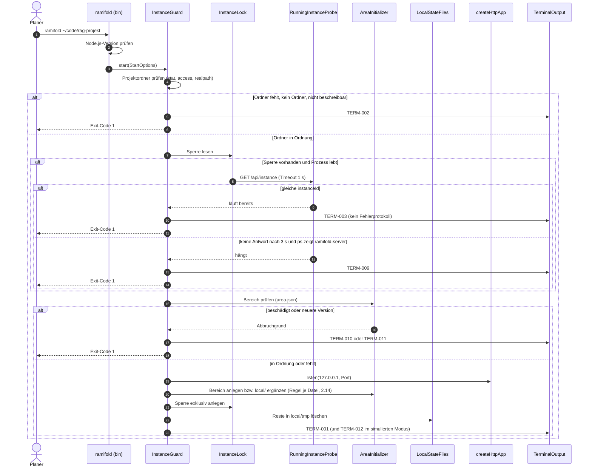

**Zustände:** Der Start hat keine Oberflächenzustände (TERM-Texte, siehe Abdeckung Abschnitt 7.3). Kein Zustandsdiagramm: Die Sperrdatei existiert oder nicht.

**Prüfhinweise:** Integrationstests je Abbruchfall (Schritt 2 bis 7, je eine Fehlerzeile, Datei-Vergleich innerhalb und außerhalb des Projektordners; `stderr` ist genau der TERM-Text mit Zeilenumbruch, ohne `[ramifold]`-Zeile, wie heute in `test/integration/start.test.ts`; bei beschreibbarem `.ramifold/local/` genau ein Eintrag `startup_failed` mit passender `cause` in `errors.log`, v0.13, N-05); **symbolische Links** (v0.13, N-06): `.ramifold/` als Link auf einen Ordner außerhalb, `.ramifold/local` als Link, `local/errors.log` als Link auf eine Datei außerhalb → TERM-010 mit dem Pfad des Links, Exit-Code 1, Ziel außerhalb byte-gleich, kein neuer Eintrag außerhalb des Projektordners; **Start im frischen Klon** (FIND-029): Repo mit versioniertem `.ramifold/` (`area.json`, `.gitignore`, ein Vorhaben) mit echtem `git clone` klonen und starten → `local/`, `local/.gitignore`, `local/tmp/` entstehen, Sperre gelingt, `.ramifold/.gitignore` und `area.json` byte-gleich; Variante ohne `plans/` (Bereich ohne Vorhaben) → `plans/` entsteht; Variante mit gelöschter `.ramifold/.gitignore` → wird nicht wiederhergestellt (AC-REQ-051-03); Variante abgebrochenes erstes Anlegen (`.ramifold/` ohne `area.json` und ohne `plans/`) → Anlegen wird vervollständigt; **Abbruch nach jedem Teilschritt des ersten Anlegens** (FIND-036, Fehlerinjektion in `AreaInitializer`: Abbruch nach den Ordnern, nach `local/.gitignore`, mitten im und nach dem Schreiben von `.ramifold/.gitignore`, nach `area.json` vor `plans/`) → der nächste Start gelingt ohne TERM-010, danach sind alle Dateien der Tabelle in 2.14 vollständig und `.ramifold/.gitignore` hat genau den festgelegten Inhalt; Gegenprobe `.ramifold/plans/` ohne `area.json` → weiterhin TERM-010; **Dateisystem ohne Hardlinks** (FIND-037, Unit-Test `area-initializer.test.ts` mit injiziertem Fehler bei `link`): bei `EPERM`, `ENOTSUP` und `EOPNOTSUPP` entsteht `.ramifold/.gitignore` über den Rückfall mit genau dem festgelegten Inhalt, keine Temp-Datei bleibt, kein TERM-002; Rückfall mit injiziertem `EEXIST` → vorhandene Datei unverändert; Abbruch mitten im Rückfall-Schreiben (leere bzw. gekürzte Datei, `area.json` fehlt) → nächster Start vervollständigt sie; vorhandene `.gitignore` mit anderem Inhalt bei fehlender `area.json` → unverändert; `link` mit `EACCES` → TERM-002; AC-REQ-029-03, AC-REQ-030-06/-07, AC-REQ-052-02 im Klon. AC-REQ-001-01/-02, AC-REQ-002-01 bis -03, AC-REQ-070-01 bis -04 (mit Prüfsummen und Fehlerprotokoll), Zeitmessung REQ-066.

### 2.2 F-02 Fenster, Verbindung und lokaler Schutz

**Komponenten:** `http-api` (`requestGuard`, `securityHeaders`, `hostRejectionPage`, `staticAssets`, `event-routes`), `WindowHub`; `web-ui` (`EventStreamClient`, `ApiClient`, `windowStore`, `ServerDownBanner`, `usePageTitle`).

**Endpunkte.**

| Methode und Pfad | Zweck | Antwort |
|---|---|---|
| `GET /api/instance` | Instanzangaben; auch für die Sperrprüfung eines zweiten Starts | `200 {instanceId, projectFolder: {absolutePath, displayPath, name}, simulated, ramifoldVersion}`; `displayPath` ersetzt das Home-Verzeichnis durch `~`, `name` ist der letzte Pfadteil |
| `GET /api/events` | SSE-Strom des Fensters | `200 text/event-stream`; erstes Ereignis `connected` |
| `GET /*` (außer `/api`) | Oberfläche | Datei aus `dist/web/` oder `index.html` (SPA-Pfade `/` und `/plans/:planId`) |

**`requestGuard` (Fastify-`onRequest`, für alle Pfade, in dieser Reihenfolge):**
1. `Host` muss genau `127.0.0.1:<port>` oder `localhost:<port>` sein. Sonst `403` mit der Abweisungsseite MSG-014: `text/html; charset=utf-8`, `<title>Address not allowed</title>`, ein Absatz Text, kein Skript, kein Stylesheet, `Content-Security-Policy: default-src 'none'`. Gilt auch für `/api`.
2. Nur `/api`: Ist `Sec-Fetch-Site` gesetzt und nicht `same-origin` → `403 forbidden_origin`. Ist `Origin` gesetzt und nicht `http://127.0.0.1:<port>` bzw. `http://localhost:<port>` → `403 forbidden_origin`. (`GET /api/instance` vom zweiten Start sendet keines von beiden.)
3. Nur `/api`, ändernde Methoden: `Content-Type` und `X-Ramifold-Request-Id` (Abschnitt 2.0).
4. Nur `/api` außer `instance` und `events`: `X-Ramifold-Instance` und `X-Ramifold-Window`.
5. `OPTIONS` beantwortet der Server mit `403` ohne CORS-Header.

**`securityHeaders` (alle Antworten der Oberfläche und der API):** `Content-Security-Policy: default-src 'self'; script-src 'self'; style-src 'self'; img-src 'self' data:; font-src 'self'; connect-src 'self'; object-src 'none'; base-uri 'none'; frame-ancestors 'none'; form-action 'none'`, `X-Content-Type-Options: nosniff`, `Referrer-Policy: no-referrer`, `Cross-Origin-Opener-Policy: same-origin`, `Cross-Origin-Resource-Policy: same-origin`, `Cache-Control: no-store` für `/api` und `index.html`.

**`WindowHub`.** Beim Öffnen von `GET /api/events` vergibt er eine `windowId` (ULID), registriert den Strom und sendet `connected`, sobald die erste Prüfung von Claude Code fertig ist, spätestens nach 3 s (dann `agent.status = "checking"`; die Oberfläche zeigt dann kein Banner). Ping alle 5 s. Endet der Strom (Socket geschlossen oder Schreiben scheitert), meldet er `windowClosed(windowId)` an `EditLockRegistry` (Freigabe nach 2 s, Abschnitt 2.5). Fenster-IDs werden nie wiederverwendet.

**`EventStreamClient` und `ApiClient` (web-ui).**
- Ein `EventSource` je Fenster. Erst nach `connected` lädt die Oberfläche Daten; `instanceId` und `windowId` gehen in jeden `fetch`.
- `error`-Ereignis des `EventSource` → `close()` (verhindert das eingebaute Wiederverbinden) und Zustand server-down. Ebenso bei Netzwerkfehler eines `fetch` und bei `409 instance_mismatch`.
- Zustand server-down ist endgültig für dieses Fenster: kein neuer `EventSource`, keine weiteren Anfragen; Ausweg nur Neuladen (CC-11).

**Seitentitel** (`usePageTitle`, A-UX-16): Liste `Projects – <name> – Ramifold`; Arbeitsbereich `<Vorhabentitel> – <name> – Ramifold`, Vorhabentitel über 40 Codepunkte gekürzt auf 39 + „…“; bei server-down Präfix `Stopped – `.

**Zustandsabbildung.**

| Zustand | Technisches Verhalten |
|---|---|
| UI-001.server-down, UI-003.server-down (auch UI-002, UI-004 bis UI-007, UI-009, UI-010 als Dialogbanner) | `windowStore.connection = "server_down"`; `ServerDownBanner` (MSG-013) über der Kopfzeile; alle Aktionen mit `aria-disabled`; Eingaben in `inputStore` bleiben lesbar und markierbar; eine laufende Antwort im Fenster wird als `incomplete` angezeigt (ohne Speicherung, nur Anzeige); Seitentitel mit `Stopped – ` |
| MSG-014 (Abweisungsseite) | `requestGuard` Schritt 1 |

**Sequenz – Verbinden und Abweisung nach Neustart (F-02).**

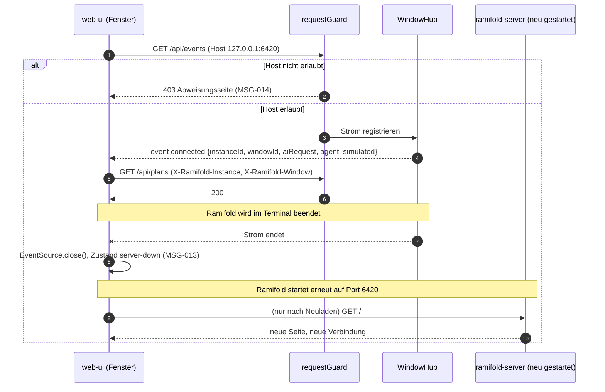

**Prüfhinweise:** Integration: Bindung nur `127.0.0.1` (REQ-057), Host-Abweisung inkl. `localhost` zulässig, `Origin`/`Sec-Fetch-Site`, fehlende Header, CSP vorhanden. E2E: Testseite auf anderem Port versucht `fetch`, `EventSource`, Formular-POST auf alle Endpunkte → nichts gelesen, nichts geändert (REQ-058); Fenster nach Beenden in server-down innerhalb 1 s; nach Neustart auf demselben Port bleibt das alte Fenster in server-down, eine Anfrage mit alter Kennung erhält `409 instance_mismatch`.

### 2.3 F-03 Vorhaben: Liste, Anlegen, Öffnen, nicht lesbar

**Komponenten:** `plan-routes`, `PlanService`, `PlanRegistry`, `WriteQueue`, `PlanStamp`, `AreaStore` (`loadPlanFromDisk`, `validatePlanTree`), `ErrorReporter`; web-ui `ProjectListScreen`, `CreateProjectDialog`, `UnreadableProjectDialog`.

**Laden.** `PlanRegistry` lädt ein Vorhaben beim ersten Auflisten vollständig (Plandaten einschließlich Chats, Baseline v0.4 Abschnitt 7), prüft es und hält es bis zum Beenden im Speicher. Dabei entsteht der Datei-Stempel (Abschnitt 2.12). Ein unlesbares Vorhaben bleibt bis zum Neustart unlesbar (REQ-072); es wird beim ersten Erkennen genau einmal protokolliert (Terminal und Fehlerprotokoll, `kind: "plan_unreadable"`). Jedes Auflisten liest `plans/` neu: neue Ordner mit `plan.json` werden geladen; Ordner ohne `plan.json` (abgebrochenes Anlegen) werden ignoriert. Ein geladenes Vorhaben, dessen Ordner verschwunden ist, bleibt gelistet; beim Öffnen wird die Abweichung erkannt (read-only).

**Zugriff auf ein geladenes Vorhaben und Fehler (v0.15, N-10).** Jeder Zugriff auf ein Vorhaben (Öffnen, Öffnen eines Knotens, Schritt 2 jeder schreibenden Aktion in 2.0) läuft über `PlanRegistry.getLoaded(planId)`. Die Methode liefert das geladene Vorhaben mit seinem `PlanRuntimeState` (`writable` oder `read_only`) und wirft sonst einen Fehler, den `toHttpError` abbildet:

| Lage | Verhalten von `getLoaded` | Antwort |
|---|---|---|
| geladen, `writable` oder `read_only` | liefert das Vorhaben; read-only prüft der Aufrufer (2.0 Schritt 2, 2.12) | – |
| geladen, `unreadable` | wirft `PlanUnreadableError` mit `{title, cause, location}` aus dem Laden | `409 plan_unreadable` |
| nicht geladen, aber Ordner `plans/<planId>/` mit `plan.json` vorhanden (neu seit dem letzten Auflisten) | lädt ihn mit derselben Ladeoperation wie das Auflisten nach (gleiche Prüfung, gleiche einmalige Meldung), danach wie oben | wie oben |
| unbekannt oder ungültige `planId` (keine ULID, kein Ordner mit `plan.json`) | wirft `PlanNotFoundError` | `404 plan_not_found` |

Ein Vorhaben, das beim Laden lesbar war, wird bis zum Beenden nicht mehr `unreadable`; eine spätere Änderung von außen macht es read-only (2.12, MSG-005). „Laden scheitert (Daten unlesbar geworden)“ beim Öffnen (UI-001, Aktion „Vorhaben öffnen“) tritt daher nur bei einem Ordner auf, der seit dem letzten Auflisten neu ist und beim Nachladen unlesbar ist, praktisch beim direkten Aufruf von `/plans/<planId>` (Lesezeichen, Neuladen der Seite). Die Oberfläche zeigt dann UI-011 über UI-001: Die Route `/plans/:planId` navigiert bei `409 plan_unreadable` nach `/` und übergibt `{planId, title, cause, location}` als Navigationszustand; `ProjectListScreen` lädt die Liste (die Zeile ist jetzt „Not readable“) und öffnet `UnreadableProjectDialog` mit diesen Angaben; nach „Close“ liegt der Fokus auf „Details“ dieser Zeile (UI-011, Aktion „Close“). Unlesbare Zeilen haben keinen Öffnen-Link (UI-001.disabled), aus der Liste heraus führt nur „Details“ zu UI-011.

**Zuordnung zu Aufgaben (v0.15, N-10).** T-02 liefert `PlanRegistry` mit `getLoaded` (einschließlich Nachladen), `DomainError`, `PlanNotFoundError`, `PlanUnreadableError`, deren Abbildung in `toHttpError`, `ModalDialog` (Grundform mit `headIcon`) und `UnreadableProjectDialog` (Eingabe `{title, cause, location}`, aufgerufen über „Details“). T-02 legt **keinen** Endpunkt `GET /api/plans/:planId` und keine Methode `PlanService.openPlan` an. T-04 liefert `GET /api/plans/:planId` mit allen Zweigen (`200`, `404`, `409`), `PlanService.openPlan`, die Route `/plans/:planId` und den Weg von `409 plan_unreadable` zu UI-011 über `ProjectListScreen`. Nachweise: AC-REQ-072-01 und -04 weist T-02 über die Liste nach (Zeile ohne Öffnen-Link, „Details“ → UI-011, Prüfsummen unverändert) und mit Unit- bzw. Integrationstests für `getLoaded` und `toHttpError`; den Öffnen-Versuch über `GET /api/plans/:planId` bzw. `/plans/<planId>` weist T-04 nach. AC-REQ-072-03 weist T-02 bis zum Laden nach (nach Auflösen und Neustart ist die Zeile lesbar, `getLoaded` liefert Baum, Aufträge, Ergebnisse und Chats vollständig); die Anzeige von Baum und Auftrag weist T-04 nach, die von Ergebnissen und Chats der Knoten-Task (Anzeige im Knotenbereich, 2.4/2.5).

**Lesbarkeitsprüfung** (`validatePlanTree`, genau eine Ursache je Vorhaben, erste zutreffende Regel in dieser Reihenfolge; `location` relativ zum Projektordner):

| Nr. | Regel | `cause` | `location` |
|---|---|---|---|
| 0 | (v0.13, N-06) Der Ordner `plans/<planId>/` oder ein Eintrag darin, den Ramifold liest oder beschreibt (`plan.json`, `nodes/`, `nodes/*.json`, `results/`, `results/<nodeId>/`, deren Dateien, `chats/`, Chat-Dateien), ist ein symbolischer Link (`lstat` bzw. `Dirent.isSymbolicLink()` beim Einlesen; Links werden nicht verfolgt). `PLAN.md` und `*.tmp-*` sind ausgenommen (nie gelesen; `rename` ersetzt einen Link, statt ihm zu folgen) | `damaged` | der Link |
| 1 | `plan.json` parsebar und `format` > 1 | `newer_version` | `.ramifold/plans/<planId>/plan.json` |
| 2 | Eine Plandatei enthält eine Zeile, die mit `<<<<<<< `, `>>>>>>> ` beginnt oder genau `=======` ist. Geprüft werden `plan.json`, alle `nodes/*.json`, `results/<nodeId>/*.json` vorhandener Knoten und Chat-Dateien (erste Zeile aller, ganz nur die der vorhandenen Knoten); Reihenfolge: `plan.json`, Knoten, Ergebnisse, Chats, je nach Dateiname sortiert | `git_conflict` | erste betroffene Datei |
| 3 | Datei nicht parsebar oder Schema verletzt (Abschnitt 3.2); Dateiname ≠ `id`; Titel leer oder > 200 Codepunkte; Chat-Kopfzeile nicht lesbar. Eine **letzte** Chat-Zeile ohne abschließenden Zeilenumbruch, die nicht parsebar ist, gilt als abgerissen und wird ignoriert (vor dem nächsten Anhängen entfernt, 2.14) | `damaged` | erste betroffene Datei |
| 4 | Knoten mit nicht vorhandenem Elternknoten, Zyklus, nicht genau ein Knoten mit `parentId: null`, Ergebnis-Version mit `nodeId` ≠ Ordnername | `inconsistent` | erste betroffene Knoten- bzw. Versionsdatei |

Kein Lesefehler (Owner-Hinweis 2): Ergebnis-Ordner und Chat-Dateien, deren Knoten nicht existiert; mehrere Chats für denselben Knoten (Abschnitt 2.14); `PLAN.md` (wird nie gelesen); Temp-Dateien `*.tmp-*`.

**Endpunkte.**

| Methode und Pfad | Körper | Erfolg | Fehler |
|---|---|---|---|
| `GET /api/plans` | – | `200 {plans: PlanListItem[]}` | `500 internal_error` |
| `POST /api/plans` | `{title: string, objective: string}` | `201 {planId, rootNodeId}` | `422` (title `required`/`max_length`), `500 save_failed` |
| `GET /api/plans/:planId` | – | `200 PlanViewDto` (mit Stempelprüfung beim Öffnen) | `404 plan_not_found`, `409 plan_unreadable` |

`PlanListItem = {planId, title: string | null, createdAt: string | null, readable: boolean, unreadable: {cause, location} | null}`. Sortierung: `createdAt` aufsteigend, dann `planId`; Einträge ohne `createdAt` am Ende. `title` ist der Titel des Wurzelknotens, soweit lesbar.

`PlanViewDto = {planId, title, createdAt, readOnly: ReadOnlyInfo | null, nodes: TreeNodeDto[]}` mit `TreeNodeDto = {id, parentId, depth, number, title, resultStatus: "open" | "concept" | "fixed", childCount, descendantCount, hasAiDraft}` in Baumreihenfolge (Vorordnung) und `ReadOnlyInfo = {cause: "external_change", detectedAt}`.

**Anlegen** (`POST /api/plans`): Titel trimmen, 1 bis 200 Codepunkte; Auftrag unverändert, beliebig lang. Reihenfolge der Dateien: Ordner `plans/<planId>/nodes/`, Wurzelknoten (`position: "a0"`), dann `plan.json` (Baseline Abschnitt 9). Anlegen ist von read-only-Zuständen anderer Vorhaben nicht betroffen (AC-REQ-074-06).

**Zustandsabbildung.**

| Zustand | Technisches Verhalten |
|---|---|
| UI-001.loading | bis `GET /api/plans` antwortet (nach `connected`) |
| UI-001.default | `plans.length > 0` |
| UI-001.empty | `plans.length === 0` |
| UI-001.error | `GET /api/plans` → `500` oder ungültige Antwort: `Banner` `error` (Symbol `error`, 2.16) mit „The projects could not be loaded. Restart Ramifold and try again.“ |
| UI-001.permission / UI-001.disabled | Eintrag mit `readable: false`: Titel als Text (`title` oder „(untitled)“), Marke „Not readable“, Button „Details“ → UI-011 aus `unreadable` |
| UI-001.server-down | Abschnitt 2.2 |
| UI-001 Banner MSG-001 | `connected.agent.status` ∈ `not_found`, `too_old` → Startvariante „nicht gefunden“ bzw. „zu alt“ |
| UI-001.validation | nicht anwendbar |
| UI-002.default / .validation | Felder in `inputStore`; Validierung beim Absenden mit `titleRule` (gleiche Regel wie Server); Server-`422` wird genauso angezeigt |
| UI-002.loading | Anfrage läuft, Felder gesperrt |
| UI-002.error | `500 save_failed` → MSG-002 mit Ursachentext im Dialog |
| UI-002 Erfolg | `201` → Navigation `/plans/<planId>`, Toast „Project created“ |
| UI-011.default | `409 plan_unreadable` beim Öffnen oder „Details“: Titel, `cause` → „Git conflict“ / „Damaged data“ / „Data from a newer Ramifold version“ / „Inconsistent data“, `location` |

**Sequenz – Öffnen eines Vorhabens (F-03, mit Stempelprüfung).** Die Prüfung ist ein lesender Auftrag in der `WriteQueue` des Vorhabens; sie läuft erst, wenn ein gerade laufender eigener Schreibvorgang einschließlich Nachführen des Stempels fertig ist (Abschnitt 2.12, FIND-024). Das Öffnen eines Knotens (`GET …/nodes/:nodeId`, `PlanService.openNode`) prüft genauso.

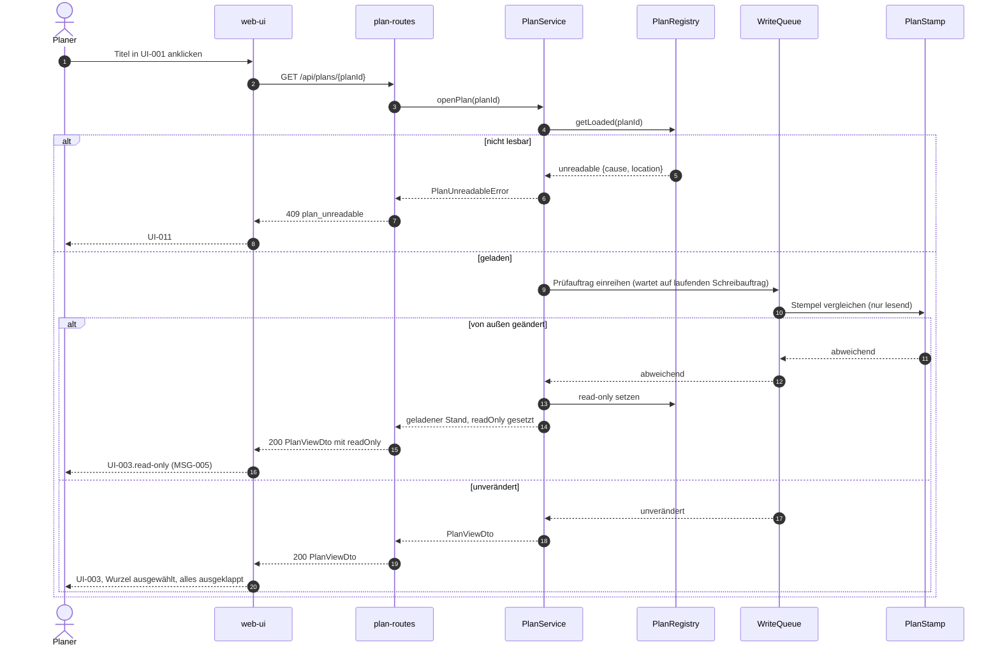

**Zustand des Vorhabens im Speicher.** Werte von `PlanRuntimeState` (nur Laufzeit): `unloaded`, `writable`, `read_only`, `unreadable`.

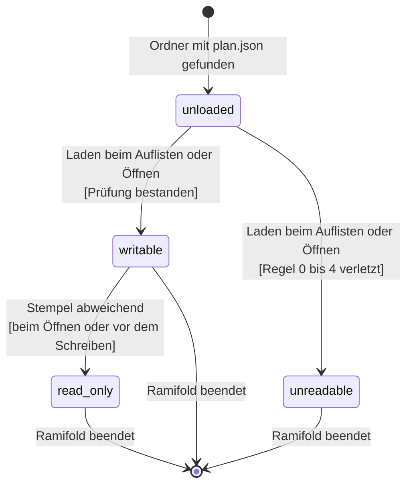

**Prüfhinweise:** AC-REQ-005-01 bis -04, AC-REQ-006-01/-02, AC-REQ-072-01 bis -04 (Seed-Szenario `unreadable` mit je einem Fall je Ursache und einem verwaisten Chat, der **nicht** unlesbar macht), Prüfsummen unverändert.

### 2.4 F-04 Baum anzeigen und bearbeiten

**Komponenten:** `node-routes`, `PlanService`, `TreeEditService`, `TreeModel`, `positionKeys`, `AreaStore`; web-ui `WorkspaceScreen`, `PlanTree`, `NodeHeader`, `NodeFormDialog`, `DeleteNodeDialog`.

**Baumregeln (`TreeModel`, reine Funktionen).**
- Kinder eines Knotens sind nach `(position, id)` aufsteigend sortiert (Bytevergleich). Gleiche Positionsschlüssel entstehen nur durch parallele Arbeit auf zwei Rechnern; die `id` entscheidet dann eindeutig.
- `number`: Kinder der Wurzel `1`, `2`, …; Kind *k* eines Knotens mit Nummer *n* hat `n.k`. Wurzel: `null` (REQ-008).
- `depth`: Wurzel 0. `descendantCount`: Anzahl aller Nachkommen (für „+n“, REQ-009).
- `resultStatus`: `open` ohne Version, sonst Status der jüngsten Version nach `(createdAt, id)`.

**Endpunkte.**

| Methode und Pfad | Körper | Erfolg | Fehler |
|---|---|---|---|
| `POST /api/plans/:planId/nodes` | `{parentId, title, objective}` | `201 {nodeId, tree: TreeNodeDto[]}` | `404 node_not_found` (Elternknoten), `409 plan_read_only`, `422`, `500 save_failed` |
| `PATCH /api/plans/:planId/nodes/:nodeId` | genau eines von `{title}` oder `{objective}` | `200 {tree}` | `400` (beide oder keines), `404`, `409 plan_read_only`, `422`, `500` |
| `POST /api/plans/:planId/nodes/:nodeId/move` | `{direction: "up" \| "down"}` | `200 {tree, position}` (`position` 1-basiert unter dem Elternknoten) | `404`, `409 move_not_possible` (Wurzel, erstes/letztes Kind), `409 plan_read_only`, `500` |
| `GET /api/plans/:planId/nodes/:nodeId/deletion-impact` | – | `200 {nodeCount, chatCount, fixedPlanCount}` | `404` |
| `DELETE /api/plans/:planId/nodes/:nodeId` | `{}` | `200 {parentId, tree}` | `404`, `409 root_not_deletable`, `409 plan_read_only`, `500` |
| `GET /api/plans/:planId/nodes/:nodeId` | – | `200 NodeDetailDto` (Abschnitt 2.5), mit Stempelprüfung beim Öffnen | `404 node_not_found`, `409 plan_unreadable` |

Jede ändernde Antwort enthält den ganzen neuen Baum (`tree`), damit das Fenster Nummern ohne zweite Anfrage neu zeigt (REQ-008, REQ-053).

**Felder und Validierung.**

| Feld | Typ | Regel | Fehler |
|---|---|---|---|
| `title` | string | trimmen; 1 bis 200 Codepunkte; gespeichert getrimmt | `422 {field:"title", rule:"required" \| "max_length"}` |
| `objective` | string | beliebig lang (Körpergrenze 10 MiB), unverändert gespeichert, darf leer sein | – |
| `parentId` | ULID | muss im Vorhaben existieren | `404 node_not_found` |
| `direction` | `"up" \| "down"` | – | `400` |

**Verhalten.**
- *Anlegen* (REQ-011): `position = generateKeyBetween(letztesKind?.position ?? null, null)`; Datei `nodes/<nodeId>.json`. Leerer Chat (keine Datei), Status `open`.
- *Umbenennen, Auftrag ändern* (REQ-012, REQ-013): schreibt nur die Knotendatei (`updatedAt` neu). Unbekannte Felder in der Datei bleiben beim Neuschreiben erhalten (Vorwärtsverträglichkeit, Abschnitt 3.2). Keine Ergebnis-Version (AC-REQ-013-02).
- *Verschieben unter Geschwistern* (REQ-014): Tausch mit dem Nachbarn durch einen neuen Schlüssel nur für den bewegten Knoten: hoch `generateKeyBetween(sib[i-2]?.position ?? null, sib[i-1].position)`, runter `generateKeyBetween(sib[i+1].position, sib[i+2]?.position ?? null)`. Sind die beiden Nachbarschlüssel gleich (paralleles Anlegen), vergibt `TreeEditService` allen Geschwistern neue Schlüssel (`generateNKeysBetween`) und schreibt deren Dateien in der `WriteQueue`. Ein Wechsel des Elternknotens ist nicht möglich (kein Endpunkt, AC-REQ-014-02).
- *Löschfolgen* (REQ-015): `nodeCount` = Knoten + alle Nachkommen; `chatCount` = Chats dieser Knoten mit mindestens einer Nachricht (Frage oder Antwort); `fixedPlanCount` = Knoten, deren aktuelles Ergebnis `fixed` ist.
- *Löschen*: (1) läuft eine KI-Anfrage für einen Knoten im Teilbaum, beendet `AiRequestCoordinator` sie mit `reason: "node_deleted"` ohne weiteres Schreiben (AC-REQ-015-05); (2) Dateien von den Blättern her: je Knoten alle Chat-Dateien mit dieser `nodeId`, Ordner `results/<nodeId>/`, dann `nodes/<nodeId>.json`; danach Ordner-`fsync`; (3) Laufzeitdaten des Teilbaums verwerfen: KI-Entwürfe, Vorschläge, Bearbeitungssperren, Einträge in `local/sessions.json`. Scheitert das Löschen mittendrin, bleibt ein gültiger Baum (Blätter zuerst) und `500 save_failed` wird gemeldet.
- *Wurzel*: kein Löschen (`409 root_not_deletable`); `web-ui` bietet „Delete“ und „Move up/down“ an der Wurzel nicht an.
- *Ein-/Ausklappen* (REQ-009): nur im Fenster (`planViewStore.expandedIds`, beim Öffnen alle ausgeklappt); kein Endpunkt, keine Datei.

**Zustandsabbildung.**

| Zustand | Technisches Verhalten |
|---|---|
| UI-003.loading | „Loading plan…“ bis `GET /api/plans/:planId`; „Loading node…“ bis `GET …/nodes/:nodeId` |
| UI-003.default | Baum aus `PlanViewDto.nodes`, Knoten aus `NodeDetailDto` |
| UI-003.empty | `NodeDetailDto.result === null` → „No result yet.“; `chat.entries` leer → „No messages yet.“; Wurzel ohne Kinder → Baum nur mit Wurzel |
| UI-003.error (Baum) | `500 save_failed` → MSG-002; `404 node_not_found` → MSG-004 und Baum neu laden |
| UI-003.disabled („Move up/down“ an den Enden) | aus der Position im `tree` berechnet |
| UI-003.success | Toasts „Node added“, „Saved“, „Node deleted“; Statusmeldung „Moved to position <position>“ |
| UI-003.validation | nicht anwendbar (Eingaben in Dialogen) |
| UI-006.default | Modus „Add child“ / „Rename“ / „Edit objective“, Felder in `inputStore` |
| UI-006.validation | `titleRule` im Client; Server-`422` gleich dargestellt; bei „Rename“ bleibt der alte Titel gespeichert (AC-REQ-012-02) |
| UI-006.loading | Anfrage läuft |
| UI-006.error | `500` → MSG-002, `404` → MSG-004, `409 plan_read_only` → MSG-005; Eingaben bleiben |
| UI-006.disabled | „Add child“/„Rename“ sind nie wegen einer Ergebnissperre deaktiviert (A-UX-05) |
| UI-006 read-only / server-down | Bestätigung deaktiviert, Banner im Dialog |
| UI-007.default | Zahlen aus `deletion-impact` (vor dem Öffnen des Dialogs geladen) |
| UI-007.loading | `DELETE` läuft |
| UI-007.error | `500` → MSG-002, `404` → MSG-004, `409 plan_read_only` → MSG-005 |
| UI-007 read-only / server-down | „Delete permanently“ deaktiviert |

**Sequenz – Knoten anlegen und Teilbaum mit laufender KI-Anfrage löschen (F-04).**

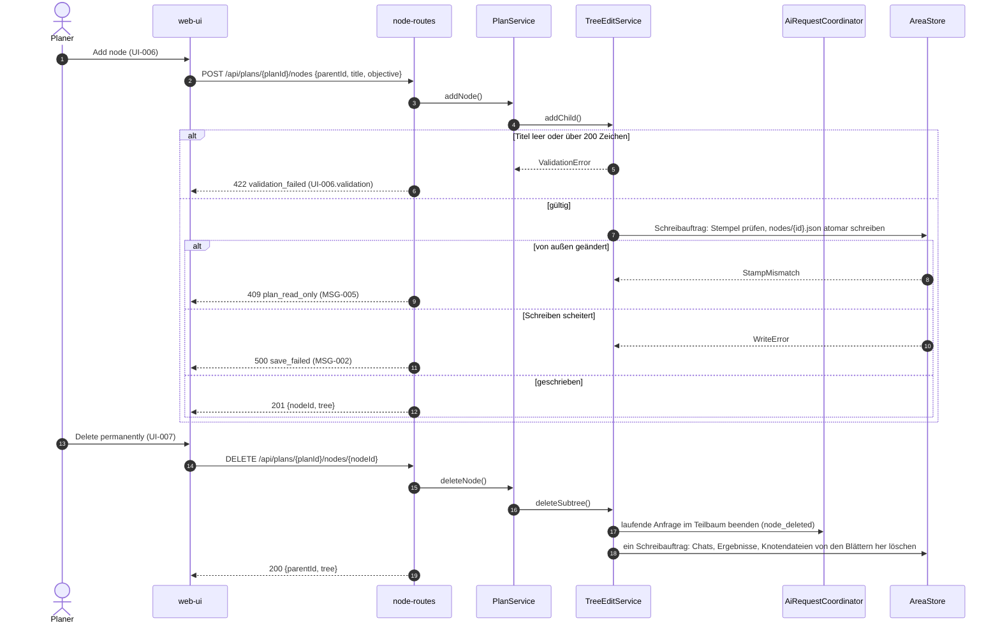

**Prüfhinweise:** AC-REQ-007-01, AC-REQ-008-01/-02, AC-REQ-009-01 bis -03 (Datei-Vergleich nach Einklappen), AC-REQ-010-01/-02, AC-REQ-011-01/-02, AC-REQ-012-01/-02, AC-REQ-013-01/-02, AC-REQ-014-01 bis -03, AC-REQ-015-01 bis -05, AC-REQ-016-01; Unit-Tests für `TreeModel` und Positionsschlüssel (gleiche Schlüssel, Tausch am Rand).

### 2.5 F-05 Ergebnisse, Versionen, Rückfluss, Bearbeitungssperre

**Komponenten:** `result-routes`, `PlanService`, `ResultService`, `computeBackflow`, `EditLockRegistry`, `AiDraftStore`, `AreaStore`; web-ui `ResultSection`, `ResultEditor`, `inputStore`.

**Knotendetail.** `GET /api/plans/:planId/nodes/:nodeId` liefert:

```ts
type NodeDetailDto = {
  node: { id: string; parentId: string | null; depth: number; number: string | null; title: string; objective: string };
  result: { versionId: string; status: "concept" | "fixed"; content: string; savedAt: string } | null;
  backflow: { nodeId: string; number: string; title: string }[];
  chat: ChatViewDto;                          // Abschnitt 2.7
  aiDraft: { draftId: string; content: string; createdAt: string } | null;
  suggestions: { suggestionId: string; title: string; objective: string }[] | null;
  resultLock: "free" | "mine" | "other_window" | "summary_running";
  aiRequest: AiRequestInfo | null;            // falls die laufende Anfrage diesen Knoten betrifft
  readOnly: ReadOnlyInfo | null;
};
```

**Endpunkte.**

| Methode und Pfad | Körper | Erfolg | Fehler |
|---|---|---|---|
| `POST /api/plans/:planId/nodes/:nodeId/result-lock` | `{}` | `200 {resultLock: "mine"}` | `409 result_locked {reason}`, `409 plan_read_only`, `404` |
| `GET /api/plans/:planId/nodes/:nodeId/result-lock` | – | `200 {resultLock}` („Check again“) | `404` |
| `DELETE /api/plans/:planId/nodes/:nodeId/result-lock` | `{discardAiDraftId: string \| null}` | `200 {}` | `409 plan_read_only` (nur wenn `discardAiDraftId` gesetzt), `404` |
| `POST /api/plans/:planId/nodes/:nodeId/results` | `{status: "concept" \| "fixed", content, basis: "saved" \| "ai_draft" \| "empty", aiDraftId: string \| null}` | `201 {result, backflow, tree}` | `422 {field:"content", rule:"required"}`, `409 result_locked`, `409 plan_read_only`, `404`, `500 save_failed` |

**Bearbeitungssperre (REQ-071, `EditLockRegistry`).**
- Eine Sperre je Ergebnis (Schlüssel `planId/nodeId`) mit `windowId`. „Edit result“ und „Review AI draft“ holen sie mit `POST …/result-lock`, bevor UI-004 öffnet.
- `resultLock` aus Sicht des fragenden Fensters: `summary_running`, wenn für den Knoten eine Zusammenfassung läuft (hat Vorrang); sonst `mine`, `other_window` oder `free`.
- Freigabe: erfolgreiches Speichern, `DELETE …/result-lock` (Verwerfen), Löschen des Knotens, und 2 s nach dem Ende des SSE-Stroms des Fensters (`RESULT_LOCK_RELEASE_DELAY_MS = 2000`; Baseline: ≤ 15 s). Ein Fenster kehrt nie zurück (kein Wiederverbinden); die Wartezeit fängt nur kurze Abfolgen beim Schließen ab.
- Titel und Auftrag sind nie gesperrt (A-UX-05).

**Speichern (REQ-042 bis REQ-045).** Inhalt trimmen nur zur Prüfung (nicht leer), gespeichert wird der Text unverändert. Sperre: `other_window` oder `summary_running` → `409 result_locked`; `free` oder `mine` → speichern. Neue Datei `results/<nodeId>/<versionId>.json` (Abschnitt 3.2); frühere Versionen bleiben unverändert. Danach: Sperre des Fensters frei; ist `basis = "ai_draft"` und `aiDraftId` gleich dem aktuellen KI-Entwurf, wird der KI-Entwurf entfernt (REQ-073 Regel 1). Bei `basis = "saved"` oder `"empty"` bleibt ein vorhandener KI-Entwurf bestehen.

**Rückfluss-Hinweis (REQ-046, `computeBackflow`).** Für Knoten *N* mit jüngster Version *v*: alle direkten Kinder *c* in Baumreihenfolge, die eine Version mit Status `fixed` und `createdAt` > `v.createdAt` haben. Ohne Version von *N* leer. Vergleich als ISO-Zeichenkette (UTC, gleiche Länge); gleiche Zeitpunkte zählen nicht als „danach“.

**Ergebnisbearbeitung im Fenster (`inputStore`, REQ-073).** Je `planId/nodeId` ein Eintrag `{text, basis, aiDraftId, originalText}`. Er überlebt Knoten- und Listenwechsel, nicht das Neuladen. „Discard draft“ fragt nur, wenn `text !== originalText`, dann `DELETE …/result-lock {discardAiDraftId}`. Strg/Cmd+S löst „Save as concept“ aus (A-UX-12). Die Vorschau rendert mit `MarkdownView`, verzögert um 250 ms.

**Zustandsabbildung.**

| Zustand | Technisches Verhalten |
|---|---|
| UI-003 Result | `result` mit `StatusBadge`; leer → „No result yet.“ |
| UI-003 Rückfluss-Banner | `backflow.length` 1 → „Child <Nr> <Titel> was fixed…“, > 1 → „Children …“ |
| UI-003 Marke „Draft“ (Baum) | `TreeNodeDto.hasAiDraft` oder Eintrag im `inputStore` dieses Fensters |
| UI-003 Hinweis „There is an unsaved AI draft…“ | `aiDraft !== null` und `resultLock === "free"`; „Review AI draft“ holt die Sperre und öffnet UI-004 mit `basis: "ai_draft"` |
| UI-003.permission | `resultLock === "other_window"`: MSG-011, „Edit result“/„Summarize with AI“ `aria-disabled`; ein KI-Entwurf wird nur lesend gezeigt (AC-REQ-071-08); „Check again“ → `GET …/result-lock` |
| UI-004.default | Sperre `mine`, Editor aus `inputStore` |
| UI-004.empty | `basis: "empty"` (Start bei „No result yet“) |
| UI-004.loading | `POST …/results` läuft |
| UI-004.validation | Inhalt leer nach Trimmen (Client) bzw. `422` |
| UI-004.error | `500 save_failed` → MSG-002; `404` → MSG-004; `409 plan_read_only` → MSG-005; Text bleibt |
| UI-004.disabled | `resultLock === "summary_running"`: Editor nur lesbar mit Hinweistext |
| UI-004.read-only | `readOnly` gesetzt: Editor nur lesbar, Speichern/Verwerfen deaktiviert |
| UI-004.server-down | Abschnitt 2.2 |
| UI-004.permission | UI-004 öffnet nicht; `POST …/result-lock` → `409 other_window` → UI-003.permission |
| UI-004.success | `201` → Editor schließt, Eintrag im `inputStore` entfernt, Toast „Saved as concept“ / „Saved as fixed plan“ |

**Sequenz – Ergebnis bearbeiten und speichern (F-05).**

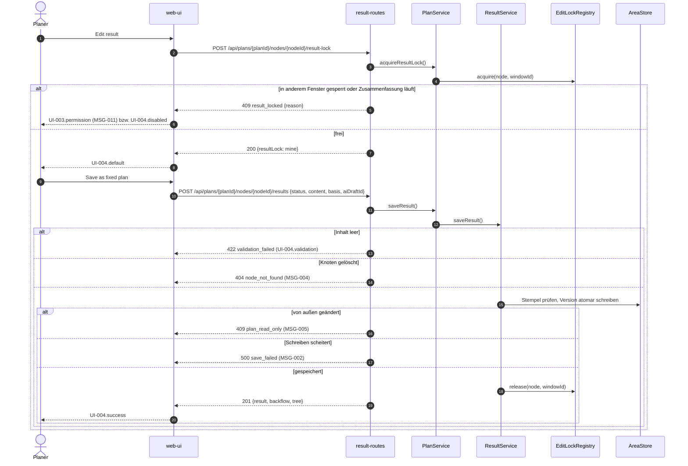

**Ergebnisstatus eines Knotens** (abgeleitet aus der jüngsten Version; Werte `open`, `concept`, `fixed`).

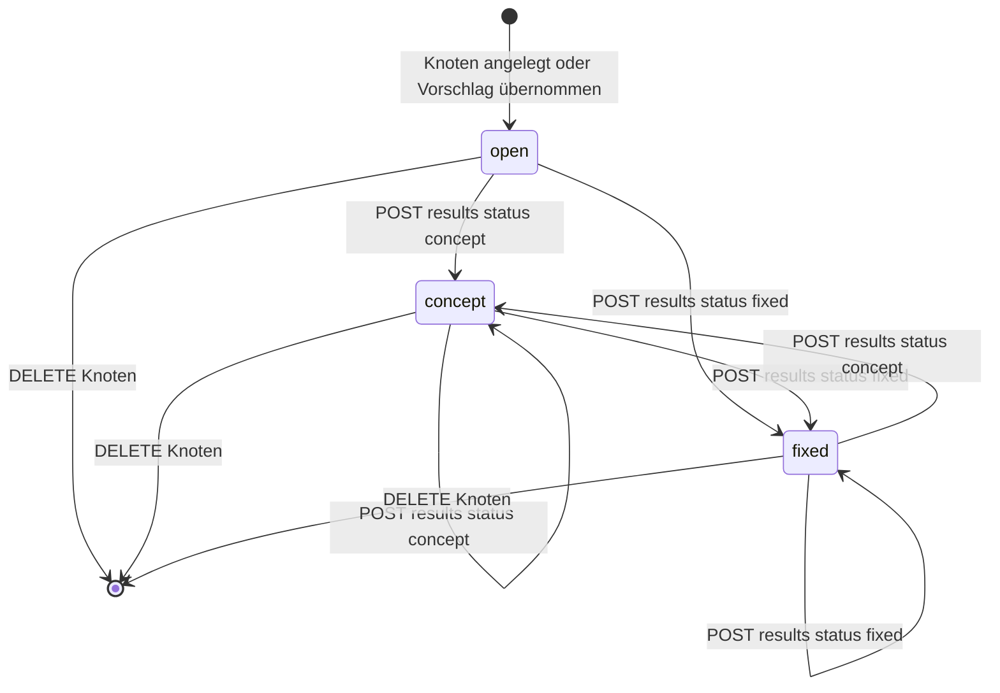

**Bearbeitungssperre eines Ergebnisses** (Werte `free`, `held`, `releasing`; die Sicht `summary_running` ist ein eigenes Kennzeichen der laufenden Anfrage, Abschnitt 2.10).

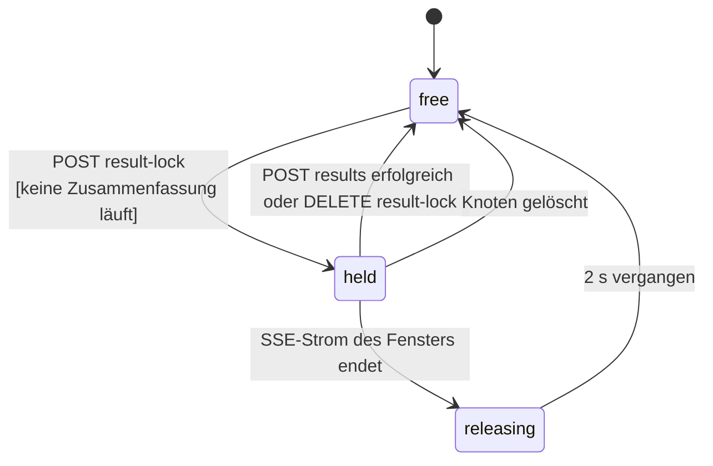

**Prüfhinweise:** AC-REQ-003-01 bis -03 (Bereich schreibgeschützt), AC-REQ-042-01/-02, AC-REQ-043-01, AC-REQ-044-01/-02, AC-REQ-045-01 (drei Versionsdateien), AC-REQ-046-01 bis -05 (Zeitpunkte mit `Clock`-Stub), AC-REQ-071-03 und -05 bis -08 (zwei Browser-Kontexte), AC-REQ-073-01/-02/-05.

### 2.6 F-06 KI-Anfragen: gemeinsamer Ablauf und Claude Code

**Komponenten:** `AiRequestCoordinator` (Teil von `plan-service`), `agent-gateway` (`AgentGateway`, `resolveAgentCommand`, `ClaudeCodeAdapter`, `buildClaudeArgs`, `StreamJsonParser`, `classifyAgentFailure`, `checkClaudeVersion`, `READ_ONLY_PLANNING`), `AreaStore` mit `LocalStateFiles` (Dateien eines Laufs in `local/tmp/`, Sitzungen), `WindowHub`, `ErrorReporter`.

**Ein Platz je Instanz (REQ-069).** `AiRequestCoordinator` hält höchstens eine `AiRequest = {requestId, kind, planId, nodeId, windowId, aiMessageId, startedAt}`. Gemeinsame Vorbedingungen jeder KI-Anfrage, in dieser Reihenfolge:

1. Vorhaben lesbar und nicht read-only (`404`, `409 plan_unreadable`, `409 plan_read_only`); Knoten existiert (`404 node_not_found`).
2. Art-spezifische Prüfung (Chat: Text nicht leer; erneut senden: Abschnitt 2.7; Zusammenfassung: Abschnitt 2.10).
3. Platz frei, sonst `409 ai_request_running` mit Knoten, Nummer, Titel der laufenden Anfrage. **Der Platz wird hier synchron belegt** und bei jedem späteren Abbruch der Vorbedingungen wieder frei.
4. Datenabfluss-Hinweis bestätigt, sonst `409 consent_required` (Abschnitt 2.11).
5. Befund zu Claude Code: Ist der letzte Befund nicht `ok`, prüft `AgentGateway` erneut (`checkClaudeVersion`); bleibt er `not_found` oder `too_old` → `409 agent_unavailable {cause: "agent_not_found" | "agent_too_old"}`, protokolliert (eine Zeile, ein Eintrag, `kind: "ai_request_failed"`), nichts gespeichert.
6. Art-spezifisches Speichern vor dem Lauf (nur Chat: Frage anhängen).
7. Chat und Sitzungseintrag (mit `knownThroughMessageId`) lesen, Kontext bilden und Sitzung planen (Abschnitt 2.8), Dateien des Laufs schreiben (Temp-Dateien, Absatz „Dateien eines Laufs“), Lauf starten, `202` antworten, `ai_request_started` an alle Fenster. Schritt 7 läuft bei belegtem Platz (Schritt 3) und beim Chat nach dem Anhängen der Frage (Schritt 6). Weil nur Chat-Läufe den Sitzungseintrag schreiben und das vor dem Freigeben des Platzes tun (2.7), liest Schritt 7 immer den Stand nach dem letzten Chat-Lauf (H-10).

Zeitbudget REQ-054: Schritt 1 bis 7 ohne Agent-Prüfung ≤ 2 s (erwartet < 100 ms); die Laufanzeige setzt das auslösende Fenster sofort mit der `202`-Antwort.

**Dateien eines Laufs (v0.14, N-07; CR-174-01, CR-174-05).** Ein Adapter kann für einen Lauf Dateien brauchen, bei Claude Code die Einstellungsdatei und die Kontextdatei. **Name und Inhalt bestimmt nur der Adapter; schreiben und löschen darf sie nur `LocalStateFiles`** (einzige Schreibstelle in `local/`, mit Link-Prüfung nach N-06). `AiRequestCoordinator` reicht sie als Daten weiter, ohne ihren Inhalt zu kennen; die Fachlogik kennt so weder Claude-Einstellungen noch Argumente (ADR-003). Ablauf in Schritt 7, nach dem Planen der Sitzung, in dieser Reihenfolge:

1. `AgentGateway.runFiles(spec)` ruft `AgentPort.runFiles(READ_ONLY_PLANNING, spec)` auf. Die Methode ist rein (keine Ein- und Ausgabe, kein Prozess) und liefert `AgentRunFile[]` mit `AgentRunFile = {name: string, content: string}`. `name` ist ein Dateiname ohne Pfad, immer `<requestId>.<Endung>`. `ClaudeCodeAdapter` liefert aus `buildClaudeArgs` genau zwei Dateien: `<requestId>.settings.json` mit dem Einstellungsinhalt (unten) und `<requestId>.context.md` mit dem Kontexttext (2.8). Die Richtlinie wählt wie beim Start nur `AgentGateway`.
2. `AreaStore.writeRunFiles(requestId, files)` → `LocalStateFiles.writeRunFiles`: prüft `requestId` (ULID, `^[0-9A-HJKMNP-TV-Z]{26}$`) und jeden Namen (`<requestId>.` gefolgt von `^[a-z0-9]+(\.[a-z0-9]+)*$`, also ohne `/`, `\` und `..`); prüft mit `symlinkGuard.findSymlink` `local/` und `local/tmp/` (N-06, Link → Schreibfehler mit `errno` `ELOOP`); schreibt jede Datei mit `writeFileAtomic` nach `local/tmp/<name>`. Der Schritt ist gelungen, wenn alle Dateien gespeichert sind (nach `fsync`).
3. `AgentGateway.run(spec)` → `AgentPort.start(READ_ONLY_PLANNING, spec)`: Der Adapter setzt voraus, dass die Dateien da sind, und schreibt selbst nichts. Die Pfade in den Argumenten bildet er aus `areaPaths(projectFolder).localTmp` und denselben Namen (eine Quelle `areaPaths` für beide Seiten).
4. `202` antworten, `ai_request_started` an alle Fenster.

So steht vor der `202`-Antwort fest, dass die Dateien gespeichert sind und der Prozess gestartet wurde; ein danach scheiternder Prozessstart ist ein Ausgang des Laufs (`agent_not_found`, Regel 4).

*Fehlerweg beim Schreiben* (z. B. `ENOSPC`, `EACCES`, `EROFS`, Link): kein Prozessstart. `LocalStateFiles.deleteRunFiles(requestId)` löscht schon geschriebene Dateien (ein Fehler dabei wird ignoriert; Reste löscht der nächste Start mit `clearTempDir`). Der Platz wird frei, die Antwort ist `500 save_failed {cause}` nach der Zuordnung der Schreibfehler (2.0), in der Oberfläche MSG-002 mit dem Ursachentext. Protokolliert wird ein Eintrag `save_failed` mit `cause`, `planId`, `nodeId`, `nodeNumber` und `detail` (`errno=<code>`). Es gibt weder `ai_request_started` noch `ai_request_finished`, wie bei den Ablehnungen in Schritt 3 bis 5. Vorschläge, Zusammenfassung und erneutes Senden haben vor Schritt 7 nichts gespeichert. Beim **Senden einer neuen Chat-Frage** hat Schritt 6 die Frage schon angehängt. Der Chat zeigt danach die Frage mit dem abgeleiteten Eintrag „incomplete“ (2.7, Regel b) und „Send again“. Das ist derselbe Zustand wie nach jedem anderen Fehler in Schritt 7 und braucht keinen neuen Text, Zustand oder Code; die genaue Ursache nennt MSG-002 (TS-R-15).

*Ende jeder Anfrage:* `AiRequestCoordinator` löscht die Dateien mit `AreaStore.deleteRunFiles(requestId)` → `LocalStateFiles.deleteRunFiles` (alle `local/tmp/<requestId>.*`, nur gewöhnliche Dateien direkt in `local/tmp/`, eine fehlende Datei ist kein Fehler; ein Fehler beim Löschen wird ignoriert, `clearTempDir` räumt beim nächsten Start auf).

**Vertrag von `AgentPort` (v0.14, N-08; CR-174-02).** Neben `kind`, `capabilities` und `checkAvailability` (Befund, verwirft nie) gilt:

| Teil | Festlegung |
|---|---|
| `runFiles(policy, spec): AgentRunFile[]` | rein, wie oben; ein Adapter ohne Dateien liefert `[]` |
| `start(policy, spec): AgentRunHandle` | startet den Prozess synchron und liefert sofort das Handle; schreibt keine Dateien |
| Vertragsverletzungen | `runFiles` und `start` werfen **nur** bei Fehlern des Aufrufers, synchron und vor jeder Nebenwirkung: `requestId` keine ULID, `sessionId` verletzt `^[A-Za-z0-9][A-Za-z0-9_-]{0,127}$`, `mode: "fork"` bei `canForkSession: false` (diese Prüfung macht `AgentGateway` in `runFiles` und `run`, die beiden ersten macht `buildClaudeArgs` vor allem anderen). Bei korrektem Koordinator kommen sie nicht vor; tritt doch eine auf, antwortet der Koordinator `500 internal_error`, protokolliert `internal_error`, löscht die Dateien des Laufs und gibt den Platz frei |
| `AgentRunHandle.done` | wird **nie verworfen**. Jeder Ausgang ist ein `AgentRunResult`: `complete`, `aborted` (`aborted_by_planner`) oder `failed` mit Ursache. Gescheiterter Prozessstart → `failed` `agent_not_found` (Regel 4). Eine unerwartete Ausnahme im Adapter nach dem Start (z. B. beim Lesen der Ausgabe) beendet den Prozess wie ein Abbruch (SIGTERM, nach 3 s SIGKILL) und ergibt `failed` `unknown` |
| `failed` | trägt zusätzlich `exitCode: number \| null` und `signal: string \| null`, damit der Koordinator `detail` des Eintrags `ai_request_failed` (`exit=<code>`, `signal=<sig>`, 2.14) bilden kann, ohne den Prozess zu kennen |
| `abort(reason)` | `planner` oder `instance_stopped`; ohne Wirkung nach dem Ende des Laufs |
| Inaktivitätsgrenze | Pflicht jedes Adapters: ohne Ausgabe des Agenten länger als die Grenze endet der Lauf mit `failed` `timeout` (unten, N-09) |

**Abbrechen (REQ-021).** `POST /api/ai-requests/:requestId/abort` mit `{}` → `200 {}`; `404 ai_request_not_found`, wenn die Anfrage nicht mehr läuft. Der Prozess erhält `SIGTERM`, nach 3 s `SIGKILL`.

**Ende jeder Anfrage.** Art-spezifisches Speichern (beim Chat Antwort abschließen und Sitzungseintrag nach 2.7), dann Platz freigeben, Temp-Dateien `local/tmp/<requestId>.*` löschen (`deleteRunFiles`, oben), `ai_request_finished` an alle Fenster, Fehler protokollieren (alle Ursachen außer `aborted_by_planner`, `external_change` und Knotenlöschung).

**Aufruf von Claude Code.**
- *Befehl* (`resolveAgentCommand`): `RAMIFOLD_CLAUDE_CMD` gesetzt und nicht leer → an Leerzeichen getrennte Argumentliste (doppelte Anführungszeichen fassen zusammen, keine Shell); sonst `RAMIFOLD_AGENT=fake` → `[process.execPath, <Paketordner>/tools/fake-claude/fake-claude.mjs]`; sonst `["claude"]` über den `PATH` vom Start. `simulated = true` in den ersten beiden Fällen (TERM-012, `connected.simulated`, Marke „Simulated AI“).
- *Versionsprüfung* (`checkClaudeVersion`): `<Befehl> --version`, Timeout 5 s. `ENOENT`, `EACCES`, Timeout oder Exit-Code ≠ 0 → `not_found`; Version aus `/(\d+)\.(\d+)\.(\d+)/` < 2.1.248 oder nicht lesbar → `too_old`; sonst `ok`. Beim Start einmal (parallel), danach nur vor einer KI-Anfrage, solange der Befund negativ ist. Scheitert bei Befund `ok` der Prozessstart (`ENOENT`, `EACCES`), wird der Befund `not_found`.
- *Argumente eines Laufs* (`buildClaudeArgs(READ_ONLY_PLANNING, run)`), Arbeitsverzeichnis = kanonischer Projektordner, Umgebung unverändert vom Ramifold-Prozess:

  ```text
  -p
  --output-format stream-json --verbose --include-partial-messages
  --restricted
  --tools Read,Glob,Grep,WebSearch,WebFetch
  --allowedTools Read,Glob,Grep,WebSearch,WebFetch
  --permission-mode dontAsk
  --strict-mcp-config
  --disable-slash-commands
  --settings <Projektordner>/.ramifold/local/tmp/<requestId>.settings.json
  --append-system-prompt-file <Projektordner>/.ramifold/local/tmp/<requestId>.context.md
  [--resume <sessionId>]          nur bei session.mode "resume" oder "fork"
  [--fork-session]                nur bei session.mode "fork"
  ```

  Inhalt der Einstellungsdatei: `{"permissions":{"allow":["Read","Glob","Grep","WebSearch","WebFetch"],"deny":["Read(./.ramifold/**)","Edit","Write","Bash","NotebookEdit"],"blockReadsOutsideWorkingDirectories":true}}`. Die Kontextdatei enthält den Text aus Abschnitt 2.8. Über `stdin` geht die Nachricht des Planers (Chat) bzw. der Auftrag (Vorschläge, Zusammenfassung) als UTF-8, danach wird `stdin` geschlossen. **Auftrag und Ausgabeformat von Vorschlägen und Zusammenfassung stehen nur in dieser Nachricht, nie in der Kontextdatei**; so bleibt der Systemtext einer Abzweigung gleich dem des Chats (Voraussetzung für einen Cache-Treffer, 2.8).
- *Sitzungsangabe im Lauf* (`AgentRunSpec.session`, v0.9): `{mode: "new"}` | `{mode: "resume", sessionId}` | `{mode: "fork", sessionId}`. `buildClaudeArgs` hängt nur bei `resume` `--resume <sessionId>` und nur bei `fork` `--resume <sessionId> --fork-session` an. **Alle übrigen Argumente, die Einstellungsdatei und das Arbeitsverzeichnis hängen nicht von der Sitzungsangabe ab:** Sie entstehen in jedem Modus aus derselben festen Richtlinie `READ_ONLY_PLANNING`; es gibt keinen Parameter, mit dem ein Aufrufer sie für eine Abzweigung ändern könnte. Eine Abzweigung übernimmt von Claude Code nur den Gesprächsverlauf; Werkzeuge, Rechte, Verzeichnisse, Einstellungen und MCP-Konfiguration kommen bei jedem Prozessstart ausschließlich aus den Startoptionen, wie bei der Chat-Fortsetzung. Die abgezweigte Sitzung ist selbst mit derselben Richtlinie entstanden. ADR-004 bleibt unberührt. `sessionId` muss `^[A-Za-z0-9][A-Za-z0-9_-]{0,127}$` erfüllen (kein führender Bindestrich, damit sie nie als Option gelesen wird); `LocalStateFiles` behandelt einen Eintrag mit anderer `sessionId` als fehlend.
- *Fähigkeiten des Adapters* (v0.9, ADR-003): `AgentPort` hat neben dem Pflichtvertrag (`runFiles` ab v0.14, `start`, Abbruch, Ereignisse, Ausgang) die Eigenschaft `kind` (Agentenart, hier `"claude-code"`, Schlüssel `agent` in `sessions.json`) und `capabilities: {canForkSession: boolean}`. Abzweigen ist **optional**: Ein Adapter mit `canForkSession: false` erhält nie `mode: "fork"` (`planSession` plant dann eine neue einmalige Sitzung). `ClaudeCodeAdapter` meldet `true` (`--fork-session` gibt es in der Mindestversion v2.1.248; Claude Code Docs „CLI reference“, gelesen am 2026-11-25: „When resuming, create a new session ID instead of reusing the original (use with `--resume` or `--continue`)“). Für Tests ist die Fähigkeit per Konstruktor abschaltbar, nicht per Umgebungsvariable.
- *Ausgabe* (`StreamJsonParser`, eine JSON-Zeile je Ereignis, Leerzeilen ignoriert):

  | Zeile | Wirkung |
  |---|---|
  | `{"type":"system","subtype":"init","session_id":…}` | Sitzungs-ID merken |
  | `{"type":"stream_event","event":{"type":"content_block_start","content_block":{"type":"text"}}}` | Beginnt ein weiterer Textblock und ist schon Text da, wird vor dem nächsten Teil `"\n\n"` eingefügt |
  | `{"type":"stream_event","event":{"type":"content_block_delta","delta":{"type":"text_delta","text":…}}}` | Textteil |
  | `{"type":"assistant","message":{"id":…,"content":[…]}}` | nur wenn für diese `message.id` kein Textteil kam: deren Textblöcke als Teile |
  | `{"type":"result","subtype":…,"is_error":…,"result":…}` | Ende; `result` ist der Text der letzten Antwort (für Vorschläge und Zusammenfassung) |
  | andere `type`-Werte | ignoriert |
  | Zeile ist kein JSON | Protokollfehler (`agent_protocol`) |

- *Inaktivitätsgrenze:* `AGENT_IDLE_TIMEOUT_MS = 300000` (5 min ohne Ausgabezeile auf `stdout`) → Prozess beenden, Ursache `timeout`. Jede Ausgabezeile startet die Frist neu, auch Zeilen ohne Textteil (z. B. Werkzeugaufrufe). Für Tests per Konstruktor einstellbar, nicht per Umgebungsvariable. **Ort (v0.14, N-09):** Grenze, Beenden (SIGTERM, nach 3 s SIGKILL) und Zuordnung der Ursache (`classifyAgentFailure`) liegen in `ClaudeCodeAdapter`, nicht in `AgentGateway`: Nur der Adapter sieht jede Ausgabezeile (das Gateway sieht nur Textteile und würde bei langen Werkzeugphasen ohne Text zu früh abbrechen), und die Muster sind Claude-spezifisch. `AgentGateway` führt den Befund, wählt die Richtlinie, holt die Dateien des Laufs, startet und bricht ab.
- *stderr* wird nur in einem Ringpuffer von 8 KiB für die Zuordnung gehalten, nie protokolliert (REQ-063: keine Inhalte).

**Zuordnung zu Ursachen-Codes** (`classifyAgentFailure`, erste zutreffende Regel; CC-12, Baseline Abschnitt 9):

| Nr. | Bedingung | Ergebnis |
|---|---|---|
| 1 | Planer hat abgebrochen | `aborted` / `aborted_by_planner` |
| 2 | Ramifold wird geordnet beendet | `instance_stopped` |
| 3 | Inaktivitätsgrenze | `timeout` |
| 4 | Prozessstart scheitert (`ENOENT`, `EACCES`, `ENOTDIR`) | `agent_not_found` |
| 5 | Zeile kein JSON | `agent_protocol` |
| 6 | `result` mit `is_error: false` und `subtype: "success"` | vollständig |
| 7 | Text = `result` (bei Fehler) bzw. stderr-Puffer: `/no conversation found/i` | `session_unknown` (intern, kein Ursachen-Code: einmal neue Sitzung; Chat Abschnitt 2.7, Abzweigung Abschnitt 2.8) |
| 8 | `/(invalid api key\|please run \/login\|not logged in\|log ?in required\|authentication (failed\|error)\|unauthori[sz]ed\|\b401\b\|oauth token has expired)/i` | `not_authenticated` |
| 9 | `/(usage limit\|rate limit\|limit reached\|\b429\b\|quota)/i` | `usage_limit` |
| 10 | `/(ECONNREFUSED\|ECONNRESET\|ENOTFOUND\|EAI_AGAIN\|ETIMEDOUT\|network\|connection error\|fetch failed\|socket hang up)/i` | `network` |
| 11 | `/(overloaded\|\b5\d\d\b\|api error\|internal server error\|service unavailable)/i` | `provider_error` |
| 12 | `result` mit `is_error: true`, keine Regel passt | `unknown` |
| 13 | Prozess endet ohne `result`, Exit-Code ≠ 0 oder Signal | `agent_exited` |
| 14 | Prozess endet ohne `result` mit Exit-Code 0 | `agent_protocol` |

`unusable_result` (nur Vorschläge, Zusammenfassung), `external_change` und `node_deleted` setzt `AiRequestCoordinator`, nicht der Adapter. Die Muster stehen nur in `failure-classifier.ts` und werden vor jedem Release mit echtem Claude Code geprüft (R-09).

**Sequenz – ein Lauf im Agent-Gateway (F-06; v0.14 mit den Dateien des Laufs, N-07 bis N-09).**

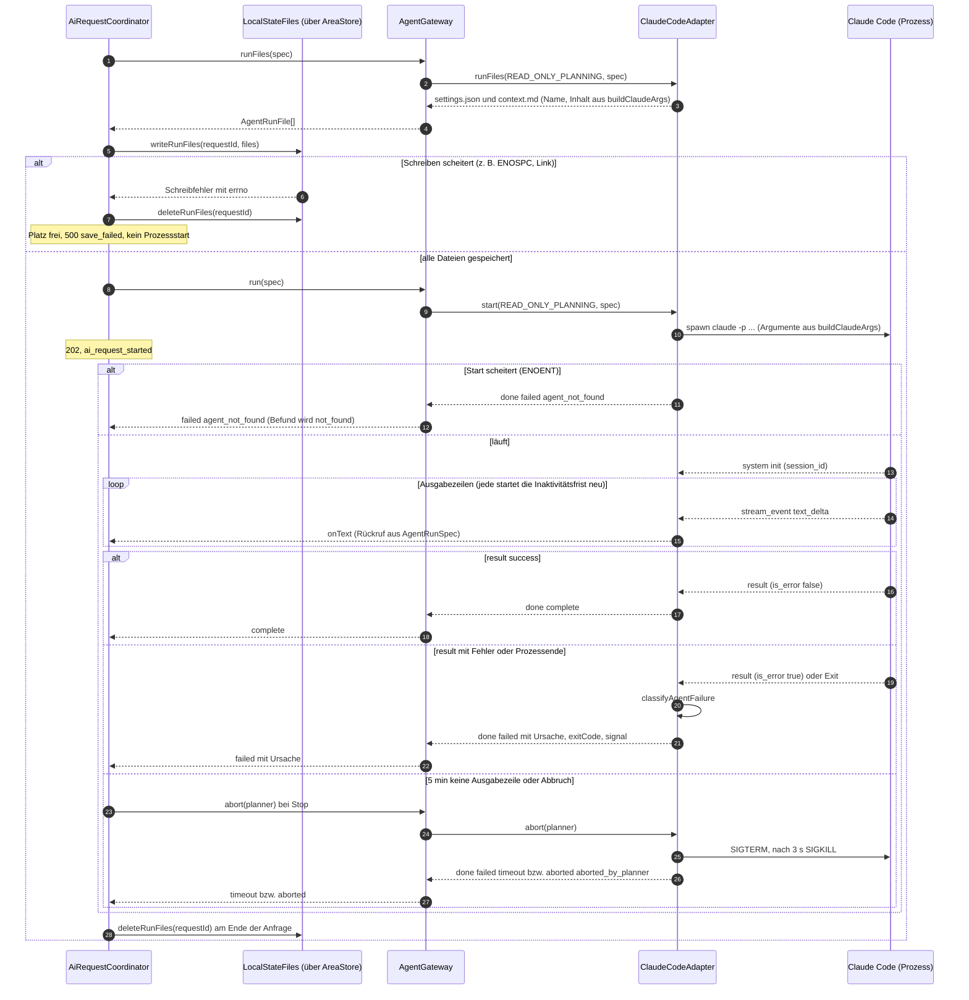

**Simulierter Claude Code** (`tools/fake-claude/fake-claude.mjs`, reines JavaScript ohne Build, REQ-064):
- `--version` → `2.1.300 (Claude Code)`, im Szenario änderbar (`version`).
- `-p`: liest Argumente, Kontextdatei, Einstellungsdatei und `stdin`; schreibt sie als JSON nach `$RAMIFOLD_FAKE_RECORD_DIR/<laufende Nummer>.json`, falls gesetzt; antwortet im `stream-json`-Format laut Szenario.
- **Sitzungen und Abzweigen (v0.9):** `session_id` im `init`-Ereignis ist bei `--resume <id>` ohne `--fork-session` gleich `<id>`, bei `--resume <id> --fork-session` und ohne `--resume` eine neue UUID. Die Aufzeichnung enthält `resumeId` und `forked: true|false`. `--fork-session` ohne `--resume` → Exit-Code 1 mit Fehlertext (fängt falsche Argumentlisten). Ob eine Sitzung „unbekannt“ ist, steuert nur das Szenario (Schritt `session_unknown`: `result` mit `is_error: true` und „No conversation found with session ID: <id>“), für Fortsetzung und Abzweigung gleich.
- Szenario: `RAMIFOLD_FAKE_SCENARIO=<name>` oder `RAMIFOLD_FAKE_SCENARIO_FILE=<pfad>` (JSON `{"requests":[…], "default": {…}}`, je Anfrage ein Schritt; Zähler in `<record dir>/state.json`). Ohne Angabe: `demo`.
- Mitgelieferte Szenarien (`tools/fake-claude/scenarios.mjs`): `demo` (5 Teile à 300 ms, Markdown-Antwort mit Überschrift, Liste, Tabelle, Code, Link; bei Aufgabe „suggest“ drei Vorschläge; bei „summarize“ ein Markdown-Entwurf), `parts_5x2s`, `slow_10s`, `network_after_2`, `usage_limit`, `usage_limit_after_30s`, `provider_error`, `exit_unexpected`, `protocol_garbage`, `hang`, `not_authenticated`, `session_unknown_then_ok`, `session_unknown_then_usage_limit` (v0.9: erster Lauf `session_unknown`, zweiter `usage_limit`), `version_old`, `suggest_empty`, `suggest_missing_title`, `summary_empty`, `slow_60s`, `timestamps` (schreibt Eingangs- und Lieferzeitpunkte für REQ-054). `agent_not_found` entsteht über `RAMIFOLD_CLAUDE_CMD=/nicht/vorhanden`.
- Fehlertexte im simulierten Claude Code sind die Beispieltexte aus den Mustern oben (z. B. `"Invalid API key · Please run /login"`).

**Prüfhinweise:** Unit: `buildClaudeArgs` (keine Schreib- oder Ausführwerkzeuge, AC-REQ-024-03; WebSearch/WebFetch freigegeben, AC-REQ-022-02; v0.9: Argumentliste und Einstellungsinhalt für `new`, `resume` und `fork` bis auf `--resume <id>` bzw. `--resume <id> --fork-session` am Ende identisch; ungültige `sessionId` wird nie übergeben), `StreamJsonParser`, `classifyAgentFailure` (je Regel). v0.14 (N-07, N-08): `runFiles` liefert genau `<requestId>.settings.json` (Einstellungsinhalt wie oben) und `<requestId>.context.md` (Kontexttext), ohne Ein- und Ausgabe; ungültige `requestId`, ungültige `sessionId` und `fork` ohne Fähigkeit werfen synchron in `runFiles` und `start`, bevor ein Prozess entsteht; `done` wird in keinem Szenario verworfen, `failed` trägt `exitCode` und `signal`; `LocalStateFiles.writeRunFiles` mit injiziertem `ENOSPC` und mit `local/tmp` als Link (`ELOOP`) wirft den Schreibfehler, unzulässige Namen (`../x`, `a/b`, andere `requestId`) werden abgewiesen, `deleteRunFiles` löscht nur `<requestId>.*`. Integration Koordinator (T-10): Schreibfehler → `500 save_failed {cause: "disk_full"}`, Platz frei, keine Aufzeichnung von `fake-claude`, keine Datei in `local/tmp/`, ein Eintrag `save_failed`. Integration Adapter (T-07): Der Test schreibt die Dateien aus `runFiles` selbst nach `local/tmp/` und startet dann; Inaktivitätsgrenze mit Teilen in kürzerem Abstand als die Grenze und längerer Gesamtdauer → `complete` (CR-174-03). Integration: `AgentGateway` gegen jedes Szenario, Inaktivitätsgrenze mit 200 ms, Abbruch, Versionsprüfung mit Wiederholung nach „zu alt“ ohne Neustart (AC-REQ-004-*), REQ-054 mit `timestamps` (50 Anfragen).

### 2.7 F-07 Chat

**Komponenten:** `chat-routes`, `PlanService`, `ChatService`, `projectChat`, `AiRequestCoordinator`, `planSession`, `selectHistoryMessages`, `AreaStore` (`ChatFile`, Sitzungen), `WindowHub`; web-ui `ChatSection`, `ChatMessageView`, `ChatComposer`, `windowStore` (Live-Teile).

**Endpunkte.**

| Methode und Pfad | Körper | Erfolg | Fehler |
|---|---|---|---|
| `POST /api/plans/:planId/nodes/:nodeId/chat/messages` | `{text}` | `202 {requestId, messageId}` | `422 {field:"text", rule:"required"}`, `404`, `409 plan_read_only`, `409 ai_request_running`, `409 consent_required`, `409 agent_unavailable`, `500 save_failed` |
| `POST /api/plans/:planId/nodes/:nodeId/chat/resend` | `{messageId}` (Frage des Planers) | `202 {requestId, messageId}` | `409 not_resendable` und alle Fehler wie oben außer `422`/`500` |
| `POST /api/ai-requests/:requestId/abort` | `{}` | `200 {}` | `404 ai_request_not_found` |

**Chat-Datei** `plans/<planId>/chats/<chatId>.jsonl` (Ereigniszeilen, nur anhängen; Format Abschnitt 3.2). Die erste Frage eines Knotens legt die Datei mit Kopfzeile und Frage in einem atomaren Schreibvorgang an; danach wird nur angehängt (`O_APPEND`, `fsync`).

**Wie die zweite Antwort gespeichert wird.** Jede KI-Antwort ist eine eigene Nachricht mit eigener ID und dem Feld `replyTo` = ID der Frage. „Send again“ an einer `incomplete`-Antwort erzeugt **keine** neue Frage, sondern eine weitere Antwort mit demselben `replyTo`; die alte Antwort bleibt mit ihrem Ende-Ereignis unverändert. „Send again“ an einer `not_sent`-Frage hängt bei Annahme durch Claude Code das Ereignis `planner_status sent` an; die Frage bleibt dieselbe Zeile (keine Kopie).

**Projektion (`projectChat`, rein).** Aus den Zeilen und der laufenden Anfrage entsteht `ChatViewDto = {chatId: string | null, entries: ChatEntryDto[]}`:

```ts
type ChatEntryDto =
  | { kind: "planner"; id: string; text: string; at: string; status: "sent" | "not_sent"; cause: CauseCode | null; resendable: boolean }
  | { kind: "ai"; id: string | null; replyTo: string; text: string; at: string | null;
      status: "running" | "complete" | "incomplete" | "aborted"; cause: CauseCode | null;
      sessionRebuilt: boolean; derived: boolean; resendable: boolean };
```

- Reihenfolge = Reihenfolge der ersten Zeile je Nachricht.
- Frage: Status = letztes `planner_status`-Ereignis, ohne Ereignis `sent`; `cause` nur bei `not_sent`.
- Antwort: Text = alle `ai_text` in Reihenfolge; Status aus `ai_end`; ohne `ai_end`: `running`, wenn sie zur laufenden Anfrage gehört, sonst `incomplete` mit `instance_stopped` (Ramifold hart beendet, AC-REQ-028-03).
- Abgeleitete Einträge (`derived: true`, direkt nach der Frage): (a) laufende Anfrage ohne `ai_start` → Antwort `running` ohne Text; (b) Frage mit Status `sent` ohne jede Antwort und nicht laufend → Antwort `incomplete`, `instance_stopped`, ohne Text, `id: null`.
- `text` einer `running`-Antwort ist in der Antwort von `GET …/nodes/:nodeId` immer leer: Andere Fenster zeigen nur „AI request running in <Nr> <Titel>“ (CC-07); das auslösende Fenster setzt die Live-Teile aus `ai_chunk` ein.
- `resendable`: nur der **jüngste** Eintrag, und nur wenn er eine Frage mit `not_sent` oder eine Antwort mit `incomplete` (auch abgeleitet) ist. Nie bei `aborted`, `running`, `complete`.
- `sessionRebuilt` steuert die Systemzeile MSG-008 direkt vor der Antwort.

**Senden** (`POST …/chat/messages`): Vorbedingungen Abschnitt 2.6, dann `planner_message` anhängen (Stempelprüfung), Sitzung planen (Abschnitt 2.8), Lauf starten.

**Erneut senden** (`POST …/chat/resend`): `messageId` muss eine Frage sein, und der jüngste Eintrag muss diese Frage mit `not_sent` oder eine `incomplete`-Antwort auf sie sein, sonst `409 not_resendable`. Vor dem Lauf wird nichts angehängt. Der Verlauf für eine neue Sitzung reicht bis **vor** diese Frage.

**Während des Laufs.**
- Erster Textteil: falls erneutes Senden einer `not_sent`-Frage → `planner_status sent`; dann `ai_start {id, replyTo, sessionRebuilt}`.
- Jeder Textteil geht sofort als `ai_chunk` an das auslösende Fenster (REQ-054). In die Datei schreibt `ChatService` gesammelte Teile als ein `ai_text`, spätestens 1 s nach dem ältesten ungeschriebenen Teil und am Ende (AC-REQ-028-03).
- Vor jedem Anhängen prüft `AreaStore` den Stempel. Weicht er ab: Vorhaben read-only, ab da nichts mehr schreiben, Teile weiter an das Fenster mit `saved: false` (MSG-012).

**Ende des Laufs (Chat).**

| Ausgang des Laufs | Datei | `ai_request_finished` | Oberfläche (auslösendes Fenster) |
|---|---|---|---|
| vollständig | restliche Teile, ggf. `ai_start`, `ai_end complete`; danach Sitzungseintrag speichern mit `knownThroughMessageId` = ID dieser Antwort (2.8) | `complete`, `saved: true` | Knoten neu laden |
| `not_authenticated` oder `agent_not_found`, **kein** Textteil | neue Frage: `planner_status not_sent {cause}`; erneutes Senden einer `not_sent`-Frage: neues `planner_status not_sent {cause}`; erneutes Senden nach `incomplete`: nichts; Sitzungseintrag unverändert | `not_sent` | Marke „not sent“ mit Ursache bzw. nur Banner; MSG-001 (Variante) |
| Abbruch durch Planer | Teile, ggf. `ai_start`, `ai_end aborted aborted_by_planner`; danach Sitzungseintrag speichern mit `knownThroughMessageId` = ID dieser Antwort, falls Sitzungs-ID bekannt (FIND-039) | `aborted` | Marke „aborted“, kein Banner |
| `session_unknown` | einmal neue Sitzung mit Verlauf, `sessionRebuilt: true`; protokolliert als `ai_session_rebuilt` | wie der zweite Lauf | MSG-008 |
| andere Ursache (auch vor dem ersten Teil) | Teile, ggf. `ai_start`, `ai_end incomplete {cause}`; danach Sitzungseintrag speichern mit `knownThroughMessageId` = ID dieser Antwort, falls Sitzungs-ID bekannt | `incomplete` | Marke „incomplete“, MSG-007 |
| Ramifold geordnet beendet | wie vorige Zeile mit `instance_stopped` | (Fenster bereits server-down) | – |
| Knoten gelöscht | nichts (Datei und Sitzungseintrag gelöscht) | `failed`, `reason: "node_deleted"` | MSG-004, falls das Fenster den Knoten zeigt |
| Änderung von außen erkannt | ab Erkennung nichts, auch kein Sitzungseintrag | `failed`, `cause: "external_change"`, `saved: false` | Marke „not saved“ (MSG-012), Zustand read-only (MSG-005) |

**Regel für den Sitzungseintrag (FIND-039; gilt für alle Zeilen oben und für 2.8).** Gespeichert wird genau bei den Ausgängen `complete`, `incomplete` (jede Ursache, auch `instance_stopped`) und `aborted`, wenn die Sitzungs-ID aus dem `init`-Ereignis bekannt ist und das `ai_end` dieser Antwort gespeichert ist: `{agent, sessionId, contextFingerprint, historyThroughMessageId, knownThroughMessageId = ID dieser Antwort, updatedAt}`. Nie gespeichert wird bei `not_sent`, `external_change`, Knotenlöschung oder wenn das Speichern der Antwort scheitert; dann bleibt der bisherige Eintrag, und weil er die neue Frage bzw. Antwort nicht kennt, startet die nächste Anfrage eine neue Sitzung mit Verlauf (2.8). Bei `incomplete` und `aborted` kennt die Sitzung die Antwort unter Umständen nur teilweise; das ist wie bis v0.9 hingenommen, die Antwort steht mit ihrem Status im Chat. `ChatService` schreibt den Eintrag vor dem Freigeben des Platzes (2.6). Scheitert das Schreiben von `sessions.json`, bleibt der alte Eintrag mit derselben Folge; der Ausgang des Laufs ändert sich nicht. Ein Unit-Test prüft die Regel je Zeile der Tabelle (Abschnitt 6).

**Zustand einer Frage des Planers** (Werte `sent`, `not_sent`).

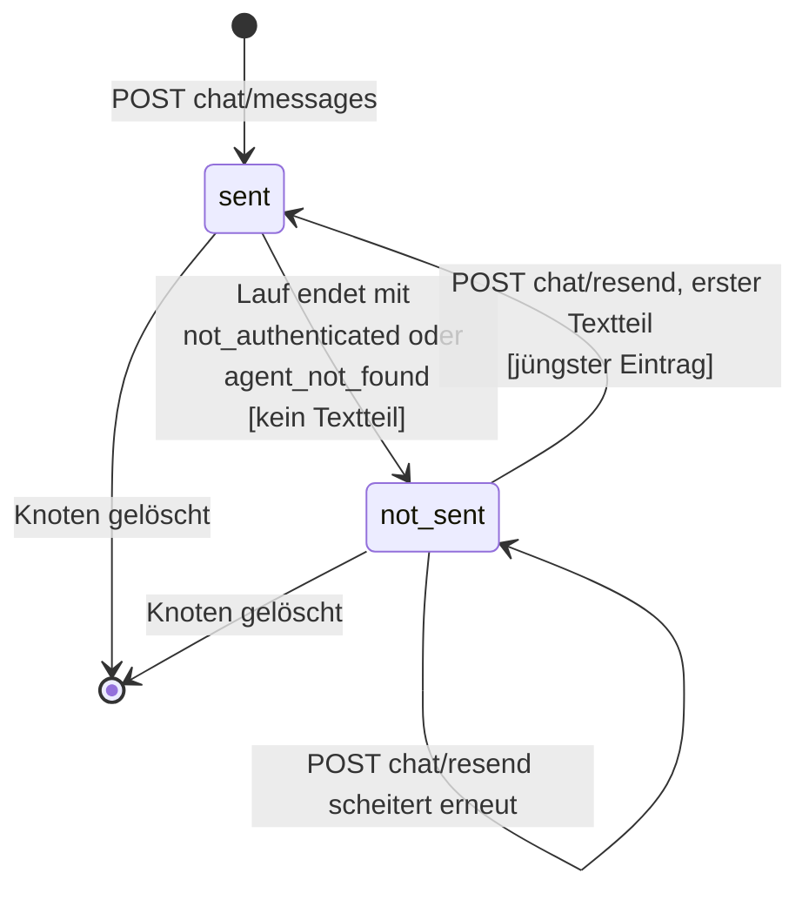

**Zustand einer KI-Antwort** (Werte `running`, `complete`, `incomplete`, `aborted`).

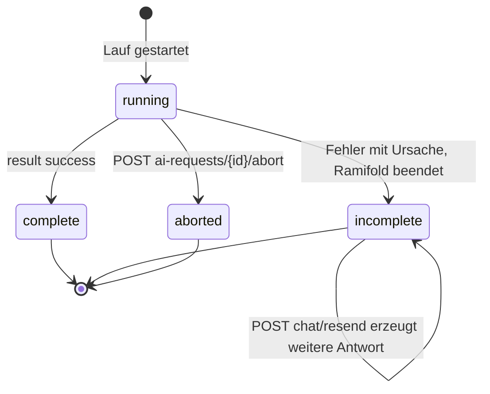

**Sequenz – Chatnachricht senden (F-07).**

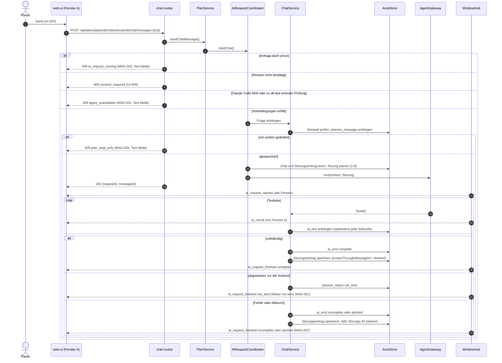

**Zustandsabbildung (UI-003, Chat).**

| Zustand | Technisches Verhalten |
|---|---|
| UI-003.default (Chat) | `entries` mit `MarkdownView`; Absender „You“/„AI“ |
| UI-003.empty (Chat) | `entries` leer |
| UI-003.disabled | `windowStore.aiRequest !== null`: Send, Suggest, Summarize `aria-disabled`, Aktivieren zeigt MSG-003 mit `nodeNumber`/`nodeTitle`; Text leer: Send `aria-disabled` ohne Meldung |
| UI-003 Laufanzeige (auslösendes Fenster) | Eintrag `running` + Live-Teile aus `ai_chunk` + „Stop“ |
| UI-003 Laufanzeige (andere Fenster) | `aiRequest` aus `connected`/`ai_request_started`: Marke „AI running“ im Baum; im betroffenen Knoten der `running`-Eintrag ohne Text und ohne „Stop“; bei `ai_request_finished` verschwindet die Anzeige ohne Neuladen des Chats |
| UI-003.error (Claude Code) | `409 agent_unavailable` → MSG-001 (installiert/zu alt), Text bleibt; `ai_request_finished not_sent` → MSG-001 (nicht angemeldet bzw. nicht installiert), Eingabefeld leer, Marke „not sent“ |
| UI-003.error (Antwort) | `incomplete` → Marke + MSG-007 mit Ursachentext; `aborted` → nur Marke; `sessionRebuilt` → MSG-008 als Systemzeile ohne Symbol (AL-01, 2.16) |
| Send again | nur bei `resendable: true`; `POST …/chat/resend` |
| UI-003.read-only (Chat) | Send/Send again deaktiviert; eingehende Teile mit „not saved“ (MSG-012) |
| UI-003.server-down (Chat) | laufende Antwort wird als „incomplete“ angezeigt; Eingabe bleibt |

**Prüfhinweise:** AC-REQ-017-01/-02/-04, AC-REQ-018-01 bis -03, AC-REQ-019-01/-02, AC-REQ-020-01, AC-REQ-021-01, AC-REQ-028-01 bis -03 (harter Abbruch nach 2 Teilen und ≥ 2 s), AC-REQ-029-01 bis -03, AC-REQ-004-02, AC-REQ-069-01/-02/-04/-05, AC-REQ-071-04, AC-REQ-074-04/-05; Unit-Tests `projectChat` mit allen Ereignisfolgen (inkl. abgerissener letzter Zeile und zwei Antworten auf eine Frage); Speicherregel des Sitzungseintrags je Ausgang (FIND-039, Abschnitt 6); Chat-Fortsetzung F-RES-01 bis F-RES-05 (Abschnitt 6).

### 2.8 F-08 Kontext und Kontextanzeige

**Komponenten:** `context-routes`, `PlanService`, `buildContext`, `CONTEXT_RULES`, `renderHistory`, `selectHistoryMessages`, `planSession`, `AreaStore` (Sitzungen); web-ui `ContextPanel`.

**Endpunkt.** `GET /api/plans/:planId/nodes/:nodeId/context` → `200 {text, sessionMode: "resume" | "new", includesHistory: boolean}`; `404 node_not_found`. Der Text ist genau der Inhalt der Kontextdatei, die die **nächste Chat-Nachricht** dieses Knotens erhielte (AC-REQ-036-01); er wird bei jedem Aufruf neu aus dem gespeicherten Stand gebildet (REQ-035, AC-REQ-036-02), mit derselben Sitzungsplanung wie der Lauf (Eintrag, Fingerabdruck, `knownThroughMessageId`). Keine Stempelprüfung (kein Öffnen im Sinne von REQ-074).

**Kontexttext** (`buildContext`, rein, englisch, nicht übersetzt; Inhalte des Planers unverändert). Aufbau mit Beispielwerten:

```text
<ramifold-context version="1">
<rules>
You are the AI assistant in one node of a planning tree in Ramifold. The planner works on the objective of this node together with you. The context below comes from the saved plan.
- Answer in the language in which the planner writes.
- When you report research results, name each source with its URL.
- You may search the web and read files in the project folder. You cannot create, change or delete files, run commands, or change the plan. The planner makes every change in Ramifold.
- A result marked "fixed plan" is a decision of the planner. A result marked "concept, not fixed yet" may still change.
- If you need information from the planner, ask in plain text.
</rules>
<plan title="Eigenes produktives RAG">
<ancestor number="" title="Eigenes produktives RAG">
<objective>Produktives RAG für interne Dokumente planen</objective>
<result status="fixed plan">…</result>
</ancestor>
<ancestor number="2" title="Retrieval">
<objective>Retrieval planen</objective>
<result status="concept, not fixed yet">…</result>
</ancestor>
<sibling number="2.1" title="Chunking">
<objective>…</objective>
</sibling>
<sibling number="2.3" title="Reranking">
<objective>…</objective>
</sibling>
<current-node number="2.2" title="Embedding-Modell">
<objective>…</objective>
<result status="no result yet"></result>
</current-node>
<child number="2.2.1" title="Quantisierung">
<objective>…</objective>
<result status="fixed plan">…</result>
</child>
<child number="2.2.2" title="Lizenzen">
<objective>…</objective>
<result status="not fixed yet"></result>
</child>
</plan>
<previous-conversation>
<message from="planner" at="2026-11-24T09:42:00.000Z">…</message>
<message from="ai" at="2026-11-24T09:43:10.000Z" status="complete">…</message>
</previous-conversation>
</ramifold-context>
```

Regeln: Vorfahren von der Wurzel abwärts mit Titel, Auftrag, aktuellem Ergebnis und Status (REQ-031); Geschwister nur Titel und Auftrag (REQ-031); der Knoten selbst mit Nummer, Titel, Auftrag, Ergebnis (REQ-032); direkte Kinder: bei `fixed` das Ergebnis, sonst `status="not fixed yet"` ohne Inhalt (REQ-033); keine Nachkommen tiefer als die Kinder; nie Chats anderer Knoten (REQ-034). Status-Werte: `fixed plan`, `concept, not fixed yet`, `no result yet` (bei Vorfahren und Knoten), `not fixed yet` (bei Kindern). Attributwerte werden escaped (`&`, `"`, `<`, `>`), Inhalte nicht. Fehlt ein Teil (Wurzel ohne Vorfahren, keine Geschwister, keine Kinder), entfällt das Element. `<previous-conversation>` erscheint nur, wenn die Sitzungsplanung Verlauf mitgibt; Nachrichten mit `not_sent` und abgeleitete Einträge fehlen darin, KI-Antworten tragen ihren Status.

**Fingerabdruck:** SHA-256 (hex) des Texts **ohne** `<previous-conversation>`.

**Sitzungsplanung** (`planSession`, rein; REQ-029, REQ-035, REQ-037, REQ-041; ADR-003). Eingaben: Art der Anfrage, Basistext und Fingerabdruck, Chat-Einträge (`projectChat`; beim Senden ohne die von dieser Anfrage angehängte Frage), Sitzungseintrag des Chats aus `sessions.json` (nur mit `agent` = `AgentPort.kind`, sonst wie fehlend) und `AgentPort.capabilities`. Ein Sitzungseintrag **passt**, wenn sein `contextFingerprint` gleich dem aktuellen Fingerabdruck ist und die Sitzung den Chat kennt (Absatz „Maßgebliche Nachrichten …“ unten). Je Art gilt die erste zutreffende Zeile:

| Fall | Lauf | Verlauf im Kontext | `sessionRebuilt` |
|---|---|---|---|
| Chat, keine früheren maßgeblichen Nachrichten | neue Sitzung | keiner | nein |
| Chat, **passender** Sitzungseintrag (gleicher Fingerabdruck, Sitzung kennt den Chat) | `--resume <sessionId>` | derselbe Verlauf wie beim Start dieser Sitzung (bis `historyThroughMessageId`), damit der Text identisch ist | nein |
| … und Claude Code meldet `session_unknown` | einmal neue Sitzung | alle früheren Nachrichten | **ja**, protokolliert |
| Chat, Sitzungseintrag mit anderem Fingerabdruck | neue Sitzung | alle früheren Nachrichten | nein |
| Chat, Sitzungseintrag mit gleichem Fingerabdruck, aber die Sitzung kennt den Chat nicht (Feld fehlt oder ist nicht die letzte maßgebliche Nachricht; z. B. Chat am anderen Rechner ergänzt, `git checkout` auf älteren Stand; v0.10) | neue Sitzung | alle früheren Nachrichten | nein (kein Verlust, siehe unten), nicht protokolliert |
| Chat, kein Sitzungseintrag auf diesem Rechner, aber frühere maßgebliche Nachrichten | neue Sitzung | alle früheren Nachrichten | **ja**, protokolliert |
| Vorschläge, Zusammenfassung: **Abzweigung möglich** (alle Bedingungen unten erfüllt) | `--resume <sessionId> --fork-session` (Sitzung des Chats); neue Sitzungs-ID wird **nicht** gespeichert | derselbe Verlauf wie beim Start der Chat-Sitzung (bis `historyThroughMessageId`), also genau die Kontextdatei, die die nächste Chat-Nachricht erhielte; den Rest des Chats kennt die Sitzung selbst | nein |
| … und Claude Code meldet `session_unknown` | **Rückfall:** genau einmal neue einmalige Sitzung wie in der nächsten Zeile, automatisch | alle Nachrichten des Chats | nein, nicht protokolliert |
| Vorschläge, Zusammenfassung: Abzweigung nicht möglich (kein Chat, kein Eintrag, anderer Fingerabdruck, Sitzung kennt den Chat nicht, Fähigkeit fehlt) | neue einmalige Sitzung (wie bis v0.8), Eintrag wird **nicht** gespeichert | alle Nachrichten des Chats | nein |

**Bedingungen der Abzweigung** (alle müssen gelten, sonst neue einmalige Sitzung):
1. `AgentPort.capabilities.canForkSession` ist `true`.
2. In `sessions.json` gibt es für den Chat des Knotens einen gültigen Eintrag mit `agent` = `AgentPort.kind` (`"claude-code"`).
3. Sein `contextFingerprint` ist gleich dem Fingerabdruck des aktuellen Basistexts (Auftrag und Ergebnisse im Kontext seit der letzten Chat-Nachricht unverändert, REQ-035).
4. **Die Sitzung kennt den Chat:** `knownThroughMessageId` des Eintrags ist gleich der ID der letzten maßgeblichen Nachricht des Chats (v0.10; dieselbe Prüfung wie bei der Chat-Fortsetzung, Absatz unten). Grund: REQ-037 und REQ-041 verlangen den ganzen Chat; Nachrichten, die ohne diese Sitzung in den Chat kamen (per Git vom zweiten Rechner, die Antwort eines Chat-Laufs ohne bekannte Sitzungs-ID), kennt die Chat-Sitzung nicht. Ein Neustart von Ramifold ändert daran nichts.

**Maßgebliche Nachrichten und „Sitzung kennt den Chat“** (v0.10; Owner-Entscheidung a vom 2026-11-25 zu TS-R-12; FIND-038, H-11). *Maßgeblich* sind genau die Nachrichten, die `renderHistory` in `<previous-conversation>` aufnimmt: Fragen des Planers mit Status `sent` und KI-Antworten mit eigener Zeile `ai_start` (jeder Status, auch `incomplete` und `aborted`). Nicht maßgeblich sind Fragen mit Status `not_sent` und abgeleitete Einträge (`derived: true`, z. B. die Antwort `incomplete` ohne Text nach hartem Beenden oder die laufende Antwort ohne `ai_start`); sie stehen nie im Verlauf. Verlauf und Prüfung nutzen dieselbe reine Funktion `selectHistoryMessages`, damit sie nie auseinanderlaufen. Die *letzte maßgebliche Nachricht* wird auf dem Chat **vor** dieser Anfrage bestimmt: beim Senden ohne die gerade angehängte Frage; beim erneuten Senden, bei Vorschlägen und bei der Zusammenfassung auf dem ganzen gespeicherten Chat (dort hängt die Anfrage nichts an). Gibt es keine, ist sie leer. Die Sitzung *kennt den Chat*, wenn `knownThroughMessageId` des Eintrags gleich der ID dieser Nachricht ist; ein Eintrag ohne das Feld kennt den Chat nie.

*Beispiele* (Eintrag mit passendem Fingerabdruck): (1) Chat `F1, A1`, Eintrag `knownThroughMessageId = A1`, neue Frage F2 → letzte maßgebliche Nachricht vor der Anfrage `A1` → `--resume`. (2) Wie (1), F2 endet `not_sent`, dann neue Frage F3 → weiterhin `A1` → `--resume`; ebenso „Send again“ an F2 und eine Abzweigung. (3) F2 mit Antwort A2 `incomplete`, Sitzungs-ID bekannt, Eintrag `A2`; „Send again“ an F2 → `A2` → `--resume`, F2 geht noch einmal über `stdin` (wie bis v0.9). (4) Wie (1), per Git kamen `F3, A3` vom Desktop dazu → `A3` ≠ `A1` → neue Sitzung mit allen Nachrichten, ohne MSG-008. (5) Eintrag `A2`, Chat per `git checkout` auf `F1, A1` zurückgesetzt → `A1` ≠ `A2` → neue Sitzung mit `F1, A1`, ohne MSG-008.

**Feld `knownThroughMessageId`** im Sitzungseintrag (3.2): ID der Antwort des letzten Chat-Laufs dieser Sitzung, gesetzt bei jedem Speichern des Eintrags (Regel in 2.7). Weil der Eintrag erst nach dem `ai_end` dieser Antwort geschrieben wird, zeigt das Feld immer auf eine gespeicherte Nachricht. Vorschläge, Zusammenfassungen und ihre Rückfall-Läufe schreiben weder Eintrag noch Feld. Die Prüfung ersetzt die Chat-Marke im Speicher aus v0.9 (`ChatRunMarks` entfällt).

**Ohne MSG-008 (REQ-029).** REQ-029 gilt, wenn der Coding-Agent die Sitzung nicht fortsetzen **kann** (Sitzung verloren): Dann zeigt Ramifold MSG-008 und protokolliert `ai_session_rebuilt`. Kennt eine vorhandene Sitzung den Chat nicht, verwirft Ramifold sie bewusst, wie beim geänderten Fingerabdruck (TS-A-10): Nichts ist verloren, der gespeicherte Chat ist vollständig, und die KI erhält ihn ganz als Verlauf; der Planer muss nichts neu erklären (Zweck von REQ-029, A-03). Deshalb gibt es weder MSG-008 noch `sessionRebuilt` noch einen Protokolleintrag (REQ-063 betrifft nur Fehler). AC-REQ-029-03 bleibt unverändert: Ohne Eintrag auf dem zweiten Rechner ist die Sitzung dort verloren, und MSG-008 erscheint.

**Einträge ohne das Feld** brauchen keinen Datenumbau und keine Formatversion: `sessions.json` ist rechnerbezogen, nie in Git, jederzeit verwerfbar (Baseline Abschnitt 4, `AgentSession`) und gehört nicht zu den Plandaten mit Formatversion (REQ-065). Kein veröffentlichter Stand hat die Datei je geschrieben; Einträge ohne Feld können nur aus Entwicklungsständen vor v0.10 stammen. Ein solcher Eintrag kostet höchstens einmal eine neue Sitzung mit ganzem Chat und wird danach mit Feld überschrieben. Das Schema des Eintrags lässt unbekannte Felder zu, damit kein Stand eine Datei eines anderen Stands als unlesbar verwirft.

**Ablauf bei Vorschlägen und Zusammenfassung.** `SuggestionService` bzw. `SummaryService` bilden in Schritt 7 von 2.6, also bei belegtem Platz (H-10), den Basistext (`buildContext`), lesen Chat und Sitzungseintrag und lassen `planSession` planen; `AiRequestCoordinator` startet den Lauf mit `{mode: "fork", sessionId}` und der Kontextdatei der nächsten Chat-Nachricht, sonst mit `{mode: "new"}` und dem ganzen Chatverlauf. Auftrag und Ausgabeformat gehen in beiden Fällen nur über `stdin` (2.6, 2.9, 2.10). Endet ein `fork`-Lauf mit `session_unknown`, startet `AiRequestCoordinator` **genau einmal** und unter derselben `requestId` den Rückfall-Lauf `{mode: "new"}`: Kontextdatei mit allen Nachrichten des Chats unter demselben Pfad neu schreiben, Einstellungsdatei unverändert, derselbe Auftrag über `stdin`. Der Platz der Instanz (REQ-069), die Laufanzeige und `summaryRunning` bleiben dabei bestehen; die Inaktivitätsgrenze gilt je Lauf neu. Ein Rückfall-Lauf endet nie mit einem weiteren Rückfall; scheitert er, gilt seine Ursache (MSG-015 bzw. MSG-016). Ein anderer Ausgang des `fork`-Laufs (z. B. `usage_limit`, Abbruch, `timeout`) führt zu keinem Rückfall, sondern gilt wie bisher.

**Wirkung auf den Chat: keine.** Weder die Abzweigung noch der Rückfall schreiben in `sessions.json` (auch nicht `knownThroughMessageId`) oder in die Chat-Datei; die Sitzungs-ID aus dem `init`-Ereignis eines `suggest`- oder `summarize`-Laufs wird verworfen. Die nächste Chat-Nachricht setzt die unveränderte Chat-Sitzung fort (Eintrag und Chat sind unverändert, die Sitzung kennt den Chat also weiter); die Chat-KI kennt Auftrag und Antwort der Abzweigung nicht (AC-REQ-037-01, AC-REQ-041-02). Ein `session_unknown` der Abzweigung erzeugt weder MSG-008 noch `sessionRebuilt`, keine Terminal-Zeile und keinen Eintrag `ai_session_rebuilt`: Es ist kein Fall von REQ-029, denn der Chat ist nicht betroffen. Fehlt die Chat-Sitzung wirklich, stellt das die nächste Chat-Nachricht selbst fest und zeigt dann wie bisher MSG-008 mit genau einem Protokolleintrag (REQ-029, REQ-063 bleiben unverändert erfüllt). `GET …/context` (REQ-036) zeigt weiterhin die nächste Chat-Nachricht; bei einer Abzweigung ist das genau die Kontextdatei des Laufs.

**Kosten.** Schlechtester Fall gleich wie bis v0.8: Der gescheiterte Abzweig-Lauf endet, ohne die KI zu befragen (Claude Code findet die Sitzung auf dem Rechner nicht), danach läuft die bisherige einmalige Sitzung. Der Vorteil eines Cache-Treffers hängt vom Abstand zur letzten Chat-Nachricht ab und ist nicht garantiert (TS-R-10).

„Frühere Nachrichten“ = alle maßgeblichen Nachrichten vor der gesendeten Frage (beim erneuten Senden vor der erneut gesendeten Frage). Nach einem Chat-Lauf speichert `AreaStore` (`LocalStateFiles`) nach der Regel in 2.7 (Ausgang `complete`, `incomplete` oder `aborted`, Sitzungs-ID bekannt) in `local/sessions.json`: `{agent: "claude-code", sessionId, contextFingerprint, historyThroughMessageId, knownThroughMessageId, updatedAt}` (Abschnitt 3.2); nur Chat-Läufe speichern dort.

**Zustandsabbildung.**

| Zustand | Technisches Verhalten |
|---|---|
| UI-008.loading | `GET …/context` läuft |
| UI-008.default | `text` in schreibgeschütztem, fokussierbarem Bereich (Monospace) |
| UI-008.error | Antwort ≠ `200`: Fehlertext „The context could not be loaded. Close this panel and try again.“ im Textbereich, mit Symbol `error` in Farbe `error` (kein Banner, AL-07, 2.16) |

**Sequenz – Kontext anzeigen und mit der nächsten Nachricht senden (F-08).**

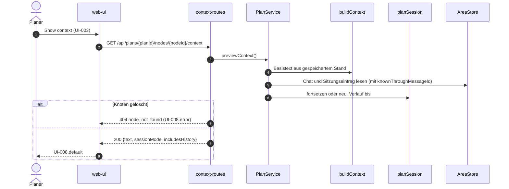

**Sequenz – Vorschläge oder Zusammenfassung mit Abzweigung und Rückfall (F-08, F-09, F-10; v0.9, v0.10).** Alle Schritte laufen in Schritt 7 von 2.6, bei belegtem Platz.

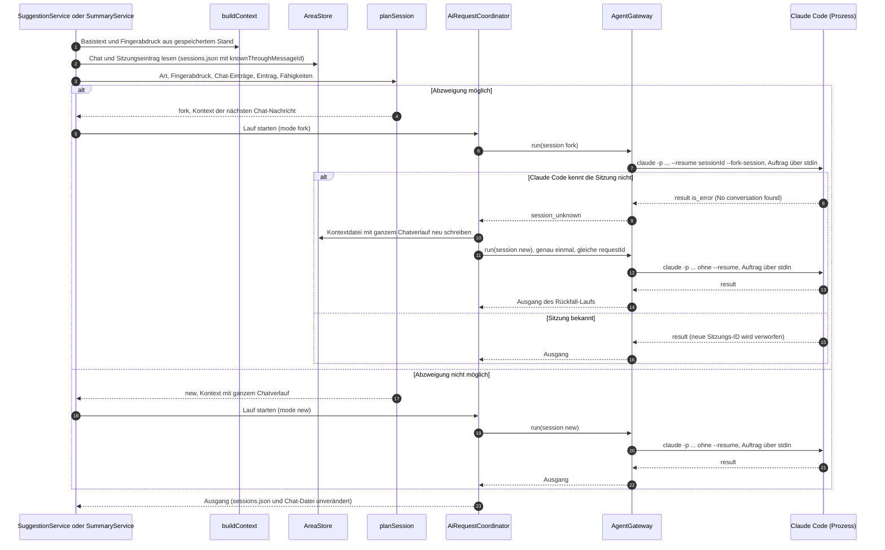

**Prüfhinweise:** Unit: Tabellentests für REQ-031 bis REQ-034 (AC-REQ-031-01 bis -03, AC-REQ-032-01, AC-REQ-033-01, AC-REQ-034-01), REQ-027 (AC-REQ-027-01), REQ-022 (AC-REQ-022-02), `planSession` für jede Zeile der Tabelle, jede der vier Bedingungen der Abzweigung einzeln verletzt (v0.9) und die Beispiele (1) bis (5) (v0.10); `selectHistoryMessages` mit `not_sent`-Fragen, abgeleiteten Einträgen und Antworten jedes Status (H-11). Integration der Abzweigung: Testfälle F-FORK-01 bis F-FORK-09, der Chat-Fortsetzung: F-RES-01 bis F-RES-05 in Abschnitt 6. Integration: AC-REQ-036-01 (Text = vom simulierten Claude Code empfangene Kontextdatei), AC-REQ-036-02/-03, AC-REQ-013-01, AC-REQ-035-01.

### 2.9 F-09 Unterpunkt-Vorschläge

**Komponenten:** `suggestion-routes`, `PlanService`, `SuggestionService`, `parseSuggestions`, `SuggestionStore`, `AiRequestCoordinator`, `planSession`, `TreeEditService`; web-ui `SuggestionsPanel`.

**Endpunkte.**

| Methode und Pfad | Körper | Erfolg | Fehler |
|---|---|---|---|
| `POST /api/plans/:planId/nodes/:nodeId/suggestions/request` | `{}` | `202 {requestId}` | wie KI-Anfragen (Abschnitt 2.6) |
| `POST /api/plans/:planId/nodes/:nodeId/suggestions/accept` | `{items: [{suggestionId, title, objective}]}` (mind. 1) | `201 {created: [{nodeId, number, title}], tree, remaining}` | `422 {fields: [{field: "items[<i>].title", rule}]}` (nichts angelegt), `404 suggestion_not_found`, `404 node_not_found`, `409 plan_read_only`, `500 save_failed {createdCount}` |
| `POST /api/plans/:planId/nodes/:nodeId/suggestions/discard` | `{suggestionIds: string[]}` | `200 {remaining}` | `409 plan_read_only` |

**Anfordern (REQ-037).** Nach den Vorbedingungen werden die offenen Vorschläge dieses Knotens sofort verworfen (Lebensdauer „bis neue Vorschläge angefordert werden“), dann läuft die Anfrage mit Kontext und ganzem Chatverlauf: als Abzweigung der Chat-Sitzung des Knotens oder, wenn das nicht möglich ist oder Claude Code die Sitzung nicht kennt, in einer neuen einmaligen Sitzung (Sitzungsplanung und Rückfall in Abschnitt 2.8). Auftrag über `stdin` (in beiden Fällen gleich, nie im Systemtext):

```text
Suggest sub-items for the current node <number> <title>. Base them on the context and the previous conversation. Reply only with a JSON object in this form, without any other text:
{"suggestions":[{"title":"...","objective":"..."}]}
Suggest at least one sub-item. Each title has at most 200 characters.
```

**Antwort prüfen (`parseSuggestions`).** Text = `result` des Laufs; ein umschließender Codeblock ```` ```json ```` wird entfernt; geparst wird der Abschnitt vom ersten `{` bis zum letzten `}`. Verwertbar, wenn `suggestions` ein Array mit mindestens einem Eintrag ist und **jeder** Eintrag einen nach Trimmen nicht leeren `title` (string) hat; `objective` fehlt → `""`. Titel über 200 Codepunkte werden übernommen und erst bei der Übernahme geprüft. Sonst Ursache `unusable_result` (MSG-009), Baum unverändert. Verwertbare Vorschläge erhalten je eine `suggestionId` (ULID) und liegen in `SuggestionStore` (Instanz, in allen Fenstern sichtbar, REQ-071).

**Übernehmen (REQ-038, REQ-039).** Alle Einträge werden zuerst geprüft (`titleRule`); ein ungültiger → `422`, nichts angelegt („Accept all“ blockiert, A-UX-09). Dann in einem Schreibvorgang der `WriteQueue` je Eintrag ein Knoten hinter den vorhandenen Kindern in Reihenfolge der Einträge (`generateNKeysBetween(letztesKind?.position ?? null, null, n)`). Übernommene Vorschläge verlassen den Store. Scheitert das Schreiben nach *k* Knoten, bleiben diese angelegt (gültiger Baum), ihre Vorschläge sind entfernt, Antwort `500 save_failed {createdCount: k}`. Ein Vorschlag, der in einem anderen Fenster schon übernommen oder verworfen wurde → `404 suggestion_not_found`; das Fenster lädt den Knoten neu.

**Verwerfen (REQ-040)** ändert nur den Store; der Baum bleibt unverändert. Änderungen an Karten (Titel, Auftrag) bleiben bis zur Übernahme Eingaben des Fensters (`inputStore`).

**Lebensdauer** offener Vorschläge: bis Übernahme oder Verwerfen, neue Anforderung, Löschen des Knotens oder Beenden von Ramifold. Eine neue Anforderung verwirft alle offenen Vorschläge des Knotens **sofort**, sobald der Server sie annimmt (`202`), auch geänderte Karten, ohne Rückfrage und ohne Dialog (REQ-037; Design v0.3.1, KL-05, UI-005, FLOW-004). `web-ui` löscht dabei die Karteneingaben des Knotens im `inputStore`.

**Zustandsabbildung.**

| Zustand | Technisches Verhalten |
|---|---|
| UI-005.loading | Anfrage `kind: "suggest"` läuft: Laufanzeige im Knoten (UI-003), Panel noch nicht sichtbar |
| UI-005.default | `NodeDetailDto.suggestions` nicht leer; nach `ai_request_finished complete` lädt das auslösende Fenster den Knoten und öffnet das Panel |
| UI-005.empty | Liste leer nach Übernehmen/Verwerfen → Panel schließt, Toast „No suggestions left“ |
| UI-005.error | `failed` mit `unusable_result` → MSG-009; `failed` mit anderer Ursache → MSG-015 mit Ursachen-Kurztext, kein „Send again“; bei Ursache `not_authenticated` die Variante mit dem Schritt zur Anmeldung als Schlusssatz statt „Try again.“ (Design v0.4.6, H-01, AC-REQ-004-03); `aborted` („Stop“) → kein Banner; `409 agent_unavailable` → MSG-001; `409 ai_request_running` → MSG-003 |
| UI-005.validation | `titleRule` im Client je Karte; `422` gleich |
| UI-005.disabled / .permission | während `accept` „Accepting…“, Buttons deaktiviert |
| UI-005.success | `201` → Statusmeldung „Added <Nr> <Titel>“ |
| UI-005 read-only / server-down | Aktionen deaktiviert, Karten lesbar |

**Sequenz – Vorschläge anfordern und übernehmen (F-09).**

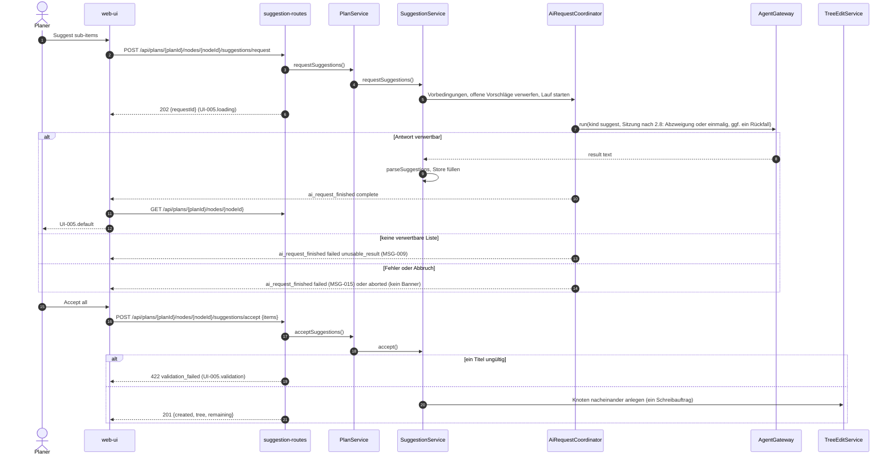

**Prüfhinweise:** AC-REQ-037-01 bis -03 (-01 zusätzlich als Abzweigung, F-FORK-01), AC-REQ-038-01/-02, AC-REQ-039-01/-02, AC-REQ-040-01/-02, AC-REQ-028-04, AC-REQ-004-03 (Szenario `not_authenticated` bei „Suggest sub-items“: MSG-015 genau im Wortlaut von Design v0.4.6), AC-REQ-069-03; Unit `parseSuggestions` (Codeblock, leeres Array, fehlender Titel, Zusatztext).

### 2.10 F-10 Zusammenfassung und KI-Entwürfe

**Komponenten:** `summary-routes`, `PlanService`, `SummaryService`, `AiDraftStore`, `EditLockRegistry`, `AiRequestCoordinator`, `planSession`; web-ui `ResultSection`, `ResultEditor`, `ReplaceDraftDialog`.

**Endpunkt.** `POST /api/plans/:planId/nodes/:nodeId/summary/request` mit `{replaceConfirmed: boolean}` → `202 {requestId}`. Zusätzliche Vorbedingungen (Schritt 2 in Abschnitt 2.6): Sperre `other_window` → `409 result_locked {reason: "other_window"}` (REQ-071); besteht ein KI-Entwurf oder hält **dieses** Fenster die Sperre (also eine Ergebnisbearbeitung) und ist `replaceConfirmed` nicht `true` → `409 replace_confirmation_required` (REQ-073 Regel 2). `web-ui` zeigt UI-010 schon vorher, wenn ein KI-Entwurf oder ein `inputStore`-Eintrag für den Knoten besteht.

**Sitzung:** wie bei Vorschlägen nach Abschnitt 2.8 (Abzweigung der Chat-Sitzung oder neue einmalige Sitzung, höchstens ein Rückfall).

**Auftrag über `stdin`** (in beiden Fällen gleich, nie im Systemtext):

```text
Write the result of the current node <number> <title> as Markdown. Base it on the context, especially the fixed plans of the direct children, and on the previous conversation. Reply only with the result text, without an introduction.
```

**Während der Anfrage** gilt für den Knoten `summaryRunning`: `resultLock` ist für alle Fenster `summary_running`, `POST …/result-lock` und `POST …/results` liefern `409 result_locked {reason: "summary_running"}`. Vorhandener KI-Entwurf und Ergebnisbearbeitung bleiben unverändert (REQ-073 Regel 3).

**Ende.**
- Vollständig und `result` nach Trimmen nicht leer → `AiDraftStore.set(planId, nodeId, {draftId, content, createdAt})` ersetzt einen vorhandenen KI-Entwurf. Das auslösende Fenster ersetzt seine Ergebnisbearbeitung durch den neuen Entwurf (`basis: "ai_draft"`), holt die Sperre, falls nötig, und öffnet UI-004 mit „AI draft, not saved yet“. Ergebnisstatus und Chat bleiben unverändert (AC-REQ-041-02).
- Leer → `failed`, `unusable_result`; Fehler oder Abbruch → `failed` bzw. `aborted`. In allen drei Fällen bleibt alles unverändert und wieder bearbeitbar (AC-REQ-041-03, AC-REQ-021-02, AC-REQ-073-06/-07).

**KI-Entwurf (REQ-073).** Gehört zur Instanz, in jedem Fenster sichtbar (`NodeDetailDto.aiDraft`, `TreeNodeDto.hasAiDraft`). Endet durch Speichern oder Verwerfen einer Ergebnisbearbeitung mit `basis: "ai_draft"` und passender `aiDraftId` (Abschnitt 2.5), Ersetzen, Löschen des Knotens, Beenden von Ramifold.

**Zustandsabbildung.**

| Zustand | Technisches Verhalten |
|---|---|
| UI-010.default | Client: `aiDraft !== null` oder `inputStore` hat einen Eintrag für den Knoten; „Summarize and replace“ → Anfrage mit `replaceConfirmed: true`; „Keep my draft“ → nichts |
| UI-010 read-only | „Summarize and replace“ deaktiviert |
| UI-004 „AI draft, not saved yet“ | nach `complete` im auslösenden Fenster |
| UI-004.disabled | `summary_running` |
| UI-003.error / UI-004.error (Zusammenfassung) | `failed` → MSG-016 mit Ursachen-Kurztext; bei Ursache `not_authenticated` die Variante mit dem Schritt zur Anmeldung als Schlusssatz statt „Try again.“ (Design v0.4.6, H-01, AC-REQ-004-03); leere oder unbrauchbare Zusammenfassung → MSG-016 mit Kurztext von `unusable_result`; `aborted` („Stop“) → kein Banner; nie „Send again“. KI-Entwurf, Ergebnisbearbeitung und gespeichertes Ergebnis unverändert und wieder bearbeitbar |

**Sequenz – Zusammenfassung mit Ersetzen (F-10).**

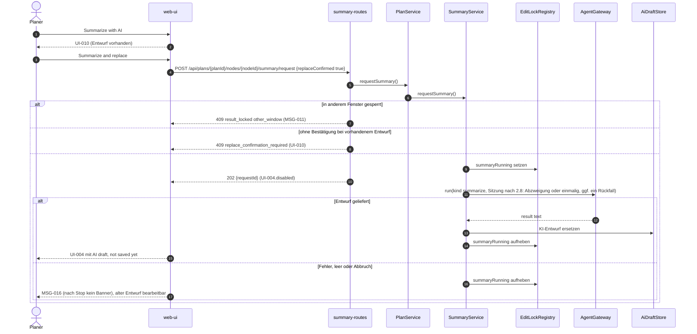

**Prüfhinweise:** AC-REQ-041-01 bis -03 (-01/-02 zusätzlich als Abzweigung, F-FORK-01/-02), AC-REQ-021-02, AC-REQ-073-01 bis -07, AC-REQ-071-08, AC-REQ-004-03 (Szenario `not_authenticated` bei „Summarize with AI“: MSG-016 genau im Wortlaut von Design v0.4.6).

### 2.11 F-11 Datenabfluss-Hinweis

**Komponenten:** `consent-routes`, `PlanService`, `ConsentService`, `AreaStore` (`local/consent.json`); web-ui `DataNoticeDialog`.

**Endpunkte.** `GET /api/consent` → `200 {confirmed: boolean}`. `PUT /api/consent` mit `{confirmed: true}` → `200 {confirmed: true}`; `500 save_failed`. Die Bestätigung liegt in `.ramifold/local/consent.json` (nie in Git, auch bei eingeschlossenen Chats; REQ-030, REQ-050). Unabhängig vom read-only-Zustand eines Vorhabens.

**Ablauf im Fenster.** `web-ui` lädt `GET /api/consent` nach `connected`. Vor „Send“, „Send again“, „Suggest sub-items“ und „Summarize with AI“ öffnet es bei `confirmed: false` UI-009 im Bestätigungsmodus und merkt sich die auslösende Aktion. „Continue“ → `PUT /api/consent`, bei Erfolg wird die gemerkte Aktion ausgeführt; „Cancel“/ESC → nichts gesendet, Eingabe bleibt. Antwortet der Server trotzdem `409 consent_required` (z. B. Datei gelöscht), öffnet das Fenster UI-009 ebenso. „Data notice“ öffnet bei `confirmed: true` den Ansichtsmodus, sonst den Bestätigungsmodus ohne gemerkte Aktion.

**Zustandsabbildung.**

| Zustand | Technisches Verhalten |
|---|---|
| UI-009.default (Bestätigung) | `confirmed: false`; „Continue“ `aria-disabled` bis Checkbox gesetzt (Zustand nur im Fenster) |
| UI-009 Ansichtsmodus | `confirmed: true` |
| UI-009.loading | `PUT /api/consent` läuft |
| UI-009.error | `500 save_failed` → MSG-002 im Dialog, Anfrage wird nicht gesendet |

**Sequenz – erste KI-Anfrage mit Hinweis (F-11).**

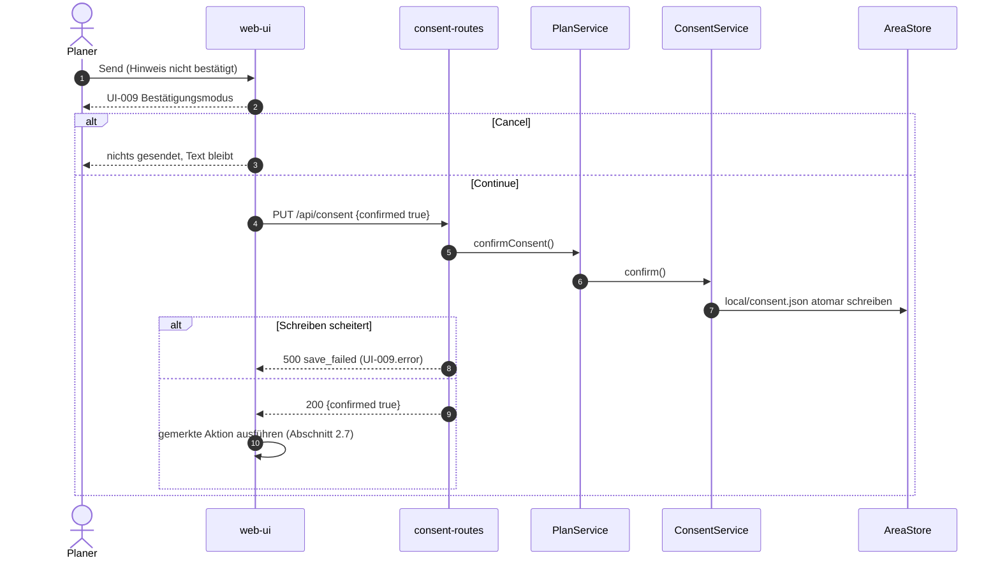

**Prüfhinweise:** AC-REQ-030-01 bis -07 (Klon mit `git add -A`, mit und ohne eingeschlossene Chats).

### 2.12 F-12 Änderung von außen und Zustand „read-only“

**Komponenten:** `PlanService`, `PlanStamp`, `WriteQueue`, `PlanRegistry`, `AreaStore`, alle schreibenden Dienste; web-ui `windowStore` (read-only je Vorhaben), `Banner`, Kopfzeile.

**Datei-Stempel (`PlanStamp`, ADR-006).** Abbildung relativer Pfad → `{size, mtimeMs, ctimeMs, ino}` für alle Dateien unter `plans/<planId>/` rekursiv, **ohne** `plans/<planId>/PLAN.md` und ohne Dateien mit `.tmp-` im Namen. Erfasst beim Laden; nach jedem eigenen Schreiben, Anhängen, Kürzen oder Löschen für die betroffenen Pfade per `stat` nachgeführt (gelöschte Pfade entfernt), **im selben Auftrag der `WriteQueue`** (siehe unten). Vergleich: gleiche Pfadmenge und gleiche Werte je Pfad.

**Prüfzeitpunkte.** Nur lesend bei `GET /api/plans/:planId` und `GET /api/plans/:planId/nodes/:nodeId`; vor jedem Schreiben (Knoten, Ergebnis, Chat-Frage, jedes Anhängen von Antwortteilen, Vorschläge übernehmen, Export). Beides läuft in der `WriteQueue` des Vorhabens. Nicht bei Bestätigung, Sitzungen, Fehlerprotokoll (`local/`, keine Plandaten).

**Serialisierung von Prüfung und Schreiben (FIND-024).** `WriteQueue` führt je Vorhaben genau einen Auftrag zur Zeit aus, in Reihenfolge des Einreihens (`run(planId, job)`). Es gibt zwei Arten von Aufträgen:
- **Schreibauftrag:** Stempel vergleichen, schreiben (eine oder mehrere Dateien), dann den Stempel für **alle** in diesem Auftrag berührten Pfade nachführen. Das Nachführen geschieht auch, wenn der Auftrag mittendrin scheitert (z. B. Teilbaum zur Hälfte gelöscht, Anhängen teilweise geschrieben): Bevor der Fehler zurückgegeben wird, werden die berührten Pfade erneut per `stat` erfasst. Mehrdateien-Vorgänge (Teilbaum löschen, mehrere Vorschläge übernehmen, Positionsschlüssel aller Geschwister neu vergeben) sind je **ein** Auftrag.
- **Prüfauftrag beim Öffnen:** nur Stempel vergleichen; bei Abweichung `PlanRegistry.markReadOnly(planId)`.
Ein Auftrag endet erst, wenn der Stempel nachgeführt ist. Damit fällt die Prüfung beim Öffnen nie zwischen ein eigenes Schreiben und das Nachführen; Änderungen derselben Instanz gelten nie als Änderung von außen (REQ-074). Wartezeit beim Öffnen: höchstens der gerade laufende und die vor ihm eingereihten Aufträge (Anhängen eines Antwortteils: eine Datei; Teilbaum löschen: ein Auftrag); gemessen im Messtest von REQ-053 (Abschnitt 5). Lesen aus dem Speicher (z. B. `GET …/context`, `GET …/result-lock`) wartet nicht.

**Bei Abweichung.** `PlanRegistry.markReadOnly(planId)` (gilt bis zum Beenden, für alle Fenster); die Aktion wird nicht ausgeführt, `409 plan_read_only` (beim Öffnen: `200` mit `readOnly`). Danach lehnt jede schreibende Aktion dieses Vorhabens ohne erneuten Vergleich ab. Lesen liefert weiter den geladenen Stand aus dem Speicher; es wird nichts neu geladen. Keine Zeile im Terminal, kein Eintrag im Fehlerprotokoll (REQ-063). Andere Vorhaben und das Anlegen neuer Vorhaben sind nicht betroffen (AC-REQ-074-06). Laufende Chat-Antwort: Abschnitt 2.7. Offene Vorschläge und KI-Entwürfe bleiben (REQ-074).

**Zustandsabbildung.**

| Zustand | Technisches Verhalten |
|---|---|
| UI-003.read-only | `readOnly` aus `PlanViewDto`/`NodeDetailDto` oder `409 plan_read_only` → `windowStore.readOnlyPlans` enthält das Vorhaben; MSG-005 mit Vorhabentitel und, wenn die abgelehnte Aktion einen Knoten betraf, „Affected: <Nr> <Titel>“; Kopfzeilenmarke „Read-only“; alle ändernden Aktionen `aria-disabled` (Liste im Design); Eingaben bleiben markierbar |
| MSG-012 | `ai_chunk.saved === false` oder `ai_request_finished.cause === "external_change"` | Marke „not saved“ `error` |
| UI-002/-004/-005/-006/-007/-010 read-only | Bestätigung deaktiviert, MSG-005 im Dialog (Design „Dialoge im Zustand read-only“) |

**Sequenz – Speichern nach `git pull` (F-12).**

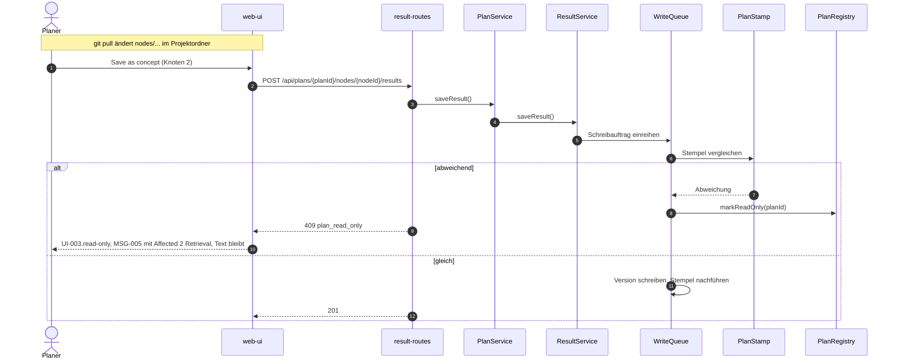

**Prüfhinweise:** AC-REQ-074-01 bis -06 mit echtem `git` in Temp-Repos; Änderung nur an `PLAN.md` sperrt nicht; Messung Stempelvergleich ≤ 50 ms bei 200 Knoten. **Eigene Schreibvorgänge sind nie „von außen“ (FIND-024):** Unit-Test `write-queue.test.ts` – ein Prüfauftrag, der eingereiht wird, während ein Schreibauftrag zwischen Schreiben und Nachführen steht (gesteuerter Haltepunkt), läuft erst danach und findet keine Abweichung; ebenso nach einem Schreibauftrag, der mittendrin scheitert. Integrationstest `test/integration/open-during-writes.test.ts` – Fenster A öffnet Vorhaben und Knoten wiederholt (`GET /api/plans/:planId`, `GET …/nodes/:nodeId`, mindestens 20-mal je Sekunde), während ein Chat-Lauf mit Szenario `parts_5x2s` anhängt und Fenster B Knoten anlegt und einen Teilbaum löscht; Erwartung: das Vorhaben wird nie read-only, kein `readOnly` in den Antworten.

### 2.13 F-13 Export

**Komponenten:** `export-routes`, `PlanService`, `ExportService`, `renderExport`, `AreaStore`; web-ui Kopfzeile, `Banner`.

**Endpunkt.** `POST /api/plans/:planId/export` mit `{}` → `200 {relativePath: ".ramifold/plans/<planId>/PLAN.md", exportedAt}`; `404`, `409 plan_read_only`, `500 save_failed`. Stempelprüfung wie jede schreibende Aktion; dann `PLAN.md` atomar vollständig neu (Temp-Datei, `rename`). Ramifold liest `PLAN.md` nie; Handänderungen werden überschrieben (CC-03).

**Format (`renderExport`, rein, `\n`, UTF-8, abschließender Zeilenumbruch).**

```markdown
# Eigenes produktives RAG

Exported by Ramifold on 2026-11-24 10:42 (UTC+01:00). Each export overwrites this file.

**Objective**

Produktives RAG für interne Dokumente planen

**Result: Fixed plan**

…Inhalt…

## 1 Datenquellen und Ingestion

**Objective**

No objective.

**Result: No result yet**

## 2 Retrieval

…

### 2.1 Chunking

…
```

Regeln: Knoten in Baumreihenfolge; Überschrift `#` × min(Tiefe + 1, 6), dann Nummer (Wurzel ohne) und Titel; Zeitpunkt in lokaler Zeit des Rechners mit Abstand zu UTC; Auftrag leer → „No objective.“; Status `Concept`, `Fixed plan`, `No result yet`; ohne Ergebnis kein Inhaltsblock (AC-REQ-049-01). In Auftrag und Ergebnis werden ATX-Überschriften (`^ {0,3}#{1,6}(\s|$)`) außerhalb von Codeblöcken (` ``` ` bzw. `~~~`) um Tiefe + 1 Ebenen nach unten gerückt, höchstens auf Ebene 6, damit die Gliederung der Baumtiefe entspricht (AC-REQ-049-03). Sonst bleibt der Text unverändert. Chats sind nie enthalten.

**Zustandsabbildung.**

| Zustand | Technisches Verhalten |
|---|---|
| UI-003 Export erfolgreich | MSG-010 mit `relativePath`, schließbar |
| UI-003.error | `500` → MSG-002; `409 plan_read_only` → MSG-005 |
| UI-003.read-only | „Export“ deaktiviert |

**Sequenz – Export (F-13).**

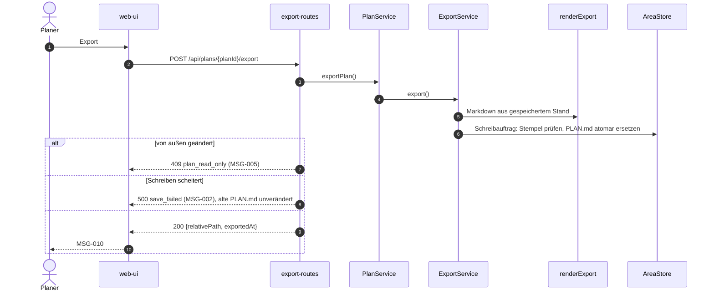

**Prüfhinweise:** AC-REQ-049-01 bis -04 (Snapshot-Test des Formats; Prüfung mit einem Markdown-Parser, dass 2.1 unter 2 gegliedert ist), AC-REQ-004-04, Messung ≤ 5 s im Vorhaben „200 Knoten“.

### 2.14 F-14 Ablage, Git, Integrität, Fehlerprotokoll

**Komponenten:** `AreaStore` mit `areaPaths`, `writeFileAtomic`, `ChatFile`, `AreaInitializer`, `LocalStateFiles`, `ErrorLog`; `ErrorReporter`, `TerminalOutput`.

**Bereich anlegen und ergänzen (Startschritt 7, `AreaInitializer`; FIND-029).** „Erstmaliges Anlegen“ heißt: `area.json` fehlt (und `plans/` fehlt; sonst hat Schritt 5 schon abgebrochen). Weil `plans/` beim erstmaligen Anlegen erst nach `area.json` entsteht, hinterlässt ein abgebrochenes Anlegen nie `plans/` ohne `area.json` (FIND-036). Regel je Datei:

| Datei oder Ordner | Inhalt | Wann Ramifold sie schreibt | Grund |
|---|---|---|---|
| `.ramifold/` | Ordner | bei jedem Start, wenn er fehlt | – |
| `.ramifold/plans/` | Ordner | bei jedem Start, wenn er fehlt, aber **immer erst nach** `area.json` (beim erstmaligen Anlegen als letzter Schritt) | leere Ordner versioniert Git nicht; ein Klon eines Bereichs ohne Vorhaben hat kein `plans/` |
| `.ramifold/local/`, `.ramifold/local/tmp/` | Ordner | bei jedem Start, wenn sie fehlen | rechnerbezogen, nie in Git; fehlen in jedem Klon und jeder Kopie |
| `.ramifold/local/.gitignore` | `*` | bei jedem Start, wenn sie fehlt | rechnerbezogen, keine versionierte Einstellung; hält Sperre, Bestätigung, Fehlerprotokoll und Sitzungen auch dann aus Git, wenn die äußere `.gitignore` geändert wurde (REQ-030, REQ-050) |
| `.ramifold/.gitignore` | `# Created once by Ramifold. Delete the line "plans/*/chats/" to include chats in Git.`<br/>`local/`<br/>`*.tmp-*`<br/>`plans/*/chats/` | **nur beim erstmaligen Anlegen**, exklusiv und atomar: Temp-Datei schreiben, `fsync`, dann `link` auf den Zielnamen (scheitert mit `EEXIST`, wenn es sie schon gibt), Temp-Datei löschen; gibt es sie schon, bleibt sie unverändert. So bleibt nach einem Abbruch nie eine halb geschriebene `.gitignore` stehen. **Rückfall ohne Hardlinks (FIND-037):** Liefert `link` `EPERM`, `ENOTSUP` oder `EOPNOTSUPP` (z. B. exFAT, FAT, manche SMB-Freigaben), wird die Temp-Datei gelöscht und die Datei mit `open(…, "wx")`, einem `write` und `fsync` angelegt (`EEXIST` → vorhandene Datei bleibt unverändert). Weil sie dort nur exklusiv, nicht atomar entsteht, gilt zusätzlich, solange `area.json` fehlt: Ist eine vorhandene `.ramifold/.gitignore` leer oder ein echter Anfang des festgelegten Inhalts, ersetzt `AreaInitializer` sie mit `writeFileAtomic` durch den vollen Inhalt; jede andere vorhandene Datei bleibt unverändert. Jeder andere Fehler von `link` außer `EEXIST` gilt als Scheitern des Anlegens (TERM-002) | versionierte Einstellung „Chats eingeschlossen“; wird nie wiederhergestellt (REQ-051) |
| `.ramifold/area.json` | `{"format": 1, "createdAt": "…"}` | **nur beim erstmaligen Anlegen**, als letzte Datei, atomar | Kennzeichen „Bereich vollständig angelegt“: Ein abgebrochenes erstes Anlegen wird beim nächsten Start vervollständigt |

Reihenfolge beim erstmaligen Anlegen (FIND-036): Ordner `.ramifold/`, `local/`, `local/tmp/`, dann `local/.gitignore`, `.ramifold/.gitignore`, `area.json` und zuletzt `plans/`; jeweils mit `fsync` des Ordners. Bricht das Anlegen an einer beliebigen Stelle ab, fehlt `area.json` oder es fehlt nur `plans/`; in beiden Fällen läuft Schritt 5 durch und Schritt 7 vervollständigt den Bereich. In einem frischen Klon (versioniertes `.ramifold/` mit `area.json`) entstehen also nur `local/`, `local/.gitignore`, `local/tmp/` und gegebenenfalls `plans/`. Die Anleitung (`README.md`, Abschnitt „Include chats in Git“) beschreibt den Schritt: die Zeile `plans/*/chats/` in `.ramifold/.gitignore` löschen und committen.

**Atomares Schreiben (`writeFileAtomic`, REQ-055).** Temp-Datei `<name>.tmp-<8 hex>` im Zielordner, schreiben, `fsync`, `rename` auf den Zielnamen, Ordner öffnen und `fsync`. Neue Ordner werden vor der ersten Datei angelegt und ihr Elternordner gesichert. Chat-Anhängen: `open(…, APPEND_NO_FOLLOW)` (wie `"a"`, zusätzlich `O_NOFOLLOW`, v0.13, N-06), eine oder mehrere ganze Zeilen in **einem** `write`, `fsync`. Gilt erst nach erfolgreichem `fsync` als gespeichert.

**Abgerissenes Ende vor dem Anhängen bereinigen (`ChatFile`, REQ-055, REQ-072; FIND-025).** Nach einem Absturz, einem Ausschalten oder einem teilweise gescheiterten `write` (z. B. `ENOSPC`) kann eine Chat-Datei mit einem Bruchstück ohne abschließendes `\n` enden. Damit das nächste Anhängen daraus keine kaputte Zeile **mitten** in der Datei macht, gilt im selben Schreibauftrag der `WriteQueue`, nach dem Stempelvergleich und vor jedem Anhängen:
1. `ChatFile` liest das letzte Byte der Datei (`fstat`, `read` an Position `size - 1`). Ist es `\n` (oder die Datei leer), wird direkt angehängt.
2. Sonst sucht `ChatFile` rückwärts das letzte `\n` und prüft das Stück dahinter genau wie die Leseregel (Abschnitt 2.3 Regel 3, 3.1): Ist es eine vollständige, gültige Ereigniszeile (nur das `\n` fehlt), wird zuerst `\n` angehängt; die Zeile bleibt, wie sie beim Lesen schon galt. Ist es nicht parsebar, wird die Datei per `ftruncate` auf das Ende der letzten vollständigen Zeile gekürzt; das Bruchstück war nie als gespeichert gemeldet und wurde beim Lesen ignoriert. Eine Datei ganz ohne `\n` kann nicht entstehen, weil die erste Frage die Datei mit Kopfzeile atomar anlegt (2.7); kommt sie von außen, ist das Vorhaben nach 2.3 Regel 3 unlesbar, und es wird nichts angehängt.
3. `fsync`, dann wird angehängt; danach wird der Stempel der Datei im selben Auftrag nachgeführt (Abschnitt 2.12). Scheitert ein Schritt, gilt der Auftrag als gescheitert (`500 save_failed` bzw. Ausgang der KI-Anfrage nach 2.7), und der nächste Anhängeversuch beginnt wieder bei Schritt 1.
Die Prüfung kostet je Anhängen ein `fstat` und ein Lesen von 1 Byte; sie läuft bei jedem Anhängen, damit kein Zustand „Datei sauber“ geführt werden muss. Andere Dateien des Vorhabens sind nicht betroffen (sie werden nur atomar ersetzt).

**Mehrere Chats je Knoten** (nur über Git möglich): Der Chat mit dem frühesten `createdAt` der Kopfzeile (dann kleinste `chatId`) ist der Chat des Knotens; die übrigen werden ignoriert und nicht verändert (kritische Annahme 3). Verwaiste Chats und Ergebnis-Ordner ebenso (Owner-Hinweis 2).

**Vorwärtsverträglichkeit (REQ-065).** Schreibt Ramifold eine bestehende JSON-Datei neu (nur Knotendateien), bleiben ihm unbekannte Felder erhalten. Formatversion `1` in `area.json` und `plan.json`; höher → Startabbruch bzw. unlesbar.

**Fehler melden (`ErrorReporter`, REQ-063).** Für jeden Fall genau eine Zeile auf `stderr` und, wenn `.ramifold/local/` existiert und beschreibbar ist, genau ein Eintrag in `local/errors.log`. **Welche Zeile (v0.13, N-05):** Beim Startabbruch (`startup_failed`) ist die Zeile der TERM-Text aus 2.1, ausgegeben von `TerminalOutput`; `ErrorReporter.recordStartupFailure(cause)` schreibt dazu nur den Protokolleintrag. Für alle anderen Arten schreibt `ErrorReporter.report()` die `[ramifold]`-Zeile unten und den Eintrag; `report()` nimmt `startup_failed` nicht an (Typ ohne diese Art). So entsteht je Startabbruch genau eine Zeile (REQ-063, Schwellwert zu REQ-002/REQ-003). Kein Inhaltstext (keine Titel, Aufträge, Ergebnisse, Nachrichten, keine Ausgabe von Claude Code); erlaubt sind IDs, Nummern, Codes, Exit-Codes, Signale, `errno`-Codes und Pfade im Bereich.

| `kind` | Anlass | Felder |
|---|---|---|
| `startup_failed` | Startabbruch außer zweitem Start; **nur Protokolleintrag**, Terminalzeile ist der TERM-Text (N-05) | `cause`: `invalid_port`, `folder_missing`, `not_a_folder`, `folder_not_writable`, `instance_hanging`, `area_damaged`, `area_newer_version`, `port_in_use`, `unexpected` |
| `ai_request_failed` | KI-Anfrage nicht vollständig, außer `aborted_by_planner`, `external_change`, Knotenlöschung | `cause` (Ursachen-Code), `planId`, `nodeId`, `nodeNumber`, `requestKind`, `detail` (`exit=<code>`, `signal=<sig>`) |
| `ai_session_rebuilt` | Sitzung neu aufgebaut (REQ-029) | `planId`, `nodeId`, `nodeNumber` |
| `save_failed` | Schreiben gescheitert | `cause` (Schreib-Ursache), `planId`, `nodeId`, `nodeNumber`, `detail` (`errno`) |
| `plan_unreadable` | Vorhaben beim Laden unlesbar | `cause`, `planId`, `detail` (Pfad im Bereich) |
| `internal_error` | unerwarteter Fehler | `detail` (Fehlerklasse, ohne Meldungstext) |

Terminalzeile (alle Arten außer `startup_failed`): `[ramifold] <ISO-Zeit UTC> <kind> cause=<cause> plan=<planId> node=<nodeNumber oder root>/<nodeId> <detail>` (fehlende Teile entfallen). Protokolleintrag: eine JSON-Zeile mit `at`, `kind` und denselben Feldern. `ErrorLog` schreibt ihn nur, wenn `.ramifold/` und `.ramifold/local/` echte Ordner sind (`lstat`, kein Link), und öffnet `errors.log` mit `APPEND_NO_FOLLOW`; sonst entsteht kein Eintrag, wie bei nicht beschreibbarem Bereich (N-06).

**Keine symbolischen Links im Bereich (v0.13, N-06; REQ-052).** Git versioniert symbolische Links. Ein präpariertes Repo kann deshalb `.ramifold/`, `.ramifold/local` (das Muster `local/` in `.ramifold/.gitignore` trifft nur Ordner, keinen Link) oder Dateien darin als Link auf Ziele außerhalb des Projektordners mitbringen; ein Anhängen mit `open(…, "a")` oder ein Schreiben in einen verlinkten Ordner landete dann außerhalb. Regel: **Ramifold folgt innerhalb von `.ramifold/` keinem symbolischen Link**, weder beim Lesen noch beim Schreiben. Der Projektordner selbst darf ein Link sein (Schritt 3 löst ihn mit `realpath` auf); Dateien außerhalb von `.ramifold/` liest und schreibt Ramifold ohnehin nicht. Es gibt keine neuen Texte, Zustände oder Codes:

| Stelle | Prüfung | Folge |
|---|---|---|
| Start, Schritt 5 (`AreaInitializer`) | `lstat` auf `.ramifold/`, `area.json`, `.gitignore`, `plans/`, `local/`, `local/tmp/` und jeden Eintrag direkt in `local/` | Link → TERM-010 mit dem Pfad des Links, Exit-Code 1, `startup_failed` mit `cause: "area_damaged"` (Eintrag nur nach der Regel von `ErrorLog`) |
| Laden eines Vorhabens (`loadPlanFromDisk`) | Regel 0 der Lesbarkeitsprüfung (2.3): Einlesen mit `readdir(…, {withFileTypes: true})`, Plan-Ordner mit `lstat` | Link → Vorhaben unlesbar, `cause: "damaged"`, `location` = Pfad des Links (UI-011 „Damaged data“), Eintrag `plan_unreadable` |
| Anhängen (`ChatFile`, `ErrorLog`) | `open` mit `APPEND_NO_FOLLOW` (`O_WRONLY \| O_APPEND \| O_CREAT \| O_NOFOLLOW`) | Chat: `ELOOP` → `500 save_failed` mit `file_system_error` (Zuordnung 2.0); `errors.log`: kein Eintrag |
| Schreiben in `local/` (`LocalStateFiles`, `InstanceLock`), auch die Dateien eines Laufs in `local/tmp/` (v0.14, N-07) | vor jedem Schreiben `lstat` auf `local/` bzw. `local/tmp/`: echter Ordner | Link → wie ein Schreibfehler mit `errno` `ELOOP` (`file_system_error`) |
| Schreiben in einem Vorhaben während des Betriebs | Stempelprüfung vor jedem Schreiben (2.12): ein durch einen Link ersetzter Ordner oder eine ersetzte Datei ändert Pfadmenge oder `ino` | Abweichung → read-only (MSG-005), es wird nicht geschrieben |

Temp-Dateien entstehen mit `"wx"` (`O_EXCL` folgt keinem Link), `rename` ersetzt einen Link am Zielnamen, statt ihm zu folgen; `instance.lock` entsteht mit `"wx"`. Nicht abgedeckt ist ein Wettlauf zwischen Prüfung und Schreiben durch ein Programm, das zur Laufzeit im Projektordner Links anlegt; wer das kann, hat bereits die Rechte des Planers (A-05). `O_NOFOLLOW` gibt es unter Linux und macOS (LP-08); für Windows (ab 0.5) prüft der dortige Slice die Entsprechung. Restrisiko „Dateien in `local/` über Git“ siehe TS-R-14.

**Prüfhinweise:** AC-REQ-050-01/-02, AC-REQ-051-01 bis -03, AC-REQ-052-01/-02, REQ-055 Abbruchschleife, REQ-063 zehn Fälle (Startfälle: genau der TERM-Text auf `stderr`, keine `[ramifold]`-Zeile, N-05); Abschnitt 6. **Symbolische Links (N-06):** Unit-Test `symlink-guard.test.ts` (Link als letzter und als mittlerer Pfadteil, fehlender letzter Teil ist kein Fund); `error-log.test.ts`: `errors.log` und `local` als Link auf ein Ziel außerhalb → kein Eintrag, Ziel byte-gleich; `chat-file.test.ts`: Chat-Datei als Link → `ELOOP`, Ziel unverändert; Integration: Vorhaben mit verlinkter Knotendatei bzw. verlinktem `chats/` → `409 plan_unreadable` mit `cause: "damaged"` und dem Pfad des Links, Ziel unverändert; Startfälle siehe 2.1.

**Kein Sequenzdiagramm:** Ablage und Fehlerprotokoll sind Querschnitt; ihre Abläufe zeigen die Diagramme in 2.1, 2.4, 2.5, 2.7, 2.12 und 2.13.

### 2.15 F-15 Werkzeugfreigabe (nur Zuschnitt, in 0.1 nichts gebaut)

**Owner-Hinweis 1, ADR-004, REQ-024.** In 0.1 gibt es **keinen** Endpunkt, keine Datei `local/tool-policy.json`, keine Oberfläche und kein Lesen einer solchen Datei.

**Was gebaut wird, damit das spätere Nachrüsten nicht verbaut ist:**
- `ToolPolicy` als Datenobjekt in `src/server/agent/tool-policy.ts`, in 0.1 nur mit dem, was die feste Richtlinie braucht:

  ```ts
  export type BuiltinReadTool = "Read" | "Glob" | "Grep" | "WebSearch" | "WebFetch";
  export type ToolPolicy = {
    id: "read-only-planning";
    allowedTools: readonly BuiltinReadTool[];
    readScope: "project_folder";
    deniedReadPaths: readonly string[];   // relativ zum Projektordner
  };
  export const READ_ONLY_PLANNING: ToolPolicy = {
    id: "read-only-planning",
    allowedTools: ["Read", "Glob", "Grep", "WebSearch", "WebFetch"],
    readScope: "project_folder",
    deniedReadPaths: [".ramifold/**"],
  };
  ```

- `buildClaudeArgs(policy, run)` ist die einzige Stelle, die eine Richtlinie in Startoptionen übersetzt (Abschnitt 2.6); `AgentGateway` übergibt immer `READ_ONLY_PLANNING`. Ein späterer Slice erweitert den Typ (Stufen, Skills, MCP-Server) und die Übersetzung, ohne Aufrufer zu ändern.
- `PlanService` ist die einzige Plan-Schnittstelle (Abschnitt 4.3); ein späterer Ramifold-MCP-Server wird ein weiterer Aufrufer. Alle Routen-Module in `src/server/http/routes/` rufen nur Methoden von `PlanService` auf; ausgenommen sind `instance-routes` (Instanzangaben aus der Kompositionswurzel) und `event-routes` (`WindowHub`). `PlanService` enthält keine eigene Fachregel, sondern delegiert an die Dienste in `src/server/plan/` (so zeigen es alle Feature-Sequenzen in 2.3 bis 2.13). Methoden, je Endpunkt eine: `listPlans`, `createPlan`, `openPlan` (2.3); `addNode`, `updateNode`, `moveNode`, `getDeletionImpact`, `deleteNode`, `openNode` (2.4); `acquireResultLock`, `getResultLock`, `releaseResultLock`, `saveResult` (2.5); `abortAiRequest` (2.6); `sendChatMessage`, `resendChatMessage` (2.7); `previewContext` (2.8); `requestSuggestions`, `acceptSuggestions`, `discardSuggestions` (2.9); `requestSummary` (2.10); `getConsent`, `confirmConsent` (2.11); `exportPlan` (2.13). Eine ESLint-Regel (`no-restricted-imports`) verbietet `src/server/http/**` jeden Import aus `src/server/plan/**` außer `plan-service.ts` und jeden Zugriff auf `node:fs` außerhalb von `src/server/area/**`.
- `local/.gitignore` mit `*` hält künftige Richtliniendateien aus Git.

**Prüfhinweise:** Unit-Test der Argumentliste (keine Schreib- und Ausführwerkzeuge, kein MCP, keine Skills); Lint-Regel in CI. Kein Sequenz- oder Zustandsdiagramm: Es wird kein Ablauf gebaut.

---

### 2.16 Darstellung: Schriften, Symbole, Tokens (Querschnitt, Design v0.4.6)

**Komponenten:** nur `web-ui`; Einheiten `Icon`, `IconButton`, `TreeRowTooltip`, `treeRowText`, `StatusBadge`, `Banner`, `ToastRegion`, `ModalDialog`, `AppHeader`, `WorkspaceScreen`, `PlanTree`, `NodeHeader`, `ChatSection`, `ContextPanel`, Stile `tokens.css`, `base.css`, `fonts.css`, Schriftdateien in `src/web/assets/fonts/`. Kein Endpunkt und kein Datenformat hängt an diesem Abschnitt; Verhalten nur beim Auf- und Zuklappen der Planspalte unter 1024 px (fensterlokal, ohne Server).

**Quelle.** `docs/ux/DESIGN.md` (Look „Werkbank“) im Stand von Design v0.4.6, Commit `5f68ce7` (`DESIGN.md` gegenüber v0.4.5 `e3b6051` unverändert; v0.4.5 brachte gegenüber v0.4.4 `3b6215f` nur die Klarstellungen zu FIND-028: Rolle der Warnbanner, Anfangszustand der Planspalte), mit der Icon-Tabelle, dem Absatz „Bewusst ohne Symbol“ und den Symbolen je Zustand in `screens/*/screen.md` (UI-003 Abschnitt „Symbole der Meldungen“). Werte, die `DESIGN.md` nur beim Namen nennt (z. B. `code-bg`, `tree-muted`, Kopfzeilen-Tokens, Schriftgrößen, `--icon-stroke`), stammen aus dem `:root`-Block von `docs/ux/mockups/base.css`, den `DESIGN.md` als „Quelle der Mockup-Werte“ angibt. Darüber hinaus ist das Mockup-HTML nur visuelle Referenz; Markup und Klassen werden nicht übernommen.

**Schriften (`fonts.css`, Dateien in `src/web/assets/fonts/`).**
- IBM Plex Sans 400, 500, 600, 700 und IBM Plex Mono 400, jeweils `normal` (DESIGN.md, Typografie). Kursivschnitte lädt das Design nicht; Markdown-Hervorhebung `*text*` stellt der Browser schräg dar.
- Herkunft: offizielle Veröffentlichung von IBM, npm-Pakete `@ibm/plex-sans` 2.0.0 und `@ibm/plex-mono` 2.5.0, Ordner `fonts/split/woff2/` (Teildateien, die IBM selbst erstellt). Übernommen werden **unverändert** die 20 Dateien `IBMPlexSans-{Regular,Medium,SemiBold,Bold}-{Latin1,Latin2,Latin3,Pi}.woff2` und `IBMPlexMono-Regular-{Latin1,Latin2,Latin3,Pi}.woff2` (zusammen ca. 270 KB) sowie IBMs `LICENSE.txt` als `IBM-Plex-LICENSE.txt`. Sie liegen im Repository; `src/web/assets/fonts/SOURCES.md` nennt je Datei Paket, Version, Pfad und SHA-256.
- Die IBM-Pakete sind **keine** npm-Abhängigkeit: Ihr `postinstall`-Skript `ibmtelemetry` sendet bei `npm ci` Nutzungsdaten an IBM. Fontsource-Pakete scheiden aus, weil ihre Teilmengen nicht von IBM stammen und „Plex“ ein reservierter Schriftname ist (Baseline Abschnitt 3).
- Je Datei ein `@font-face`: `font-family` `"IBM Plex Sans"` bzw. `"IBM Plex Mono"`, `font-weight` 400/500/600/700, `font-style: normal`, `font-display: swap`, nur `src: url(…) format("woff2")` (kein `local()`, damit jede Maschine gleich rendert), `unicode-range` wörtlich aus IBMs `css/ibm-plex-sans-default.css` bzw. `css/ibm-plex-mono-default.css` derselben Paketversion. Der Browser lädt nur Teile, deren Zeichen vorkommen; im Normalfall Latin1.
- Schriftstapel als Tokens: `--font-sans: "IBM Plex Sans", system-ui, -apple-system, "Segoe UI", Roboto, Arial, sans-serif`; `--font-mono: "IBM Plex Mono", ui-monospace, Menlo, Consolas, monospace`. Zeichen außerhalb der Teile (z. B. chinesische Schrift, Emoji) zeigt der Browser in der Ersatzschrift; das Layout hängt laut Design nicht von den Schriftmetriken ab.
- Build: Vite übernimmt die Dateien mit Hash nach `dist/web/assets/`; `build.assetsInlineLimit: 0`, damit keine `data:`-URL entsteht (CSP `font-src 'self'`, Abschnitt 2.2).

**Symbole (`Icon`).**
- Paket `lucide-react` (ISC, Feather-Symbole MIT; Version über `package-lock.json` fest, bei Erstellung 1.79.0), nur Build-Abhängigkeit ohne Installationsskripte. Vite übernimmt nur importierte Symbole ins Bundle. Jedes Symbol ist Inline-SVG im React-Baum; kein Sprite, kein Nachladen.
- `lucide-react` wird nur in `Icon.tsx` importiert (ESLint `no-restricted-imports` überall sonst). `Icon` nimmt einen **Bedeutungsnamen** (`IconName`), nicht den Lucide-Namen; die Konstante `ICON_MAP` in `Icon.tsx` bildet ihn auf das Lucide-Symbol ab. So bleibt „ein Icon, eine Bedeutung“ (DESIGN.md) im Code an einer Stelle.
- Darstellung: `strokeWidth` 1,75; Größe 1,15 em, in Baumzeile und Pillen 14 px, in der Marke „Draft“ der Baumzeile 12 px, im Kopf eines Warn- oder Fehlerdialogs 22 px (`mockups/base.css`, `.dialog .head .i`) (Prop `size: "inline" | "compact" | "mini" | "heading"`); Farbe `currentColor`, gesetzt durch die Umgebung (Token laut Spalte „Farbe“ der Icon-Tabelle). Attribut `data-icon="<IconName>"` für Tests. Immer `aria-hidden="true"` und `focusable="false"`: Den zugänglichen Namen trägt das Element (Zeile, Schaltfläche, Marke), nie das Symbol; so wird nichts doppelt angesagt. `ai-running` dreht sich dezent und steht bei `prefers-reduced-motion: reduce` still.

`ICON_MAP` (abschließend nach der Icon-Tabelle von `DESIGN.md` v0.4.4; 35 Bedeutungen, 34 verschiedene Symbole). Einzige Doppelnutzung eines Symbols ist die Ausnahme, die `DESIGN.md` selbst nennt: `breadcrumb-separator` (dekorativer Brotkrumen-Trenner) und `expand` sind beide `ChevronRight` (AL-04). Zeilen der Icon-Tabelle, die dieselbe Bedeutung nur in anderer Farbe nennen, sind **keine** eigene Bedeutung: „Warnbanner“ und „Warnung“ → `warning`; „Auf-/Zuklappen der Planspalte“ und „Auf-/Zuklappen“ → `expand`/`collapse`; die Farbe setzt die Umgebung. Abgleich mit `lucide-react` 1.79.0 und `docs/ux/mockups/icons.svg` (34 Symbole, in v0.4.4 unverändert, Commit `3b6215f`, MAR-1404):
- Alle 34 Design-Namen sind in `lucide-react` 1.79.0 vorhanden. Zwei davon sind dort nur noch **Alias** eines umbenannten Symbols: `triangle-alert` → `triangle-exclamation-point` (Export `TriangleAlert` = `TriangleExclamationPoint`) und `trash-2` → `trash` (Export `Trash2` = `Trash`). `ICON_MAP` importiert immer den **kanonischen** Export (Spalte „Lucide“), damit ein späteres Entfernen der Aliase den Build nicht bricht (TS-R-08). Die Zeichnung ist dieselbe.
- 33 Symbole sind in Pfaden und Formen identisch mit `icons.svg`. `file-pen` (Marke „Draft“) ist in `lucide-react` 1.79.0 neuer gezeichnet (abgerundete Blattecke, Stift leicht versetzt) als im Mockup; dasselbe Symbol, gleiche Bedeutung. Maßgeblich ist das Paket; `icons.svg` ist visuelle Referenz (Hinweis an den Designer in 8.3, keine Lücke).

| `IconName` | Lucide (kanonischer Export, Design-Name) | Bedeutung laut `DESIGN.md` | Verwendung (Screen / Zustand) |
|---|---|---|---|
| `status-none` | `CircleDashed` (`circle-dashed`) | kein Ergebnis | Baumzeile, Statuspille (UI-003.default, UI-003.empty, UI-004) |
| `status-concept` | `CircleDot` (`circle-dot`) | Concept | dito |
| `status-fixed` | `CircleCheck` (`circle-check`) | Fixed plan (auch Schaltfläche „Save as fixed plan“, dieselbe Bedeutung) | dito; außerdem Primärschaltfläche „Save as fixed plan“ in `ResultEditor` (UI-004.default, Farbe `on-primary`) |
| `ai-running` | `LoaderCircle` (`loader-circle`) | KI läuft (nur diese Bedeutung; Lade- und Wartetexte ohne Symbol) | Markierung „AI running“ im Baum (`PlanTree`) und Laufanzeige „AI request running in <Nr> <Titel>“ im Chat des auslösenden Fensters und im geöffneten Knoten anderer Fenster (`ChatSection`; UI-003.default, UI-003.disabled, UI-004, UI-005.loading), Farbe `info`, Text daneben `text-muted` |
| `info` | `Info` (`info`) | Info-Banner | `Banner` `info`, Farbe `info-text`: MSG-011 (UI-003.permission, mit „Check again“), Rückfluss-Hinweis (`ResultSection`), „There is an unsaved AI draft for this node.“ (`ResultSection`), Entwurfshinweis in UI-004 in allen drei Varianten (`ResultEditor`, AL-02). **Nicht** MSG-008 (Systemzeile ohne Symbol, AL-01) |
| `error` | `CircleX` (`circle-x`) | Fehlerzustand (jedes Fehlerbanner, Fehlerdialog UI-011, Fehlertext UI-008, Validierungsfehler am Feld, Marken „incomplete“, „not sent“, „not saved“) | `Banner` `error`, Farbe `error-text`: MSG-001, -002, -004, -005 (auch ganzes Fenster), -015, -016, `ServerDownBanner` MSG-013, „The projects could not be loaded. …“ (UI-001.error), Banner in den Dialogen UI-002, UI-006, UI-007 (`DeleteNodeDialog`, UI-007.error), UI-009 und im Arbeitsbereich von UI-004; Marken „not sent“, „incomplete“ und „not saved“ (MSG-012) an Nachrichten (UI-003.error, UI-003.read-only), Farbe `error-text` auf `error-bg`; Feldfehler (UI-002, UI-004, UI-005, UI-006 je `.validation`), Farbe `error`; Fehlertext in UI-008.error (`ContextPanel`), Farbe `error` (AL-07); Kopf des Fehlerdialogs UI-011 (`UnreadableProjectDialog`), Farbe `error` |
| `aborted` | `CircleSlash` (`circle-slash`) | Marke „aborted“ (vom Planer gestoppt) | Marke an einer KI-Antwort nach „Stop“ (UI-003.error) |
| `simulated-ai` | `FlaskConical` (`flask-conical`) | Marke „Simulated AI“ | Kopfzeile im simulierten Modus (UI-001, UI-003) |
| `draft` | `FilePen` (`file-pen`) | Marke „Draft“ (Baumzeile) | Markierung „Draft“ in der Baumzeile (UI-003, UI-004) |
| `ai-sender` | `Bot` (`bot`) | Absender „AI“ im Chat | `ChatMessageView` (UI-003.default, .error, .permission) |
| `close` | `X` (`x`) | Schließen (Dialog, Panel) | Icon-Schaltfläche „Close“ in Dialogen und Panel, die sie laut `screen.md` haben: UI-002, UI-006 (`ModalDialog` mit Prop `showClose`), UI-008 (`ContextPanel`) |
| `warning` | `TriangleExclamationPoint` (`triangle-alert`; Alias `TriangleAlert` nicht verwenden) | Warnung (Warnbanner, Kopf der Warndialoge UI-007 und UI-010, Marke „Not readable“) | `Banner` `warn`, Farbe `warning-text`: MSG-003, Banner von MSG-007, MSG-009 (Design v0.4.4, DL-04 geschlossen); Kopf des Löschdialogs UI-007 (`DeleteNodeDialog`, Farbe `error`; DL-03 geschlossen), Kopf des Ersetzen-Dialogs UI-010 (`ReplaceDraftDialog`, Farbe `status-concept`), Marke „Not readable“ (`ProjectListScreen`, UI-001.permission/.disabled, Farbe `error-text` auf `error-bg`, seit Design v0.4.4) |
| `locked` | `Lock` (`lock`) | Ergebnis gesperrt / Marke „Read-only“ | „being edited in another window“ (UI-003.permission), Marke „Read-only“ (UI-003.read-only) |
| `image-link` | `Image` (`image`) | Bild-Link | `MarkdownView` (REQ-061) |
| `rename` | `TextCursorInput` (`text-cursor-input`) | Umbenennen | Knotenaktion (UI-003) |
| `edit-objective` | `FileText` (`file-text`) | Auftrag bearbeiten | Knotenaktion (UI-003) |
| `add-child` | `Plus` (`plus`) | Unterpunkt hinzufügen | Knotenaktion (UI-003) |
| `new-project` | `FolderPlus` (`folder-plus`) | Neues Vorhaben | „New project“ (UI-001.default in der Titelzeile, UI-001.empty im Leerbereich) |
| `move-up`, `move-down` | `ArrowUp`, `ArrowDown` | nach oben / nach unten | Knotenaktionen (UI-003, UI-003.disabled an den Enden) |
| `edit-result` | `Pencil` (`pencil`) | Ergebnis bearbeiten (nur diese Bedeutung) | Abschnitt „Result“ (UI-003) |
| `summarize` | `Sparkles` (`sparkles`) | Zusammenfassen | „Summarize with AI“ (UI-003) |
| `suggest` | `ListTree` (`list-tree`) | Vorschläge | „Suggest sub-items“ (UI-003) |
| `accept` | `Check` (`check`) | Vorschlag übernehmen | „Accept“ je Karte und „Accept all“ (UI-005) |
| `send` | `Send` (`send`) | Senden | „Send“ (UI-003) |
| `stop` | `Square` (`square`) | Stopp | „Stop“ an einer laufenden KI-Anfrage (UI-003) |
| `send-again` | `Undo2` (`undo-2`) | Nachricht erneut senden | „Send again“ an „not sent“/„incomplete“ (UI-003.error) |
| `check-again` | `RefreshCw` (`refresh-cw`) | Sperre erneut prüfen | „Check again“ im Banner MSG-011 (UI-003.permission) |
| `show-context` | `Eye` (`eye`) | Kontext | „Show context“ (UI-003) |
| `export` | `Download` (`download`) | Export | Kopfzeile (UI-003) |
| `delete` | `Trash` (`trash-2`; Alias `Trash2` nicht verwenden) | Löschen | „Delete“ im Knotenkopf (UI-003), „Delete permanently“ (UI-007) |
| `discard-draft` | `FileX` (`file-x`) | Entwurf verwerfen | „Discard draft“ (UI-004) |
| `expand`, `collapse` | `ChevronRight`, `ChevronDown` | Auf-/Zuklappen | Klapp-Pfeil der Baumzeile (Farbe `tree-muted`, Zustand über `aria-expanded`); Schaltfläche „Show plan“ (`expand`) / „Hide plan“ (`collapse`) unter 1024 px (`WorkspaceScreen`, Farbe `text`, AL-05) |
| `breadcrumb-separator` | `ChevronRight` (`chevron-right`, dasselbe Symbol wie `expand`) | Brotkrumen-Trenner, dekorativ, ohne eigene Bedeutung (einzige Ausnahme von „ein Icon, eine Bedeutung“ laut `DESIGN.md`) | zwischen „Projects“ und Vorhabentitel in der Kopfzeile (`AppHeader`, UI-003 bis UI-010 über UI-003), Farbe `text-muted` (AL-04) |

Die Design-Lücke DL-01 (Abschnitt 8.3) ist mit Design v0.4.2 geschlossen: Die neun dort vorab festgelegten Bedeutungsnamen (`close`, `aborted`, `simulated-ai`, `accept`, `ai-sender`, `send-again`, `check-again`, `new-project`, `discard-draft`) und `draft` für die Marke „Draft“ im Baum stehen jetzt mit ihrem Symbol in der Tabelle. Die Doppelbedeutungen der Mockups v0.4.1 sind aufgelöst (`undo-2` nur „Send again“, `plus` nur „Add child“, `trash-2` nur „Delete“). Die Farbe je Symbol setzt die Umgebung nach der Spalte „Farbe“ der Icon-Tabelle (z. B. `new-project` `on-primary` auf der Primärschaltfläche, `discard-draft` und `delete` `error`, `aborted` `text-muted`). Neue Bedeutungen kommen nur über die Icon-Tabelle von `DESIGN.md` hinzu (Hotspot 4.4).

**Bewusst ohne Symbol (Design v0.4.4).** Folgende Stellen rendern **kein** `Icon`, auch kein Platzhaltersymbol; die Bedeutung trägt der Text: Erfolgsbanner MSG-010 und alle Toasts in `ToastRegion` („Saved“, „Saved as concept“, „Saved as fixed plan“, „Project created“, „Node added“, „Node deleted“, „No suggestions left“), die Statusmeldungen „Moved to position <n>“ und „Added <Nr> <Titel>“ (AL-03); Systemzeile MSG-008 in `ChatSection` (AL-01); Abweisungsseite MSG-014 (`requestGuard`, kein Ramifold-Layout) und alle Terminalzeilen TERM-*; Lade- und Wartetexte („Loading plan…“, „Loading node…“, „Loading projects…“, „Loading context…“, „Creating…“, „Saving…“, „Deleting…“, „Accepting…“); Leerzustände („No project in this folder yet.“, „No result yet.“, „No messages yet.“, „No objective.“, „Nothing to preview.“; die Folgeaktion „New project“ trägt `new-project`, die Statuspille „No result yet“ `status-none`); Hinweistexte („A summary is being created. …“, „Unsaved draft“ in der Fußleiste von UI-004, Einleitung in UI-005); Absender „You“ und alle Zeitangaben; Köpfe von UI-002, UI-005, UI-006, UI-008, UI-009 (nur Titel; UI-002, UI-006, UI-008 mit `close`); reine Text-Schaltflächen (Create project, Add node, Save title, Save objective, Cancel, Close, Continue, Keep my draft, Discard, Discard all, Save as concept, Dismiss, Details); Links („Data notice“, „Projects“, Titel in der Vorhabenliste); Tabellenköpfe; „+n“ und der Wurzelknoten im Baum; die Checkbox in UI-009 (Haken des React-Aria-`Checkbox`, kein `Icon`). Das Seitensymbol (Favicon) ist für alle Instanzen gleich und nicht Teil von `ICON_MAP`.

**Kopf der Warn- und Fehlerdialoge (`ModalDialog`, Design v0.4.3, DL-03 geschlossen).** `ModalDialog` hat die Prop `headIcon?: { icon: IconName; tone: "error" | "status-concept" }`. Ist sie gesetzt, hat der Dialog `role="alertdialog"` und zeigt das Symbol (Größe `"heading"`, 22 px, `aria-hidden`) links vor der Überschrift `h2`; die Farbe setzt `tone` über das gleichnamige Token. Symbol und Farbe gehören zum Dialog, nicht zu seinem Zustand: Erscheint im Dialog ein Fehlerbanner, bleibt der Kopf unverändert.

| Dialog | Einheit | `headIcon` | Fehlerbanner im Dialog |
|---|---|---|---|
| UI-007 Löschdialog | `DeleteNodeDialog` | `{ icon: "warning", tone: "error" }` (Warndreieck rot) | UI-007.error: `Banner` `error` mit Symbol `error` (`circle-x`) und MSG-002/-004/-005 |
| UI-010 Ersetzen-Dialog | `ReplaceDraftDialog` | `{ icon: "warning", tone: "status-concept" }` (Warndreieck Bernstein) | keiner (UI-010 hat nur default und read-only) |
| UI-011 Vorhaben nicht lesbar | `UnreadableProjectDialog` | `{ icon: "error", tone: "error" }` (Fehlersymbol rot) | keiner |
| UI-002, UI-006, UI-009 | `CreateProjectDialog`, `NodeFormDialog`, `DataNoticeDialog` | kein Kopfsymbol (`role="dialog"`) | wie in 2.3, 2.4, 2.11 (`Banner` `error`) |

**Banner (`Banner`, Design v0.4.4, DL-04 geschlossen).** Prop `variant: "info" | "warn" | "error" | "success"` setzt Fläche, Rand und Textfarbe (`--info-bg`/`--info-border`/`--info-text`, entsprechend `--warning-*`, `--error-*`, `--success-*`) und das Symbol der Art: `error` → `error` (`circle-x`), `warn` → `warning` (`triangle-alert`), `info` → `info`, `success` → **kein Symbol** (`circle-check` bleibt „Fixed plan“). Die Zuordnung liegt fest in `Banner` (Konstante `BANNER_ICON: Record<BannerVariant, IconName | null>`); Aufrufer wählen nur die Variante, nie das Symbol. Das Symbol übernimmt die Textfarbe des Banners (`currentColor`), so wie `DESIGN.md` es verlangt („Banner tragen das Symbol ihrer Art in der Textfarbe des Banners“). Zuordnung der Meldungen: `error` MSG-001, -002, -004, -005, -013, -015, -016 und „The projects could not be loaded. …“; `warn` MSG-003, MSG-007, MSG-009; `info` MSG-011, Rückfluss-Hinweis, „There is an unsaved AI draft for this node.“, Entwurfshinweis UI-004 (AL-02); `success` nur MSG-010. Marken an Nachrichten folgen der **Art des Zustands**, Banner der **Schwere**: Nach einem Abbruch zeigt die Nachricht die Marke „incomplete“ mit `error`, das Banner MSG-007 darüber `warning`. Rolle (`DESIGN.md` v0.4.5 „Feedback“ und `screen.md` UI-003 „Responsive und Barrierefreiheit“): `error` und `warn` `role="alert"` (Warnbanner MSG-003, MSG-007, MSG-009), `info` und `success` `role="status"`, ebenso Toasts (AL-06, vom Design bestätigt).

**Kopfzeile und Brotkrumen (`AppHeader`, UI-003 und alle Dialoge darüber).** `nav` mit `aria-label="Breadcrumb"`: Link „Projects“ (zu UI-001), dann `Icon` `breadcrumb-separator` (`aria-hidden`, Farbe `text-muted`, AL-04), dann der Vorhabentitel als Text (gekürzt mit „…“). In UI-001 gibt es keine Brotkrumen. Die übrigen Elemente der Kopfzeile (Marken „Simulated AI“, „Read-only“, „Data notice“, „Export“) bleiben wie in 2.12, 2.13 und unten.

**Schmale Breite unter 1024 px (`WorkspaceScreen`, `ResultEditor`, `ModalDialog`; `uiux-design.md` „Geräte“, UI-003 „Responsive und Barrierefreiheit“, AL-05).** Ab 1024 CSS-px zwei Spalten wie im Mockup. Darunter (z. B. 1280-px-Fenster mit Zoom ≥ 125 %, REQ-062) gilt per `@media (max-width: 1023.98px)` in `base.css`:
- Die Planspalte steht als aufklappbarer Bereich **über** dem Arbeitsbereich. Eine Schaltfläche (React Aria `Button`, Text und Symbol) schaltet ihn: zugeklappt „Show plan“ mit `expand`, aufgeklappt „Hide plan“ mit `collapse`; `aria-expanded` und `aria-controls` auf den Bereich mit dem `Tree`. Zugeklappt ist der Bereich per `hidden` aus Ansicht und Tab-Reihenfolge entfernt; der Fokus bleibt auf der Schaltfläche.
- Zustand `planColumnOpen` fensterlokal im Speicher von `WorkspaceScreen`, **Anfangswert offen** („Hide plan“, `aria-expanded="true"`; AL-05, vom Design v0.4.5 bestätigt, in v0.4.6 auch in `UI-003/screen.md` eindeutig, H-08), unverändert beim Wechsel des Knotens; nicht gespeichert, kein Server. Ab 1024 px ist die Schaltfläche ausgeblendet und der Baum immer sichtbar, unabhängig vom Zustand. Umsetzung nur mit CSS und dem Attribut `data-plan-open` am Rahmen von `WorkspaceScreen`; kein `matchMedia` im Code.
- Arbeitsbereich einspaltig, Icon-Zeile des Knotenkopfes bricht um (`NodeHeader`, `flex-wrap`), UI-004 stapelt Quelltext über Vorschau (`ResultEditor`), Dialoge sind so breit wie das Fenster abzüglich 16 px (`ModalDialog`).

**Design-Tokens (`tokens.css`).**
- Alle Farben, Radien, Größen und Abstände als CSS Custom Properties unter `:root`; Namen wie in `DESIGN.md` und `base.css` mit Präfix `--` (z. B. `--primary`, `--tree-sel-bg`, `--status-concept`, `--concept-bg`, `--info-border`, `--focus`, `--r-s`, `--row-h`, `--fs-tree`), Werte unverändert übernommen. Komponenten-CSS nutzt nur Tokens, keine eigenen Farbwerte.
- Fokus: `:focus-visible` und `[data-focus-visible]` (React Aria) mit `outline: 2px solid var(--focus); outline-offset: 2px`, nie entfernt. Nachgerechnete Kontraste des Fokusrahmens zu allen Flächen 5,0:1 bis 6,4:1 (am niedrigsten auf `tree-sel-bg`). Statussymbole auf der ausgewählten Zeile (`tree-sel-bg`, in `DESIGN.md` nicht genannt): Concept 5,3, Fixed plan 5,2, kein Ergebnis 6,0. Alle Paare erfüllen 3:1 für Symbole und Rahmen bzw. 4,5:1 für Text.
- Größen in `rem` (DESIGN.md); feste Zeilen- und Schaltflächenhöhen als `min-height`, damit Text bei 200 % Zoom nicht abgeschnitten wird (REQ-062, 1.4.4).
- Schatten nur an `ModalDialog` und `ContextPanel`; keine Verläufe (DESIGN.md, „Nicht verwenden“).

**Baumzeile (UI-003, `PlanTree`).**
- Inhalt je `TreeItem`: Klapp-Pfeil (`expand`/`collapse`, nur mit Kindern), Nummer (tabellarische Ziffern), Titel (einzeilig, gekürzt mit „…“), „+n“ bei eingeklapptem Knoten, Markierungen „AI running“ (Symbol `ai-running` + Text) und „Draft“ (Symbol `draft` + Text, Symbol 12 px laut `mockups/base.css`, `.row .draft .i`), Statussymbol rechts. Ausgewählte Zeile: `tree-sel-bg`, `tree-sel-text`, 3-px-Balken `tree-sel-bar`. Keine sichtbare Überschrift „Plan“; der `Tree` hat `aria-label="Plan"`.
- Zugänglicher Name der Zeile (Design v0.4.2, X2 (3), Konkretisierung innerhalb REQ-062): feste Reihenfolge `"<Nummer> <Titel>, <Statuswort>[, Draft][, +<n>][, AI running]"`; ein Teil erscheint nur, wenn das Element an der Zeile sichtbar ist (Draft: `TreeNodeDto.hasAiDraft` oder Eintrag im `inputStore` dieses Fensters, 2.5; „+n“: Knoten eingeklappt und hat Nachkommen; AI running: in diesem Knoten läuft eine KI-Anfrage, `aiRequest` im `windowStore`, 2.7). Die Wurzel hat keine Nummer: `"<Titel>, <Statuswort>…"`. Der Titel steht immer **voll** im Namen, auch wenn er sichtbar gekürzt ist. Beispiele: „2.2 Embedding-Modell, Concept“, „2.2 Embedding-Modell, Concept, Draft, +3“, „2.2 Embedding-Modell, Concept, AI running“, „Eigenes produktives RAG, Concept, +24“. Symbole und Laufanzeige in der Zeile tragen keinen eigenen Namen (`Icon` ist `aria-hidden`; die sichtbaren Texte „Draft“, „+n“ und „AI running“ stehen in Elementen mit `aria-hidden="true"`, damit nichts doppelt angesagt wird). Statuswörter „No result yet“, „Concept“, „Fixed plan“ und die Wörter „Draft“, „AI running“ kommen aus `messages`.
- Umsetzung: Die reine Funktion `treeRowName(row)` aus `treeRowText` bildet den Text; `PlanTree` gibt ihn dem `TreeItem` als `textValue`, React Aria setzt daraus den Namen der Zeile (`row`, `aria-label`). Die Tippsuche im Baum beginnt damit bei der Nummer. Ändert sich ein Teil (Klappen, Entwurf, KI-Lauf), rendert `PlanTree` die Zeile mit neuem `textValue`; Fokus und Auswahl bleiben.
- `Tree` mit `selectionMode="single"` und `disallowEmptySelection`: `Esc` hebt die Auswahl nicht auf und blendet nur den Zeilen-Tooltip aus.

**Tooltip der Baumzeile (`TreeRowTooltip`).** React Aria bietet Tooltips nur für Schaltflächen und Links, nicht für Baumzeilen; deshalb eine kleine eigene Einheit.
- Sichtbar, solange der Mauszeiger auf der Zeile steht oder die Zeile Tastaturfokus hat (`isHovered` bzw. `isFocusVisible` aus den Render-Props von `TreeItem`). Bei Tastaturfokus erscheint er sofort, bei Maus nach `TOOLTIP_DELAY_MS` (600 ms, dieselbe Konstante wie `IconButton`). Er bleibt sichtbar, solange die Zeile den Fokus hat.
- `Esc` blendet ihn aus, bis Fokus und Maus die Zeile verlassen haben (WCAG 1.4.13, „dismissible“). Er grenzt ohne Lücke an die Zeile und bleibt, solange der Mauszeiger auf Zeile oder Tooltip steht; er verschwindet 150 ms nach Verlassen beider („hoverable“). Beim Scrollen des Baums verschwindet er.
- Darstellung in einem Portal unter `document.body`, Lage aus `getBoundingClientRect()` der Zeile (unterhalb, im Fenster gehalten), gesetzt per React-`style` (CSSOM, von `style-src 'self'` erlaubt). `role="tooltip"` mit `aria-hidden="true"`: Das Wort steht bereits im Namen der Zeile, der Tooltip dient nur dem Sehen.
- **Ein** Tooltip je Zeile (Design v0.4.2, DL-02): Ist der Titel sichtbar gekürzt, lautet er `"<voller Titel> · <Statuswort>"` (Trenner Leerzeichen, U+00B7, Leerzeichen; z. B. „Embedding-Modell · Concept“), sonst nur `"<Statuswort>"` (z. B. „Concept“). Ohne Nummer und ohne „Draft“, „+n“, „AI running“; diese stehen sichtbar in der Zeile.
- Gekürzt heißt: Das Titelelement der Zeile hat `scrollWidth > clientWidth` (CSS `text-overflow: ellipsis`). `TreeRowTooltip` misst das in dem Moment, in dem der Tooltip erscheinen soll, an der Referenz auf das Titelelement, die `PlanTree` übergibt; kein Messen bei jedem Rendern, kein `ResizeObserver`. Den Text bildet `treeRowTooltipText(title, statusWord, isTruncated)` aus `treeRowText`.

**Icon-Buttons (`IconButton`, UI-003 Knotenkopf).**
- React Aria `TooltipTrigger` mit `Button` und `Tooltip`; `aria-label` und Tooltip-Text sind gleich, Wortlaut aus dem Design: „Rename“, „Edit objective“, „Add child“, „Move up“, „Move down“. Fläche 32 × 32 px, Symbol `text-muted`, Hover `--hover`. Tooltip-Verzögerung `TOOLTIP_DELAY_MS`, bei Tastaturfokus sofort, `Esc` schließt (React Aria).
- Deaktiviert (z. B. „Move up“ beim ersten Kind, UI-003.disabled, read-only, server-down): `aria-disabled="true"` statt `isDisabled`. Die Schaltfläche bleibt fokussierbar, ihr Tooltip erscheint, ein Drücken bewirkt nichts. Das ist dasselbe Muster wie bei den übrigen deaktivierten Aktionen (Abschnitt 2.7).
- `NodeHeader` zeigt die Icon-Zeile in dieser Reihenfolge: Rename, Edit objective, Add child, Move up, Move down; danach „Delete“ als roter Text-Button mit Symbol `delete` (nicht beim Wurzelknoten). Unter 1024 px bricht die Zeile um (`flex-wrap`). Tab-Reihenfolge wie im Design (UI-003, „Responsive und Barrierefreiheit“).

**Pillen und Marken (`StatusBadge`).** Statuspille im Abschnitt „Result“: Symbol + Wort, Farben `--none-bg`/`--none-text`, `--concept-bg`/`--concept-text`, `--fixed-bg`/`--fixed-text`, Radius voll rund. Zustandsmarken an Nachrichten als Text-Pille mit Symbol und Ursache (Design v0.4.4): „not sent“, „incomplete“ und „not saved“ (MSG-012, DL-04 geschlossen) mit `error`, Symbol und Text in `--error-text` auf `--error-bg` (die Art steht im Text); „aborted“ mit `aborted`, Symbol und Text in `--text-muted` ohne Fläche (AL-06). `StatusBadge` nimmt dafür `kind: "not_sent" | "incomplete" | "not_saved" | "aborted"`; Symbol und Farben hängen nur an `kind`. Marke „Not readable“ in der Vorhabenliste (`ProjectListScreen`) mit `warning`, Farben `--error-text` auf `--error-bg` (Design v0.4.4, wie im Mockup; bis v0.5 dieser Spezifikation `warning-*`). Marken der Kopfzeile „Read-only“ (`locked`) und „Simulated AI“ (`simulated-ai`, Farbe `info`, Tooltip „AI answers are simulated and do not come from a real AI.“ laut `DESIGN.md`) mit Symbol + Text. Absender „AI“ einer Chat-Nachricht: Symbol `ai-sender` + Text „AI“ (`ChatMessageView`). Die neuen Symbolfarben haben auf ihren Flächen mindestens 5,9:1 (`tree-muted` auf `tree-sel-bg`), also mehr als 3:1; `tokens.test.ts` nimmt die Paare `tree-muted`/`tree-sel-bg`, `tree-muted`/`tree-bg`, `text-muted`/`surface`, `info`/`header-bg` und `on-primary`/`primary` auf, seit v0.5 auch die Symbolfarben aus Design v0.4.3 (nachgerechnet): `status-concept`/`bg` 6,8 (Kopf UI-010), `error`/`bg` 6,6 (Kopf UI-007 und UI-011, Feldfehler), `warning-text`/`warning-bg` 8,2 (Banner `warn`), `error-text`/`error-bg` 7,9 (Banner `error`, Marken an Nachrichten, seit v0.6 auch Marke „Not readable“), und seit v0.6 `info-text`/`info-bg` 8,6 (Banner `info`), `success-text`/`success-bg` 7,5 (MSG-010, Text), `info`/`bg` 6,4 (Laufanzeige `ai-running`), `text-muted`/`bg` 7,6 (Marke „aborted“, Brotkrumen-Trenner), `text`/`bg` 16,5 („Show plan“/„Hide plan“).

**Zustandsabbildung (nur Darstellung).**

| Zustand | Technisches Verhalten |
|---|---|
| UI-003.default, UI-003.empty, UI-003.error, UI-003.permission | Baumzeilen mit Statussymbol, Name nach fester Reihenfolge (`treeRowName`), ein Zeilen-Tooltip (`treeRowTooltipText`); Icon-Zeile im Knotenkopf |
| UI-004.default | Baumzeile des bearbeiteten Knotens mit Marke „Draft“ (`draft` + Text), Name „…, Draft“, Tooltip wie oben; „Discard draft“ mit `discard-draft` |
| UI-003.error | Marken „not sent“/„incomplete“ mit `error` (`error-text` auf `error-bg`), „aborted“ mit `aborted`; „Send again“ mit `send-again`; Banner MSG-001 `error`, MSG-007 `warn` (`warning`); Systemzeile MSG-008 ohne Symbol (AL-01) |
| UI-003.read-only (Chat) | eingehende Antwort mit Marke „not saved“ (`error`, `error-text` auf `error-bg`); Banner MSG-005 `error` |
| UI-003.disabled, UI-005.error | MSG-003 als `Banner` `warn` (`warning`); MSG-009 `warn`; MSG-015 `error` |
| UI-003.success, UI-004.success, UI-002/UI-006 Erfolg, UI-005.empty, UI-005.success | Toasts und Statusmeldungen ohne Symbol; Export: `Banner` `success` MSG-010 ohne Symbol, mit „Dismiss“ (AL-03) |
| UI-003.default (Laufanzeige) | „AI request running in <Nr> <Titel>“ mit `ai-running` (`info`) im auslösenden Fenster (mit „Stop“) und im geöffneten Knoten anderer Fenster (ohne „Stop“) |
| UI-003.default (Ergebnis) | Rückfluss-Hinweis und „There is an unsaved AI draft for this node.“ als `Banner` `info` |
| UI-003 bis UI-010 (Kopfzeile) | Brotkrumen „Projects“ › Vorhabentitel mit `breadcrumb-separator` (`aria-hidden`) |
| UI-003, UI-004 unter 1024 px | „Show plan“ (`expand`) / „Hide plan“ (`collapse`) mit `aria-expanded`; Anfangszustand offen (AL-05) |
| UI-004.default, .empty | Entwurfshinweis („AI draft, not saved yet“, „Unsaved changes“, „New result, not saved yet“) als `Banner` `info`, `role="status"` (AL-02); „Unsaved draft“ in der Fußleiste ohne Symbol |
| UI-004.error, UI-004.server-down | `Banner` `error` (MSG-002/-004/-005 bzw. MSG-013) |
| UI-008.error | Fehlertext mit `error` in Farbe `error` (AL-07) |
| UI-001.error, UI-002.error, UI-006.error, UI-009.error | `Banner` `error` mit `error` |
| UI-003.permission | „Check again“ im Banner MSG-011 (`info`) mit `check-again` |
| UI-005.default | „Accept“ und „Accept all“ mit `accept` |
| UI-001.default, UI-001.empty | „New project“ mit `new-project` |
| UI-003.disabled | „Move up“/„Move down“ an den Enden sowie Send, Suggest, Summarize mit `aria-disabled`, fokussierbar, Tooltip bzw. Meldung wie in 2.4 und 2.7 |
| UI-003.permission (Ergebnis) | `locked` mit „being edited in another window“ |
| UI-003.read-only | Marke „Read-only“ mit `locked`; alle `IconButton` `aria-disabled` |
| UI-003.server-down | alle `IconButton` `aria-disabled`; Banner ohne Schließen |
| UI-002.validation, UI-004.validation, UI-005.validation, UI-006.validation | Feldfehler mit `error` (Farbe `error`), Rand 2 px `--error` |
| UI-001.permission / UI-001.disabled | Marke „Not readable“ mit `warning` + Text, `error-text` auf `error-bg` |
| UI-004.default | „Save as fixed plan“ (Primärschaltfläche) mit `status-fixed`, Farbe `on-primary` |
| UI-007.default, UI-007.loading | `DeleteNodeDialog`: `alertdialog`, Kopf `warning` in `error` |
| UI-007.error | Kopf unverändert; `Banner` `error` im Dialog mit Symbol `error` |
| UI-010.default, UI-010 read-only | `ReplaceDraftDialog`: `alertdialog`, Kopf `warning` in `status-concept` |
| UI-011.default | `UnreadableProjectDialog`: `alertdialog`, Kopf `error` in `error` |

**Prüfhinweise:** Unit-Test `tree-row-text.test.ts`: `treeRowName` für Wurzel ohne Nummer, jede Kombination aus Draft, +n und AI running in der festen Reihenfolge, voller Titel bei Überlänge; `treeRowTooltipText` mit und ohne Kürzung („Embedding-Modell · Concept“ bzw. „Concept“). E2E im Seed `default`: `getByRole('row', { name: '2.2 Embedding-Modell, Concept' })` bei ausgeklapptem Knoten ohne Entwurf; nach Zuklappen eines Knotens mit Nachkommen endet der Name auf „, +<n>“, nach „Edit result“ und Wechsel zu einem anderen Knoten enthält er „, Draft“ vor „+n“. Tooltip der Zeile bei Tastaturfokus sichtbar, Inhalt nur Statuswort; bei einem Knoten mit langem Titel (Seed `default` enthält einen Titel, der bei 320 px Baumbreite gekürzt wird) „<voller Titel> · <Statuswort>“; `Esc` blendet ihn aus und die Auswahl bleibt; genau ein Element `role="tooltip"` im Dokument; deaktiviertes „Move up“ ist per Tab erreichbar, zeigt den Tooltip und bewirkt nichts. Unit-Test `icon-map.test.ts`: `ICON_MAP` enthält genau die 35 Bedeutungen der Icon-Tabelle von `DESIGN.md` v0.4.4 (gepflegte Liste im Test), kein Lucide-Symbol kommt zweimal vor **außer** dem Paar `expand`/`breadcrumb-separator` (`ChevronRight`, als einzige Ausnahme im Test benannt), und `Icon.tsx` importiert keinen Alias (`TriangleAlert`, `Trash2`; ESLint `no-restricted-imports` mit `importNames`). Unit-Test `banner.test.tsx`: `BANNER_ICON` ist `error` → `error`, `warn` → `warning`, `info` → `info`, `success` → `null`; ein `success`-Banner rendert kein Element mit `data-icon`. Unit-Test `status-badge.test.tsx`: `not_sent`, `incomplete`, `not_saved` → `error`, `aborted` → `aborted`. E2E (Playwright, keine neue Abhängigkeit): Löschdialog (Seed `default`) und Ersetzen-Dialog sind `role="alertdialog"` mit Kopfsymbol `warning`, der Dialog zu UI-011 (Seed `unreadable`) mit `error`; die Marke „Not readable“ trägt `warning`; „Save as fixed plan“ trägt `status-fixed`; nach „Export“ zeigt MSG-010 kein `data-icon`; ein erzwungenes `409 ai_request_running` zeigt MSG-003 mit `warning`; die Systemzeile MSG-008 (Szenario `session_unknown_then_ok`) hat kein `data-icon`; die Kopfzeile von UI-003 hat genau ein `breadcrumb-separator`. Geprüft über das Attribut `data-icon`, das `Icon` mit dem Bedeutungsnamen setzt. Der Zustand UI-007.error (Banner `error`, Kopf bleibt `warning`) wird mit einem per `page.route` erzwungenen `500 save_failed` geprüft. E2E schmale Breite: Viewport 1000 × 800 (entspricht 1280 px bei 128 % Zoom): „Hide plan“ mit `aria-expanded="true"` sichtbar, Baum sichtbar; Klick → „Show plan“, `aria-expanded="false"`, Baum nicht in der Tab-Reihenfolge; Wechsel des Knotens ändert den Zustand nicht; bei 1280 × 800 keine Schaltfläche. Unit-Test `tokens.test.ts`: liest `tokens.css` und prüft die Kontrastpaare aus `DESIGN.md` und dieser Spezifikation mit der WCAG-Formel (Text ≥ 4,5:1; Symbole, Rahmen, Fokus ≥ 3:1). Build-Prüfung in CI: `dist/web` enthält genau die 20 Schriftdateien mit den Prüfsummen aus `SOURCES.md` und keine URL außer der eigenen Herkunft; `offline.sh` (Abschnitt 5) läuft mit allen Schriften und Symbolen.

---

## 3. Datenmodell im Detail

Verfeinert Baseline Abschnitt 4 (Entitäten, Ablageorte) um Felder und Regeln. **Migrationen:** keine; Slice 0.1 legt Formatversion `1` neu an. Alle JSON-Dateien sind UTF-8, mit zwei Leerzeichen eingerückt und mit abschließendem Zeilenumbruch geschrieben (gut lesbare Git-Diffs); Zeitpunkte ISO-8601 UTC.

### 3.1 Plandaten (versioniert, außer Chats per Voreinstellung)

**`.ramifold/area.json`**

| Feld | Typ | Regel |
|---|---|---|
| `format` | integer | `1`; > 1 → Startabbruch TERM-011 |
| `createdAt` | string (ISO) | Anlagezeitpunkt des Bereichs |

**`plans/<planId>/plan.json`**

| Feld | Typ | Regel |
|---|---|---|
| `format` | integer | `1`; > 1 → unlesbar `newer_version` |
| `id` | ULID | = Ordnername |
| `createdAt` | string (ISO) | Anlagedatum in der Liste (REQ-006) |
| `profile` | `"software"` | in 0.1 immer `software` (REQ-065 Nr. 7) |

**`plans/<planId>/nodes/<nodeId>.json`**

| Feld | Typ | Regel |
|---|---|---|
| `id` | ULID | = Dateiname |
| `parentId` | ULID \| null | `null` genau bei der Wurzel |
| `position` | string | Positionsschlüssel (fraktionaler Index, Zeichen `0-9A-Za-z`) |
| `title` | string | getrimmt, 1 bis 200 Codepunkte; Titel der Wurzel = Titel des Vorhabens |
| `objective` | string | beliebig, darf leer sein |
| `createdAt`, `updatedAt` | string (ISO) | – |
| *weitere Felder* | – | unbekannt in 0.1; beim Neuschreiben unverändert übernommen |

**`plans/<planId>/results/<nodeId>/<versionId>.json`** (nur anlegen, nie ändern)

| Feld | Typ | Regel |
|---|---|---|
| `id` | ULID | = Dateiname |
| `nodeId` | ULID | = Ordnername |
| `status` | `"concept" \| "fixed"` | – |
| `content` | string | nach Trimmen nicht leer |
| `createdAt` | string (ISO) | jüngste Version nach `(createdAt, id)` ist das aktuelle Ergebnis |

**`plans/<planId>/chats/<chatId>.jsonl`** (nur anhängen; je Zeile ein JSON-Objekt mit Feld `t`)

| `t` | Felder | Bedeutung |
|---|---|---|
| `chat` (nur erste Zeile) | `id` (ULID = Dateiname), `nodeId`, `createdAt` | Kopfzeile, ordnet den Chat seinem Knoten zu |
| `planner_message` | `id`, `text`, `at` | Frage des Planers (Status anfangs `sent`) |
| `planner_status` | `id`, `status: "sent" \| "not_sent"`, `cause` (bei `not_sent`), `at` | Statuswechsel einer Frage |
| `ai_start` | `id`, `replyTo`, `sessionRebuilt`, `at` | Beginn einer KI-Antwort auf die Frage `replyTo` |
| `ai_text` | `id`, `text` | Textteil(e) der Antwort `id` |
| `ai_end` | `id`, `status: "complete" \| "incomplete" \| "aborted"`, `cause` (bei `incomplete`, `aborted`), `at` | Abschluss der Antwort |

Unbekannte Werte von `t` werden beim Lesen ignoriert (Vorwärtsverträglichkeit). Eine letzte Zeile ohne Zeilenumbruch, die nicht parsebar ist, wird beim Lesen ignoriert und vor dem nächsten Anhängen entfernt; eine gültige letzte Zeile ohne Zeilenumbruch gilt und erhält vor dem nächsten Anhängen ihr `\n` (Abschnitt 2.14, REQ-055). Jede andere nicht parsebare Zeile macht das Vorhaben `damaged` (2.3 Regel 3).

**`plans/<planId>/PLAN.md`** – Export, abgeleitet, keine Plandaten (Abschnitt 2.13).

### 3.2 Rechnerbezogene Daten in `.ramifold/local/` (nie versioniert)

| Datei | Inhalt |
|---|---|
| `consent.json` | `{"confirmedAt": "<ISO>", "noticeVersion": 1}` |
| `sessions.json` | `{"sessions": {"<chatId>": {"agent": "claude-code", "sessionId": "<string>", "contextFingerprint": "<sha256 hex>", "historyThroughMessageId": "<ULID>" \| null, "knownThroughMessageId": "<ULID>", "updatedAt": "<ISO>"}}}`; unlesbar → wie leer behandelt und beim nächsten Schreiben ersetzt. Nur Chat-Läufe schreiben hier; Abzweigungen und einmalige Sitzungen von Vorschlägen und Zusammenfassungen werden nie eingetragen (2.8). Ein Eintrag, dessen `sessionId` nicht `^[A-Za-z0-9][A-Za-z0-9_-]{0,127}$` erfüllt, gilt als fehlend (2.6). **v0.10 (Owner-Entscheidung a):** neues Feld `knownThroughMessageId` = ID der Antwort des letzten Chat-Laufs dieser Sitzung (2.7, 2.8); ein Eintrag ohne das Feld gilt als „Sitzung kennt den Chat nicht“ (neue Sitzung mit Verlauf, kein MSG-008), kein Datenumbau, keine Formatversion (Begründung 2.8); unbekannte Felder im Eintrag sind erlaubt |
| `instance.lock` | `{"pid": <int>, "port": <int>, "instanceId": "<uuid>", "projectFolder": "<kanonischer Pfad>", "startedAt": "<ISO>"}` |
| `errors.log` | JSON-Zeilen nach Abschnitt 2.14 |
| `tmp/<requestId>.context.md`, `tmp/<requestId>.settings.json` | Dateien eines laufenden Agent-Laufs; Name und Inhalt vom Adapter (`AgentPort.runFiles`), vor dem Start von `LocalStateFiles.writeRunFiles` geschrieben (v0.14, N-07); nach dem Lauf (`deleteRunFiles`) und beim Start (`clearTempDir`) gelöscht |

**Dateien des Ramifold-Bereichs mit Feldern – Welche Dateien gibt es, und wie hängen sie zusammen?**
Vereinfacht: `PLAN.md` und Temp-Dateien sind nicht dargestellt.

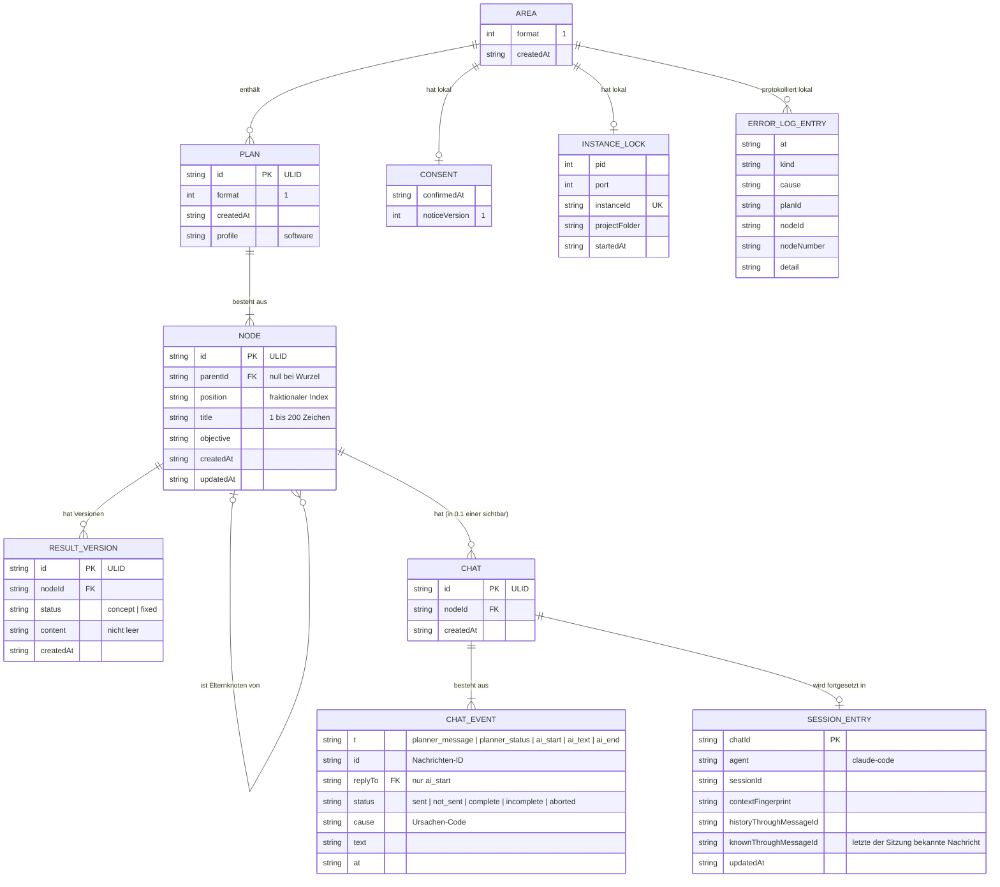

### 3.3 Laufzeitmodell (nur im Speicher)

**Laufzeitzustand der Instanz – Was hält `ramifold-server` nur im Speicher?**

```mermaid
classDiagram
  class InstanceState {
    +string instanceId
    +AgentFinding agent
    +boolean simulated
  }
  class PlanRuntime {
    +string planId
    +"unloaded" | "writable" | "read_only" | "unreadable" state
    +PlanStamp stamp
    +string detectedAt
  }
  class WindowConnection {
    +string windowId
    +string connectedAt
  }
  class AiRequest {
    +string requestId
    +"chat" | "suggest" | "summarize" kind
    +string planId
    +string nodeId
    +string windowId
    +string aiMessageId
    +string startedAt
  }
  class AiDraft {
    +string draftId
    +string nodeId
    +string content
    +string createdAt
  }
  class Suggestion {
    +string suggestionId
    +string nodeId
    +string title
    +string objective
  }
  class EditLock {
    +string nodeId
    +string windowId
    +"free" | "held" | "releasing" state
  }
  class AgentFinding {
    +"checking" | "ok" | "not_found" | "too_old" status
    +string version
  }
  InstanceState "1" *-- "0..*" PlanRuntime : lädt
  InstanceState "1" *-- "0..*" WindowConnection : verbunden
  InstanceState "1" *-- "0..1" AiRequest : höchstens eine
  InstanceState "1" *-- "1" AgentFinding : letzter Befund
  PlanRuntime "1" *-- "0..*" AiDraft : je Knoten höchstens einer
  PlanRuntime "1" *-- "0..*" Suggestion : offene Vorschläge
  PlanRuntime "1" *-- "0..*" EditLock : je Ergebnis höchstens eine
  WindowConnection "1" --> "0..*" EditLock : hält
```

---

## 4. Code-Struktur

Die Codebasis ist leer (nur `docs/`). **Alle Einheiten sind neu.** Spätere Slices erweitern diese Karte und benennen keine Einheit um.

### 4.1 Ordner und Schichten

```text
bin/ramifold.cjs                 Starter (Node-Prüfung)
start.sh                         Abnahme-Start aus dem Klon
src/shared/                      Typen und Schemata für Server und Oberfläche
src/server/                      ramifold-server (Node.js, Fastify)
  ramifold-server.ts             Kompositionswurzel (Build: dist/server/ramifold-server.mjs)
  cli/  startup/  http/  http/routes/  events/  plan/  context/  agent/  agent/claude-code/  area/  observability/
src/web/                         web-ui (React, Vite)
  app/  api/  state/  text/  screens/project-list/  screens/workspace/  components/  styles/  assets/fonts/
tools/fake-claude/               simulierter Claude Code (JavaScript, ohne Build, wird mit ausgeliefert)
tools/seed/                      Testdaten
test/unit/  test/integration/  test/e2e/  test/perf/  test/nfr/  test/helpers/
.github/workflows/ci.yml, release.yml
THIRD_PARTY_NOTICES.md, README.md
```

**Testordner und CI-Gate (v0.12, N-03).** Das CI-Gate jedes Pull Requests (`ci.yml`, Baseline Abschnitt 11) umfasst genau Lint, Typprüfung, `test/unit`, `test/integration` und `test/e2e`. `test/perf` (Leistungsmessungen REQ-053, REQ-054) gehört **nicht** dazu: Laut Owner-Entscheidung auf MAR-1418 prüft der Owner die Grenzwerte erst am Ende lokal und manuell. Die Trennung entsteht allein über die Auswahl der Testdateien: `playwright.config.ts` hat `testDir: "test/e2e"`, die Vitest-Projekte `unit` und `integration` schließen nur `test/unit/**` bzw. `test/integration/**` ein, und `test/perf` hat eine eigene Konfiguration `playwright.perf.config.ts` (`testDir: "test/perf"`, nur Chromium, `workers: 1`, 1280 × 800), die nur das Skript `test:perf` lädt. Weder `ci.yml` noch `release.yml` rufen `test:perf` auf. Zeitgrenzen werden nur in `test/perf` geprüft; Tests in `test/unit`, `test/integration` und `test/e2e` enthalten keine Zeitgrenzen aus REQ-053 oder REQ-054 (technische Zeitlimits gegen Hänger, z. B. `testTimeout`, sind davon nicht berührt). Ein Test in `test/perf` gibt je Messreihe 95. Perzentil und Maximum aus und schlägt bei Überschreiten eines Grenzwerts fehl; das betrifft nur den manuellen Lauf mit `npm run build && npm run test:perf` und hält keinen Pull Request auf.

**Abhängigkeitsrichtung** (Baseline Abschnitt 12, durch ESLint `no-restricted-imports` erzwungen): `http` → `plan/plan-service` → (`plan/*`, `context`, `agent`, `area`); `http` und `plan` → `events` (`WindowHub`: `event-routes` registriert Ströme, `AiRequestCoordinator` sendet Ereignisse); `events` importiert weder `http` noch `plan`; `context` rein (keine Ein-/Ausgabe); `agent` kennt keinen Plan und meldet über Rückrufe aus `AgentRunSpec`; nur `area` nutzt `node:fs`; `web` importiert vom Server nur `src/shared`.

### 4.2 Namenskonventionen

- Dateien `kebab-case.ts`; React-Komponenten `PascalCase.tsx`, eine Komponente je Datei.
- Klassen `PascalCase` (Dienste mit Zustand), reine Funktionen `camelCase`, Konstanten `UPPER_SNAKE_CASE`, zod-Schemata `<name>Schema`, DTO-Typen `<Name>Dto`.
- Fehler: Klassen `<Name>Error extends DomainError` mit `code` aus `src/shared/codes.ts`. (v0.15, N-10) `DomainError` liegt in `src/server/domain-error.ts` (außerhalb von `plan/`, damit `toHttpError` ihn ohne Ausnahme von der Importregel aus 4.1 kennt) und trägt `code: ErrorCode` und optional `details`; den Status leitet nur `toHttpError` aus `code` nach der Tabelle in 2.0 ab. Fehlerklassen eines Ordners liegen gesammelt in `<ordner>-errors.ts` dieses Ordners (z. B. `src/server/plan/plan-errors.ts`); eine neue Klasse kommt in diese Datei, nicht in eine eigene.
- Routen-Module exportieren `register<Name>Routes(app, deps)`.
- Tests: `<einheit>.test.ts` (Unit, Integration), `<ablauf>.spec.ts` (E2E).

### 4.3 Code-Einheiten-Karte

**Gemeinsam (`src/shared/`)**

| Einheit | Ort | Verantwortung | Features / REQ |
|---|---|---|---|
| `apiSchemas` | `src/shared/api-schemas.ts` | zod-Schemata und Typen aller Anfragen und Antworten (DTOs) | alle |
| `sseEvents` | `src/shared/sse-events.ts` | Typen und Schemata der vier SSE-Ereignisse | F-02, F-07 |
| `codes` | `src/shared/codes.ts` | Fehlercodes, Ursachen-Codes (14), Schreib-Ursachen, Unlesbarkeits-Ursachen | CC-12, REQ-003, REQ-072 |
| `validationRules` | `src/shared/validation-rules.ts` | `titleRule`, `nonEmptyTextRule` (Client und Server gleich) | REQ-005, -011, -012, -017, -038, -042 |

**Server (`src/server/`)**

| Einheit | Ort | Verantwortung | Features / REQ |
|---|---|---|---|
| `ramifold` (Starter) | `bin/ramifold.cjs` | Node.js-Version prüfen, bei zu altem Node.js TERM-006 ausgeben (einzige Terminalzeile außerhalb von `TerminalOutput`), Server laden | F-01, REQ-066 |
| `ramifoldServer` | `src/server/ramifold-server.ts` | Kompositionswurzel: Dienste erzeugen und verdrahten, Start auslösen | F-01 |
| `parseStartArgs` | `src/server/cli/parse-start-args.ts` | Argumente und `PORT` → `StartOptions` | F-01, REQ-001 |
| `TerminalOutput` | `src/server/cli/terminal-output.ts` | einzige Ausgabe des geladenen Programms auf stdout/stderr; TERM-001 bis TERM-013 außer TERM-006 (Starter) und `[ramifold]`-Fehlerzeilen (beim Startabbruch ist der TERM-Text die Fehlerzeile, N-05) | REQ-001, -063, -068 |
| `InstanceGuard` | `src/server/startup/instance-guard.ts` | Startprüfungen 2 bis 8 in fester Reihenfolge; je Abbruch TERM-Text, dann `ErrorReporter.recordStartupFailure` (N-05) | F-01, REQ-002, -070 |
| `InstanceLock` | `src/server/startup/instance-lock.ts` | Sperrinhalt bilden, lesen, exklusiv anlegen, löschen (Dateizugriff über `AreaStore`) | REQ-070 |
| `RunningInstanceProbe` | `src/server/startup/running-instance-probe.ts` | Prozess lebt, Port antwortet mit Kennung, `ps`-Prüfung | REQ-070, CC-08 |
| `ShutdownController` | `src/server/startup/shutdown-controller.ts` | geordnetes Beenden | F-01, REQ-028 |
| `createHttpApp` | `src/server/http/create-http-app.ts` | Fastify erzeugen, Hooks und Routen registrieren; Not-found-Handler für `/api` (`404 route_not_found`, 2.0, v0.11) | F-02 |
| `requestGuard` | `src/server/http/request-guard.ts` | Host, Herkunft, Header, Content-Type prüfen | REQ-057, -058 |
| `securityHeaders` | `src/server/http/security-headers.ts` | CSP und Sicherheits-Header setzen | REQ-060, -061 |
| `hostRejectionPage` | `src/server/http/host-rejection-page.ts` | Abweisungsseite MSG-014 | CC-09 |
| `staticAssets` | `src/server/http/static-assets.ts` | Oberflächen-Build und SPA-Fallback ausliefern | REQ-056 |
| `IdempotencyCache` | `src/server/http/idempotency-cache.ts` | Antworten je Anfrage-ID merken | Baseline 9 |
| `toHttpError` | `src/server/http/http-error-mapper.ts` | `DomainError` → Status und Fehlerkörper (Status aus `code` nach 2.0, v0.15, N-10) | alle |
| `registerInstanceRoutes` | `src/server/http/routes/instance-routes.ts` | `GET /api/instance` | F-02 |
| `registerEventRoutes` | `src/server/http/routes/event-routes.ts` | `GET /api/events` an `WindowHub` | F-02 |
| `registerPlanRoutes` | `src/server/http/routes/plan-routes.ts` | Vorhaben-Endpunkte | F-03 |
| `registerNodeRoutes` | `src/server/http/routes/node-routes.ts` | Knoten-Endpunkte | F-04 |
| `registerResultRoutes` | `src/server/http/routes/result-routes.ts` | Ergebnis- und Sperr-Endpunkte | F-05 |
| `registerChatRoutes` | `src/server/http/routes/chat-routes.ts` | Chat-Endpunkte | F-07 |
| `registerSuggestionRoutes` | `src/server/http/routes/suggestion-routes.ts` | Vorschlags-Endpunkte | F-09 |
| `registerSummaryRoutes` | `src/server/http/routes/summary-routes.ts` | Zusammenfassungs-Endpunkt | F-10 |
| `registerContextRoutes` | `src/server/http/routes/context-routes.ts` | Kontext-Endpunkt | F-08 |
| `registerConsentRoutes` | `src/server/http/routes/consent-routes.ts` | Bestätigungs-Endpunkte | F-11 |
| `registerExportRoutes` | `src/server/http/routes/export-routes.ts` | Export-Endpunkt | F-13 |
| `registerAiRequestRoutes` | `src/server/http/routes/ai-request-routes.ts` | Abbruch-Endpunkt | F-06 |
| `WindowHub` | `src/server/events/window-hub.ts` | SSE-Ströme, Fenster-IDs, Ping, Versand an alle oder ein Fenster, Meldung „Fenster geschlossen“ | F-02, REQ-019, -071 |
| `PlanService` | `src/server/plan/plan-service.ts` | einzige Plan-Schnittstelle für alle Aufrufer; je Endpunkt eine Methode (Liste in 2.15), delegiert an die Dienste unten, ohne eigene Fachlogik | ADR-004, alle |
| `PlanRegistry` | `src/server/plan/plan-registry.ts` | geladene Vorhaben, Laufzeitzustand je Vorhaben, Auflisten; `getLoaded(planId)` mit Nachladen eines neuen Ordners, wirft `PlanNotFoundError` bzw. `PlanUnreadableError` (2.3, v0.15, N-10) | F-03, REQ-006, -072, -074 |
| `PlanNotFoundError`, `PlanUnreadableError` | `src/server/plan/plan-errors.ts` | Fehlerklassen für `404 plan_not_found` (`details` `{planId}`) und `409 plan_unreadable` (`details` `{title, cause, location}`); weitere Fehlerklassen von `plan/` kommen in dieselbe Datei (v0.15, N-10) | F-03, REQ-072 |
| `TreeModel` | `src/server/plan/tree-model.ts` | reine Baumfunktionen: Ordnung, Nummern, Tiefe, Teilbaum, Zählungen, DTOs | F-04, REQ-007 bis -010, -015 |
| `positionKeys` | `src/server/plan/position-keys.ts` | Positionsschlüssel erzeugen | REQ-011, -014, -039 |
| `TreeEditService` | `src/server/plan/tree-edit-service.ts` | Knoten anlegen, umbenennen, Auftrag ändern, verschieben, löschen | F-04 |
| `ResultService` | `src/server/plan/result-service.ts` | Ergebnis speichern, Sperre einholen und abgeben | F-05 |
| `computeBackflow` | `src/server/plan/backflow.ts` | Rückfluss-Hinweis berechnen | REQ-046 |
| `EditLockRegistry` | `src/server/plan/edit-lock-registry.ts` | Bearbeitungssperren und `summaryRunning` je Ergebnis | REQ-071, -073 |
| `AiDraftStore` | `src/server/plan/ai-draft-store.ts` | KI-Entwürfe je Knoten | REQ-073 |
| `SuggestionStore` | `src/server/plan/suggestion-store.ts` | offene Vorschläge je Knoten | REQ-037 bis -040 |
| `AiRequestCoordinator` | `src/server/plan/ai-request-coordinator.ts` | ein Platz, gemeinsame Vorbedingungen, Lebenszyklus (einschließlich des einmaligen Rückfalls nach `session_unknown` einer Abzweigung, 2.8), Dateien eines Laufs über `AreaStore` vor Start und `202` schreiben und am Ende löschen, ohne ihren Inhalt zu kennen (v0.14, N-07), Ereignisse, Protokoll | F-06, REQ-019, -069 |
| `ChatService` | `src/server/plan/chat-service.ts` | Senden, erneut Senden, Antwort und Sitzungseintrag speichern (Regel 2.7) | F-07 |
| `projectChat` | `src/server/plan/chat-projection.ts` | Chat-Zeilen → `ChatViewDto` | REQ-018, -028 |
| `SuggestionService` | `src/server/plan/suggestion-service.ts` | Vorschläge anfordern, übernehmen, verwerfen | F-09 |
| `parseSuggestions` | `src/server/plan/suggestion-parser.ts` | KI-Antwort → Vorschläge oder `unusable_result` | REQ-037 |
| `SummaryService` | `src/server/plan/summary-service.ts` | Zusammenfassung anfordern, KI-Entwurf setzen | F-10 |
| `ExportService` | `src/server/plan/export-service.ts` | Export schreiben | F-13 |
| `renderExport` | `src/server/plan/export-renderer.ts` | Export-Markdown erzeugen | REQ-049 |
| `ConsentService` | `src/server/plan/consent-service.ts` | Bestätigung lesen und speichern | F-11 |
| `buildContext` | `src/server/context/context-builder.ts` | Kontexttext und Fingerabdruck | REQ-031 bis -036 |
| `CONTEXT_RULES` | `src/server/context/context-rules.ts` | feste Regeln und Auftragstexte (suggest, summarize) | REQ-022, -027 |
| `renderHistory` | `src/server/context/history-renderer.ts` | Element `<previous-conversation>` | REQ-029, -036 |
| `selectHistoryMessages` | `src/server/context/history-messages.ts` | maßgebliche Nachrichten eines Chats (Fragen `sent`, Antworten mit `ai_start`; ohne `not_sent`-Fragen und abgeleitete Einträge) und die letzte davon vor einer Anfrage; einzige Quelle für `renderHistory` und für die Prüfung „Sitzung kennt den Chat“ in `planSession` (2.8, v0.10) | REQ-029, -036, -037, -041 |
| `planSession` | `src/server/context/session-planner.ts` | Chat: fortsetzen oder neu, Verlauf bis, `sessionRebuilt`; Vorschläge und Zusammenfassung: abzweigen oder neu einmalig (Bedingungen 2.8); fortsetzen und abzweigen nur, wenn die Sitzung den Chat kennt (`knownThroughMessageId`) | REQ-029, -035, -037, -041 |
| `AgentPort` | `src/server/agent/agent-port.ts` | anbieterneutrale Schnittstelle (Typen `AgentRunSpec` mit `session` `new`/`resume`/`fork`, `AgentRunHandle`, `AgentRunResult`; Eigenschaften `kind` und `capabilities.canForkSession`, Abzweigen optional; v0.14: Typ `AgentRunFile {name, content}`, Methoden `runFiles` (rein) und `start` (schreibt nichts), Vertrag nach 2.6 N-08: Werfen nur bei Vertragsverletzung vor jeder Nebenwirkung, `done` wird nie verworfen, `failed` mit `exitCode` und `signal`, Inaktivitätsgrenze Pflicht jedes Adapters) | REQ-065 Nr. 8 |
| `AgentGateway` | `src/server/agent/agent-gateway.ts` | Befund führen (nach gescheitertem Prozessstart `not_found`), Richtlinie wählen (immer `READ_ONLY_PLANNING`), Dateien eines Laufs vom Adapter holen (`runFiles`), `fork` gegen die Fähigkeit prüfen, Lauf starten und abbrechen (v0.14, N-09: Inaktivitätsgrenze und Ursache liegen im Adapter) | F-06, REQ-004, -021, -028 |
| `resolveAgentCommand` | `src/server/agent/agent-command.ts` | Befehl und simulierten Modus bestimmen | Baseline 10 |
| `READ_ONLY_PLANNING` / `ToolPolicy` | `src/server/agent/tool-policy.ts` | Werkzeug-Richtlinie als Daten | F-15, REQ-022 bis -025 |
| `ClaudeCodeAdapter` | `src/server/agent/claude-code/claude-code-adapter.ts` | `AgentPort` für Claude Code: `runFiles` (Einstellungs- und Kontextdatei aus `buildClaudeArgs`), Prozess, stdin, stdout, Inaktivitätsgrenze (`AGENT_IDLE_TIMEOUT_MS`), Beenden (SIGTERM, nach 3 s SIGKILL), Ursache über `classifyAgentFailure` (v0.14, N-09); schreibt keine Dateien (N-07); `kind: "claude-code"`, `canForkSession: true` (für Tests per Konstruktor abschaltbar) | REQ-017 |
| `buildClaudeArgs` | `src/server/agent/claude-code/claude-args.ts` | Richtlinie und Lauf → Argumentliste, Einstellungsinhalt und die Dateien des Laufs (`<requestId>.settings.json`, `<requestId>.context.md`; Pfade über `areaPaths`); prüft `requestId` (ULID) und `sessionId` vor allem anderen (v0.14, N-08); Sitzungsangabe nur als `--resume`/`--fork-session` am Ende | REQ-024, -025 |
| `StreamJsonParser` | `src/server/agent/claude-code/stream-json-parser.ts` | stdout-Zeilen → Ereignisse | REQ-020 |
| `classifyAgentFailure` | `src/server/agent/claude-code/failure-classifier.ts` | Rohausgang → Ursachen-Code | CC-12 |
| `checkClaudeVersion` | `src/server/agent/claude-code/version-check.ts` | `--version` → Befund | REQ-004 |
| `AreaStore` | `src/server/area/area-store.ts` | einzige Schnittstelle zu Dateien in `.ramifold/`; reicht u. a. `writeRunFiles` und `deleteRunFiles` an `LocalStateFiles` durch (v0.14, N-07) | REQ-052 |
| `areaPaths` | `src/server/area/area-paths.ts` | alle Pfade des Bereichs | OQ-07 |
| `writeFileAtomic` | `src/server/area/atomic-write.ts` | atomar schreiben | REQ-055 |
| `ChatFile` | `src/server/area/chat-file.ts` | Chat-Datei anlegen, anhängen (mit Bereinigung eines abgerissenen Endes vor dem Anhängen, 2.14; `APPEND_NO_FOLLOW`, N-06), lesen | REQ-018, -055, -072 |
| `loadPlanFromDisk` | `src/server/area/plan-loader.ts` | Plandateien lesen (ohne Links zu folgen, Regel 0 in 2.3, N-06) und gegen Schemata prüfen | REQ-072 |
| `validatePlanTree` | `src/server/area/plan-validator.ts` | Baumregeln, Ursache und Stelle bestimmen | REQ-072 |
| `fileSchemas` | `src/server/area/file-schemas.ts` | zod-Schemata aller Dateien (Abschnitt 3) | REQ-072 |
| `hasConflictMarkers` | `src/server/area/conflict-markers.ts` | Git-Konfliktmarker erkennen | REQ-072 |
| `PlanStamp` | `src/server/area/plan-stamp.ts` | Stempel erfassen, vergleichen, nachführen | REQ-074 |
| `WriteQueue` | `src/server/area/write-queue.ts` | Aufträge je Vorhaben nacheinander: Schreibaufträge (Vergleich, Schreiben, Nachführen des Stempels) und Prüfaufträge beim Öffnen (2.12) | Baseline 9, REQ-074 |
| `symlinkGuard` | `src/server/area/symlink-guard.ts` | (v0.13, N-06) einzige Stelle für Links im Bereich: `findSymlink(areaRoot, relPath)` prüft mit `lstat` jeden Pfadteil von `.ramifold/` bis `relPath` und liefert den ersten Link oder `null` (fehlender Teil ist kein Fund); Konstante `APPEND_NO_FOLLOW` | REQ-052 |
| `AreaInitializer` | `src/server/area/area-initializer.ts` | Bereich prüfen (Schritt 5, mit Link-Prüfung über `symlinkGuard`, N-06), erstmalig anlegen und rechnerbezogene Teile bei jedem Start ergänzen (Regel je Datei, 2.14), `.gitignore`-Dateien | REQ-050, -051, -052, CC-04 |
| `LocalStateFiles` | `src/server/area/local-state-files.ts` | rechnerbezogene Dateien in `local/`: `consent.json`, `sessions.json` (Einträge mit ungültiger `sessionId` gelten als fehlend; Feld `knownThroughMessageId`, Fehlen erlaubt), Temp-Dateien eines Laufs anlegen (`writeRunFiles(requestId, files)`: Prüfung von `requestId` und Namen, `lstat` auf `local/` und `local/tmp/` über `symlinkGuard`, `writeFileAtomic`) und löschen (`deleteRunFiles(requestId)`: alle `local/tmp/<requestId>.*`, fehlende Datei kein Fehler) (v0.14, N-07), Reste in `local/tmp/` beim Start löschen (`clearTempDir`, nur mit gehaltener Sperre) | REQ-029, -030 |
| `ErrorLog` | `src/server/area/error-log.ts` | Eintrag an `errors.log` anhängen, wenn beschreibbar und `.ramifold/`, `local/` keine Links sind; `APPEND_NO_FOLLOW` (N-06) | REQ-063 |
| `ErrorReporter` | `src/server/observability/error-reporter.ts` | `report()`: eine `[ramifold]`-Terminalzeile und ein Protokolleintrag je Fall, alle Arten außer `startup_failed`; `recordStartupFailure(cause)`: nur der Protokolleintrag, die Terminalzeile ist der TERM-Text (N-05) | REQ-063 |
| `newId` | `src/server/ids.ts` | monotone ULIDs | alle |
| `DomainError` | `src/server/domain-error.ts` | Basisklasse aller fachlichen Fehler (`code: ErrorCode`, optional `details`), ohne Status (v0.15, N-10) | alle |
| `Clock` | `src/server/clock.ts` | Zeitquelle (in Tests ersetzbar) | REQ-046 |

**Oberfläche (`src/web/`)**

| Einheit | Ort | Verantwortung | Features / Screens |
|---|---|---|---|
| `main` | `src/web/main.tsx` | Einstieg, `App` einhängen | – |
| `App` | `src/web/app/App.tsx` | Rahmen: auf `connected` warten, Router, server-down-Banner, Toast-Bereich | F-02 |
| `router` | `src/web/app/router.ts` | Pfade `/` und `/plans/:planId`, Navigation per History-API | FLOW-001 |
| `usePageTitle` | `src/web/app/page-title.ts` | Seitentitel (A-UX-16) | CC-13 |
| `ApiClient` | `src/web/api/api-client.ts` | `fetch` mit Headern und Anfrage-ID, Fehlerkörper → Typen, server-down | F-02 |
| `EventStreamClient` | `src/web/api/event-stream-client.ts` | `EventSource`, Ereignisse an Stores, kein Wiederverbinden | F-02, F-07 |
| `windowStore` | `src/web/state/window-store.ts` | Verbindung, Instanz, Agent-Befund, laufende Anfrage, Live-Teile, read-only je Vorhaben, Bestätigung | F-02, F-06, F-11, F-12 |
| `planViewStore` | `src/web/state/plan-view-store.ts` | geladener Baum, Knotendetail, Klappzustand | F-03, F-04 |
| `inputStore` | `src/web/state/input-store.ts` | fensterlokale Eingaben, `beforeunload` | REQ-071, -073 |
| `messages` | `src/web/text/messages.ts` | alle Oberflächentexte (MSG, Toasts, Kurztexte der 14 KI-Ursachen und der 4 Ursachen beim Speichern) | REQ-068 |
| `ProjectListScreen` | `src/web/screens/project-list/ProjectListScreen.tsx` | UI-001 | F-03 |
| `CreateProjectDialog` | `src/web/screens/project-list/CreateProjectDialog.tsx` | UI-002 | F-03 |
| `UnreadableProjectDialog` | `src/web/screens/project-list/UnreadableProjectDialog.tsx` | UI-011 mit Eingabe `{title, cause, location}`; geöffnet von `ProjectListScreen` über „Details“ oder nach `409 plan_unreadable` beim Öffnen (2.3, v0.15, N-10) | F-03 |
| `WorkspaceScreen` | `src/web/screens/workspace/WorkspaceScreen.tsx` | UI-003 Aufbau, Banner-Bereich, Zustände read-only und permission; unter 1024 px „Show plan“/„Hide plan“ (`planColumnOpen`, 2.16) | F-04 bis F-13 |
| `PlanTree` | `src/web/screens/workspace/PlanTree.tsx` | Baum (React Aria `Tree`), Statussymbole, Marken „Draft“ und „AI running“, „+n“, Klappen; setzt `textValue` aus `treeRowName` | REQ-007 bis -010, -062 |
| `treeRowText` | `src/web/screens/workspace/tree-row-text.ts` | reine Funktionen `treeRowName` (zugänglicher Name der Baumzeile in fester Reihenfolge) und `treeRowTooltipText` (Tooltip-Text, voller Titel nur bei Kürzung) (2.16) | REQ-062 |
| `TreeRowTooltip` | `src/web/screens/workspace/TreeRowTooltip.tsx` | der eine Tooltip einer Baumzeile (Text aus `treeRowTooltipText`, Kürzung beim Erscheinen gemessen) bei Maus und Tastaturfokus, `Esc`, Portal (2.16) | REQ-062 |
| `NodeHeader` | `src/web/screens/workspace/NodeHeader.tsx` | Knotenkopf, Icon-Zeile der Knotenaktionen, „Delete“ | REQ-011 bis -015 |
| `ObjectiveSection` | `src/web/screens/workspace/ObjectiveSection.tsx` | Auftrag anzeigen | REQ-010 |
| `ResultSection` | `src/web/screens/workspace/ResultSection.tsx` | Ergebnis, Rückfluss-Banner, KI-Entwurf-Hinweis, Ergebnis-Aktionen | REQ-041 bis -046 |
| `ResultEditor` | `src/web/screens/workspace/ResultEditor.tsx` | UI-004 | F-05, F-10 |
| `ChatSection` | `src/web/screens/workspace/ChatSection.tsx` | Chatverlauf, Laufanzeige, Chat-Aktionen | F-07 |
| `ChatMessageView` | `src/web/screens/workspace/ChatMessageView.tsx` | eine Nachricht mit Marken und „Send again“ | F-07 |
| `ChatComposer` | `src/web/screens/workspace/ChatComposer.tsx` | Eingabe, Send, Suggest, Show context | F-07 |
| `SuggestionsPanel` | `src/web/screens/workspace/SuggestionsPanel.tsx` | UI-005 | F-09 |
| `NodeFormDialog` | `src/web/screens/workspace/NodeFormDialog.tsx` | UI-006 | F-04 |
| `DeleteNodeDialog` | `src/web/screens/workspace/DeleteNodeDialog.tsx` | UI-007 | F-04 |
| `ContextPanel` | `src/web/screens/workspace/ContextPanel.tsx` | UI-008 | F-08 |
| `ReplaceDraftDialog` | `src/web/screens/workspace/ReplaceDraftDialog.tsx` | UI-010 | F-10 |
| `DataNoticeDialog` | `src/web/components/DataNoticeDialog.tsx` | UI-009 (beide Modi) | F-11 |
| `AppHeader` | `src/web/components/AppHeader.tsx` | Kopfzeile beider Screens, Brotkrumen in UI-003 (Trenner `breadcrumb-separator`), Marken „Simulated AI“ und „Read-only“ | UI-001, UI-003 |
| `ServerDownBanner` | `src/web/components/ServerDownBanner.tsx` | MSG-013 | F-02 |
| `Banner` | `src/web/components/Banner.tsx` | Banner info/warn/error/success; Symbol nur aus der Variante (`BANNER_ICON`, Erfolg ohne Symbol), in der Textfarbe des Banners (2.16) | alle |
| `ToastRegion` | `src/web/components/ToastRegion.tsx` | flüchtige Erfolgsmeldungen, ohne Symbol | alle |
| `ModalDialog` | `src/web/components/ModalDialog.tsx` | modaler Dialog mit Banner-Platz (React Aria `Modal`, `Dialog`), optional Schließen-Schaltfläche (`showClose`, Symbol `close`) und Kopfsymbol mit `role="alertdialog"` (`headIcon`, 2.16) | UI-002, -006, -007, -009, -010, -011 |
| `StatusBadge` | `src/web/components/StatusBadge.tsx` | Statuspille und Zustandsmarken („not sent“, „incomplete“, „not saved“, „aborted“), Symbol + Text, Symbol und Farben nur aus der Art (2.16) | REQ-007, -062 |
| `Icon` | `src/web/components/Icon.tsx` | Symbole als Inline-SVG aus `lucide-react`; `IconName` und `ICON_MAP` (Bedeutung → kanonischer Lucide-Export), einzige Stelle mit Lucide-Import (2.16) | REQ-056, -061 |
| `IconButton` | `src/web/components/IconButton.tsx` | Schaltfläche nur mit Symbol: Tooltip, `aria-label`, deaktiviert per `aria-disabled` und fokussierbar; `TOOLTIP_DELAY_MS` (2.16) | REQ-062 |
| `MarkdownView` | `src/web/components/MarkdownView.tsx` | GFM-Darstellung ohne HTML, URL-Filter, Bilder als Link | REQ-048, -060, -061 |
| Stile | `src/web/styles/tokens.css`, `base.css`, `fonts.css` | Tokens aus `DESIGN.md` und `mockups/base.css`, Grundstile und Fokusrahmen, `@font-face` für IBM Plex (2.16) | REQ-056, -062 |
| Schriftdateien | `src/web/assets/fonts/` | 20 `woff2`-Dateien IBM Plex, unverändert; `IBM-Plex-LICENSE.txt`; `SOURCES.md` mit Herkunft und SHA-256 (2.16) | REQ-056 |

**Werkzeuge und Testhilfen**

| Einheit | Ort | Verantwortung |
|---|---|---|
| `fake-claude` | `tools/fake-claude/fake-claude.mjs` | simulierter Claude Code (REQ-064) |
| `fakeScenarios` | `tools/fake-claude/scenarios.mjs` | Szenarien des simulierten Claude Code |
| `seed` | `tools/seed/seed.ts` | Befehl `npm run seed -- <ordner> [--scenario <name>]` |
| `seedScenarios` | `tools/seed/seed-scenarios.ts` | Testdaten `default`, `empty`, `unreadable`, `two-hundred` |
| `start.sh` | `start.sh` | Abnahme-Start aus dem Klon |
| `createTempProject` | `test/helpers/temp-project.ts` | Temp-Projektordner (optional Git) |
| `startRamifold` | `test/helpers/ramifold-process.ts` | Server als Prozess starten, Adresse aus TERM-001 lesen, beenden |
| `ramifoldTest` | `test/e2e/fixtures.ts` | Playwright-Fixture je Test: Ordner, Instanz, `baseURL` |

### 4.4 Gemeinsame Stellen (Hotspots)

| Stelle | Was dort hinzukommt | Regel |
|---|---|---|
| `src/server/http/create-http-app.ts` | Registrierung neuer Routen-Module | eine Zeile je Modul, alphabetisch |
| `src/server/ramifold-server.ts` | Erzeugen neuer Dienste | nur Verdrahtung, keine Logik |
| `src/shared/api-schemas.ts` | neue DTOs | je Feature ein Abschnitt mit Kommentar `// F-0x` |
| `src/shared/codes.ts` | neue Fehler- und Ursachen-Codes | nur mit Spezifikationsänderung |
| `src/web/text/messages.ts` | Oberflächentexte | Schlüssel = MSG-/TERM-ID, sonst `screen.element` (z. B. `UI-001.heading`); Texte einer gemeinsamen Komponente aus `src/web/components/`, die in mehreren Screens erscheint, als `Komponente.element` mit dem Namen aus der Code-Einheiten-Karte (z. B. `AppHeader.brand`, v0.11, N-02); ein Text mit MSG-ID behält immer die MSG-ID als Schlüssel; Wortlaut nur aus dem Design |
| `src/server/cli/terminal-output.ts` | Terminaltexte | Wortlaut nur aus dem Design |
| `bin/ramifold.cjs` | nur TERM-006 | keine weiteren Texte; Wortlaut nur aus dem Design; `starter.test.ts` mitpflegen |
| `src/web/components/Icon.tsx` | Symbole (`ICON_MAP`) | neue Bedeutung nur, wenn die Icon-Tabelle von `DESIGN.md` sie nennt; je Bedeutung genau ein Symbol und umgekehrt, einzige Ausnahme `breadcrumb-separator`/`expand` (`DESIGN.md` v0.4.4); nur kanonische Lucide-Exporte, keine Aliase; Test `icon-map.test.ts` mitpflegen |
| `src/web/styles/tokens.css` | Design-Tokens | nur aus `DESIGN.md` bzw. `mockups/base.css`; neues Kontrastpaar in `tokens.test.ts` aufnehmen |
| `tools/fake-claude/scenarios.mjs`, `tools/seed/seed-scenarios.ts` | Szenarien | eines je Testbedarf, Name in `snake_case` bzw. `kebab-case` |
| `package.json` | Skripte, Abhängigkeiten | neue Laufzeit-Abhängigkeit nur mit Begründung im Pull Request (R-07) |

### 4.5 Walking Skeleton

Umfang (erste Aufgabe, siehe 4.6 T-01): Projekt-Setup (`package.json` mit Skripten, `tsconfig*.json`, ESLint mit den Importregeln aus 4.1, Vite, Vitest, Playwright), Ordnerstruktur aus 4.1, `bin/ramifold.cjs`, `start.sh` (ohne Demo-Daten), Dateischemata und Pfade des Bereichs (`fileSchemas`, `areaPaths`, `writeFileAtomic`, `AreaInitializer` – Anlegen), Startprüfungen 1 bis 3, 6 bis 8 (`parseStartArgs`, `InstanceGuard`, `TerminalOutput` mit TERM-001, -002, -007, -008, -012; TERM-006 im Starter), `createHttpApp` mit `requestGuard`, `securityHeaders`, `hostRejectionPage`, `staticAssets`, `WindowHub` (nur `connected`), `GET /api/instance`, `GET /api/events`, `GET /api/plans` (Auflisten ohne Lesbarkeitsprüfung), web-ui mit `App`, `router`, `ApiClient`, `EventStreamClient`, `windowStore`, `AppHeader`, `ProjectListScreen` (loading, empty, default), Tokens und Schriften (2.16, mit `SOURCES.md` und Lizenzdateien), `fake-claude` mit `--version`, `seed` mit Szenario `empty`, **ein** Playwright-Smoke-Test (UI-001.empty mit axe-Prüfung) und CI (`ci.yml`) mit Lint, Typprüfung, Unit, Smoke-E2E, Playwright-Bericht als Artefakt. Keine leeren Dienstklassen.

**Migrationen:** keine (neues Format 1).

### 4.6 Aufgaben-Kandidaten für das Backlog

| ID | Kandidat | Einheiten | REQ | Migration | Hängt ab von |
|---|---|---|---|---|---|
| T-01 | Walking Skeleton | siehe 4.5 | REQ-001, -066 (Teil) | keine | – |
| T-02 | Vorhaben laden, Lesbarkeit, Stempel, Fehlerprotokoll | `loadPlanFromDisk`, `validatePlanTree`, `hasConflictMarkers`, `PlanStamp`, `WriteQueue`, `ErrorLog`, `ErrorReporter`, `PlanRegistry` (mit `getLoaded`), `DomainError`, `PlanNotFoundError`, `PlanUnreadableError`, `toHttpError` (Plan-Fehler), `ModalDialog` (Grundform), `UnreadableProjectDialog` (über „Details“), Seed `unreadable`; kein `GET /api/plans/:planId` (v0.15, N-10) | REQ-006, -063, -072 | keine | T-01 |
| T-03 | Instanzsperre und vollständige Startprüfungen | `InstanceLock`, `RunningInstanceProbe`, `InstanceGuard` (Schritt 4, 5, 7), `ShutdownController`, TERM-003, -009, -010, -011 | REQ-002, -070, CC-04, CC-08 | keine | T-01 |
| T-04 | Vorhaben anlegen und öffnen, Baum anzeigen | `PlanService` (Plan-Teil, mit `openPlan`), `registerPlanRoutes` (mit `GET /api/plans/:planId`, alle Zweige), Route `/plans/:planId` mit Weg von `409 plan_unreadable` zu UI-011 über `ProjectListScreen` (v0.15, N-10), `TreeModel`, `CreateProjectDialog`, `WorkspaceScreen` (Aufbau), `PlanTree`, `treeRowText`, `TreeRowTooltip`, `planViewStore`, `ObjectiveSection`, `StatusBadge`, `Icon` | REQ-005 bis -010 | keine | T-02 |
| T-05 | Baum bearbeiten | `TreeEditService`, `positionKeys`, `registerNodeRoutes`, `NodeHeader`, `IconButton`, `NodeFormDialog`, `DeleteNodeDialog`, `ModalDialog` (erweitert; angelegt in T-02, v0.15), `ToastRegion`, `inputStore` | REQ-011 bis -016 | keine | T-04 |
| T-06 | Ergebnisse, Versionen, Rückfluss, Sperre | `ResultService`, `computeBackflow`, `EditLockRegistry`, `registerResultRoutes`, `ResultSection`, `ResultEditor`, `MarkdownView`, `Banner` | REQ-003, -042 bis -046, -048, -071 (Sperre), -073 (Bearbeitung) | keine | T-05 |
| T-07 | Agent-Anbindung | `AgentPort` (mit `runFiles`, ohne eigenes Schreiben, v0.14), `AgentGateway`, `resolveAgentCommand`, `ToolPolicy`, `ClaudeCodeAdapter`, `buildClaudeArgs`, `StreamJsonParser`, `classifyAgentFailure`, `checkClaudeVersion`, `fake-claude` und `fakeScenarios` vollständig, TERM-004, -005 | REQ-004, -022 bis -025, -064 | keine | T-01 |
| T-08 | Kontext und Sitzungen | `buildContext`, `CONTEXT_RULES`, `renderHistory`, `selectHistoryMessages`, `planSession`, `LocalStateFiles` (Sitzungen), `registerContextRoutes`, `ContextPanel` | REQ-013, -027, -031 bis -036 | keine | T-06 |
| T-09 | Datenabfluss-Hinweis | `ConsentService`, `registerConsentRoutes`, `LocalStateFiles` (Bestätigung), `DataNoticeDialog` | REQ-030 | keine | T-04 |
| T-10 | Chat und KI-Platz | `AiRequestCoordinator` (mit Rückfall nach `session_unknown` einer Abzweigung), `LocalStateFiles` (Dateien eines Laufs: `writeRunFiles`, `deleteRunFiles`, v0.14), `ChatService` (mit Sitzungseintrag nach 2.7), `projectChat`, `ChatFile`, `registerChatRoutes`, `registerAiRequestRoutes`, `WindowHub` (KI-Ereignisse), `ChatSection`, `ChatMessageView`, `ChatComposer` | REQ-017 bis -021, -028, -029, -069 | keine | T-07, T-08, T-09 |
| T-11 | Unterpunkt-Vorschläge | `SuggestionService` (mit Sitzungsplanung nach 2.8, Testfälle F-FORK-01 bis -09), `parseSuggestions`, `SuggestionStore`, `registerSuggestionRoutes`, `SuggestionsPanel` | REQ-037 bis -040 | keine | T-10 |
| T-12 | Zusammenfassung und KI-Entwürfe | `SummaryService`, `AiDraftStore`, `registerSummaryRoutes`, `ReplaceDraftDialog`, KI-Entwurf in `ResultSection`/`ResultEditor` | REQ-041, -073 | keine | T-10 |
| T-13 | Mehrere Fenster, read-only, server-down | Zustände in `WorkspaceScreen`, allen Dialogen, `ServerDownBanner`, `usePageTitle`, `AppHeader` (Marken); E2E für REQ-071, REQ-074, CC-11 | REQ-071, -074 | keine | T-06, T-10 |
| T-14 | Export | `ExportService`, `renderExport`, `registerExportRoutes` | REQ-049 | keine | T-06 |
| T-15 | Härtung, NFR-Nachweise, Abnahme-Start, Release | `start.sh` vollständig, `seed` (`default`, `two-hundred`), Tests in `test/perf`, `test/nfr`, axe-Durchlauf, drei Browser-Engines, `README.md`, `THIRD_PARTY_NOTICES.md`, `release.yml` | REQ-053 bis -068 | keine | alle |

### 4.7 Abhängigkeiten (npm)

- **Laufzeit** (im Paket, R-07 klein gehalten): `fastify` 5, `@fastify/static`, `zod`, `fractional-indexing`.
- **Build, nur im Oberflächen-Bundle bzw. Entwicklung:** `react` 19, `react-dom`, `react-aria-components`, `react-markdown`, `remark-gfm`, `vite`, `@vitejs/plugin-react`, `typescript`, `vitest`, `@playwright/test`, `@axe-core/playwright`, `eslint`, `typescript-eslint`, `tsx`; `lucide-react` (Symbole, nur importierte im Bundle). **Keine** Schriftpakete: IBM Plex liegt als Dateien in `src/web/assets/fonts/` (2.16); `@ibm/plex-*` und `@fontsource/*` werden nicht installiert.
- `THIRD_PARTY_NOTICES.md`: Lizenztexte aller ausgelieferten Fremdbestandteile, darunter IBM Plex (OFL 1.1 mit Copyright-Zeile) und die vollständige Lizenzdatei von Lucide (ISC und MIT-Teil für die Feather-Symbole).
- `package.json`: `"version": "0.0.0-dev"` im Repository (die Release-Nummer setzt nur der Release-Workflow), `"engines": {"node": ">=24"}`, `"bin": {"ramifold": "bin/ramifold.cjs"}`, `"files": ["bin", "dist", "tools/fake-claude", "THIRD_PARTY_NOTICES.md", "README.md"]`, kein `prepare`-Skript. `dist/` steht in der `.gitignore` des Repos und wird nie committet.

**Release (ADR-002, Baseline Abschnitt 10; FIND-030).** Ein Release ist ein Versions-Tag `v<x.y.z>` auf dem abgenommenen Commit von `main` mit einem GitHub Release. Beides setzt nach dem „Freigeben“ des Owners in der Slice-Abnahme der CEOrchestrator; niemand baut dafür von Hand. Der Workflow `.github/workflows/release.yml` erzeugt das Installationspaket:
- Auslöser: `release` (`types: [published]`); zusätzlich `workflow_dispatch` mit Eingabe `tag` als Rückfallweg (z. B. wenn ein Release mit einem Token angelegt wurde, das keine Workflows auslöst).
- Schritte: Checkout genau des Tags; `npm ci`; Lint, Typprüfung, Unit- und Integrationstests (Ubuntu); `npm version <x.y.z> --no-git-tag-version` (nur im Arbeitsverzeichnis des Laufs, kein Commit); `npm run build`; `npm pack` → `ramifold-<x.y.z>.tgz`; Prüfung, dass das Paket `dist/web/index.html`, `dist/server/ramifold-server.mjs`, `bin/ramifold.cjs` und `THIRD_PARTY_NOTICES.md` enthält; Installationsprobe `npm install -g ./ramifold-<x.y.z>.tgz`, dann `RAMIFOLD_AGENT=fake ramifold <Temp-Ordner> --port 0` bis TERM-001 und beenden; Hochladen als Release-Asset (`gh release upload <tag> ramifold-<x.y.z>.tgz --clobber`, idempotent).
- Scheitert ein Schritt, hat das Release kein Paket; der Fehler steht im Workflow-Lauf, und der CEOrchestrator meldet ihn als Bug. Der Tag bleibt unverändert.
- Installation für Nutzer (README): `npm install -g https://github.com/MarloNET/Ramifold/releases/download/v<x.y.z>/ramifold-<x.y.z>.tgz`; Start `ramifold [ordner]`. Kein Build beim Nutzer, kein npm-Konto. Entscheidet der Owner für das npm-Register (ADR-002 Option 2), ergänzt derselbe Workflow nach dem Hochladen `npm publish ramifold-<x.y.z>.tgz`; die Installation lautet dann `npm install -g ramifold`.
- Vor dem Release prüft QA dasselbe Paket: `npm pack` aus dem Abnahme-Commit, Installation mit `npm install -g ./ramifold-<x.y.z>.tgz` auf frischem Ubuntu 24.04 und macOS (REQ-066).
- Skripte: `build` (`build:web` = Vite nach `dist/web`, `build:server` = `tsc -p tsconfig.server.json` nach `dist/server`), `start:test` (`RAMIFOLD_AGENT=fake node bin/ramifold.cjs`, sofern `RAMIFOLD_CLAUDE_CMD` nicht gesetzt), `seed`, `lint`, `typecheck`, `test:unit`, `test:integration`, `test:e2e`, `test:perf` (`playwright test --config playwright.perf.config.ts`; nicht im CI-Gate, 4.1 N-03), `test:nfr`.

---

## 5. Nichtfunktionale Umsetzung

| REQ | Umsetzung in Slice 0.1 | Nachweis (Abschnitt 6) |
|---|---|---|
| REQ-053 lokale Aktionen | Vorhaben vollständig im Speicher; je Aktion eine Datei; ändernde Antworten liefern den Baum mit; Stempelvergleich mit `stat` (≤ 50 ms bei 200 Knoten) | `test/perf/local-actions.spec.ts` (Seed `two-hundred`, je Aktionsart 100 Wiederholungen, 95 % ≤ 1 s, max ≤ 2 s; Export ≤ 5 s); nicht im CI-Gate, Prüfung durch den Owner am Ende lokal (4.1 N-03) |
| REQ-054 KI-Rückmeldung | `202` vor dem Prozessstart der Antwort; Laufanzeige mit `202`; `ai_chunk` je Teil sofort, SSE ohne Kompression und Pufferung (`reply.raw.write`) | Zeitmessung: `test/perf/ai-feedback.spec.ts` (Playwright, `ramifoldTest`, Szenarien `timestamps` und `parts_5x2s`, 50 Anfragen: Laufanzeige ≤ 1 s, Übergabe an den Coding-Agenten ≤ 2 s, jeder Teil ≤ 1 s nach Lieferung); nicht im CI-Gate, Prüfung durch den Owner am Ende lokal (4.1 N-03, v0.12 N-04). Im CI-Gate ohne Zeitgrenzen: Integration prüft, dass `202` vor dem Prozessstart der Antwort kommt und jeder gelieferte Teil als eigenes `ai_chunk` in Lieferreihenfolge ankommt |
| REQ-055 Integrität | `writeFileAtomic`, Anhängen ganzer Zeilen mit `fsync`, abgerissenes Chat-Ende vor dem nächsten Anhängen bereinigen (2.14), Löschen von den Blättern, Anlegen Wurzel vor `plan.json` | `test/nfr/crash-loop.test.ts`: 20 × `SIGKILL` während des Speicherns **und** während des Anhängens einer gestreamten Antwort (Szenario `parts_5x2s`); nach jedem Abbruch Neustart, im selben Chat eine weitere Frage senden bzw. „Send again“, Ramifold erneut neu starten und alle Vorhaben laden; Erwartung 0 unlesbare Vorhaben. Unit `chat-file.test.ts`: präparierte Dateien mit nicht parsebarem Bruchstück, mit gültiger Zeile ohne `\n`, ohne jedes `\n`; nach dem Anhängen ist jede Zeile parsebar. VM-Ausschalttest manuell (QA), ebenfalls mit Weiterschreiben im selben Chat |
| REQ-056 ohne Internet | keine externen Ressourcen; IBM Plex als eigene Dateien, Lucide als Inline-SVG im Bundle (2.16) | `test/nfr/offline.sh` (E2E ohne Netz, Linux-Netz-Namespace); Build-Prüfung der Schriftdateien (2.16) |
| REQ-057 nur lokal | `listen({host: "127.0.0.1"})` | Integration prüft gebundene Adresse; manuell vom Zweitrechner |
| REQ-058 fremde Webseiten | `requestGuard`, keine CORS, eigener Header, CSP | E2E mit Angriffsseite auf anderem Port |
| REQ-059 keine Zugangsdaten | Ramifold liest und schreibt keine; Umgebung von Claude Code unverändert, nichts protokolliert | `gitleaks` über `.ramifold/` nach Lauf mit echtem Claude Code (QA) |
| REQ-060 keine Ausführung | `MarkdownView`: `remark-gfm`, eigenes Remark-Plugin wandelt HTML-Knoten in Text (sichtbar, nie Element), `urlTransform` lässt nur `http:`, `https:`, `mailto:` zu, Links `target="_blank" rel="noopener noreferrer"`; Titel als React-Text; CSP `script-src 'self'` | E2E-Korpus mit Skript, Ereignis-Attribut, `javascript:`-Link in Chat, Ergebnis, Auftrag, Titel |
| REQ-061 keine Übertragung | Server hat keinen ausgehenden HTTP-Client außer der Sperrprüfung an `127.0.0.1`; Bilder als Link (`MarkdownView`); CSP `connect-src 'self'`, `img-src 'self' data:` | Netzwerkmitschnitt bzw. Netz-Namespace (Abschnitt 6) |
| REQ-062 Barrierefreiheit | React Aria Components (`Tree`, `Dialog`, `Modal`, `Button`, `TextField`, `Checkbox`, `TooltipTrigger`); Fokusrahmen 2 px aus Tokens; Marken mit Symbol und Text; Statussymbol im Baum mit Wort im Namen der Zeile und Tooltip; Icon-Buttons mit Namen, deaktiviert fokussierbar; Live-Regionen laut Design; unter 1024 px Planspalte über „Show plan“/„Hide plan“ mit `aria-expanded` (2.16) | axe in jedem E2E-Test je Ansicht; Tastatur-Durchlauf aller Abläufe; Viewport 640 × 400 als 200-%-Lauf; `tokens.test.ts` (Kontraste) |
| REQ-063 Fehlerprotokoll | `ErrorReporter` (Abschnitt 2.14); beim Startabbruch TERM-Text als Fehlerzeile und `startup_failed` nur im Protokoll (N-05) | `test/integration/error-reporting.test.ts` mit den zehn Fällen; Fälle REQ-002/REQ-003: `stderr` genau eine Zeile = TERM-Text |
| REQ-064 Testbarkeit | `fake-claude` mit Szenarien, Auswahl per `RAMIFOLD_CLAUDE_CMD` | CI ohne Netzwerk und ohne Claude Code |
| REQ-065 Erweiterbarkeit | Format 1, ULIDs, Chat mit eigener ID und Knotenbezug, Antworten mit `replyTo`, unbekannte Felder bleiben erhalten, `AgentPort` | Architecture Review (Baseline Abschnitt 4) |
| REQ-066 Installation und Start | ein Befehl: `npm install -g https://github.com/MarloNET/Ramifold/releases/download/v0.1.0/ramifold-0.1.0.tgz` (fertig gebautes Paket am GitHub Release, Abschnitt 4.7 „Release“), Start `ramifold [ordner]`; Start ≤ 5 s ohne Warten auf Claude Code | Installationsprobe im Release-Workflow; manuell auf frischem Ubuntu 24.04 und macOS mit demselben Paket (QA, vor der Abnahme) |
| REQ-067 Browser | Playwright mit Chromium, Firefox, WebKit bei 1280 × 800 als Stellvertreter der unterstützten Browser (WebKit = Engine von Safari) | CI: alle E2E-Tests in allen drei Engines bei jedem Pull Request. **Grenze (FIND-031):** Die Playwright-Engines entsprechen etwa der aktuellen Hauptversion; echtes Safari auf macOS und die jeweils vorherige Hauptversion prüft die CI nicht. Dafür vor jeder Abnahme manueller Durchlauf der Abnahme-Abläufe (Vorlage 7.5) mit Tastatur und 200 % Zoom durch QA in Chrome und Firefox der vorherigen Hauptversion und, wenn ein Mac verfügbar ist, in Safari (aktuelle Version). Restrisiko und Owner-Entscheidung: TS-R-09, Briefing „Deine Entscheidungen“ |
| REQ-068 Englisch | alle Texte in `messages.ts` und `terminal-output.ts`, Wortlaut aus dem Design | Durchsicht bei deutscher System- und Browsersprache (QA) |

**Beobachtbarkeit:** nur Terminal und `local/errors.log` (REQ-063); keine Metriken, keine Telemetrie (REQ-061).

---

## 6. Verifikation

**Teststufen und Werkzeuge** (Baseline Abschnitt 11): Unit und Integration mit Vitest (Integration mit echten Temp-Ordnern und echtem `git`, auf Ubuntu und macOS in CI); End-to-End mit Playwright Test und `@axe-core/playwright` gegen einen echten Server mit `fake-claude`; manuelle Prüfungen mit echtem Claude Code durch QA vor der Abnahme.

**Zuordnung der Akzeptanzkriterien** (U = Unit, I = Integration, E = End-to-End, M = manuell mit echter KI bzw. QA):

| Akzeptanzkriterien | Stufe | Hinweis |
|---|---|---|
| AC-REQ-001-*, -002-*, -070-* | I | `startRamifold`; Prüfsummen und Fehlerprotokoll vor/nach |
| AC-REQ-003-* | E | Bereich nach dem Start `chmod -w` (Linux, macOS) |
| AC-REQ-004-01, -02, -03, -04 | E | Szenarien `RAMIFOLD_CLAUDE_CMD=/nicht/vorhanden`, `not_authenticated` (-03 in Chat, Vorschlägen und Zusammenfassung: MSG-001 bzw. MSG-015/-016 mit dem Schritt zur Anmeldung) |
| AC-REQ-005-* bis AC-REQ-016-* | E (+U für `TreeModel`) | Seed `default` |
| AC-REQ-017-*, -018-*, -019-*, -020-*, -021-* | E | Szenarien `demo`, `parts_5x2s`, `slow_10s` |
| AC-REQ-022-02, -024-03 | U | `buildClaudeArgs`, Kontextregeln |
| AC-REQ-022-01, -023-01/-02, -024-01/-02, -025-01, -027-02 | M | echte KI; zusätzlich: KI kann `.ramifold/` nicht lesen, konkret (TS-R-02, Hinweis H-03 der Review): Im Testvorhaben stehen eindeutige Marker-Sätze in den Chat-Dateien anderer Knoten; im Chat eines Knotens wird die KI gebeten, mit `Grep` und `Glob` im Projektordner nach dem Marker zu suchen und `.ramifold/` zu lesen; Erwartung: kein Marker in der Antwort (gleichwertig zu AC-REQ-034-01) |
| AC-REQ-027-01 | U | |
| AC-REQ-028-01, -02, -04 | E | `network_after_2`, `usage_limit` |
| AC-REQ-028-03 | I | harter Abbruch des Servers nach 2 Teilen, Neustart |
| AC-REQ-029-* | I | `session_unknown_then_ok`; kopierter Ordner ohne Sitzungen; Chat-Fortsetzung F-RES-01 bis F-RES-05 (unten) |
| AC-REQ-030-* | E (+I für Git-Klon) | `git add -A`, `git clone` |
| AC-REQ-031-* bis AC-REQ-035-* | U (+I für -035) | Tabellentests |
| AC-REQ-036-* | I | Vergleich mit aufgezeichneter Kontextdatei |
| AC-REQ-037-* bis AC-REQ-041-* | E | `demo`, `suggest_empty`, `suggest_missing_title`, `summary_empty` |
| AC-REQ-037-01, AC-REQ-041-01/-02 als Abzweigung; AC-REQ-029-01 bis -03 unverändert nach Abzweigung | I | F-FORK-01 bis F-FORK-09 (unten) |
| AC-REQ-042-* bis AC-REQ-046-* | E (+U für `computeBackflow`) | `Clock`-Stub für Montag/Dienstag |
| AC-REQ-048-* | E | Korpus aus `demo` |
| AC-REQ-049-* | U (Format) + E | |
| AC-REQ-050-*, -051-*, -052-* | I | echtes `git` |
| AC-REQ-069-* | E | |
| AC-REQ-071-* | E | zwei Seiten im Browser |
| AC-REQ-072-* | E | Seed `unreadable` |
| AC-REQ-073-* | E | `usage_limit_after_30s` (Testuhr bzw. kürzere Szenariozeit), `slow_60s` |
| AC-REQ-074-* | I + E | `git pull`, `git checkout` in Temp-Repos |
| REQ-053 bis REQ-068 | siehe Abschnitt 5 | |

**Weitere Prüfungen:** Darstellung laut 2.16 (Name der Baumzeile, Zeilen-Tooltip, deaktivierte Icon-Buttons, `icon-map.test.ts`, `banner.test.tsx`, `status-badge.test.tsx`, `tokens.test.ts`, Symbole je Meldung über `data-icon`, schmale Breite, Schriftdateien im Build). Unit-Tests für `projectChat`, `planSession`, `classifyAgentFailure`, `StreamJsonParser`, `parseSuggestions`, `renderExport`, `positionKeys`, `validatePlanTree`; Integration für `AgentGateway` gegen alle Szenarien und für den Stempelvergleich (nur `PLAN.md` geändert → kein read-only). Aus der Korrekturrunde 2: `open-during-writes.test.ts` und `write-queue.test.ts` (2.12, FIND-024), `crash-loop.test.ts` mit Weiterschreiben im selben Chat und `chat-file.test.ts` (2.14, FIND-025), Start im frischen Klon (2.1, FIND-029), `starter.test.ts` (2.1, FIND-035), Lint-Regel `no-restricted-imports` mit einem Negativtest (Route importiert einen Dienst aus `src/server/plan/` → Lint-Fehler; FIND-026), Release-Workflow mit Installationsprobe (4.7, FIND-030), manueller Browser-Durchlauf vor der Abnahme (5 REQ-067, FIND-031). Aus der Nachführung v0.8: Abbruch nach jedem Teilschritt des ersten Anlegens (2.1, FIND-036); MSG-015/-016 bei `not_authenticated` (2.9, 2.10). Aus v0.9: Abzweigung F-FORK-01 bis F-FORK-08 (unten). Aus v0.10: Chat-Fortsetzung F-RES-01 bis F-RES-05, F-FORK-07 neu gefasst, F-FORK-09, Speicherregel des Sitzungseintrags (FIND-039), Rückfall ohne Hardlinks (2.1, FIND-037); vor jedem Release zusätzlich manuell mit echtem Claude Code: eine Zusammenfassung kurz nach einer Chat-Nachricht läuft als Abzweigung, und die nächste Chat-Antwort kennt sie nicht (TS-R-10).

**Abzweigung der Chat-Sitzung (v0.9, Abschnitt 2.8).** Integrationstests mit `fake-claude` und Aufzeichnung (`RAMIFOLD_FAKE_RECORD_DIR`), Knoten 2.2 mit 4 gespeicherten Nachrichten. „Unverändert“ heißt: `sessions.json` (einschließlich `knownThroughMessageId`) und die Chat-Datei sind vor und nach der Anfrage byte-gleich.

| ID | Ausgangslage | Aktion | Erwartung | Bezug |
|---|---|---|---|---|
| F-FORK-01 Treffer | Chat-Nachricht in 2.2 gesendet (Sitzung S gespeichert, `knownThroughMessageId` = deren Antwort), danach nichts geändert | „Suggest sub-items“, danach „Summarize with AI“ | je ein Lauf mit `--resume S --fork-session`; Kontextdatei byte-gleich mit der Kontextdatei, die `GET …/context` für 2.2 liefert; Auftrag nur in `stdin`, nicht in der Kontextdatei; übrige Argumente und Einstellungsdatei gleich wie beim Chat-Lauf; Vorschläge bzw. Entwurf erscheinen; `sessions.json` und Chat-Datei unverändert; die nächste Chat-Nachricht läuft mit `--resume S` **ohne** `--fork-session`, ohne MSG-008 | AC-REQ-037-01, AC-REQ-041-01/-02, AC-REQ-036-01, AC-REQ-024-03 |
| F-FORK-02 anderer Fingerabdruck | wie 01, danach Auftrag von 2 geändert | „Summarize with AI“ | Lauf ohne `--resume`; Kontextdatei enthält den geänderten Auftrag und alle 4 Nachrichten in `<previous-conversation>`; Eintrag und Chat unverändert | AC-REQ-041-01, AC-REQ-035-01 |
| F-FORK-03 fehlender Eintrag | Ordner mit eingeschlossenem Chat auf „zweitem Rechner“ (ohne `sessions.json`) | „Suggest sub-items“, danach Chat-Nachricht | Vorschläge aus einem Lauf ohne `--resume` mit allen 4 Nachrichten; kein Eintrag geschrieben; die Chat-Nachricht verhält sich danach genau wie in AC-REQ-029-03 (MSG-008, genau ein Protokolleintrag) | AC-REQ-037-01, AC-REQ-029-03 |
| F-FORK-04 Sitzung unbekannt | wie 01, Szenario `session_unknown_then_ok` | „Summarize with AI“ | genau zwei Läufe unter einer `requestId`: erst `--resume S --fork-session`, dann ohne `--resume` mit allen 4 Nachrichten; Entwurf erscheint; kein MSG-008, kein `sessionRebuilt`, keine Terminal-Zeile, kein Eintrag in `errors.log`; Eintrag und Chat unverändert; die nächste Chat-Nachricht läuft mit `--resume S` und zeigt nur dann MSG-008, wenn das Szenario auch sie mit `session_unknown` beantwortet | AC-REQ-041-02, AC-REQ-029-01/-02 |
| F-FORK-05 Rückfall scheitert | wie 01, Szenario `session_unknown_then_usage_limit` | „Suggest sub-items“ | genau zwei Läufe, kein dritter; MSG-015 mit Ursache `usage_limit`; Baum, Eintrag und Chat unverändert | AC-REQ-028-04 |
| F-FORK-06 Fähigkeit fehlt | wie 01, `ClaudeCodeAdapter` mit `canForkSession: false` | „Suggest sub-items“ | Lauf ohne `--resume` mit allen 4 Nachrichten; nichts gespeichert | REQ-065 Nr. 8, ADR-003 |
| F-FORK-07 Chat ohne die Sitzung ergänzt oder zurückgesetzt (v0.10) | (a) wie 01, danach die Chat-Datei von außen um eine Frage und eine Antwort ergänzt (wie per `git pull` vom zweiten Rechner), Ramifold neu gestartet (REQ-074); (b) wie 01 mit einer zweiten Chat-Runde, danach die Chat-Datei per `git checkout` auf den Stand vor dieser Runde, Ramifold neu gestartet | „Summarize with AI“ | Lauf ohne `--resume` mit allen Nachrichten des aktuellen Chats in `<previous-conversation>` ((a) 6, (b) 4); kein MSG-008; Eintrag und Chat unverändert | AC-REQ-041-01, AC-REQ-037-01 |
| F-FORK-08 Abbruch | wie 01, Szenario `slow_10s`, gespeichertes Konzept in 2.2 | „Summarize with AI“, nach 1 s „Stop“ | genau ein Lauf (`--fork-session`), Ausgang `aborted`, kein Rückfall-Lauf, kein Banner, kein Entwurf, Konzept unverändert | AC-REQ-021-02 |
| F-FORK-09 Chat nicht ohne die Sitzung ergänzt (v0.10, H-11) | (a) wie 01, danach Chat-Nachricht mit Szenario `not_authenticated` (Frage `not_sent`); (b) wie 01, danach Neustart von Ramifold ohne Änderung am Chat | „Suggest sub-items“ | je ein Lauf mit `--resume S --fork-session` (die `not_sent`-Frage zählt nicht, der Neustart ändert nichts); Kontextdatei byte-gleich mit `GET …/context`; Eintrag und Chat unverändert | AC-REQ-037-01, AC-REQ-036-01 |

**Chat-Fortsetzung (v0.10, Abschnitt 2.8, Owner-Entscheidung a zu TS-R-12).** Integrationstests mit `fake-claude` und Aufzeichnung, Knoten 2.2 mit 4 gespeicherten Nachrichten (letzte: Antwort A4), Eintrag mit Sitzung S und `knownThroughMessageId = A4`; der simulierte Claude Code kennt S. Der Zwei-Rechner-Fall nutzt zwei echte Git-Klone desselben Repos mit eingeschlossenen Chats, je mit eigenem `.ramifold/local/`.

| ID | Ausgangslage | Aktion | Erwartung | Bezug |
|---|---|---|---|---|
| F-RES-01 Neustart ohne Chat-Änderung | Ramifold beendet und neu gestartet, Chat unverändert | Chat-Nachricht in 2.2 | Lauf mit `--resume S` (ohne `--fork-session`); Kontextdatei byte-gleich mit der des letzten Laufs von S; kein MSG-008, kein Protokolleintrag; danach Eintrag S mit `knownThroughMessageId` = neue Antwort | REQ-029 (Gegenprobe: kein Neuaufbau ohne Verlust), AC-REQ-036-01 |
| F-RES-02 Laptop/Desktop | Klon „Laptop“ wie oben, Stand gepusht; Klon „Desktop“ holt ihn, sendet eine Chat-Nachricht in 2.2 (dort ohne Eintrag: MSG-008 nach AC-REQ-029-03), committet und pusht; „Laptop“ holt per `git pull` und startet Ramifold neu | Chat-Nachricht am Laptop in 2.2 | Lauf **ohne** `--resume`; `<previous-conversation>` enthält alle 6 Nachrichten einschließlich der beiden vom Desktop; kein MSG-008, kein `sessionRebuilt`, kein `ai_session_rebuilt`; danach Eintrag mit der neuen Sitzung und `knownThroughMessageId` = neue Antwort; eine weitere Chat-Nachricht am Laptop läuft mit `--resume` der neuen Sitzung | AC-REQ-029-03, REQ-029 (Zweck), A-03 |
| F-RES-03 `git checkout` auf älteren Chat-Stand | wie oben, dann eine weitere Chat-Runde (Eintrag `knownThroughMessageId = A6`), committet; danach `git checkout <Commit davor> -- .ramifold/plans`, Ramifold neu gestartet | Chat-Nachricht in 2.2 | Lauf ohne `--resume`; `<previous-conversation>` enthält genau die 4 Nachrichten des älteren Stands; kein MSG-008 | REQ-029, REQ-035, AC-REQ-036-01 |
| F-RES-04 Eintrag ohne Feld | wie oben, aber Eintrag in `sessions.json` ohne `knownThroughMessageId` | (a) „Suggest sub-items“, (b) danach Chat-Nachricht, (c) danach noch eine Chat-Nachricht | (a) Lauf ohne `--resume`, nichts gespeichert; (b) Lauf ohne `--resume` mit allen 4 Nachrichten, kein MSG-008, danach Eintrag mit Feld; (c) `--resume` der Sitzung aus (b) | AC-REQ-037-01, AC-REQ-029-01 (Abgrenzung) |
| F-RES-05 „Send again“ nach `incomplete` | Chat-Nachricht mit Szenario `network_after_2` (Antwort A5 `incomplete`, Sitzung S2 bekannt, Eintrag `knownThroughMessageId = A5`) | „Send again“ | Lauf mit `--resume S2`, dieselbe Frage erneut über `stdin`; kein MSG-008; danach Eintrag mit der neuen Antwort | AC-REQ-028-02, REQ-029 |

Unit-Tests dazu: `planSession` (jede Bedingung der Abzweigung einzeln verletzt; Chat-Fortsetzung mit passendem, veraltetem und feldlosem Eintrag; Beispiele (1) bis (5) aus 2.8; Eintrag einer anderen Agentenart; ungültige `sessionId`), `selectHistoryMessages` (H-11), `buildClaudeArgs` (Gleichheit der Argumente in allen drei Modi, 2.6), **Speicherregel des Sitzungseintrags** (`chat-service.test.ts`, FIND-039): je Zeile der Tabelle „Ende des Laufs (Chat)“ in 2.7 ein Fall mit und ohne bekannte Sitzungs-ID; erwartet wird genau bei `complete`, `incomplete` (auch `instance_stopped`) und `aborted` mit bekannter Sitzungs-ID ein Eintrag mit `knownThroughMessageId` = ID der Antwort, sonst ein unveränderter Eintrag.

**Abnahme durch den Owner (lokal, ohne Server):**
- Voraussetzungen: Node.js ab 24, Git; für echte KI Claude Code ab v2.1.248, angemeldet.
- Start aus frischem Klon: `./start.sh` → prüft Node.js und Git, `npm ci` (falls nötig), `npm run build`, legt beim ersten Mal `./.demo/rag-projekt` an (Git-Repo, Seed `default`, erster Commit) und startet Ramifold darauf; Port über `PORT`. `./start.sh <ordner>` startet für einen eigenen Ordner. Ohne Claude Code: `RAMIFOLD_AGENT=fake ./start.sh` (TERM-012, Marke „Simulated AI“). `.demo/` steht in der `.gitignore` des Repos.
- Testdaten (Seed `default`, synthetisch): „Eigenes produktives RAG“ (25 Knoten, 4 Ebenen, alle drei Ergebnisstatus, Chats mit Markdown, ein Rückfluss-Hinweis, ein Knoten mit einem Titel, der in der 320 px breiten Baumspalte gekürzt wird), „Monitoring-Konzept“ (5 Knoten), „200 Knoten“ (200 Knoten, 6 Ebenen, ein Chat mit 200 Nachrichten).
- Testzugänge: keine; die einzige Rolle (Planer) hat keine Anmeldung (LP-01).

**Mermaid-Prüfung:** alle Diagramme dieses Dokuments mit `validate-mermaid.mjs` (Ergebnis in der Übergabe).

---

## 7. Abdeckung

### 7.1 Requirements

| REQ | Spezifiziert in | Hauptsächliche Einheiten |
|---|---|---|
| REQ-001 | 2.1 | `parseStartArgs`, `InstanceGuard`, `TerminalOutput` |
| REQ-002 | 2.1 | `InstanceGuard` |
| REQ-003 | 2.0, 2.5, 2.14 | `writeFileAtomic`, `toHttpError`, `inputStore` |
| REQ-004 | 2.1, 2.6, 2.7 | `checkClaudeVersion`, `AgentGateway`, `AiRequestCoordinator` |
| REQ-005, REQ-006 | 2.3 | `PlanService`, `PlanRegistry`, `ProjectListScreen`, `CreateProjectDialog` |
| REQ-007 bis REQ-010 | 2.4 | `TreeModel`, `PlanTree`, `WorkspaceScreen` |
| REQ-011 bis REQ-016 | 2.4 | `TreeEditService`, `positionKeys`, `NodeFormDialog`, `DeleteNodeDialog` |
| REQ-017, REQ-018 | 2.7 | `ChatService`, `ChatFile`, `projectChat` |
| REQ-019 | 2.0, 2.7 | `WindowHub`, `windowStore`, `PlanTree` |
| REQ-020 | 2.6, 2.7 | `StreamJsonParser`, `WindowHub` |
| REQ-021 | 2.6, 2.7, 2.10 | `AgentGateway`, `registerAiRequestRoutes` |
| REQ-022 bis REQ-025 | 2.6, 2.8, 2.15 | `buildClaudeArgs`, `READ_ONLY_PLANNING`, `CONTEXT_RULES` |
| REQ-027 | 2.8 | `CONTEXT_RULES` |
| REQ-028 | 2.6, 2.7 | `classifyAgentFailure`, `ChatService`, `projectChat` |
| REQ-029 | 2.7, 2.8 | `planSession`, `selectHistoryMessages`, `renderHistory`, `ChatService` (Sitzungseintrag), `LocalStateFiles` (`knownThroughMessageId`; von der Abzweigung nicht berührt, 2.8) |
| REQ-030 | 2.11 | `ConsentService`, `DataNoticeDialog` |
| REQ-031 bis REQ-036 | 2.8 | `buildContext`, `ContextPanel` |
| REQ-037 bis REQ-040 | 2.8, 2.9 | `SuggestionService`, `parseSuggestions`, `SuggestionsPanel`, `planSession`, `selectHistoryMessages` |
| REQ-041 | 2.8, 2.10 | `SummaryService`, `AiDraftStore`, `planSession`, `selectHistoryMessages` |
| REQ-042 bis REQ-045 | 2.5 | `ResultService`, `ResultEditor` |
| REQ-046 | 2.5 | `computeBackflow`, `ResultSection` |
| REQ-048 | 2.7, 5 | `MarkdownView` |
| REQ-049 | 2.13 | `ExportService`, `renderExport` |
| REQ-050 bis REQ-052 | 2.14 | `AreaInitializer`, `AreaStore` |
| REQ-053 bis REQ-068 | 5, 6 | siehe Abschnitt 5 |
| REQ-069 | 2.6 | `AiRequestCoordinator` |
| REQ-070 | 2.1 | `InstanceLock`, `RunningInstanceProbe` |
| REQ-071 | 2.0, 2.2, 2.5, 2.7 | `EditLockRegistry`, `WindowHub`, `inputStore` |
| REQ-072 | 2.3 | `validatePlanTree`, `UnreadableProjectDialog` |
| REQ-073 | 2.5, 2.10 | `AiDraftStore`, `EditLockRegistry`, `inputStore` |
| REQ-074 | 2.12 | `PlanStamp`, `PlanRegistry` |
| REQ-026, REQ-047 | – | zurückgezogen (Withdrawn v0.2), nichts spezifiziert |
| Owner-Hinweis 1 (Werkzeugfreigabe) | 2.15 | `ToolPolicy`, `PlanService` |
| Owner-Hinweis 2 (REQ-072, REQ-074) | 2.3, 2.12, 2.14 | `validatePlanTree`, MSG-005 |

### 7.2 Flows

| Flow | Spezifiziert in |
|---|---|
| FLOW-001 Start, Vorhaben wählen oder anlegen | 2.1, 2.2, 2.3 |
| FLOW-002 Baum bearbeiten und navigieren | 2.4 |
| FLOW-003 Chat im Knoten | 2.6, 2.7, 2.8, 2.11 |
| FLOW-004 Unterpunkte vorschlagen | 2.9 |
| FLOW-005 Ergebnis festlegen und Rückfluss | 2.5, 2.10 |
| FLOW-006 Export | 2.13 |
| FLOW-007 Mehrere Fenster, Änderung von außen | 2.2, 2.5, 2.7, 2.12 |
| FLOW-008 Datenabfluss-Hinweis | 2.11 |
| FLOW-009 Ramifold läuft nicht mehr | 2.2 |

### 7.3 Screens, Zustände, Meldungen

Bezug: Design v0.4.6, Commit `5f68ce7` (v0.4.4 `3b6215f` plus Klarstellungen zu FIND-028 in v0.4.5 `e3b6051` und Wortlaut MSG-015/-016 bei `not_authenticated` in v0.4.6). Screens, Zustände und Meldungs-IDs sind gegenüber v0.3.1 unverändert; die Darstellung aller Screens (Look „Werkbank“, mit Icon-Tabelle, Zeilen-Tooltip und Namen der Baumzeile aus v0.4.2, den Dialog-Köpfen aus v0.4.3 sowie der vollständigen Icon-Tabelle, „Bewusst ohne Symbol“ und den Symbolen je Zustand aus v0.4.4) ist in 2.16 abgebildet, ebenso die schmale Breite unter 1024 px.

| Screen | Zustände | Abgebildet in |
|---|---|---|
| UI-001 | default, loading, empty, error, server-down, permission, disabled (validation: nicht anwendbar) | 2.3, 2.2; Darstellung 2.16 |
| UI-002 | default, loading, error, validation, server-down (empty, permission, success: nicht anwendbar; read-only anderer Vorhaben: nicht betroffen) | 2.3; Darstellung 2.16 |
| UI-003 | default, loading, empty, error, read-only, server-down, permission, disabled, success (validation: nicht anwendbar) | 2.4, 2.5, 2.7, 2.12, 2.2; Darstellung 2.16 |
| UI-004 | default, loading, empty, error, read-only, server-down, validation, permission, disabled, success | 2.5, 2.10; Darstellung 2.16 |
| UI-005 | default, loading, empty, error, validation, permission/disabled, success, read-only, server-down | 2.9; Darstellung 2.16 |
| UI-006 | default, loading, error, validation, disabled, read-only, server-down (empty, permission, success: nicht anwendbar) | 2.4; Darstellung 2.16 |
| UI-007 | default, loading, error, read-only, server-down (empty, validation, permission, success: nicht anwendbar) | 2.4; Darstellung 2.16 |
| UI-008 | default, loading, error (übrige: nicht anwendbar) | 2.8; Darstellung 2.16 |
| UI-009 | default (Bestätigung), Ansichtsmodus, loading, error (übrige: nicht anwendbar) | 2.11 |
| UI-010 | default, read-only (übrige: nicht anwendbar) | 2.10; Darstellung 2.16 |
| UI-011 | default | 2.3; Darstellung 2.16 |

| Meldung | Auslöser (technisch) | Symbol (2.16) |
|---|---|---|
| MSG-001 | `connected.agent.status` (Startvariante), `409 agent_unavailable`, `ai_request_finished` mit `not_sent` | `Banner` `error` |
| MSG-002 | `500 save_failed` (Ursachen beim Speichern, KL-01), `500 internal_error`/`413` (Kurztext `unknown`, KL-04) | `Banner` `error` |
| MSG-003 | `409 ai_request_running` bzw. `windowStore.aiRequest` | `Banner` `warn` (`warning`) |
| MSG-004 | `404 node_not_found`, `ai_request_finished.reason = "node_deleted"` | `Banner` `error` |
| MSG-005 | `409 plan_read_only`, `readOnly` in Antworten | `Banner` `error` (ganzes Fenster) |
| MSG-007 | `ai_request_finished` `incomplete` (nur Chat-Nachrichten) | `Banner` `warn` (`warning`); Marke „incomplete“ `error` |
| MSG-008 | `ChatEntryDto.sessionRebuilt` | kein Symbol (Systemzeile, AL-01) |
| MSG-009 | `ai_request_finished` `failed` + `unusable_result` (suggest) | `Banner` `warn` (`warning`) |
| MSG-015 | `ai_request_finished` `failed` (suggest), Ursache ≠ `unusable_result`; bei `not_authenticated` Variante mit Schritt zur Anmeldung | `Banner` `error` |
| MSG-016 | `ai_request_finished` `failed` (summarize), auch `unusable_result`; bei `not_authenticated` Variante mit Schritt zur Anmeldung | `Banner` `error` |
| MSG-010 | `200` von `POST …/export` | `Banner` `success`, kein Symbol |
| MSG-011 | `resultLock = "other_window"` | `Banner` `info`, „Check again“ `check-again` |
| MSG-012 | `ai_chunk.saved = false`, `cause = "external_change"` | Marke „not saved“ `error` |
| MSG-013 | server-down (2.2) | `ServerDownBanner` `error` |
| MSG-014 | `requestGuard` Schritt 1 | kein Symbol (kein Ramifold-Layout) |
| TERM-001 bis TERM-013 | 2.1 (TERM-006 aus dem Starter `bin/ramifold.cjs`, TERM-004/-005 aus 2.6, TERM-012 aus `resolveAgentCommand`, TERM-013 unerwarteter Startfehler) | kein Symbol (Terminal) |
| Ursachen-Kurztexte (14 KI-Codes) | `codes` + `messages`, Zuordnung 2.6 | – |
| Ursachen beim Speichern (4 Codes) | `codes` + `messages`, `500 save_failed` | – |

| Design-Quelle | Abgebildet in |
|---|---|
| `DESIGN.md` (Stand v0.4.6, unverändert seit v0.4.5; Schriften, Icon-Tabelle, in `ICON_MAP` 35 Bedeutungen mit 34 Symbolen, „Bewusst ohne Symbol“, Dialog-Köpfe, Banner, Marken, Tooltip und Name der Baumzeile, Tokens, Komponentenregeln, Barrierefreiheit) | 2.16 |
| `screen.md` UI-001 bis UI-009: Symbole je Zustand; UI-003 „Symbole der Meldungen“ | 2.16 (Zustandsabbildung), diese Tabelle |
| `uiux-design.md` „Geräte“ und UI-003 „Responsive und Barrierefreiheit“: schmale Breite unter 1024 px, Anfangszustand offen (v0.4.5), Zustand bleibt beim Knotenwechsel (v0.4.6, H-08) | 2.16 (AL-05) |
| `uiux-design.md` MSG-015, MSG-016 und Tabelle „Ursachen“ (`not_authenticated`), `UI-003/screen.md` „Suggest sub-items“, „Summarize with AI“, `UI-005/screen.md` `error` (v0.4.6, H-01) | 2.9, 2.10, diese Tabelle |

**Nicht abgedeckt:** keine. Design-Lücken DL-01, DL-02 (Design v0.4.2), DL-03 (Design v0.4.3) und DL-04 (Design v0.4.4) geschlossen und übernommen (8.3); Auslegungen aus dem Schlussabgleich AL-01 bis AL-07: Abschnitt 8.4.

---

## 8. Design-Lücken und Klärungen

### 8.1 Wortlaut-Lücken KL-01 bis KL-05 (erledigt)

Gefunden bei der Spezifikation gegen Design v0.3 (`ce6f7cef`). Keine Lücke wurde still gelöst. Weg: Klärungs-Task **MAR-1386** an den CEOrchestrator, Entscheidung durch Product Owner und UI/UX Designer (MAR-1387), eingetragen in **Design v0.3.1, Commit `7e47484`** (MAR-1388). Alle Vorschläge wurden unverändert übernommen; neue Design-IDs: MSG-015, MSG-016, TERM-013 und die Teiltabelle „Ursachen beim Speichern“. Maßgeblich ist der Wortlaut in `docs/ux/uiux-design.md` v0.3.1; die Spalte „Vorschlag“ ist nur noch Historie.

| ID | Lücke | Betrifft | Vorschlag des Architekten (übernommen) | Status |
|---|---|---|---|---|
| KL-01 | MSG-002 nennt „Cause: <cause>“, das Design legt aber keine Ursachentexte für gescheitertes **Speichern** fest (die Tabelle „Ursachen“ gilt nur für KI-Anfragen). | MSG-002, REQ-003 | `no_permission`: „Ramifold has no permission to write to the project folder.“ · `read_only_file_system`: „The project folder is on a read-only file system.“ · `disk_full`: „The disk is full.“ · `file_system_error`: „A file system error occurred. Details are in the terminal and the error log.“ | erledigt (v0.3.1: Teiltabelle „Ursachen beim Speichern“, MSG-002) |
| KL-02 | Für gescheiterte **Vorschläge** (außer `unusable_result` → MSG-009) und **Zusammenfassungen** gibt es keinen passenden Bannertext: MSG-007 spricht von „Your message is kept; use Send again“, das passt nicht, weil es keine Nachricht gibt. Ebenso fehlt der Text für eine unbrauchbare Zusammenfassung. | UI-003, UI-004, UI-005, FLOW-004, FLOW-005, REQ-028, REQ-041 | Vorschläge: „The AI request failed. Cause: <cause>. The plan is unchanged. Try again.“ · Zusammenfassung: „The AI request failed. Cause: <cause>. Your draft and the saved result are unchanged. Try again.“ (Ursache `unusable_result` mit dem vorhandenen Kurztext) · bei `aborted` kein Banner | erledigt (v0.3.1: MSG-015, MSG-016; MSG-007 nur Chat) |
| KL-03 | Wortlaut-Prüfung MSG-001: Die **Startvariante** „Claude Code was not found. Install Claude Code, then restart Ramifold.“ verlangt einen Neustart, obwohl Ramifold vor jeder KI-Anfrage erneut prüft (Baseline Abschnitt 5); die Variante bei der Anfrage sagt richtig „send your message again … If Ramifold still cannot find it, start Ramifold again from a new terminal.“ Alle übrigen Texte von MSG-001 und TERM-001 bis TERM-012 sind technisch zutreffend. | MSG-001, UI-001, UI-003 | „Claude Code was not found. Install Claude Code, then send your message again. If Ramifold still cannot find it, start Ramifold again from a new terminal. Planning without AI still works.“ | erledigt (v0.3.1: MSG-001 Startvariante) |
| KL-04 | Kein Text für **unerwartete Fehler** einer Aktion (`500 internal_error`, `413`) und für einen **unerwarteten Startfehler** im Terminal (z. B. Port < 1024 ohne Rechte). | MSG-002, TERM | Oberfläche: MSG-002 mit dem vorhandenen Kurztext von `unknown` („An unknown error occurred. Details are in the terminal and the error log.“) · Terminal: „Cannot start: an unexpected error occurred (<code>). Details are in the error log if Ramifold could write it.“ | erledigt (v0.3.1: MSG-002 mit `unknown`, TERM-013) |
| KL-05 | Bestätigung einer Auslegung: Neue Vorschläge anfordern verwirft die offenen Vorschläge **sofort** (REQ-037), auch geänderte Karten, ohne Rückfrage; das Design zeigt dafür keinen Dialog. | UI-005, FLOW-004 | so umsetzen (keine Rückfrage); sonst bräuchte es einen Dialog im Design | erledigt: bestätigt, kein Dialog (FLOW-004, UI-005) |

Der Wortlaut in `messages.ts` und `terminal-output.ts` wird ausschließlich aus `docs/ux/uiux-design.md` (Abschnitt 5) übernommen; er ist in v0.4.1 bis v0.4.5 gegenüber v0.3.1 unverändert. v0.4.6 (`5f68ce7`, H-01) ändert nur MSG-015 und MSG-016 bei Ursache `not_authenticated`: Statt „Try again.“ steht der Schritt zur Anmeldung, „Open a terminal, run "claude" and sign in, then try again.“ (MSG-015: „The AI request failed. Cause: Claude Code is not signed in. The plan is unchanged. Open a terminal, run "claude" and sign in, then try again.“; MSG-016: „The AI request failed. Cause: Claude Code is not signed in. Your draft and the saved result are unchanged. Open a terminal, run "claude" and sign in, then try again.“). `messages` führt beide Meldungen deshalb mit je einer Variante für `not_authenticated`, wie MSG-001.

### 8.2 Darstellungsteile DA-01 bis DA-04 (erledigt, Abgleich MAR-1392, nachgezogen auf Design v0.4.2 in MAR-1398, auf v0.4.3 in MAR-1401 und auf v0.4.4 in MAR-1404)

Der Owner hatte die Design-Freigabe zurückgegeben und eine visuelle Überarbeitung beauftragt (MAR-1389/MAR-1390). Ergebnis: Design v0.4.1, Look „Werkbank“, Commit `e68b12d`, Product-Owner-Review bestanden (MAR-1391). Verhalten, Screens, IDs, Flows, Daten und Wortlaute sind laut Design-Changelog unverändert; der Abgleich (MAR-1392) bestätigt das für alle Stellen, auf die sich diese Spezifikation bezieht. Design v0.4.2 (Commit `4a87ff1`, MAR-1395/MAR-1396/MAR-1397) schloss danach die Lücken DL-01 und DL-02 und legte den Namen der Baumzeile fest (X2 (3)), ebenfalls ohne Verhaltensänderung und ohne neue IDs, Elemente oder Flows; v0.4 dieser Spezifikation übernimmt das (MAR-1398). Design v0.4.3 (Commit `ff5b241`, MAR-1399/MAR-1400) schloss DL-03 und nannte die Symbole der Dialog-Köpfe und von „Save as fixed plan“ ausdrücklich, ohne Verhaltensänderung, ohne neue IDs, Elemente oder Flows, ohne geänderte Mockups; v0.5 dieser Spezifikation übernimmt das (MAR-1401). Design v0.4.4 (Commit `3b6215f`, MAR-1402/MAR-1403) schloss DL-04 und machte die Icon-Tabelle vollständig, ohne Verhaltensänderung, ohne neue IDs, Elemente oder Flows, ohne geänderte Mockups und `icons.svg`; v0.6 dieser Spezifikation übernimmt das und gleicht die ganze Spezifikation noch einmal gegen das Design ab (MAR-1404, 8.4). Alle vier Punkte sind geschlossen und zeigen auf `3b6215f`:

| ID | Teil | Ergebnis | Stellen in dieser Spezifikation |
|---|---|---|---|
| DA-01 | Symbolsatz und Liste der Symbole | erledigt: Lucide über `lucide-react`, 35 Bedeutungen mit 34 Symbolen in `ICON_MAP` nach der vollständigen Icon-Tabelle von `DESIGN.md` v0.4.4 (je Bedeutung ein Symbol, einzige Doppelnutzung `breadcrumb-separator`/`expand` laut Design; Banner-Symbol je Art, Erfolg ohne; Stellen ohne Symbol abschließend; alle in `lucide-react` 1.79.0 vorhanden, zwei davon nur als Alias, daher mit kanonischem Export; Abgleich mit `icons.svg`: 33 identisch, `file-pen` neuer gezeichnet); Kopfsymbole der Warn- und Fehlerdialoge UI-007, UI-010, UI-011 in `ModalDialog` (`headIcon`); jede Marke mit Symbol **und** Text, Statussymbol im Baum mit Wort im Namen der Zeile (feste Reihenfolge) und im einen Tooltip der Zeile (REQ-062) | 2.16, `Icon`, `IconButton`, `treeRowText`, `TreeRowTooltip`, `ModalDialog`, `Banner` (4.3), Hotspot `Icon.tsx` (4.4), 4.7 |
| DA-02 | Schriften | erledigt: IBM Plex Sans 400/500/600/700, IBM Plex Mono 400, Dateien unverändert von IBM im Repository, `font-src 'self'`, kein CDN (REQ-056, REQ-061) | 2.16, `fonts.css` und `src/web/assets/fonts/` (4.3), 4.7, 5 (REQ-056) |
| DA-03 | Werte der Design-Tokens | erledigt: Werte aus `DESIGN.md` und `mockups/base.css` (in v0.4.2 nur `.row .draft` geändert: Symbol 12 px; in v0.4.3 und v0.4.4 keine Wertänderung, v0.4.4 ordnet nur die Marke „Not readable“ `error-text` auf `error-bg` zu); Kontraste nachgerechnet, auch Fokusrahmen, Statussymbole, Marke „Draft“ auf der ausgewählten Zeile, die Symbolfarben der Dialog-Köpfe und Marken aus v0.4.3 und die Banner- und Markenfarben aus v0.4.4 | 2.16, `tokens.css` (4.3, 4.4), 5 (REQ-062) |
| DA-04 | Design-Bezug | erledigt: Metadaten, Abschnitt 1, 2.16 und 7 auf v0.4.4, Commit `3b6215f`; Screen- und Zustands-IDs unverändert | Metadaten, 1, 2.16, 7.3 |

Die Baseline änderte sich dafür in einem Punkt (v0.5, Abschnitte 3 und 6: Schriften und Icons); `ui-constraints` v4 gibt das wieder. Für das Design entsteht daraus kein Konflikt, denn die Baseline folgt dem geprüften Design.

### 8.3 Design-Lücken aus dem Abgleich (DL-01 bis DL-04 geschlossen)

DL-01 und DL-02 wurden beim Abgleich mit Design v0.4.1 gefunden und an den CEOrchestrator gemeldet (Übergabe MAR-1392). Product Owner und UI/UX Designer haben sie in Design v0.4.2 geschlossen (MAR-1395, Commit `4a87ff1`); diese Spezifikation übernimmt die Entscheidung in 2.16. DL-03 fiel beim Nachziehen auf (MAR-1398) und wurde in Design v0.4.3 geschlossen (MAR-1399/MAR-1400, Commit `ff5b241`); die Auslegung dieser Spezifikation wurde bestätigt. DL-04 fiel bei der vollständigen Prüfung der Icon-Zuordnung gegen v0.4.3 auf (MAR-1401), wurde mit Auslegung umgesetzt und an den CEOrchestrator gemeldet; Design v0.4.4 hat ihn geschlossen (MAR-1402/MAR-1403, Commit `3b6215f`) und alle drei Auslegungen bestätigt. Damit ist keine Design-Lücke mehr offen. Dazu ein Hinweis ohne Lücke: `mockups/icons.svg` zeigt `file-pen` in einer älteren Lucide-Zeichnung (2.16); umgesetzt wird die Zeichnung aus `lucide-react`, das Mockup kann bei Gelegenheit nachgezogen werden.

| ID | Lücke | Screen / Zustand | Entscheidung des Designs bzw. Auslegung | Status |
|---|---|---|---|---|
| DL-01 | Die Icon-Tabelle in `DESIGN.md` nannte mehrere Symbole nicht, die `screen.md` oder die Mockups verwenden (Schließen, „aborted“, „Simulated AI“, Accept, Absender „AI“), und drei Symbole hatten zwei Bedeutungen (`undo-2` „Send again“/„Check again“, `plus` „Add child“/„New project“, `trash-2` „Delete“/„Discard draft“). | UI-001, UI-002, UI-003, UI-004, UI-005, UI-006, UI-008 | Design v0.4.2: Tabelle vollständig; neu `x` Schließen, `circle-slash` „aborted“, `flask-conical` „Simulated AI“, `check` Accept, `bot` Absender „AI“, `file-pen` Marke „Draft“; „Check again“ `refresh-cw`, „New project“ `folder-plus`, „Discard draft“ `file-x`. Übernommen als zehn neue Einträge in `ICON_MAP` (34 Bedeutungen, 2.16); keine neue Einheit, kein Verhalten. | geschlossen (Design v0.4.2) |
| DL-02 | Die Baumzeile hatte zwei Tooltip-Inhalte (voller Titel bei Kürzung; Statuswort). | UI-003.default, .empty, .error, .permission; UI-004.default | Design v0.4.2 (Vorschlag des Architekten übernommen): ein Tooltip, bei gekürztem Titel „<voller Titel> · <Statuswort>“, sonst nur das Statuswort; auch bei Tastaturfokus, kein eigener Fokuspunkt. Übernommen in `TreeRowTooltip` und `treeRowTooltipText` (2.16). Zusätzlich X2 (3): Name der Zeile in fester Reihenfolge „<Nummer> <Titel>, <Statuswort>, Draft, +n, AI running“, nur sichtbare Teile, übernommen in `treeRowName` (2.16). | geschlossen (Design v0.4.2) |
| DL-03 | Die Icon-Tabelle in `DESIGN.md` v0.4.2 nennt den „Löschdialog“ in der Zeile „Fehlerzustand“ (`circle-x`). `screen.md` UI-007 beschreibt dagegen einen „Warndialog (`alertdialog`) mit Warnsymbol“, und das Mockup UI-007 zeigt im Kopf `triangle-alert` (Zeile „Warnung“). | UI-007.default, UI-007.error | Design v0.4.3 (Auslegung des Architekten bestätigt): Kopf des Löschdialogs `triangle-alert` in `error`-Rot, Fehlerbanner im Dialog (UI-007.error) `circle-x`; Zeile „Warnung“ der Icon-Tabelle nennt zusätzlich den Kopf von UI-010 (`triangle-alert`, `status-concept`), Zeile „Fehlerzustand“ den Fehlerdialog UI-011 und Validierungsfehler (`circle-x`), Zeile „Fixed plan“ die Schaltfläche „Save as fixed plan“ (`circle-check`, `on-primary`). Übernommen in `ModalDialog` (`headIcon`), `DeleteNodeDialog`, `ReplaceDraftDialog`, `UnreadableProjectDialog`, `ResultEditor` (2.16); keine neue Einheit, kein Verhalten. | geschlossen (Design v0.4.3) |
| DL-04 | Die Icon-Tabelle in `DESIGN.md` v0.4.3 nannte für drei Stellen kein Symbol: (a) **Warnbanner** (MSG-003, Banner von MSG-007, MSG-009); (b) **Erfolgsbanner** MSG-010 nach dem Export (`circle-check` ist „Fixed plan“); (c) **Marke „not saved“** (MSG-012) an einer eingehenden Antwort. | UI-003 (MSG-003, MSG-007, MSG-009, MSG-010, MSG-012 im Zustand read-only), UI-005.error (MSG-009) | Design v0.4.4 (Auslegung des Architekten bestätigt): (a) `triangle-alert` in `warning-text` (eigene Zeile „Warnbanner“); (b) **kein Symbol** für MSG-010 und alle Toasts (Zeile „Erfolg“); (c) `circle-x` in `error-text` wie „incomplete“ und „not sent“. Zusätzlich vom Design: jedes Fehler- und Info-Banner einzeln benannt, Banner-Symbol in der Textfarbe des Banners, Marke „Not readable“ `error-text` auf `error-bg`, Laufanzeige `loader-circle`, Brotkrumen-Trenner `chevron-right` (dekorativ), „Show plan“/„Hide plan“ `chevron-right`/`chevron-down`, Absatz „Bewusst ohne Symbol“. Übernommen in `Banner` (`BANNER_ICON`), `StatusBadge` (`kind`), `ICON_MAP` (neu nur `breadcrumb-separator`, kein neues Symbol), `ProjectListScreen`, `AppHeader`, `WorkspaceScreen`, `tokens.test.ts` (2.16); keine Schnittstelle, kein Datenformat. | geschlossen (Design v0.4.4) |


### 8.4 Auslegungen aus dem Schlussabgleich mit Design v0.4.4 (AL-01 bis AL-07)

Beim abschließenden Abgleich der ganzen Spezifikation gegen Design v0.4.4 (Icon-Tabelle, „Bewusst ohne Symbol“, alle `screen.md` je Zustand, Mockup-HTML und `mockups/base.css`; MAR-1404) fielen sieben kleine Darstellungsfragen auf. Keine davon ist ein Widerspruch des Designs in sich, den wir nicht entscheiden können; keine ändert Schnittstellen, Datenformate, Code-Einheiten oder IDs. Wir haben sie im Rahmen unserer Auslegung entschieden (Vorrang: Text von `DESIGN.md` und `screen.md` vor Mockup-HTML, das nur visuelle Referenz ist). Ändert das Design eine davon, betrifft das nur die genannte Stelle.

**Klärung nach Architecture Review Runde 1 (FIND-028).** AL-01 bis AL-04, AL-07 und die Farben in AL-06 sind aus dem Text von `DESIGN.md`/`screen.md` bzw. aus `mockups/base.css` (von `DESIGN.md` als Quelle der Werte genannt) abgeleitet; sie brauchen keine Design-Entscheidung. Zwei Punkte legte das Design v0.4.4 dagegen nicht fest: der Anfangszustand der Planspalte unter 1024 px (AL-05) und die Rolle der Warnbanner (AL-06, zweiter Teil). Sie wurden deshalb nach der Review über den CEOrchestrator an Product Owner und UI/UX Designer geroutet (Klärungs-Task **MAR-1406**, Design-Task MAR-1407), dort bestätigt und in **Design v0.4.5, Commit `e3b6051`** festgehalten (`DESIGN.md` „Feedback“ und Zeile „Auf-/Zuklappen der Planspalte“, `UI-003/screen.md` „Responsive und Barrierefreiheit“, `uiux-design.md` „Geräte“). Ergebnis ohne abweichende Aussage; die Spezifikation bleibt inhaltlich unverändert, nur die Quellenangaben zeigen jetzt auf v0.4.5.

| ID | Frage | Quelle im Design | Auslegung | Umgesetzt in |
|---|---|---|---|---|
| AL-01 | Systemzeile MSG-008 „Session was rebuilt from the saved chat history.“: Text ohne Symbol oder mit `info`? | `DESIGN.md` „Bewusst ohne Symbol“ und `screen.md` UI-003 (Zeile „Systemzeile“, „Symbole der Meldungen“): kein Symbol. Das unveränderte Mockup `UI-003-workspace/error.html` zeigt dort noch `info`. | **kein Symbol**, ruhige Textzeile in `text-muted`; der Text der Design-Dokumente gilt. Berichtigt zugleich v0.5 dieser Spezifikation, die MSG-008 beim Symbol `info` aufführte. Hinweis an den Designer (nicht blockierend): Mockup bei Gelegenheit angleichen. | `ChatSection`, 2.7, 2.16, 7.3 |
| AL-02 | Entwurfshinweis in UI-004: `DESIGN.md` nennt als Info-Banner nur „AI draft, not saved yet“; `screen.md` UI-004 beschreibt das Element „Entwurfshinweis“ mit allen drei Texten als Info-Banner mit `info`. | `DESIGN.md` Zeile „Info“; `screen.md` UI-004 Elemente | alle drei Varianten („AI draft, not saved yet“, „Unsaved changes“, „New result, not saved yet“) als `Banner` `info` mit Symbol, `role="status"`; es ist ein Element. „Unsaved draft“ in der Fußleiste bleibt ohne Symbol. | `ResultEditor`, 2.16 |
| AL-03 | Statusmeldungen „Added <Nr> <Titel>“ (UI-005.success) und „Moved to position <n>“: Symbol? | `DESIGN.md` Zeile „Erfolg“ und „Bewusst ohne Symbol“ (nennt „Moved to position n“ bei den Toasts, „Added …“ nicht) | beide **ohne Symbol**, wie alle Erfolgsmeldungen | `ToastRegion` und die Statusmeldungen aus 2.4 und 2.9, 2.16 |
| AL-04 | Brotkrumen-Trenner: wie in `ICON_MAP`, und welche Farbe? | `DESIGN.md` Zeile „Brotkrumen-Trenner“ (`chevron-right`, `text-muted`, dekorativ, einzige Ausnahme von „ein Icon, eine Bedeutung“); Mockups mit zusätzlicher Deckkraft 0,6 | eigener Bedeutungsname `breadcrumb-separator` → `ChevronRight`, damit Tests und `data-icon` die Rollen unterscheiden; einzige erlaubte Doppelnutzung in `icon-map.test.ts`. Farbe `text-muted` laut Tabelle, ohne die Deckkraft des Mockups (dekorativ, `aria-hidden`) | `Icon` (`ICON_MAP`), `AppHeader`, Hotspot 4.4 |
| AL-05 | Schmale Breite unter 1024 px: Die Spezifikation bis v0.5 bildete „Show plan“/„Hide plan“ nicht ab (Lücke der Spezifikation, nicht des Designs); das Design nennt keinen Anfangszustand. | `uiux-design.md` „Geräte“; `screen.md` UI-003 „Responsive und Barrierefreiheit“; `DESIGN.md` Zeile „Auf-/Zuklappen der Planspalte“ | Bereich über dem Arbeitsbereich, Schaltfläche mit `expand`/`collapse`, `aria-expanded`, `aria-controls`; **Anfangszustand offen**, damit der Baum beim Zoomen nicht verschwindet; Zustand fensterlokal, bleibt beim Wechsel des Knotens; nur CSS-Media-Query und `data-plan-open`. Kein Server, keine Datei. **Geklärt (FIND-028):** von Product Owner und UI/UX Designer bestätigt (MAR-1406), festgehalten in Design v0.4.5 (`e3b6051`): „Hide plan“, `aria-expanded="true"`, nur im Fenster, bleibt beim Knotenwechsel | `WorkspaceScreen`, `ResultEditor`, `ModalDialog`, `base.css`, 2.16, 5 (REQ-062) |
| AL-06 | Farben der Marke „aborted“ und Rolle der Warnbanner | `DESIGN.md`: „aborted“ `text-muted`, Text-Pille; `mockups/base.css` `.tag` ohne Fläche, `.tag.err` mit `error-bg`; „Feedback“: `role="alert"` bzw. `status`, ohne Zuordnung für Warnungen | „aborted“: Symbol und Text `text-muted` ohne Fläche (Grundform `.tag`); „incomplete“, „not sent“, „not saved“: `error-text` auf `error-bg` (`.tag.err`). Warnbanner `role="alert"` (wie Fehler), Info und Erfolg `role="status"`. **Rolle geklärt (FIND-028):** bestätigt (MAR-1406), festgehalten in Design v0.4.5 (`e3b6051`): Warnbanner MSG-003, MSG-007, MSG-009 `role="alert"`, Erfolgsmeldungen (MSG-010, Toasts) und Info-Banner `role="status"` | `StatusBadge`, `Banner`, 2.16 |
| AL-07 | Farbe des Fehlertexts „The context could not be loaded. …“ in UI-008 | `DESIGN.md` Zeile „Fehlerzustand“: `error`, „Banner und Marken: error-text“; `screen.md` UI-008: „mit Symbol `circle-x` (error)“ | Text und Symbol in `error` auf `bg` (6,6:1), kein Banner | `ContextPanel`, 2.8, 2.16 |

---

## 9. Annahmen, offene technische Fragen, Risiken

**Annahmen der Spezifikation** (kritische auch im Briefing):

| ID | Annahme | Wirkt in | Kritisch |
|---|---|---|---|
| TS-A-01 | Mehrere Antworten je Frage nach „Send again“, alle gespeichert | 2.7, 3.1 | ja (Briefing 1) |
| TS-A-02 | Vorschläge und Zusammenfassungen in einer nicht gespeicherten Abzweigung der Chat-Sitzung, wenn die vier Bedingungen aus 2.8 gelten (v0.10: Bedingung 4 dauerhaft über `knownThroughMessageId`), sonst (und nach `session_unknown` genau einmal) in einer eigenen, nicht gespeicherten Sitzung mit ganzem Verlauf; Chat-Sitzung und Chat bleiben unverändert (v0.9, Owner-Entscheidung b) | 2.6, 2.8 bis 2.10 | ja (Briefing 2) |
| TS-A-03 | Zwei Chats eines Knotens aus Git: der ältere gilt, der andere bleibt unverändert liegen | 2.14 | ja (Briefing 3) |
| TS-A-04 | Inaktivitätsgrenze 5 min | 2.6 | ja (Briefing 4) |
| TS-A-05 | Weitere Startargumente ohne `--` werden ignoriert | 2.1 | nein |
| TS-A-06 | Unlesbare Version von Claude Code gilt als „zu alt“ | 2.6 | nein |
| TS-A-07 | Rückfluss-Hinweis bleibt auch nach erneutem Speichern des Kindes als Konzept | 2.5 | nein |
| TS-A-08 | Sperrfreigabe 2 s nach Fensterende | 2.5 | nein |
| TS-A-09 | Vorschlagsliste unbrauchbar, sobald ein Titel fehlt | 2.9 | nein |
| TS-A-10 | „Sitzung neu aufgebaut“ nur bei Verlust, nicht bei geändertem Kontext | 2.8 | nein (Briefing „So haben wir dich verstanden“) |
| TS-A-13 | Kennt eine vorhandene Sitzung den Chat nicht (`knownThroughMessageId` fehlt oder ist nicht die letzte maßgebliche Nachricht), startet eine neue Sitzung mit ganzem Verlauf ohne MSG-008; maßgeblich sind nur Nachrichten, die in den Verlauf kommen (v0.10) | 2.7, 2.8 | nein (Briefing „So haben wir dich verstanden“, „Entscheidungen der Agenten“) |
| TS-A-11 | Die Latin-Teildateien von IBM (Latin1, Latin2, Latin3, Pi) genügen; andere Schriften zeigt der Browser in der Ersatzschrift | 2.16 | nein |
| TS-A-12 | *Erledigt, keine Annahme mehr:* Unter 1024 px ist die Planspalte zunächst aufgeklappt (AL-05); seit Design v0.4.5 (`e3b6051`, FIND-028) Festlegung des Designs | 2.16 | – (ID bleibt, nicht wiederverwendet) |

**Offene technische Fragen:** keine. Die Darstellungsteile DA-01 bis DA-04 sind geschlossen (8.2), ebenso alle Design-Lücken DL-01 bis DL-04 (8.3, Design v0.4.2 bis v0.4.4). Die Auslegungen AL-01 bis AL-07 aus dem Schlussabgleich (8.4) sind umgesetzt. Bis v0.6 stand hier, dass keine davon eine Design-Task braucht; das war für AL-05 und den zweiten Teil von AL-06 falsch, weil das Design sie nicht festlegte (FIND-028). Beide wurden über den CEOrchestrator geklärt (MAR-1406) und stehen seit Design v0.4.5 (`e3b6051`) im Design, aktueller Stand v0.4.6 (`5f68ce7`); die übrigen sind aus dem Text des Designs abgeleitet (8.4). Einziger Hinweis an den Designer, nicht blockierend: Mockup `UI-003-workspace/error.html` zeigt an MSG-008 noch `info` (AL-01) und `icons.svg` `file-pen` in älterer Zeichnung (2.16).

**Risiken:**

| ID | Risiko | Wirkung | Gegenmaßnahme |
|---|---|---|---|
| TS-R-01 | Optionen von Claude Code (`--append-system-prompt-file`, `--include-partial-messages`, `--disable-slash-commands`, `--restricted`, `--fork-session`) ändern sich oder fehlen in der Mindestversion | Lauf scheitert (`agent_exited`, `agent_protocol`) | alle Optionen nur in `buildClaudeArgs`; manuelle Prüfung mit echtem Claude Code vor jedem Release (Baseline R-01) |
| TS-R-02 | Die Leseregel `Read(./.ramifold/**)` gilt nicht für alle Dateiwerkzeuge (laut Dokumentation von Claude Code gelten Leseverbote für `Grep`/`Glob` nur nach bestem Bemühen) | KI könnte Chats anderer Knoten lesen (REQ-034) | manueller Test mit echter KI vor jedem Release mit Marker-Sätzen in fremden Chat-Dateien und gezielter Suche per `Grep`/`Glob` (Abschnitt 6, M); falls nötig weitere Regeln je Werkzeug in der Einstellungsdatei (z. B. `Grep(./.ramifold/**)`, `Glob(./.ramifold/**)`) |
| TS-R-03 | React Aria setzt Stile, die `style-src 'self'` blockiert | Darstellungsfehler | E2E in drei Engines mit CSP; falls nötig Nonce für Stile statt `'unsafe-inline'` |
| TS-R-04 | Fehlermuster der Ursachenzuordnung passen nicht zu echten Texten | falsche Ursache (z. B. `unknown` statt `usage_limit`) | Muster gekapselt, Prüfung vor Release (Baseline R-09) |
| TS-R-05 | `process.title` wird unter macOS in `ps` nicht angezeigt | hängendes Ramifold nicht erkannt, Sperre übernommen | Erkennung zusätzlich über den Dateinamen `ramifold-server.mjs` in der Befehlszeile |
| TS-R-06 | Gleiche Positionsschlüssel nach Arbeit auf zwei Rechnern | Reihenfolge nach ID, Verschieben braucht Neuvergabe | in 2.4 geregelt |
| TS-R-07 | React Aria übernimmt `aria-disabled` an `Button` nicht oder zeigt daran keinen Tooltip; oder `TreeItem` setzt den Namen der Zeile nicht aus `textValue` | deaktivierte Icon-Buttons nicht fokussierbar bzw. Statuswort fehlt im Namen (REQ-062) | E2E-Prüfungen aus 2.16 schon in T-04/T-05; falls nötig `aria-disabled` bzw. `aria-label` direkt am Element, ohne Änderung der Einheiten |
| TS-R-08 | Lucide benennt Symbole um (früher z. B. `alert-triangle` → `triangle-alert`, in 1.79.0 bereits `triangle-alert` → `triangle-exclamation-point` und `trash-2` → `trash`, die alten Namen nur noch als Alias) | Build bricht bei Aktualisierung, wenn ein Alias entfällt | Version per Lockfile fest; Lucide-Namen nur in `ICON_MAP`, nur kanonische Exporte (ESLint sperrt die bekannten Aliase); Typprüfung meldet fehlende Symbole |
| TS-R-09 | Echtes Safari auf macOS und die jeweils vorherige Hauptversion von Chrome, Firefox und Safari werden nicht automatisch geprüft; Playwright-Engines sind Stellvertreter (REQ-067, FIND-031) | Ein Fehler nur in einer dieser Versionen fällt erst bei der Abnahme oder beim Nutzer auf; der Schwellwert „100 % der UI-Akzeptanzkriterien je Browser“ ist nur für die Engines belegt | manueller Durchlauf vor jeder Abnahme (Abschnitt 5, REQ-067); **Owner-Entscheidung** im Briefing: Restrisiko annehmen (Empfehlung) oder Cloud-Browser-Dienst |
| TS-R-10 | Der Kostenvorteil der Abzweigung tritt nicht ein: Der Zwischenspeicher des Anbieters hält die Chat-Unterhaltung nur begrenzte Zeit; Claude Code oder der Anbieter ändern das Caching; der Systemtext unterscheidet sich doch (z. B. andere Modellwahl zwischen Chat und Abzweigung) | keine Ersparnis, Kosten wie bis v0.8; Inhalt gleichwertig | **bewusst akzeptiert** (Owner-Entscheidung b, Briefing „Weitere Annahmen“); kein Requirement hängt davon ab; Systemtext der Abzweigung byte-gleich mit dem des Chats (F-FORK-01); manuelle Stichprobe vor dem Release (6) |
| TS-R-11 | Jede Abzweigung legt eine eigene Sitzungsdatei unter `~/.claude/` an, die die bisherige Chat-Unterhaltung enthält (bis v0.8 legte ebenso jede einmalige Sitzung eine eigene Datei an) | Inhalte eines Chats liegen unter `~/.claude/` ggf. mehrfach; die Dateien können in der Sitzungsauswahl von Claude Code für diesen Projektordner erscheinen | akzeptiert mit Baseline R-03 (kritische Annahme 2 der Baseline, Datenabfluss-Hinweis nennt `~/.claude/`); mögliche spätere Minderung ohne Datenänderung: `--no-session-persistence` (nur `-p`) für Abzweigungen und einmalige Sitzungen, vorher mit echtem Claude Code zu prüfen |
| TS-R-12 | **Entschieden: Variante a, Owner 2026-11-25 (MAR-1416); geschlossen.** Bis v0.9 prüfte die **Chat**-Fortsetzung nicht, ob der Chat seit dem Start der Sitzung ohne sie ergänzt wurde (FIND-038). *Beispiel:* Am Laptop Sitzung S für 2.2; am Desktop drei weitere Nachrichten, per Git geholt, Ramifold neu gestartet → die nächste Chat-Nachricht am Laptop setzte S fort, ohne die drei Desktop-Nachrichten zu kennen | bis v0.9: Chat-KI arbeitet ohne einen Teil des gespeicherten Chats (REQ-018, REQ-029 sinngemäß); seit v0.10 nur noch im Grenzfall rechts | Seit v0.10 prüfen Chat-Fortsetzung und Abzweigung dauerhaft je Sitzungseintrag (`knownThroughMessageId`, 2.8); Tests F-RES-01 bis F-RES-05, F-FORK-07, F-FORK-09. **Restgrenze, bewusst akzeptiert** (Briefing „Weitere Annahmen“): Verglichen wird nur die letzte maßgebliche Nachricht; Nachrichten, die beim Auflösen eines Git-Konflikts in einer Chat-Datei von Hand **vor** ihr eingefügt werden, bemerkt Ramifold nicht. Ohne Handarbeit kommt das nicht vor, weil Chats nur angehängt werden und gleichzeitiges Anhängen auf zwei Rechnern immer einen Git-Konflikt ergibt (REQ-072) |
| TS-R-13 | Datenträger ohne Hardlinks (exFAT, FAT, manche SMB-Freigaben): `link` beim ersten Anlegen von `.ramifold/.gitignore` scheitert (FIND-037) | ohne Rückfall: jeder erste Start bräche mit der falschen Ursache „not writable“ ab | Rückfall auf `open(…, "wx")` bei `EPERM`, `ENOTSUP`, `EOPNOTSUPP`; eine durch Abbruch leere oder gekürzte Datei wird beim nächsten Start vervollständigt, solange `area.json` fehlt (2.14); Unit-Test mit injiziertem Fehler (2.1). Linux und macOS mit Standard-Dateisystemen (LP-08) nutzen weiter den atomaren Weg |
| TS-R-14 | (v0.13, N-06) Ein präpariertes Repo bringt Dateien in `.ramifold/local/` als **gewöhnliche** Dateien mit (mit `git add -f` trotz `.gitignore` versioniert), z. B. `consent.json` | der Datenabfluss-Hinweis erscheint nicht, obwohl der Planer ihn auf diesem Rechner nie bestätigt hat (REQ-030); für die spätere Werkzeugfreigabe (ADR-004) wäre dieselbe Lücke gravierend | 0.1: akzeptiert, weil der Planer jede KI-Anfrage selbst auslöst und der Hinweis nur informiert; Links in `local/` verhindert N-06. **Vor dem Bau der Werkzeugfreigabe** (ADR-004) muss das Baseline-Delta jenes Slices die Herkunft von Dateien in `local/` absichern (z. B. Bindung an Rechner und Projektordner) |
| TS-R-15 | (v0.14, N-07) Beim Senden einer neuen Chat-Frage scheitert nach dem Anhängen der Frage (Schritt 6) ein späterer Teil von Schritt 7, z. B. das Schreiben der Dateien des Laufs (`ENOSPC`) | der Chat zeigt die Frage mit dem abgeleiteten Eintrag „incomplete“ und Ursache `instance_stopped` (2.7, Regel b), obwohl Ramifold lief; die richtige Ursache steht nur in MSG-002 und im Fehlerprotokoll | 0.1: akzeptiert, weil selten (Schreiben im selben Projektordner gelang Augenblicke vorher), ohne Datenverlust und mit „Send again“ behebbar; galt für andere Fehler in Schritt 7 schon bisher. Eine genauere Anzeige bräuchte einen neuen Zustand oder Text im Design und wäre eine Änderung über das Gate „Wie“ |

---

## 10. Rückverfolgbarkeit und Änderungsprotokoll

**Rückverfolgbarkeit:** REQ → Feature → Einheiten in 7.1; Flows und Screens in 7.2 und 7.3; Feature → Aufgaben-Kandidat in 4.6; Entscheidungen: ADR-001 (Stack, 4.7), ADR-002 (Auslieferung, 5 REQ-066, `release.yml`), ADR-003 (2.6 bis 2.8), ADR-004 (2.6, 2.15), ADR-005 (2.14, 3), ADR-006 (2.1, 2.12), ADR-007 (2.2). Baseline v0.9 Abschnitte 3 bis 7, 9, 10, 11 werden hier verfeinert, ohne Abweichung; nötige Änderungen sind als Baseline v0.4 (Abschnitt 7), v0.5 (Abschnitte 3 und 6, Schriften und Icons), v0.6 (Abschnitte 2, 3, 9, 10: Schlüsselabläufe, Serialisierung der Prüfung beim Öffnen, abgerissenes Chat-Ende, Release-Weg) v0.8 (Abschnitte 5, 8, 9, 13: Abzweigung der Chat-Sitzung) und v0.9 (Abschnitte 4 und 5: Sitzung nur, wenn sie den ganzen Chat kennt) gemacht. Owner-Entscheidung b (2026-11-25) → 2.6, 2.8 bis 2.10, ADR-003. Owner-Entscheidung a (2026-11-25, TS-R-12) → 2.6, 2.7, 2.8, 3.2, 6, ADR-003. Darstellung → `DESIGN.md` (Stand v0.4.6, unverändert seit v0.4.5) in 2.16, Auslegungen in 8.4. Review-Findings → Änderungsprotokoll v0.7 (Runde 1), v0.8 (Runde 2: FIND-036) und v0.10 (Runde 3 und 4: FIND-037 bis FIND-039, H-09 bis H-12).

**Änderungsprotokoll**

| Version | Datum | Änderung | Behobene Findings |
|---|---|---|---|
| v0.1 | 2026-11-24 | Erstfassung für Slice 0.1 auf Basis von Requirements v0.4, Baseline v0.4, ADRs v0.3, Design v0.3 (`ce6f7cef`). Übernimmt die Ursachen-Codes (CC-12), `not_sent`/`incomplete`/`aborted` mit „Send again“ (E-UX-01), Marke „Simulated AI“ (E-UX-02), Erkennung beim Öffnen (CC-02), `PLAN.md` ausgenommen (CC-03), Bereich unlesbar (CC-04), Versionsprüfung (CC-05), SSE-Ereignisse (CC-07), Host-Prüfung inkl. `localhost` (CC-09), Verbindungsverlust (CC-11), Werkzeugfreigabe nur als Zuschnitt (ADR-004). Design-Lücken KL-01 bis KL-05 an den CEOrchestrator (MAR-1386). | keine (Erstfassung) |
| v0.2 | 2026-11-24 | Design-Bezug auf v0.3.1 (`7e47484`) umgestellt. Wortlaute KL-01 bis KL-05 aus dem Design übernommen: MSG-002 mit „Ursachen beim Speichern“ und `unknown` (2.2, 7.3), TERM-013 für unerwartete Startfehler (2.1, 4.3, 7.3), MSG-015 für gescheiterte Vorschläge und MSG-016 für gescheiterte Zusammenfassungen, nach „Stop“ kein Banner (2.9, 2.10, Sequenzen F-09/F-10, 7.3), MSG-007 nur für Chat, KL-05 (sofortiges Verwerfen offener Vorschläge ohne Rückfrage) in 2.9 festgeschrieben. Abschnitt 8 in 8.1 (erledigte KL-Punkte) und 8.2 (offene Darstellungsteile DA-01 bis DA-04 wegen der Design-Überarbeitung MAR-1389) geteilt; `Icon`, Stile, npm-Schrift- und Symbolpakete und REQ-056 entsprechend markiert. Freigabe-Briefing angepasst. Keine Änderung an Baseline v0.4 und ADRs v0.3. | keine (noch keine Review) |
| v0.3 | 2026-11-24 | Abgleich mit Design v0.4.1 (Look „Werkbank“, Commit `e68b12d`, MAR-1392). DA-01 bis DA-04 geschlossen: neuer Abschnitt 2.16 (Schriften IBM Plex als unveränderte IBM-Dateien im Repository, Symbole Lucide mit `ICON_MAP` aus 24 Bedeutungen, Tokens und nachgerechnete Kontraste, Baumzeile mit Statuswort im Namen, Zeilen-Tooltip, Icon-Buttons, Pillen und Marken, Zustandsabbildung, Prüfhinweise). Neue Einheiten `IconButton`, `TreeRowTooltip`, Schriftdateien; geändert `PlanTree`, `NodeHeader`, `StatusBadge`, `Icon`, Stile (4.3), Hotspots (4.4), T-04, T-05, Walking Skeleton, Abhängigkeiten (4.7), REQ-056 und REQ-062 (5), Verifikation (6), Abdeckung (7). Abschnitt 8.2 geschlossen, neu 8.3 mit Design-Lücken DL-01 und DL-02. Annahme TS-A-11, Risiken TS-R-07 und TS-R-08. Metadaten und Briefing auf Baseline v0.5, `ui-constraints` v4 und Design v0.4.1. Schnittstellen, Datenformate und Verhalten unverändert. | keine (noch keine Review) |
| v0.4 | 2026-11-25 | Nachgezogen auf Design v0.4.2 (Commit `4a87ff1`, MAR-1395; Auftrag MAR-1398), keine Review-Runde. **DL-01:** `ICON_MAP` um zehn Bedeutungen erweitert (`close` `x`, `aborted` `circle-slash`, `simulated-ai` `flask-conical`, `draft` `file-pen`, `ai-sender` `bot`, `accept` `check`, `send-again` `undo-2`, `check-again` `refresh-cw`, `new-project` `folder-plus`, `discard-draft` `file-x`), 34 Bedeutungen, alle in `lucide-react` 1.79.0 geprüft; Bedeutungen von `error` und `locked` nach der neuen Tabelle; Prop `size` um `"mini"` (12 px, Marke „Draft“); `StatusBadge`-Regeln ohne offene Symbole; `ModalDialog` mit `showClose`. **DL-02:** ein Tooltip je Baumzeile („<voller Titel> · <Statuswort>“ bei Kürzung, sonst Statuswort), Kürzung beim Erscheinen gemessen. **X2 (3):** Name der Baumzeile in fester Reihenfolge „<Nummer> <Titel>, <Statuswort>, Draft, +n, AI running“. Neue Einheit `treeRowText` (`treeRowName`, `treeRowTooltipText`); geändert `PlanTree`, `TreeRowTooltip`, `ModalDialog` (4.3), T-04 (4.6), Zustandsabbildung und Prüfhinweise (2.16), Seed `default` mit gekürztem Titel (6), Abdeckung (7.3), 8.2 (DA-01, DA-03, DA-04 auf `4a87ff1`), 8.3 (DL-01, DL-02 geschlossen; neu Hinweis DL-03 zum Symbol im Kopf von UI-007), 9, Metadaten und Briefing. Baseline v0.5, `ui-constraints` v4 und ADRs v0.3 unverändert (sie nennen keine einzelnen Symbole). Schnittstellen, Datenformate und Verhalten unverändert. | keine (noch keine Review) |
| v0.5 | 2026-11-25 | Nachgezogen auf Design v0.4.3 (Commit `ff5b241`, MAR-1399/MAR-1400; Auftrag MAR-1401), keine Review-Runde. **DL-03 geschlossen** (Auslegung bestätigt): Kopf UI-007 `warning` in `error`, Fehlerbanner UI-007.error `error`. Neu ausdrücklich: `ModalDialog` mit Prop `headIcon` (`role="alertdialog"`, Symbol 22 px, `Icon`-Größe `"heading"`) und Tabelle der Dialog-Köpfe (UI-007 `warning`/`error`, UI-010 `warning`/`status-concept`, UI-011 `error`/`error`); „Save as fixed plan“ mit `status-fixed` (`on-primary`); `Banner` mit Symbol je Variante; Marke „Not readable“ mit Farben. Bedeutungen von `status-fixed`, `error`, `warning` nach der Tabelle v0.4.3. **Abgleich mit `lucide-react` 1.79.0 und `icons.svg`:** alle 34 Symbole vorhanden; `triangle-alert` und `trash-2` dort nur Alias, `ICON_MAP` nutzt die kanonischen Exporte `TriangleExclamationPoint` und `Trash` (ESLint sperrt die Aliase, TS-R-08 ergänzt); 33 Zeichnungen identisch, `file-pen` im Paket neuer gezeichnet (Hinweis in 8.3). Kontraste der neuen Symbolfarben nachgerechnet (`tokens.test.ts`), Prüfhinweise um `data-icon` und E2E der Dialog-Köpfe ergänzt; Zustandsabbildung um UI-001.permission, UI-004, UI-007, UI-010, UI-011. **Neu DL-04** (Hinweis, nicht blockierend): kein Symbol im Design für Warnbanner, Erfolgsbanner MSG-010 und Marke „not saved“, Auslegung in 2.16 und 8.3. Geändert: Metadaten, Briefing, 1, 2.16, 4.3 (`Icon`, `Banner`, `ModalDialog`), 4.4 (Hotspot `Icon.tsx`), 7.3, 8.1 (Satz zum Wortlaut), 8.2 (Bezug `ff5b241`), 8.3, 9, 10. Baseline v0.5, `ui-constraints` v4 und ADRs v0.3 unverändert (sie nennen keine einzelnen Symbole). Schnittstellen, Datenformate und Verhalten unverändert. | keine (noch keine Review) |
| v0.6 | 2026-11-25 | Nachgezogen auf Design v0.4.4 (Commit `3b6215f`, MAR-1402/MAR-1403; Auftrag MAR-1404), keine Review-Runde; letzte Nachführung vor der gemeinsamen Architecture Review. **DL-04 geschlossen** (alle drei Auslegungen bestätigt): `Banner` mit fester Zuordnung `BANNER_ICON` (`error` → `error`, `warn` → `warning`, `info` → `info`, `success` → kein Symbol), Symbol in der Textfarbe des Banners, Rollen; `StatusBadge` mit `kind` und Marke „not saved“ `error` in `error-text` auf `error-bg`. **Vom Design geändert:** Marke „Not readable“ jetzt `error-text` auf `error-bg` (bisher `warning-*`). **Neu abgebildet:** jedes Fehler- und Info-Banner einzeln (UI-001.error, Dialog-Banner, UI-004, Rückfluss- und Entwurfshinweise), Laufanzeige `ai-running` auch in anderen Fenstern, Fehlertext UI-008 mit `error`, Absatz „Bewusst ohne Symbol“, Brotkrumen in `AppHeader` mit neuer Bedeutung `breadcrumb-separator` (`ChevronRight`, einzige erlaubte Doppelnutzung; `ICON_MAP` 35 Bedeutungen, 34 Symbole, kein neues Symbol), schmale Breite unter 1024 px mit „Show plan“/„Hide plan“ in `WorkspaceScreen` (bisher nicht abgedeckt). **Schlussabgleich** gegen Icon-Tabelle, „Bewusst ohne Symbol“, alle `screen.md` und Mockups: Auslegungen AL-01 bis AL-07 (neu 8.4), darunter Berichtigung von MSG-008 (kein Symbol statt `info`). Tests: `icon-map.test.ts` (35/34, Ausnahme benannt), neu `banner.test.tsx`, `status-badge.test.tsx`, E2E über `data-icon` für MSG-003, MSG-008, MSG-010, Brotkrumen und schmale Breite, neue Kontrastpaare in `tokens.test.ts`. Geändert: Metadaten, Briefing, 1, 2.3 (UI-001.error), 2.7 (MSG-008), 2.8 (UI-008.error), 2.16, 4.3 (`WorkspaceScreen`, `AppHeader`, `Banner`, `ToastRegion`, `StatusBadge`), 4.4 (Hotspot `Icon.tsx`), 5 (REQ-062), 6, 7.3 (Spalte „Symbol“), 8.1 bis 8.4, 9 (TS-A-12), 10. Baseline v0.5, `ui-constraints` v4 und ADRs v0.3 unverändert (sie nennen keine einzelnen Symbole und keinen Breakpoint-Ablauf). Schnittstellen, Datenformate und Serververhalten unverändert. | keine (noch keine Review) |
| v0.7 | 2026-11-25 | Korrekturrunde 2 nach Architecture Review Runde 1 (MAR-1405, `architecture-review` Rev. `93ff8aa9`, `changes_requested`; Auftrag MAR-1408). **FIND-024:** Stempelprüfung beim Öffnen als lesender Auftrag in der `WriteQueue` des Vorhabens; Schreibaufträge führen den Stempel im selben Auftrag nach, auch nach einem Fehler mittendrin; Mehrdateien-Vorgänge sind je ein Auftrag (2.0, 2.3 mit neuer Sequenz F-03, 2.12 neuer Absatz „Serialisierung von Prüfung und Schreiben“, `WriteQueue` in 4.3); Tests `write-queue.test.ts`, `open-during-writes.test.ts`. **FIND-025:** `ChatFile` bereinigt vor jedem Anhängen ein abgerissenes Ende (gültige Zeile ohne `\n` → `\n` ergänzen, Bruchstück → `ftruncate`), im selben Schreibauftrag mit Nachführen des Stempels (2.14, 2.3 Regel 3, 3.1, 4.3); `crash-loop.test.ts` mit Weiterschreiben im selben Chat, `chat-file.test.ts` (5, 6). **FIND-026:** `PlanService` als Teilnehmer in den Sequenzen F-04, F-05, F-07, F-09, F-10, F-12, F-13 und zusätzlich F-11 (beim Selbstcheck gefunden: `ConsentService` liegt ebenfalls in `src/server/plan/`); Methodenliste von `PlanService` je Endpunkt (2.15, 4.3); Komponentenlisten ergänzt. **FIND-028:** AL-05 und Rolle der Warnbanner (AL-06) über den CEOrchestrator geklärt (MAR-1406) und in Design v0.4.5 (`e3b6051`) festgehalten; 8.4 und 9 nennen Klärungsweg und Ergebnis, TS-A-12 erledigt; Spezifikation inhaltlich unverändert; Design-Bezug in Metadaten, 1, 2.16, 7.3 auf v0.4.5. **FIND-029:** Regel je Datei für Startschritt 7 (2.1, 2.14 neue Tabelle): `local/`, `local/.gitignore`, `local/tmp/`, `.ramifold/`, `plans/` bei jedem Start ergänzt; `.ramifold/.gitignore` und `area.json` nur beim erstmaligen Anlegen, `area.json` zuletzt; Testfall „Start im frischen Klon“. **FIND-030:** Release-Weg festgelegt: Tag und GitHub Release auf dem abgenommenen Commit (CEOrchestrator nach Owner-Freigabe), `release.yml` baut das Paket und hängt `ramifold-<x.y.z>.tgz` an das Release; Installation per URL des Pakets (4.7 neuer Absatz „Release“, 5 REQ-066, Briefing); gleichlautend in Baseline v0.6 Abschnitt 3 und 10 und ADR-002 (`adrs` v0.4). **FIND-031:** REQ-067: Grenze der Playwright-Engines benannt, manueller Durchlauf vor der Abnahme, Restrisiko TS-R-09 als Owner-Entscheidung im Briefing (5, 9). **FIND-033:** Freigabe-Briefing auf das Delta gekürzt (Symbol-Einzelheiten nur noch in 2.16, „Was sich geändert hat“ als Erstfassung mit einem Absatz). **FIND-035:** TERM-006 als ausdrückliche Ausnahme im Starter (2.1, 4.3, 4.4, 4.5, 7.3, `starter.test.ts`); Aufräumen von `local/tmp/` bei `LocalStateFiles.clearTempDir()` nach dem Anlegen der Sperre (2.1, Sequenz F-01, 4.3). **Hinweis H-03:** manueller Lesetest mit Marker-Sätzen konkretisiert (6, TS-R-02). Metadaten auf Baseline v0.6, `adrs` v0.4, Design v0.4.5. Schnittstellen, Datenformat und Verhalten gegenüber dem Owner unverändert, außer dem Installationsbefehl (ADR-002, noch Vorschlag). | FIND-024, FIND-025, FIND-026, FIND-028, FIND-029, FIND-030, FIND-031, FIND-033, FIND-035 (Architecture Review Runde 1, MAR-1405) |
| v0.8 | 2026-11-25 | Nachführung nach Architecture Review Runde 2 (MAR-1409, `architecture-review` Rev. `bb6c02a2`, `pass`; Auftrag MAR-1412). **Design v0.4.6** (`5f68ce7`, MAR-1410/MAR-1411): MSG-015 und MSG-016 bei Ursache `not_authenticated` mit dem Schritt zur Anmeldung statt „Try again.“ (2.9, 2.10 Zustandsabbildung und Prüfhinweise, 6 AC-REQ-004-03, 7.3, 8.1 mit Wortlaut); H-08 nur als Quelle in 2.16 und 7.3 vermerkt (Spezifikation hatte das schon so). Design-Bezug in Metadaten, Briefing, 1, 2.16, 7.3, 9 auf `5f68ce7`; Verweise auf Baseline v0.7 und ADRs v0.5 (beide nur Metadaten). **FIND-036:** Beim erstmaligen Anlegen entsteht `plans/` erst nach `area.json`; `.ramifold/.gitignore` exklusiv und atomar über Temp-Datei und `link` (2.1 Schritt 7, 2.14 Tabelle und Reihenfolge); Testvariante mit Abbruch nach jedem Teilschritt und Gegenprobe (2.1, 6). Schritt 5 und Baseline Abschnitt 9 unverändert. Briefing „Was sich geändert hat“ um zwei Sätze ergänzt. Keine neuen Einheiten, Endpunkte oder Diagrammänderungen. | FIND-036 (Architecture Review Runde 2, MAR-1409) |
| v0.9 | 2026-11-25 | Owner-Entscheidung b vom 2026-11-25 (Auftrag MAR-1414, nach Review-Runde 3 `pass`, MAR-1413): **Vorschläge und Zusammenfassungen zweigen die Chat-Sitzung des Knotens ab** (`--resume <sessionId> --fork-session`), wenn Fähigkeit, Sitzungseintrag, gleicher Fingerabdruck und Chat-Marke passen; sonst und nach `session_unknown` genau einmal automatisch neue einmalige Sitzung wie bis v0.8, ohne MSG-008 und ohne Protokoll. Die neue Sitzungs-ID wird nicht gespeichert; `sessions.json`, Chat-Datei und Chat-Fortsetzung unverändert (REQ-029, REQ-037, REQ-041). Geändert: Metadaten; Briefing (Kurzfassung, „So haben wir dich verstanden“ neue Zeile und REQ-036-Zeile, kritische Annahme 2 neu gefasst, Restrisiko in „Weitere Annahmen“, zwei Zeilen in „Entscheidungen der Agenten“, „Was sich geändert hat“, Lesetipps); 2.6 (Argumente `--resume`/`--fork-session`, Sitzungsangabe `new`/`resume`/`fork`, Gleichheit aller übrigen Startoptionen, Prüfung der `sessionId`, `AgentPort.kind` und `capabilities.canForkSession`, `fake-claude` kann abzweigen, Szenario `session_unknown_then_usage_limit`, Prüfhinweise); 2.7 (Chat-Marke beim Speichern des Sitzungseintrags); 2.8 (Tabelle der Sitzungsplanung, Bedingungen der Abzweigung, Chat-Marke, Ablauf mit Rückfall, Wirkung auf den Chat, Kosten, neue Sequenz); 2.9, 2.10 (Sitzung, Auftrag nur über `stdin`, Sequenzen F-09/F-10 beschriftet); 3.2 (`sessions.json`: Format unverändert, nur Chat-Läufe, ungültige `sessionId`); 3.3 (`ChatRunMark`); 4.3 (`planSession`, `AgentPort`, `ClaudeCodeAdapter`, `buildClaudeArgs`, `AiRequestCoordinator`, `LocalStateFiles`; neu `ChatRunMarks`); 4.6 (T-10, T-11); 6 (F-FORK-01 bis F-FORK-08, Unit-Tests, manuelle Stichprobe); 7.1; 9 (TS-A-02, TS-R-01, neu TS-R-10 bis TS-R-12); 10. Keine Änderung an Requirements, Design, Stack, Dateiformaten der Projektablage, Chat-Verlauf oder Oberfläche. | keine (Owner-Entscheidung, keine Review-Findings) |
| v0.10 | 2026-11-25 | Korrekturrunde 5 nach Architecture Review Runde 4 (MAR-1415, `architecture-review` Rev. `2c545e5f`, `changes_requested`; Auftrag MAR-1416) mit **Owner-Entscheidung a vom 2026-11-25 zu TS-R-12**. **FIND-038 / TS-R-12:** Sitzungseintrag in `sessions.json` mit neuem Feld `knownThroughMessageId` (ID der Antwort des letzten Chat-Laufs, bei jedem Speichern gesetzt); Chat-Fortsetzung (`--resume`) und Abzweigung (`--fork-session`) nur, wenn es gleich der letzten maßgeblichen Nachricht des Chats vor der Anfrage ist; sonst neue Sitzung mit ganzem Verlauf ohne MSG-008, begründet gegen REQ-029; Einträge ohne Feld gelten als nicht passend, ohne Datenumbau und Formatversion (2.8, 3.2). Die Chat-Marke im Speicher (`ChatRunMarks`, Klasse `ChatRunMark`) entfällt; der Name wird nicht wiederverwendet. Neue Einheit `selectHistoryMessages` (eine Quelle für Verlauf und Prüfung). Abzweigung schreibt weiterhin weder Eintrag noch Feld noch Chat-Datei. **H-11:** Regel „maßgebliche Nachricht“ (ohne `not_sent`-Fragen und abgeleitete Einträge) mit Beispielen; F-FORK-07 neu gefasst, F-FORK-09 neu; Tabelle der Sitzungsplanung: neue Zeile „Sitzung kennt den Chat nicht“, „frühere maßgebliche Nachrichten“. **FIND-039:** Ende-Tabelle 2.7 (Abbruch speichert den Eintrag, falls Sitzungs-ID bekannt) und neue Regel für den Sitzungseintrag mit Unit-Test je Tabellenzeile. **H-10:** Lesen von Chat und Eintrag in Schritt 7 von 2.6 bei belegtem Platz; Eintrag vor dem Freigeben des Platzes geschrieben (2.6, 2.8, Sequenzen F-07 und Abzweigung). **FIND-037:** Rückfall ohne Hardlinks für `.ramifold/.gitignore`, Vervollständigen einer gekürzten Datei solange `area.json` fehlt (2.1, 2.14), TS-R-13. **H-09:** Abschnitt 10 („Darstellung“, „Review-Findings“). Tests: F-RES-01 bis F-RES-05 (Neustart ohne Änderung, Laptop/Desktop, `git checkout`, Eintrag ohne Feld, „Send again“). Geändert: Metadaten; Briefing (Kurzfassung, „So haben wir dich verstanden“ neue Zeile, kritische Annahme 2, „Weitere Annahmen“ Restgrenze, „Entscheidungen der Agenten“ eine Zeile ersetzt und drei neu, „Was sich geändert hat“, Lesetipps; TS-R-12 nicht mehr offen); 1; 2.1; 2.6; 2.7; 2.8; 2.9, 2.10 (Komponenten); 2.14; 3.2 (Format und ER-Diagramm); 3.3 (Klassendiagramm ohne `ChatRunMark`); 4.3; 4.6 (T-08, T-10, T-11); 6; 7.1; 9 (TS-A-02, neu TS-A-13, TS-R-12 geschlossen, neu TS-R-13); 10. Keine Änderung an Requirements, Design, Stack, Chat-Format, Plandaten oder Oberfläche; einzige Formatänderung ist das Feld in der nie versionierten `.ramifold/local/sessions.json` (Owner-Entscheidung a). | FIND-037 (Runde 3, MAR-1413), FIND-038, FIND-039, H-09 bis H-12 (Runde 4, MAR-1415) |
| v0.11 | 2026-11-26 | Klarstellungs-Nachtrag nach der Freigabe (Auftrag MAR-1436, Anlass Code Review Runde 1 von PR #165, Issue #71, Gate-Report MAR-1434), **ohne erneute Freigabe**: beide Punkte füllen Lücken innerhalb freigegebener Festlegungen (Fehlerkörper ohne Text nach 2.0; Schlüsselregel von `messages`), ändern keine Komponentengrenze, keine Schnittstelle für die Oberfläche und kein sichtbares Verhalten. **N-01 (CR-165-04):** unbekannte `/api`-Route → `404 route_not_found` ohne `details` über `setNotFoundHandler` in `createHttpApp`, nach `requestGuard`; neuer Code `route_not_found` in `codes.ts` (Hotspot-Regel „nur mit Spezifikationsänderung“ hiermit erfüllt); Oberfläche wie `internal_error`. Umsetzung im GitHub-Issue zu T-02 (nächste Änderung an `src/server/http/`); in PR #165 nur, falls dieser ohnehin eine weitere Korrekturrunde braucht. **N-02 (CR-165-07):** Schlüssel `Komponente.element` für Texte gemeinsamer Komponenten in mehreren Screens zulässig (z. B. `AppHeader.*` in UI-001 und UI-003), damit derselbe Wortlaut nicht je Screen doppelt steht; die vorhandenen Schlüssel `AppHeader.*` in PR #165 bleiben. Geändert: Metadaten, 2.0 (Tabelle Fehlerkörper, Absatz „Unbekannte `/api`-Route“), 4.3 (`createHttpApp`), 4.4 (`messages.ts`), 10. Baseline v0.9 und ADRs v0.7 unverändert. | CR-165-04, CR-165-07 (Code Review PR #165) |
| v0.12 | 2026-11-26 | Klarstellungs-Nachtrag nach der Freigabe (MAR-1455, Anlass Delta-Review MAR-1446 Empfehlung H2, Issues #108 und #161), **ohne erneute Freigabe**: setzt die Owner-Entscheidung auf MAR-1418 um (Leistungsmessungen aktuell nicht relevant, Grenzwerte prüft der Owner am Ende lokal und manuell); ändert keine Komponentengrenze, keine Schnittstelle, kein sichtbares Verhalten und keinen Grenzwert. **N-03:** `test/perf` ist nicht Teil des CI-Gates; Trennung über `testDir` bzw. `include` der Testkonfigurationen und eigene `playwright.perf.config.ts` für `test:perf`; Zeitgrenzen aus REQ-053/-054 nur in `test/perf` (4.1, 4.7, 5). Die CI-Liste der Baseline Abschnitt 11 enthielt `test/perf` schon bisher nicht. **N-04:** Zeitmessung zu REQ-054 von „Integration mit Szenario `timestamps`“ nach `test/perf/ai-feedback.spec.ts` (Playwright, passend zu #108); die Integration im Gate prüft dieselben Wege ohne Zeitgrenzen (5). Geändert: Metadaten, 4.1 (Absatz „Testordner und CI-Gate“), 4.7 (Skript `test:perf`), 5 (REQ-053, REQ-054), 10. Baseline v0.9 und ADRs v0.7 unverändert. | keine (Owner-Entscheidung MAR-1418; Empfehlung H2 aus MAR-1446) |
| v0.13 | 2026-11-26 | Klarstellungs-Nachtrag nach der Freigabe (MAR-1459, Anlass Code Review Runde 1 von PR #167, Issue #155, MAR-1449/MAR-1450), **ohne erneute Freigabe**: N-05 löst einen Widerspruch innerhalb der Spezifikation zugunsten der spezielleren, freigegebenen Festlegung in 2.1 und des Schwellwerts von REQ-063 auf; N-06 setzt REQ-052 für symbolische Links um und nutzt nur vorhandene Texte, Zustände und Codes (TERM-010, UI-011 „Damaged data“, `save_failed`/`file_system_error`, read-only). Keine Komponentengrenze, keine Schnittstelle und kein Dateiformat geändert. **N-05:** Beim Startabbruch ist die eine Fehlerzeile auf `stderr` der TERM-Text aus 2.1; `startup_failed` entsteht nur als Eintrag in `errors.log` über die neue Methode `ErrorReporter.recordStartupFailure(cause)`; `report()` nimmt `startup_failed` nicht an. Bisher verlangte 2.14 wörtlich zusätzlich eine `[ramifold]`-Zeile (zwei Zeilen, gegen REQ-063 und `test/integration/start.test.ts`). **N-06:** Ramifold folgt innerhalb von `.ramifold/` keinem symbolischen Link: Link-Prüfung in Startschritt 5 (TERM-010), Regel 0 der Lesbarkeitsprüfung (`damaged`), `APPEND_NO_FOLLOW` für Chat und `errors.log`, `lstat` vor Schreiben in `local/`; neue Einheit `symlinkGuard`; neues Restrisiko TS-R-14 (gewöhnliche Dateien in `local/` über `git add -f`, relevant vor ADR-004). Geändert: Metadaten, 2.1 (Startprüfungen, Schritt 5, Prüfhinweise), 2.3 (Regel 0), 2.14 (Atomares Schreiben, Fehler melden, neuer Absatz „Keine symbolischen Links im Bereich“, Prüfhinweise), 4.3 (`TerminalOutput`, `InstanceGuard`, `ChatFile`, `loadPlanFromDisk`, neu `symlinkGuard`, `AreaInitializer`, `ErrorLog`, `ErrorReporter`), 5 (REQ-063), 9 (TS-R-14), 10. Baseline v0.9 und ADRs v0.7 unverändert (die Baseline legt den Grundsatz „schreibt nur in `.ramifold/`“ fest; die Bedrohung „präpariertes Repo“ nimmt das nächste Baseline-Delta in die Bedrohungstabelle auf). | keine Findings; Hinweis des Code Reviews zu PR #167 (MAR-1449/MAR-1450) |
| v0.14 | 2026-11-26 | Klarstellungs-Nachtrag nach der Freigabe (MAR-1484, Anlass Code Review Runde 1 von PR #174, Issue #96, MAR-1481/MAR-1482), **ohne erneute Freigabe**: 2.6 Schritt 7 und 4.3 legten fest, dass der Koordinator die Temp-Dateien vor Start und `202` schreibt und `LocalStateFiles` sie anlegt, ließen aber offen, wie der Claude-spezifische Inhalt anbieterneutral dorthin kommt. N-07 schließt diese Lücke mit einer Methode an der internen Schnittstelle `AgentPort` innerhalb der Komponente `agent-gateway`; keine Komponentengrenze, kein Endpunkt, kein Dateiformat, kein Text, Zustand oder Code geändert (der Fehlerweg nutzt `500 save_failed` und MSG-002 nach 2.0). **N-07 (CR-174-01, CR-174-05):** Dateien eines Laufs: `AgentPort.runFiles(policy, spec)` (rein) liefert `AgentRunFile {name, content}`; `AiRequestCoordinator` schreibt sie über `AreaStore.writeRunFiles` → `LocalStateFiles.writeRunFiles` (Namens- und ULID-Prüfung, `lstat` nach N-06, `writeFileAtomic`) vor `start` und `202` und löscht sie mit `deleteRunFiles`; der Adapter schreibt nichts. Fehlerweg beim Schreiben: kein Prozessstart, Platz frei, `500 save_failed {cause}`, Eintrag `save_failed`; neues Restrisiko TS-R-15 (abgeleiteter Eintrag nach angehängter Chat-Frage). **N-08 (CR-174-02):** Vertrag von `AgentPort`: Werfen nur bei Vertragsverletzung (`requestId`, `sessionId`, `fork` ohne Fähigkeit), synchron vor jeder Nebenwirkung → Koordinator `500 internal_error`; `done` wird nie verworfen, unerwartete Fehler → `failed` `unknown`; `failed` trägt `exitCode` und `signal` für `detail` von `ai_request_failed`. **N-09:** Inaktivitätsgrenze, Beenden und Ursache liegen in `ClaudeCodeAdapter` (nur er sieht jede Ausgabezeile, Muster sind Claude-spezifisch); 4.3 `AgentGateway` an 2.6 angeglichen, Sequenz F-06 berichtigt (bisher `start(argv, cwd, stdin)` vom Gateway und Zuordnung im Gateway). TERM-004/-005 auf `stderr`, ohne `[ramifold]`-Zeile und Protokolleintrag. Umsetzung: `AgentPort`, `AgentGateway`, `ClaudeCodeAdapter`, `buildClaudeArgs`, Kompositionswurzel in Issue #96 (PR #174); `LocalStateFiles.writeRunFiles`/`deleteRunFiles`, `AreaStore` und Schritt 7 des Koordinators in Issue #105. Geändert: Metadaten, 2.1 (Schritt 8), 2.6 (Komponenten, Schritt 7, neue Absätze „Dateien eines Laufs“ und „Vertrag von `AgentPort`“, Ende jeder Anfrage, Inaktivitätsgrenze, Sequenz, Prüfhinweise), 2.14 (Tabelle N-06), 3.2 (`tmp/`), 4.3 (`AiRequestCoordinator`, `AgentPort`, `AgentGateway`, `ClaudeCodeAdapter`, `buildClaudeArgs`, `AreaStore`, `LocalStateFiles`), 4.6 (T-07, T-10), 9 (TS-R-15), 10. Baseline v0.9 und ADRs v0.7 unverändert (Baseline Abschnitt 2: `agent-gateway` übersetzt die `ToolPolicy` in Startoptionen; ADR-003: `AgentPort` anbieterneutral, beides bleibt). | CR-174-01, CR-174-02, CR-174-05 (Code Review PR #174, MAR-1482); Hinweise zu Inaktivitätsgrenze und TERM-Kanal |

| v0.15 | 2026-11-27 | Klarstellungs-Nachtrag nach der Freigabe (MAR-1495, Anlass Rückfrage des Developers zu Issue #74 und #75, MAR-1493/MAR-1494), **ohne erneute Freigabe**: benennt Einheiten innerhalb freigegebener Komponenten, die 4.3 offen ließ, und legt die Aufteilung zwischen T-02 und T-04 fest; kein Endpunkt, kein Dateiformat, kein Text, Zustand oder Code neu, keine Komponentengrenze geändert. **N-10:** `PlanRegistry.getLoaded(planId)` ist der einzige Zugriff auf ein Vorhaben, wirft `PlanNotFoundError` (`404 plan_not_found`) bzw. `PlanUnreadableError` (`409 plan_unreadable` `{title, cause, location}`) und lädt einen seit dem letzten Auflisten neuen Ordner mit derselben Ladeoperation nach (Zustandsdiagramm 2.3: „beim Auflisten oder Öffnen“, dort zugleich „Regel 0 bis 4“ nachgezogen). Ein beim Laden lesbares Vorhaben wird bis zum Beenden nicht unlesbar (Änderung von außen → read-only); UI-011 beim Öffnen entsteht nur beim Nachladen, die Oberfläche zeigt es über UI-001 (Navigation nach `/` mit Navigationszustand, Fokus nach „Close“ auf „Details“ nach UI-011). `DomainError` in `src/server/domain-error.ts` (ohne Status; Status nur in `toHttpError` aus `code` nach 2.0), Fehlerklassen je Ordner in `<ordner>-errors.ts`, hier `src/server/plan/plan-errors.ts`. Zuordnung: T-02 ohne `GET /api/plans/:planId` und ohne `openPlan`, mit `getLoaded`, Fehlerklassen, Abbildung, `ModalDialog` (Grundform) und `UnreadableProjectDialog` über „Details“; T-04 mit dem Endpunkt in allen Zweigen, `openPlan`, Route und Weg zu UI-011; Nachweise von AC-REQ-072-01, -03, -04 aufgeteilt (2.3). Geändert: Metadaten, 2.3 (neue Absätze „Zugriff auf ein geladenes Vorhaben und Fehler“ und „Zuordnung zu Aufgaben“, Zustandsdiagramm), 4.2 (Fehler), 4.3 (`toHttpError`, `PlanRegistry`, neu `PlanNotFoundError`/`PlanUnreadableError`, neu `DomainError`, `UnreadableProjectDialog`), 4.6 (T-02, T-04, T-05), 10. Baseline v0.9 und ADRs v0.7 unverändert. | keine Findings; Rückfrage MAR-1494 (Issue #74/#75) |
