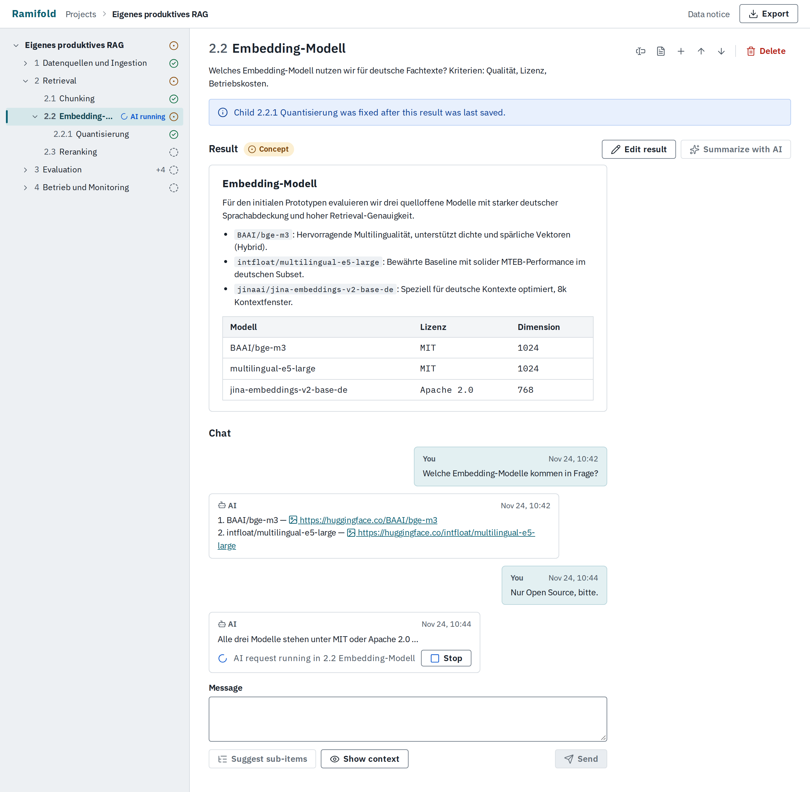
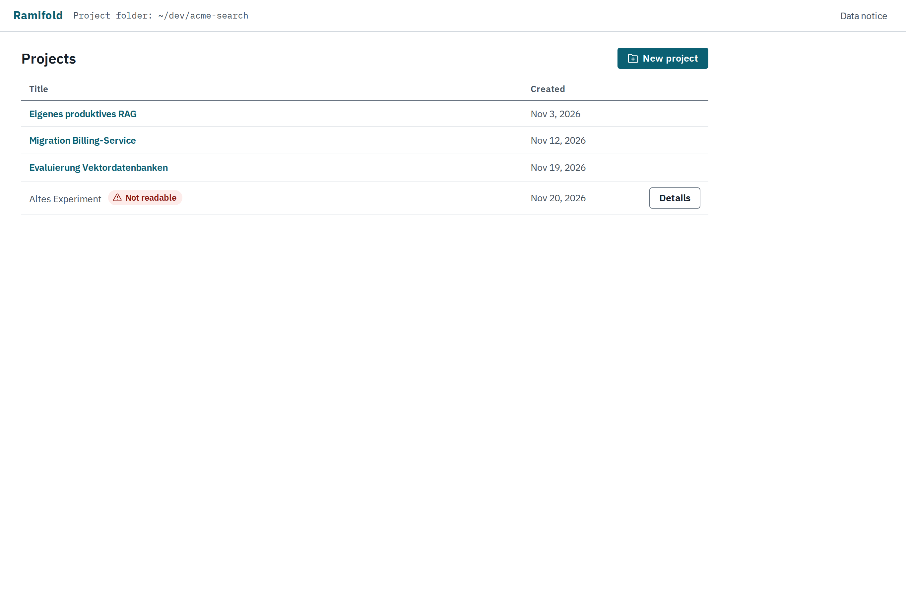
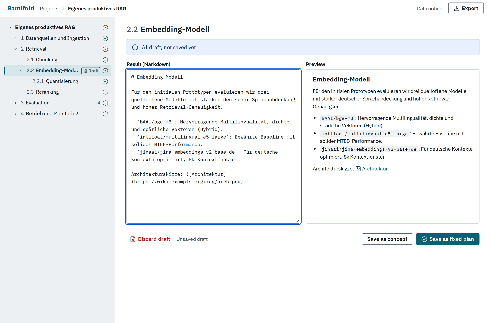
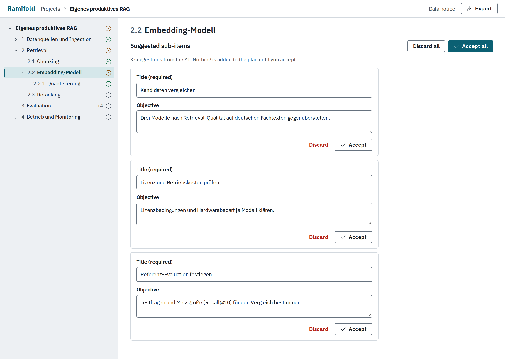

# UI/UX Design – Ramifold

## 1. Metadaten und Grundlage

| Feld | Wert |
|---|---|
| Projekt | Ramifold |
| Slice | 0.1 (erster Slice; kein früheres Design) |
| Version | 0.4.6 (Wortlaut MSG-015/-016 bei nicht angemeldet, H-01; Satz Planspalte, H-08; MAR-1410/MAR-1411, auf Basis 0.4.5, Commit `e3b6051`; keine Verhaltensänderung); 0.4.5 (Klarstellung FIND-028, MAR-1406/MAR-1407, auf Basis 0.4.4, Commit `3b6215f`; keine Verhaltensänderung); 0.4.4 (Design-Lücke DL-04, Icon-Tabelle vollständig, MAR-1403, auf Basis 0.4.3, Commit `ff5b241`; keine Verhaltensänderung); 0.4.3 (Design-Lücke DL-03, MAR-1400, auf Basis 0.4.2, Commit `4a87ff1`; keine Verhaltensänderung); 0.4.2 (Design-Lücken DL-01, DL-02, X2 (3), MAR-1396, auf Basis 0.4.1, Commit `e68b12d`; keine Verhaltensänderung); 0.4.1 (Review-Befunde FIND-PO-V1/-V2, MAR-1391, auf Basis 0.4, Commit `118b2ea`; 0.4 = visuelle Überarbeitung nach den neuen Design-Regeln, MAR-1390; Basis: 0.3.1, Commit `7e47484`; keine Verhaltensänderung) |
| Status | **Entwurf**, zur Prüfung durch den Product Owner und anschließend Gate „Wie“; Look „Werkbank“ vom Owner gewählt (2026-11-24) |
| Klassifizierung | Material |
| Autor | UI/UX Designer (Agent), Design-Tasks MAR-1372, MAR-1375, MAR-1382, MAR-1388, MAR-1390, MAR-1396, MAR-1403, MAR-1407, MAR-1411 |
| Datum | 2026-11-24 |
| Branch / PR | `design/MAR-1372` / Draft Pull Request gegen `main` (Commit siehe Übergabe in der Task) |
| Quellen | Product Brief v0.2 (`docs/product/product-brief.md`, Commit `af886be`); Requirements v0.4 (`docs/product/requirements.md`, Commit `3c85c33`, Gate „Was“ freigegeben); Marktrecherche `docs/product/product-research.md` (nicht verbindlich) |
| `ui-constraints` | **v3**, Paperclip-Dokument `ui-constraints` an MAR-1379, Revision `40c3d77d-5c9d-428f-bb02-cb564c6123db` (Software Architect, Entwurf); Baseline v0.3 (`architecture-baseline` Revision `b9cbb5f4-110b-4439-80ff-d508511be2bd`, `adrs` Revision `a97d389a-86f0-444b-858f-fdb08a397498`); Frontend: React + TypeScript mit React Aria Components (ADR-001); Abgleich in Abschnitt 8 |
| Werkzeug | Mockups als statisches HTML/CSS, gerendert nach PNG (`mockups/base.css`, `mockups/icons.svg`, `mockups/fonts/`). Die früheren Stitch-Mockups sind ersetzt; `stitch-log.md` bleibt als Historie (Projekt `17557905236438839052`, Budget 26/40, nicht mehr verwendet) |
| Sprache | Dokumente Deutsch; **Oberflächentexte Englisch** (REQ-068, LP-09); Beispielinhalte (Titel, Aufträge, Chat) deutsch, weil der Planer auf Deutsch plant |

## Freigabe-Briefing

### Kurzfassung
Slice 0.1 von Ramifold: Ein einzelner Entwickler plant ein Vorhaben als Baum (Vorhabenliste, Arbeitsbereich mit Baum links und Auftrag, Ergebnis und Chat rechts, dazu Dialoge; elf Screens). Diese Version 0.4 ändert **nur die Darstellung**: Du hast den Look „Werkbank“ gewählt; alle Screens sind neu als Mockups gebaut, jeder `screen.md` hat ein Screen-Konzept. Verhalten, Screens, Flows, Zustände und Wortlaute sind gegenüber 0.3.1 unverändert, die bisherigen Annahmen und Entscheidungen bleiben (die alten Annahmen-Karten zu 0.3.1 sind zurückgezogen). Version 0.4.2 schließt drei kleine Lücken (Icon-Tabelle, ein Tooltip je Baumzeile, zugänglicher Name der Baumzeile), siehe „Was sich geändert hat“. Stand jetzt ist Version 0.4.6 (Wortlaute und Klarstellungen, keine Verhaltensänderung). Die Bilder unten zeigen die wichtigsten Screens.

Jeder Screen hat ein aktuelles Bild; alle elf Screens (UI-001 bis UI-011) und die Zustände `empty`, `error`, `permission` (UI-003), `empty` (UI-001) und `validation` (UI-006) liegen unter `screens/`. Ohne Bild (nur Text in `screen.md`): die Zustände „read-only“ und „server-down“ (Layout wie `permission.png` mit dem jeweiligen Banner), „loading“, der Ansichtsmodus von UI-009 und die Zustände ohne eigenes Layout.

### So haben wir dich verstanden
| Deine Vorgabe (Quelle) | Unsere Auslegung | Beispiel |
|---|---|---|
| „Baum anzeigen, navigieren, ein-/ausklappen“ (Brief 9, REQ-007 bis -010) | Baum und Knotenansicht stehen auf **einer** Seite nebeneinander (UI-003). | Der Planer klickt links „2.2 Embedding-Modell – Concept“ und sieht rechts Auftrag, Ergebnis, Chat. |
| „Auf derselben Ebene sortieren“ (REQ-014) | „Move up“ / „Move down“ im Knotenkopf, kein Ziehen. | „Reranking“ steht als 2.3; zweimal „Move up“ macht es zu 2.1. |
| „Hinweis, wenn ein Kind neu festgelegt wurde“ (REQ-046) | Info-Banner im geöffneten Elternknoten, keine Markierung im Baum. | „Child 2.1 Chunking was fixed after this result was last saved.“ |
| „Datenabfluss-Hinweis vor der ersten KI-Anfrage“ (REQ-030) | Dialog mit Checkbox; **neu:** zwei Zeilen mehr (siehe Annahme 8); danach über „Data notice“ jederzeit lesbar. | Erste Frage → Dialog → „Continue“ → Frage geht los; „Cancel“ lässt sie im Feld stehen. |
| „Ergebnis gesperrt, wenn es in einem anderen Fenster bearbeitet wird“ (REQ-071) | Gesperrt ist nur das **Ergebnis**; Titel und Auftrag bleiben änderbar (A-UX-05). | In Fenster B lässt sich „Embedding“ umbenennen, obwohl A das Ergebnis bearbeitet. |
| „Änderung von außen: darf keine Änderung speichern“ (REQ-074) | Ab Erkennung ist das ganze Vorhaben bis zum Neustart nur lesbar; erkannt wird beim Speichern **und** beim Öffnen von Vorhaben und Knoten. Der Export `PLAN.md` zählt nicht als Änderung. | `git pull` ändert einen Knoten; beim nächsten Öffnen eines Knotens zeigt das Fenster „Read-only“. Ändert `git pull` nur `PLAN.md`, bleibt alles bedienbar. |
| Look: „Werkbank“ gewählt (deine Antwort auf MAR-1390) | Kompakt, nüchtern, kühles Grau, ein Petrol-Akzent nur für Auswahl und Hauptaktion; IBM Plex; Statussymbole statt Statuswörtern im Baum (`DESIGN.md`). | Im Baum steht „2.3 Reranking“ mit einem gestrichelten Kreis; „No result yet“ erscheint als Tooltip. |
| „Oberfläche Englisch“ (REQ-068) | Alle Oberflächentexte englisch, Beispielinhalte deutsch. | Schaltfläche „Export“; der Knotentitel „Retrieval“ bleibt Inhalt. |

### Kritische Annahmen – bitte einzeln bestätigen
1. **Entwürfe bleiben im Fenster.** Ungespeicherte Ergebnistexte und Chat-Eingaben bleiben beim Wechsel zwischen Knoten und Liste erhalten, nicht beim Neuladen (der Browser fragt vorher). *Beispiel:* 10 Minuten am Ergebnis von „2 Retrieval“ gearbeitet, kurz „3 Evaluation“ geöffnet, zurück: Text da. F5 und „Leave site?“ bestätigt: Text weg. *Wenn falsch:* Erhalt beim Neuladen wäre eine neue Funktion mit Datenschutzfolgen. (UI-003/-004; REQ-071, -073)
2. **Festlegen mit einem Klick.** „Save as fixed plan“ speichert ohne Bestätigungsdialog. *Beispiel:* Fehlklick bei 2.2 lässt sich durch erneutes Bearbeiten und „Save as concept“ korrigieren (REQ-044). *Wenn falsch:* ein Dialog kommt hinzu. (UI-004)
3. **Export ohne Rückfrage, überschreibt vollständig.** „Export“ überschreibt `PLAN.md` des Vorhabens ohne Rückfrage, auch wenn sie von Hand geändert wurde; Banner mit Pfad. Im gesperrten Vorhaben („read-only“) ist Export abgewiesen. *Beispiel:* Montag exportiert, Dienstag von Hand ergänzt, Mittwoch wieder „Export“: die Handänderung ist weg (nur Git hat sie noch). (UI-003; REQ-049)
4. **Chat beim Bearbeiten ausgeblendet.** Solange der Editor offen ist, ist der Chat des Knotens ausgeblendet; der Entwurf bleibt beim Knotenwechsel. *Beispiel:* Rückfrage an die KI mitten im Überarbeiten: erst speichern oder Editor verlassen. *Wenn falsch:* UI-003/-004 werden umgebaut. (siehe „Deine Entscheidungen“)
5. **Neu – „not sent“ und „Send again“ (D3a).** „not sent“ erscheint nur, wenn die Nachricht schon gespeichert ist, Claude Code sie aber vor der Antwort abweist (nicht angemeldet, Prozess startet nicht). Sie bleibt mit Ursache im Verlauf; „Send again“ schickt **dieselbe** Nachricht erneut (keine Kopie), nur solange sie die jüngste des Chats ist. Alle anderen Abweisungen (andere Anfrage läuft, Hinweis unbestätigt, Claude Code nicht installiert oder zu alt, read-only, Ramifold beendet) geschehen vor dem Speichern: die Nachricht bleibt im Eingabefeld. Fehler vor dem ersten Textteil (Netzwerk, Limit) ergeben eine KI-Antwort „incomplete“ ohne Text mit Ursache. *Beispiel:* Anmeldung abgelaufen; im Chat steht „not sent – Claude Code is not signed in“; nach Anmeldung im Terminal klickt der Planer „Send again“, die Antwort folgt. (UI-003; REQ-004, -028)

### Weitere Annahmen
**Ebenfalls kritisch** (schon Teil früherer, vom Product Owner geprüfter Fassungen; keine einzelne Antwort nötig, Widerspruch jederzeit möglich):
- **Datenabfluss-Hinweis mit Checkbox**, „Data notice“ dauerhaft in der Kopfzeile. *Beispiel:* Wer das Repo klont, sieht den Hinweis bei der ersten Frage. (UI-009; REQ-030)
- **„nicht angemeldet“ = „abgelaufen“.** Ramifold unterscheidet beides nicht: **eine** Meldung, Schritt „im Terminal `claude` starten, anmelden, erneut senden“, kein Neustart; nach `claude update` genügt erneut senden. *Beispiel:* „Claude Code is not signed in. Open a terminal, run "claude" …“ (MSG-001)
- **Wortlaute KL-01 bis KL-05** (v0.3.1, vom Product Owner geprüft, keine neuen Flows oder Screens): Speichern scheitert mit Ursache (MSG-002); Vorschläge und Zusammenfassung haben eigene Fehlerbanner ohne „Send again“ (MSG-015/-016); unerwartete Fehler verweisen aufs Terminal (TERM-013); „Suggest sub-items“ ersetzt offene Vorschläge ohne Rückfrage. *Beispiel:* Zwei Karten umbenannt, erneut „Suggest sub-items“: Änderungen weg. *Wenn falsch:* ein Bestätigungsdialog kommt hinzu.
- **Datenabfluss-Hinweis nennt zwei weitere Tatsachen (CC-06, Entscheidung Product Owner).** (1) Claude Code legt Sitzungsprotokolle der Gespräche lokal in `~/.claude/` ab; (2) die KI kann im Web suchen und Seiten öffnen. Die Anmeldeart bleibt ungenannt (OQ-01 offen). *Beispiel:* Der Planer sieht vor der ersten Frage, dass seine Gespräche auch lokal liegen. (UI-009; REQ-030)
- **Anzeige „Simulated AI“.** Im simulierten Modus (`RAMIFOLD_AGENT=fake`, Abnahmetests) zeigt die Kopfzeile dauerhaft „Simulated AI“, damit eine erfundene Antwort nicht für echt gehalten wird; im Normalbetrieb fehlt die Marke. (UI-001, UI-003; TERM-012)
- **Andere Fenster sehen nur „läuft“.** Ein zweites Fenster zeigt während einer KI-Anfrage nur „AI request running in 2.2 Embedding“ ohne Teiltext; die Antwort erscheint dort erst nach erneutem Öffnen des Knotens. *Beispiel:* A streamt in 2.2, B zeigt nur die Laufanzeige. (UI-003; REQ-019, -069)
- **Geöffnete Stände können veraltet sein.** Erkennt Ramifold beim Öffnen eines Vorhabens oder Knotens eine Änderung von außen, bleibt der zuvor geladene (möglicherweise veraltete) Stand sichtbar, mit „Read-only“ und Ursache, ohne automatisches Neuladen; andere Fenster erfahren es erst bei ihrer nächsten Öffnen- oder Speicheraktion. *Beispiel:* Nach `git pull` zeigt Knoten 3 „Read-only“; Neustart lädt den neuen Stand. (UI-003; REQ-074)
- **Adresse.** `http://localhost:<port>` funktioniert wie `http://127.0.0.1:<port>`; jede andere Adresse bekommt eine schlichte englische Abweisungsseite ohne Ramifold-Layout („This address is not allowed. …“, MSG-014).

**Übrige:**
- Vorhabenliste nach Anlagedatum aufsteigend (A-UX-07); Baum fest 320 px (A-UX-08); die Should-Funktionen aus OQ-09 (schrittweise Antwort, Abbrechen) sind enthalten.
- Seitentitel unterscheidet Instanzen: `<Vorhabentitel> – <Ordnername> – Ramifold`, in der Liste `Projects – <Ordnername> – Ramifold`; das Symbol ist überall gleich (CC-13).
- Neustart-Hinweis nur noch bei „Claude Code nicht installiert“ (Rückfall: erst installieren und erneut senden, sonst Ramifold aus einem neuen Terminal starten; Ramifold prüft vor jeder Anfrage erneut, ein Neustart ist nicht zwingend; Wortlaut festgelegt in MSG-001, KL-03).

### Entscheidungen der Agenten
| Entscheidung | Verworfene Alternative | Warum | Umkehrbar |
|---|---|---|---|
| **DL-01:** Doppelbedeutungen aufgelöst durch neue Symbole `refresh-cw`, `folder-plus`, `file-x` (Vorschlag des Software Architects war nur `refresh-cw` und Ergänzungen; die anderen zwei Auflösungen sind unsere Ergänzung) | dasselbe Symbol mit Begründung „gleiche Aktion“ | Die Aktionen sind verschieden („New project“ ≠ „Add child“; „Discard draft“ löscht nichts am Knoten). *Beispiel:* Papierkorb steht nur für „Delete“. | leicht |
| Statuswort im Baum: Name der Zeile + Tooltip der Zeile (auch bei Tastaturfokus) | eigener Fokuspunkt am Symbol | kein neues Element, keine Zusatzbedienung (FIND-PO-V2) | leicht |
| Baum und Knoten auf einer Seite | getrennte Seiten | Baum bleibt beim Arbeiten sichtbar (REQ-053) | mittel |
| „Move up/Move down“ statt Drag-and-drop | Ziehen | Tastatur Pflicht (REQ-062) | leicht |
| Vorschläge als Panel mit Karten; Kontext als Seitenpanel | Dialog / eigene Seite | Prüfen braucht Platz, schneller Rückweg | mittel |
| Status im Baum als Symbol (Form unterscheidet), das Wort als Tooltip und zugänglicher Name; in der Pille im Abschnitt „Result“ Symbol + Wort | Symbol + Wort in jeder Zeile (v0.3.1) | Neue Regel „Icons statt Wörter“, mehr Baum sichtbar; „nicht nur Farbe“ ist durch die Form erfüllt. *Beispiel:* der Haken-Kreis bei „2.1 Chunking“ heißt für Screenreader „Fixed plan“. Darstellung, keine Verhaltensänderung | leicht |
| Knotenaktionen „Rename“, „Edit objective“, „Add child“, „Move up/down“ als Icon-Zeile mit Tooltip; „Delete“ bleibt Text | Text-Buttons (v0.3.1) | Frequente Zeilenaktionen als Icons; die Aktion mit Folgen behält das Wort. Gleiche Aktionen, gleiche Namen | leicht |
| Chat bleibt unter dem Ergebnis im Arbeitsbereich (Platzierung unverändert) | Chat als Tab oder Seitenpanel | Das wäre eine Verhaltensänderung; nicht geändert | – |
| „read-only“ und „Ramifold läuft nicht mehr“ als dauerhafte Banner, Eingaben bleiben stehen | Einzelfehler je Aktion | Text lässt sich vor dem Neustart sichern | leicht |
| **E-UX-01:** „Send again“ auch an einer unvollständigen KI-Antwort („incomplete“), nicht bei „aborted“; nur an der jüngsten Nachricht | nur bei „not sent“ | REQ-028 verlangt „erneut senden“; „aborted“ hat der Planer selbst gewollt. Die unvollständige Antwort bleibt stehen, die neue folgt darunter. *Beispiel:* Antwort bricht nach zwei Teilen mit „Usage limit reached“ ab; nach dem Limit klickt der Planer „Send again“. | leicht |
| **E-UX-02:** Marke „Simulated AI“ in der Kopfzeile | nur im Terminal | Gefahr, simulierte Antworten für echt zu halten; kleines Element, nur im Testmodus | leicht |
| Ein Zustand „nicht angemeldet“ (auch abgelaufen) | zwei Meldungen | gleicher Schritt, Baseline v0.3 | leicht |

### Bewusst nicht enthalten
- Keine Anzeige und keine Bedienung für Werkzeuge, Skills, MCP-Server oder Werkzeugfreigaben, auch kein ausgegrautes Feld (*Beispiel:* kein Menüpunkt „Tools“). Nur ein Textabschnitt „Ausblick Werkzeugfreigabe“ in Abschnitt 8 beschreibt die spätere Absicht (Owner-Hinweis, REQ-024).
- Keine Versionsansicht, Verweise, Verschieben in andere Eltern, mehrere Chats, Material, Einstellungen, Suche, Konto, Dark Mode, Mobil-/Tablet-Layout, Mockups für Terminal-Ausgaben und Banner-Zustände.

### Was sich geändert hat
**Version 0.4.6 (aktueller Stand, keine Verhaltensänderung):** Meldungen bei Vorschlägen und Zusammenfassung nennen bei nicht angemeldetem Claude Code jetzt den Schritt zur Anmeldung. *Beispiel:* „The AI request failed. Cause: Claude Code is not signed in. The plan is unchanged. Open a terminal, run "claude" and sign in, then try again.“ Alle anderen Ursachen bleiben wie bisher („… Try again.“). Außerdem ein Satz zur Planspalte widerspruchsfrei gemacht: beim Knotenwechsel bleibt der gewählte Zustand erhalten.

**Version 0.4.5 (keine Verhaltensänderung):** Unter 1024 px (starker Zoom) ist der Baum beim Öffnen eines Vorhabens sichtbar („Hide plan“) und bleibt so, wie der Planer ihn gewählt hat. Warnbanner werden Screenreadern wie Fehlerbanner gemeldet.

**Version 0.4.4 (keine Verhaltensänderung):** Die Icon-Tabelle ist jetzt vollständig: jede Stelle mit Symbol hat Symbol und Farbe, jede Stelle ohne Symbol steht ausdrücklich unter „Bewusst ohne Symbol“. Warnbanner (MSG-003, -007, -009) `triangle-alert`; Erfolgsbanner MSG-010 und Toasts kein Symbol; Marke „not saved“ (MSG-012) `circle-x`. Keine neuen Elemente, kein Mockup geändert.

**Version 0.4.3 (keine Verhaltensänderung):** Icon-Zuordnung des Löschdialogs eindeutig: Kopf von UI-007 `triangle-alert` (Warnsymbol, wie im Mockup), Fehlerbanner im Dialog `circle-x`. Weitere Angaben der Icon-Tabelle an die Mockups angeglichen (UI-010, UI-011, „Save as fixed plan“). Keine neuen Elemente, kein Mockup geändert.

**Version 0.4.2 (keine Verhaltensänderung)**, gegenüber 0.4.1 (Commit `e68b12d`), drei Lücken aus Cross-Check und Review:
- **Icon-Tabelle vollständig (DL-01):** Jedes Symbol steht mit Bedeutung in `DESIGN.md`. Drei Doppelbedeutungen aufgelöst: „Check again“ `refresh-cw` (statt `undo-2`, bleibt „Send again“), „New project“ `folder-plus` (statt `plus`, bleibt „Add child“), „Discard draft“ `file-x` (statt `trash-2`, bleibt „Delete“). „Draft“ im Baum bekam ein kleines Symbol (REQ-062). Umsetzung: nur Einträge in `ICON_MAP`.
- **Ein Tooltip je Baumzeile (DL-02):** bei gekürztem Titel „<voller Titel> · <Statuswort>“ (z. B. „Embedding-Modell · Concept“), sonst nur das Statuswort.
- **Zugänglicher Name der Baumzeile (X2 (3)):** feste Reihenfolge „Nummer Titel, Statuswort, Draft, +n, AI running“, nur sichtbare Elemente, z. B. „2.2 Embedding-Modell, Concept, Draft, +3“. Konkretisierung innerhalb REQ-062; keine neuen Elemente, IDs oder Flows.
- Briefing gekürzt: fünf kritische Annahmen; die übrigen stehen unter „Weitere Annahmen“ (nichts entfernt).

**Version 0.4 (Look „Werkbank“, keine Verhaltensänderung)**, gegenüber 0.3.1 (Commit `7e47484`):
- **Look und Schriften:** „Werkbank“ (deine Wahl), IBM Plex statt Inter und JetBrains Mono, Lucide statt Material Symbols, Petrol `#0B6073`; frei lizenziert (OFL 1.1, ISC), mitgeliefert ohne CDN (REQ-056).
- **Mockups und Konzept:** alle Stitch-Mockups durch HTML/PNG ersetzt (neu: UI-006 `default`; Vorher-Bilder: [Stand 0.3.1](https://github.com/MarloNET/Ramifold/tree/7e47484/docs/ux/screens)); Screen-Konzept in jedem `screen.md`.
- **Baum:** Status als Symbol mit Tooltip, Knotenaktionen als Icon-Zeile, Überschrift „Plan“ entfällt sichtbar, Beispielknoten 2.2.1 neu.
- Unverändert: Inventar, Flows, Daten, Aktionen, Zustände, Rollen, Wortlaute, Annahmen und Entscheidungen.

**Version 0.3 und 0.3.1** (letzter Stand, den der Owner sah; nach den Cross-Checks, ohne neue Flows oder Screens): Claude-Code-Fehlerfälle mit „not sent“ und „Send again“, Änderung von außen (Erkennung auch beim Öffnen, `PLAN.md` zählt nicht), Datenabfluss-Hinweis, Terminal-Fehler, Abweisungsseite, „Simulated AI“, Seitentitel je Instanz, Baumrolle treegrid.

### Deine Entscheidungen
1. **Editor und Chat gleichzeitig?** (a) Chat beim Bearbeiten ausgeblendet (Entwurf); (b) Editor über dem Chat. Empfehlung: (a).
2. **Festlegen mit Bestätigung?** (a) ein Klick (Entwurf); (b) Bestätigungsdialog. Empfehlung: (a).
3. **Should-Funktionen aus OQ-09** (REQ-020/-021) sind enthalten; Entscheidung zum Slice-Zuschnitt steht aus; das Design lässt sich ohne Umbau kürzen.
4. **Look:** beantwortet (Werkbank, 2026-11-24); keine neue Frage. Du siehst das Ergebnis mit dieser Freigabe; eine andere Wahl wäre eine Neugestaltung.

### Lesetipps
`DESIGN.md` (der gewählte Look, Icons, Kontraste), `screens/UI-003-workspace/screen.md` (Kern mit Screen-Konzept), Abschnitt 5 unten (Meldungen im Wortlaut), Abschnitt 8 (Ausblick Werkzeugfreigabe).

## 2. Nutzer, Umfang und Designziele
- **Nutzer:** ein lokaler Planer (Entwickler, erster Nutzer der Owner), Desktop/Laptop mit Tastatur und Maus; lange Sitzungen über mehrere Tage parallel zu Terminal und Coding-Agent (10.5). Die KI und der Coding-Agent sind Systemakteure ohne eigene Oberfläche.
- **Plattformen:** Browser Chrome/Chromium, Firefox, Safari (macOS), ab 1280 px Breite; kein Smartphone/Tablet (REQ-067).
- **Umfang Slice 0.1:** Vorhaben anlegen/wählen, Baum anzeigen/bearbeiten, Chat pro Knoten mit Kontextanzeige, Unterpunkt-Vorschläge, Ergebnis (Zusammenfassen, Konzept/festgelegter Plan), Rückfluss-Hinweis, Export, Datenabfluss-Hinweis, Fehler- und Mehrfenster-Fälle, sechs WCAG-2.2-AA-Kriterien (REQ-062).
- **Nicht-Ziele:** siehe „Bewusst nicht enthalten“; keine früheren Slices vorhanden.
- **Designziele:** ruhig, dicht, lesbar; Aufgabe vor Dekoration; jeder Zustand und jede Meldung verständlich ohne Handbuch; vollständig per Tastatur bedienbar.
- **Randbedingungen:** Oberflächensprache Englisch; keine Konten; nur lokal; keine Marke vorgegeben (10.4).

## 3. User Journeys und Navigation

Übersicht: `flows/flow.svg`.

| ID | Flow | Normaler Pfad | Alternativen / Fehlerpfade | Screens |
|---|---|---|---|---|
| FLOW-001 | Start, Vorhaben wählen oder anlegen | 1 Planer startet Ramifold im Terminal (TERM-001), öffnet die Adresse im Browser → 2 UI-001 zeigt Liste → 3 „Open“ per Titel → UI-003; oder 4 „New project“ → 5 UI-002 (Title, Objective) → „Create project“ → UI-003 mit Wurzelknoten | Leere Liste (UI-001 empty); Vorhaben nicht lesbar → „Details“ → UI-011; Claude Code fehlt oder ist zu alt → Banner MSG-001 (Varianten „nicht gefunden“, „zu alt“); fremde Host-Angabe → Abweisungsseite MSG-014; Start-Fehler nur im Terminal (TERM-002 bis -011) | UI-001, UI-002, UI-011 |
| FLOW-002 | Baum bearbeiten und navigieren | 1 Knoten anklicken/mit Pfeiltasten wählen → 2 ein-/ausklappen → 3 „Add child“ (UI-006) → 4 „Rename“/„Edit objective“ (UI-006) → 5 „Move up/down“ → 6 „Delete“ (UI-007, Bestätigung) | Titel leer/zu lang (Validierung); Knoten in anderem Fenster gelöscht (MSG-004); Speichern scheitert (MSG-002) | UI-003, UI-006, UI-007 |
| FLOW-003 | Chat im Knoten | 1 Knoten öffnen → 2 Nachricht schreiben, „Send“ (beim ersten Mal UI-009 bestätigen) → 3 Laufanzeige → 4 Antwort (Markdown) im Chat → optional „Show context“ (UI-008) | KI läuft anderswo (MSG-003); Claude Code nicht installiert/zu alt (MSG-001, Nachricht bleibt im Feld) oder nicht angemeldet (Nachricht „not sent“, „Send again“); Funktionen ohne KI bleiben nutzbar; Antwort bricht ab (MSG-007, ggf. „Send again“; nur Chat-Nachrichten); Sitzung neu aufgebaut (MSG-008); „Stop“ (Should) | UI-003, UI-008, UI-009 |
| FLOW-004 | Unterpunkte vorschlagen | 1 „Suggest sub-items“ → 2 Laufanzeige → 3 UI-005 mit Vorschlagskarten → 4 Titel/Auftrag ändern → 5 „Accept“/„Accept all“ oder „Discard“/„Discard all“ → neue Kinder im Baum | keine verwertbare Liste (MSG-009); Fehler (MSG-015, kein Banner nach „Stop“); Titel leer. **„Suggest sub-items“ bei bereits offenen Vorschlägen verwirft diese sofort, auch geänderte Karten, ohne Rückfrage (KL-05, REQ-037).** | UI-003, UI-005 |
| FLOW-005 | Ergebnis festlegen und Rückfluss | 1 „Summarize with AI“ (ggf. UI-010) → 2 Laufanzeige, Ergebnis lesbar gesperrt → 3 UI-004 mit KI-Entwurf → 4 bearbeiten → 5 „Save as concept“ oder „Save as fixed plan“ → 6 beim Elternknoten erscheint der Rückfluss-Hinweis (Banner) | Fehler: Entwurf und gespeichertes Ergebnis unverändert (MSG-016; kein Banner nach „Stop“); leeres Ergebnis (Validierung); „Edit result“ ohne KI direkt; „Discard draft“ | UI-003, UI-004, UI-010 |
| FLOW-006 | Export | 1 „Export“ in der Kopfzeile → 2 Banner „Exported to <Pfad>“ (überschreibt `PLAN.md` vollständig) | Speichern scheitert (MSG-002); Vorhaben von außen geändert: Export abgewiesen (MSG-005) | UI-003 |
| FLOW-007 | Mehrere Fenster, Änderung von außen | Zweites Fenster zeigt dieselbe Instanz; Ergebnis in Fenster A in Bearbeitung → Fenster B zeigt es nur lesbar (MSG-011); nach Speichern in A erneut öffnen; läuft eine KI-Anfrage in A, zeigt B nur „AI request running in <Nr> <Titel>“, die Antwort erscheint in B beim erneuten Öffnen des Knotens | Knoten in A gelöscht → Aktion in B abgewiesen (MSG-004); Bearbeitungssperre endet verzögert (bis etwa 15 s nach Schließen von A): B zeigt weiter MSG-011, „Check again“ prüft neu; `git pull` ändert Plandaten → erkannt beim Speichern, beim Öffnen des Vorhabens oder eines Knotens (nur lesend); ab Erkennung ist das ganze Vorhaben bis zum Neustart nur lesbar (Zustand „read-only“, MSG-005; geladener Stand bleibt sichtbar, kann veraltet sein), Text bleibt zum Kopieren; Änderung nur an `PLAN.md` zählt nicht | UI-003 (permission, read-only), UI-004, UI-002/-005/-006/-007 |
| FLOW-008 | Datenabfluss-Hinweis | 1 Erste KI-Anfrage → 2 UI-009 (Bestätigung) → 3 „Continue“ → Anfrage geht los; später „Data notice“ (Ansichtsmodus) | Abbruch: nichts gesendet, Nachricht bleibt | UI-009 |
| FLOW-009 | Ramifold läuft nicht mehr (Querschnitt) | In jedem Flow: Ramifold im Terminal beendet → nächste Aktion oder Verbindungsverlust → dauerhaftes Banner MSG-013; Eingaben bleiben im Fenster stehen; Planer kopiert Text, startet Ramifold neu, lädt das Fenster neu bzw. öffnet die Adresse; das Fenster verbindet sich nie von selbst neu, auch nicht bei Neustart auf demselben Port | – (jede Aktion scheitert einheitlich; keine Einzelfehler) | UI-001, UI-003 (alle Dialoge) |

**Informationsarchitektur.** Zwei Ebenen: (1) Vorhabenliste des Projektordners (UI-001); (2) Arbeitsbereich eines Vorhabens (UI-003) mit dem Baum als einziger Navigation. Navigation: Brotkrume „Projects / <Titel>“ in der Kopfzeile führt zurück; „Data notice“ in jeder Kopfzeile. Die Kopfzeile hat rechts Platz für weitere Aktionen späterer Slices (Textlinks/Buttons), ohne Umbau; die Bereiche des Arbeitsbereichs (Result, Chat) können später um Abschnitte erweitert werden. Hinweis zur späteren Werkzeuganzeige: sie kann als zusätzliche Textaktion im Chat-Bereich neben „Show context“ stehen; in 0.1 gibt es dafür weder Screen noch Element.

**Navigationsregeln.** Ein Klick auf eine Baumzeile öffnet den Knoten im Arbeitsbereich; die Auswahl bleibt beim Wechsel zur Liste und zurück nicht erhalten (beim Öffnen immer Wurzelknoten). Dialoge sind modal und geben den Fokus an den Auslöser zurück. Nach „Create project“ → UI-003; nach „Add child“ → neuer Knoten ausgewählt; nach Löschen → Elternknoten.

## 4. Screen-Katalog

| ID | Name | Zweck | Rollen | Anforderungen | Zustände (Mockup / Text) | Ordner |
|---|---|---|---|---|---|---|
| UI-001 | Vorhabenliste | Vorhaben listen, öffnen, anlegen | Planer | REQ-005, -006, -072, -004 | default, empty (Mockup); loading, error (inkl. MSG-001, MSG-013), disabled (Text) | `screens/UI-001-project-list/` |
| UI-002 | Vorhaben anlegen (Dialog) | Titel/Auftrag erfassen | Planer | REQ-005 | default (Mockup); loading, error, validation (Text/Muster) | `screens/UI-002-create-project/` |
| UI-003 | Arbeitsbereich (Baum + Knoten) | Baum bearbeiten, Knoten mit Ergebnis und Chat | Planer | REQ-007–016, -017–024, -027–030, -036, -041–046, -048, -049, -061, -069, -071, -073, -074 | default, empty, error, permission (Mockup); loading, disabled, success, read-only, server-down (Text) | | `screens/UI-003-workspace/` |
| UI-004 | Ergebnis bearbeiten | Ergebnis als Markdown bearbeiten, speichern | Planer | REQ-041–046, -073, -003 | default (Mockup); loading, empty, error, validation, disabled, success (Text) | `screens/UI-004-result-editor/` |
| UI-005 | Unterpunkt-Vorschläge | Vorschläge prüfen, ändern, übernehmen, verwerfen | Planer | REQ-037–040 | default (Mockup); loading, empty, error, validation (Text) | `screens/UI-005-suggestions/` |
| UI-006 | Knoten-Formular (Dialog) | Knoten anlegen, umbenennen, Auftrag ändern | Planer | REQ-011–013 | default, validation (Mockup); loading, error (Text) | `screens/UI-006-node-form/` |
| UI-007 | Knoten löschen (Dialog) | Folgen zeigen, bestätigen | Planer | REQ-015 | default (Mockup); loading, error (Text) | `screens/UI-007-delete-node/` |
| UI-008 | Kontext anzeigen (Panel) | gesendeten Kontext lesen | Planer | REQ-036 | default (Mockup); loading, error (Text) | `screens/UI-008-context/` |
| UI-009 | Datenabfluss-Hinweis (Dialog) | Bestätigung vor erster KI-Anfrage; Ansicht | Planer | REQ-030 | default (Mockup); Ansichtsmodus, loading, error (Text) | `screens/UI-009-data-notice/` |
| UI-010 | Ergebnisentwurf ersetzen (Dialog) | Ersetzen bestätigen | Planer | REQ-073 | default (Mockup) | `screens/UI-010-replace-draft/` |
| UI-011 | Vorhaben nicht lesbar (Dialog) | Ursache und nächster Schritt | Planer | REQ-072 | default (Mockup) | `screens/UI-011-project-unreadable/` |

Zählregel: UI-001 bis UI-011 sind stabil; keine zurückgezogenen IDs.

## 5. Interaktion, Zustände und Meldungen

**Querschnittsregeln.**
- *Validierung:* beim Absenden, Fehlertext unter dem Feld (Symbol + Text, `aria-describedby`), Fokus auf das erste fehlerhafte Feld, Eingaben bleiben. Titel: Pflicht, nach Trim 1–200 Zeichen („A title is required.“ / „The title can be at most 200 characters.“); Ergebnis: nicht leer („The result cannot be empty.“); Chat: leer → „Send“ deaktiviert.
- *Feedback:* Banner (bleibt, `role=alert`/`status`), Toast nur für flüchtigen Erfolg (6 s, schließbar), Dialoge modal. Fehler nennen Ursache und nächsten Schritt und enthalten keine Inhaltstexte aus dem Plan.
- *Eingaben bleiben immer erhalten* bei Fehlern (REQ-003, -069, -071, -074).
- *Einzelne KI-Anfrage (REQ-069):* Solange eine läuft, zeigt der Baum „AI running“ am betroffenen Knoten; „Send“, „Suggest sub-items“ und „Summarize with AI“ in jedem Knoten sind `aria-disabled` und erklären beim Aktivieren per MSG-003, warum nichts passiert; alle Funktionen ohne KI bleiben nutzbar.
- *Bestätigung vor Zerstörung:* nur beim Löschen (UI-007), Ersetzen eines Entwurfs (UI-010) und Verwerfen geänderter Texte.
- *Zwei Zustände, die das ganze Fenster betreffen:* **„read-only“** (Vorhaben von außen geändert, MSG-005; REQ-074; `PLAN.md` zählt nicht) und **„server-down“** (Ramifold beendet, MSG-013). Beide zeigen ein dauerhaftes Banner, lassen Eingaben stehen und deaktivieren alle Aktionen, die etwas ändern bzw. Ramifold brauchen; Beschreibung in `screens/UI-003-workspace/screen.md`.
- *Kein Live-Abgleich zwischen Fenstern:* Kein Zustand, keine Meldung und keine Aktion setzt voraus, dass ein zweites Fenster Änderungen sofort sieht; Nachführen geschieht beim erneuten Öffnen des Vorhabens oder Knotens bzw. mit „Check again“ (MSG-011). Ausnahme nach Vorgabe: die Anzeige „AI running“ (REQ-019); andere Fenster bekommen nur die Ereignisse „gestartet“ und „beendet“ (nie Teiltext) und zeigen „AI request running in <Nr> <Titel>“. Die Erkennung einer Änderung von außen läuft beim Speichern sowie beim Öffnen von Vorhaben und Knoten (nur lesend), nicht live.
- *Tastatur:* Strg/Cmd+S speichert im Editor als „Concept“ (A-UX-12); Strg/Cmd+Enter sendet/bestätigt in Formularen und im Chat; ESC schließt Dialoge.

**Meldungen (Wortlaut, englisch).**
*Symbole der Meldungen (vollständige Icon-Tabelle: `DESIGN.md`, Abschnitt Icons):* Fehlerbanner (MSG-001, -002, -004, -005, -013, -015, -016) `circle-x`; Warnbanner (MSG-003, -007, -009) `triangle-alert`; Info-Banner (MSG-011) `info`; Erfolgsbanner MSG-010 und Toasts **kein Symbol**; Systemzeile MSG-008, Abweisungsseite MSG-014 und Terminal-Meldungen kein Symbol; Marken an Nachrichten: „incomplete“ (MSG-007), „not sent“ und „not saved“ (MSG-012) `circle-x`, „aborted“ `circle-slash`.

| ID | Wo | Typ | Text |
|---|---|---|---|
| MSG-001 | Banner nach Start / bei KI-Anfrage | Fehler | Vier Varianten, je mit Ursache und nächstem Schritt, Funktionen ohne KI bleiben nutzbar (AC-REQ-004-04). **Beim Start, nicht gefunden (KL-03):** „Claude Code was not found. Install Claude Code, then send your message again. If Ramifold still cannot find it, start Ramifold again from a new terminal. Planning without AI still works.“ (Ramifold prüft vor jeder Anfrage erneut; ein Neustart ist nicht zwingend.) · **nicht installiert (bei Anfrage):** „Claude Code is not installed. Install Claude Code, then send your message again. If Ramifold still cannot find it, start Ramifold again from a new terminal.“ · **zu alt (eigener Zustand, Start und Anfrage; kein Neustart nötig):** „Claude Code is too old. Ramifold needs version v2.1.248 or newer. Planning without AI still works. To use AI, open a terminal and run "claude update", then send your message again.“ · **nicht angemeldet (ein Zustand, gilt auch für abgelaufene Anmeldung; kein Neustart):** „Claude Code is not signed in. Open a terminal, run "claude" and sign in, then send your message again.“ „Anmeldung fehlgeschlagen“ ist kein Ramifold-Zustand. Der Neustart-Hinweis bleibt nur bei „nicht gefunden/installiert“ (Suchpfad des Terminals), dort als Rückfall („If Ramifold still cannot find it …“) nach „Install … send your message again“ (KL-03). Ramifold prüft die Version vor jeder Anfrage erneut, solange der Befund negativ ist. **Wo der Befund erscheint:** ein neuer Befund sofort im Fenster, das die Anfrage gestellt hat; andere Fenster erst beim nächsten Laden der Seite. Bei „nicht installiert“ und „zu alt“ ist „Send“ nicht gesperrt: der Versuch endet vor dem Speichern mit dieser Meldung, die Nachricht bleibt im Feld. Bei „nicht angemeldet“ und bei einem nicht startenden Claude Code ist die Nachricht schon gespeichert: Marke „not sent“ mit Ursache und „Send again“ (UI-003). |
| MSG-002 | Banner / im Dialog | Fehler | „Your change was not saved. Cause: <cause>. Your input is still here; you can try again.“ `<cause>` ist der Kurztext aus der Teiltabelle „Ursachen beim Speichern“ (KL-01: `no_permission`, `read_only_file_system`, `disk_full`, `file_system_error`). **Unerwartete Fehler** (auch unerwartete Serverfehler und zu große Eingaben über 10 MiB) zeigen dieselbe Meldung mit dem Kurztext von `unknown`: „An unknown error occurred. Details are in the terminal and the error log.“ (KL-04). |
| MSG-003 | Banner | Warnung | „AI request running in <Nr> <Titel>. Your message was not sent.“ (bei Vorschlägen/Zusammenfassung: „…Your request was not sent.“) |
| MSG-004 | Banner | Fehler | „This node no longer exists. It was deleted in another window. Your text stays here so you can copy it.“ |
| MSG-005 | dauerhaftes Banner (Zustand „read-only“) | Fehler | „"<Vorhaben>" was changed outside Ramifold. What this window shows may be out of date. Nothing was saved, and this project is read-only until you restart Ramifold. Copy any text you want to keep now: restarting discards everything that is not saved, including the text in this window. Reloading this window is not enough. Then restart Ramifold in the terminal to load the changed version.“ (+ „Affected: <Nr> <Titel>“ falls zutreffend). Erscheint bei Erkennung beim Speichern, beim Öffnen des Vorhabens und beim Öffnen eines Knotens (CC-02); beim Öffnen bleibt der geladene Stand sichtbar, es wird nicht neu geladen. Dieselbe Meldung für jede weitere abgelehnte speichernde Aktion, auch „Export“. Eine Änderung nur an `PLAN.md` löst sie nicht aus. |
| MSG-007 | an der Nachricht + Banner (nur **Chat-Nachrichten**; Vorschläge und Zusammenfassung: MSG-015/-016) | Warnung | Marke „incomplete“ oder „aborted“ mit Ursache (Tabelle „Ursachen“ unten); Banner: „The AI answer is incomplete. Cause: <cause>. Your message is kept; use "Send again" to ask again.“ Bei „aborted“ (Planer hat gestoppt) kein Banner und kein „Send again“. Ohne Text vor dem Fehler (z. B. Netzwerk): KI-Nachricht „incomplete“ ohne Textkörper, nur mit Ursache. |
| MSG-008 | Systemzeile im Chat | Info | „Session was rebuilt from the saved chat history.“ |
| MSG-009 | Banner | Warnung | „The AI returned no usable suggestions. The plan is unchanged. Try again.“ (keine verwertbare Liste; bleibt MSG-009, nicht MSG-015) |
| MSG-015 | Banner (KL-02) | Fehler | **Unterpunkt-Vorschläge** gescheitert: „The AI request failed. Cause: <cause>. The plan is unchanged. Try again.“ **Bei Ursache `not_authenticated`** ersetzt der Schritt zur Anmeldung den Schlusssatz (H-01, AC-REQ-004-03): „The AI request failed. Cause: Claude Code is not signed in. The plan is unchanged. Open a terminal, run "claude" and sign in, then try again.“ Kein „Send again“. Nach „Stop“ (`aborted_by_planner`): **kein** Banner. `<cause>` = Kurztext aus der Tabelle „Ursachen“. |
| MSG-016 | Banner (KL-02) | Fehler | **Zusammenfassung** gescheitert: „The AI request failed. Cause: <cause>. Your draft and the saved result are unchanged. Try again.“ **Bei Ursache `not_authenticated`** ersetzt der Schritt zur Anmeldung den Schlusssatz (H-01, AC-REQ-004-03): „The AI request failed. Cause: Claude Code is not signed in. Your draft and the saved result are unchanged. Open a terminal, run "claude" and sign in, then try again.“ Kein „Send again“. Leere oder unbrauchbare Zusammenfassung: dasselbe Banner mit dem Kurztext von `unusable_result` („The AI answer was not in the expected format.“). Nach „Stop“: **kein** Banner. |
| MSG-010 | Banner (success) | Erfolg | „Exported to <Pfad>. Each export overwrites this file.“ (Button „Dismiss“). Verspricht kein Sperren: `PLAN.md` ist abgeleitet und gehört nicht zu den Plandaten (CC-03). |
| MSG-011 | Banner | Info | „This result is being edited in another window. If you closed that window just now, it can take a moment (up to about 15 seconds) until you can edit here.“ + Button „Check again“ (prüft neu, ohne Neuladen). Bearbeiten/Zusammenfassen deaktiviert, Text „being edited in another window“. Es gibt keinen Live-Abgleich: der Hinweis verschwindet erst nach „Check again“ oder erneutem Öffnen des Knotens. |
| MSG-012 | an der eingehenden Antwort | Warnung | Marke „not saved“; die Antwort wird angezeigt, aber nicht gespeichert (REQ-074); das Banner MSG-005 steht bereits (Zustand „read-only“) |
| MSG-013 | dauerhaftes Banner ganz oben im Fenster (über Kopfzeile, `role="alert"`, nicht schließbar) | Fehler | „Ramifold is no longer running. Start it again in the terminal, then reload this window or open the address it shows. This window does not reconnect by itself, even if Ramifold starts again on the same port. Text you typed stays in this window; copy it before you reload or close it.“ Zustand „Server nicht erreichbar“: Das Fenster **bleibt** in diesem Zustand (kein stilles Wiederverbinden, CC-11); weiter nur durch Neuladen bzw. Öffnen der angezeigten Adresse. Eingaben bleiben stehen, solange das Fenster offen ist; alle Aktionen, die Ramifold brauchen, sind `aria-disabled`; bereits geladene Inhalte bleiben lesbar. Ungespeichertes ist nach dem Neuladen verloren (REQ-073). |
| MSG-014 | Abweisungsseite für jede Host-Angabe außer `127.0.0.1` und `localhost` (CC-09) | Fehler | Schlichte Seite **ohne Ramifold-Layout, ohne Skripte, ohne Daten**, nur ein Absatz englischer Text: „This address is not allowed. Open the address shown in the terminal.“ Seitentitel „Address not allowed“. `http://localhost:<port>` ist zulässig, das Terminal nennt weiter `127.0.0.1`. |

**Ursachen (CC-12).** Der Kurztext steht an der Marke bzw. in „Cause: <cause>“ von MSG-007/-015/-016. Abschließende Liste der 14 KI-Codes (Baseline v0.3, Abschnitt 9); die Ursachen beim Speichern (MSG-002) stehen in der Teiltabelle darunter und zählen nicht zu diesen 14; kein Code gibt es für „Sitzung neu aufgebaut“ (MSG-008) und „Knoten gelöscht“ (MSG-004).
| Code | Kurztext (englisch) | Marke / Wo |
|---|---|---|
| `agent_not_found` | Claude Code was not found or could not be started. | vor dem Speichern: MSG-001, Nachricht im Feld; beim Prozessstart: „not sent“ |
| `agent_too_old` | Claude Code is too old (needs v2.1.248 or newer). | MSG-001, Nachricht im Feld |
| `not_authenticated` | Claude Code is not signed in. | „not sent“ + MSG-001; bei Vorschlägen und Zusammenfassung MSG-015/-016 mit dem Schritt zur Anmeldung (H-01) |
| `network` | There is no connection to the AI provider. | „incomplete“ (ggf. ohne Text) |
| `usage_limit` | The usage limit of the AI provider was reached. | „incomplete“ |
| `provider_error` | The AI provider reported an error. | „incomplete“ |
| `agent_exited` | Claude Code stopped unexpectedly. | „incomplete“ |
| `agent_protocol` | Ramifold could not understand the output of Claude Code. | „incomplete“ |
| `timeout` | Claude Code did not respond in time and was stopped. | „incomplete“ |
| `instance_stopped` | Ramifold was stopped during the request. | „incomplete“ (beim nächsten Laden) |
| `unusable_result` | The AI answer was not in the expected format. | nur Vorschläge und Zusammenfassung: Vorschläge: MSG-009 (keine verwertbare Liste); Zusammenfassung: MSG-016; Plan/Ergebnis unverändert |
| `aborted_by_planner` | You stopped the request. | „aborted“ |
| `external_change` | The project was changed outside Ramifold. | nur im Fenster: „not saved“ (MSG-012) |
| `unknown` | An unknown error occurred. Details are in the terminal and the error log. | „incomplete“; auch in MSG-002 bei unerwarteten Fehlern (KL-04) |

**Ursachen beim Speichern (KL-01).** Sie stehen in „Cause: <cause>“ von MSG-002 (nicht an Chat-Nachrichten). Vier Ursachen:
| Code | Kurztext (englisch) | Wo |
|---|---|---|
| `no_permission` | Ramifold has no permission to write to the project folder. | MSG-002 |
| `read_only_file_system` | The project folder is on a read-only file system. | MSG-002 |
| `disk_full` | The disk is full. | MSG-002 |
| `file_system_error` | A file system error occurred. Details are in the terminal and the error log. | MSG-002 |

**Terminal-Ausgaben (nur Text, englisch, keine Mockups).**
| ID | Anlass | Text |
|---|---|---|
| TERM-001 | Start (REQ-001) | `Ramifold is running for <Projektordner>` / `Open http://127.0.0.1:<port> in your browser.` (`http://localhost:<port>` funktioniert ebenso; das Terminal nennt `127.0.0.1`) |
| TERM-002 | Startfehler Ordner (REQ-002) | `Cannot start: <Pfad> does not exist.` / `… is not a folder.` / `… is not writable.` |
| TERM-003 | Zweiter Start (REQ-070) | `Ramifold is already running for <Projektordner> at http://127.0.0.1:<port>.` |
| TERM-004 | Claude Code fehlt (REQ-004) | `Warning: Claude Code was not found. AI features will not work until it is installed.` |
| TERM-005 | Claude Code zu alt (REQ-004) | `Warning: Claude Code is too old (need v2.1.248 or newer). Run "claude update". AI features will not work until then.` |
| TERM-006 | Node.js zu alt (CC-08) | `Cannot start: Node.js <gefunden> is too old (need v24 or newer).` Beispiel: `Cannot start: Node.js v22.1.0 is too old (need v24 or newer).` |
| TERM-007 | Port ungültig (CC-08) | `Cannot start: "<Wert>" is not a valid port. Use a whole number from 0 to 65535.` |
| TERM-008 | Ausdrücklich angegebener Port belegt (CC-08) | `Cannot start: port <Port> is already in use. Choose another port, or start without a port and Ramifold picks a free one.` Ohne Angabe weicht Ramifold still auf einen freien Port aus (keine Meldung). |
| TERM-009 | Sperre durch hängendes Ramifold (CC-08) | `Cannot start: a Ramifold process (PID <pid>) for <Projektordner> is still running but does not respond. End that process, then start Ramifold again.` Ist der Prozess kein Ramifold, übernimmt Ramifold die Sperre still. |
| TERM-010 | Ramifold-Daten beschädigt (CC-04) | `Cannot start: the Ramifold data is damaged: <Pfad>. Ramifold changed nothing. Restore the file (for example with Git), then start Ramifold again.` Gilt auch, wenn `area.json` fehlt, obwohl `.ramifold/plans/` existiert. |
| TERM-011 | Von neuerer Ramifold-Version angelegt (CC-04) | `Cannot start: the Ramifold data in <Pfad> was created by a newer Ramifold version. Update Ramifold, then start it again.` |
| TERM-012 | Simulierter Modus (CC-08) | Zusätzlich zu TERM-001 beim Start: `Simulated mode: AI answers are simulated and do not come from a real AI.` Die Oberfläche zeigt die Marke „Simulated AI“ (UI-001, UI-003). |
| TERM-013 | Unerwarteter Fehler beim Start (KL-04) | `Cannot start: an unexpected error occurred (<code>). Details are in the error log if Ramifold could write it.` |
Port und Adresse legt der Software Architect fest. Ramifold prüft die Version beim Start und vor jeder KI-Anfrage, solange der Befund negativ ist. TERM-006 bis TERM-011 brechen den Start ab; die Reihenfolge der Prüfungen steht in der Baseline v0.3, Abschnitt 9. TERM-013 gilt für unerwartete Fehler beim Start. Die allgemeine Meldung in UI-001.error bleibt für Unerwartetes nach dem Start (Liste nicht ladbar); unerwartete Fehler beim Speichern zeigen MSG-002 mit `unknown`; die Ursachen von TERM-010/-011 haben keinen Zustand in der Oberfläche.

## 6. Responsive Verhalten und Barrierefreiheit

**Geräte.** Nur Desktop/Laptop ab 1280 px (REQ-067); Smartphone/Tablet nicht unterstützt. Breakpoint: **1024 CSS-px** – darunter (insbesondere bei Browser-Zoom ≥ 125 % auf 1280-px-Fenstern) wird der Baum zum aufklappbaren Bereich („Show plan“/„Hide plan“; Anfangszustand **offen**, Schaltfläche „Hide plan“, nur im Fenster, nicht gespeichert, bleibt beim Knotenwechsel), der Arbeitsbereich einspaltig, UI-004 stapelt Quelltext und Vorschau, Dialoge füllen die Breite abzüglich 16 px. Text in rem, damit Browser-Textvergrößerung greift; Markdown-Tabellen/Codeblöcke scrollen horizontal im eigenen Bereich; lange Titel umbrechen im Knotenkopf und werden im Baum gekürzt (Tooltip, voller Titel im Kopf).

**Erfüllung der sechs WCAG-2.2-AA-Kriterien aus REQ-062.**
| Kriterium | Wie das Design es erfüllt | Evidenz / Prüfung |
|---|---|---|
| 1.4.3 Kontrast (Minimum) | Alle Text-/Hintergrundpaare ≥ 4,5:1, UI-Komponenten ≥ 3:1 | berechnet in `DESIGN.md` (Look „Werkbank“: Text 16,5; Sekundärtext 7,6; Primärbutton 7,2; Rand 4,9; Fehler 6,6; Statussymbole im Baum 5,8 bis 6,6). Mockups sind kein Beleg; automatisierte Prüfung bei Umsetzung |
| 1.4.4 Textgröße ändern | rem-Einheiten, Layout reflowt bei < 1024 px (siehe oben), keine festen Höhen für Text | manueller Zoom-Durchlauf 200 % (Chrome/Firefox) bei Umsetzung (REQ-062) |
| 2.1.1 Tastatur | Alle Aktionen per Tastatur: Baum nach ARIA-Tree-Muster (Pfeile, Home/End, Enter), „Move up/Move down“ statt Drag-and-drop, Dialoge mit Fokus-Falle und ESC, Strg/Cmd+Enter | je Screen im Abschnitt „Responsive und Barrierefreiheit“ |
| 2.4.3 Fokus-Reihenfolge | Reihenfolge folgt Lesereihenfolge: Kopfzeile → Baum → Knotenkopf → Banner → Result → Chat → Eingabe → Aktionen; Dialoge: Titel/erstes Feld → Aktionen; Fokus kehrt zum Auslöser zurück | `screen.md` UI-003 |
| 2.4.7 Fokus sichtbar | 2 px Fokusrahmen (#0B57D0) mit 2 px Abstand an allen Bedienelementen, nie entfernt | `DESIGN.md` |
| 4.1.2 Name, Rolle, Wert | Semantische Elemente (`button`, `table`, `dialog`, `tree`, `log`), sichtbare Labels, `aria-expanded/selected/disabled/invalid/busy`; Statussymbole mit zugänglichem Namen (`aria-label`, Tooltip), Zustandsmarken als Text; Warn- und Fehlerbanner `role=alert`, Info/Erfolg `role=status` | `screen.md` je Screen |
Zusätzlich: Information nie nur durch Farbe (Status im Baum = Symbol mit unterschiedlicher Form und zugänglichem Namen, in der Pille Symbol + Wort; Auswahl = Balken; Fehler = Symbol + Text); Animationen nur dezent, bei `prefers-reduced-motion` aus. Volle AA-Konformität ist nicht zugesagt (A-07).

## 7. Komponenten und visuelle Hinweise
Look und Design-System: `DESIGN.md` (**vom Owner gewählt am 2026-11-24, Look „Werkbank“**; Auswahl und Alternativen in `looks/looks.md`). Mockup-Stylesheet: `mockups/base.css`. Wiederverwendete Muster: Baumzeile mit Statussymbol, Statuspille, Banner (info/warn/error/success), Toast, modaler Dialog (Standard/Alert), Formularfeld mit Label/Fehlertext, Karte (Vorschlag), Chat-Nachricht mit Zustandsmarke, Markdown-Darstellung, Seitenpanel (Kontext). Umsetzung: React mit React Aria Components ohne Fertig-Bibliothek mit eigenem Look; die Tokens aus `DESIGN.md` werden CSS Custom Properties (ADR-001, `ui-constraints` v3). Ob jede Komponente damit machbar ist, beurteilt der Software Architect im Cross-Check.

## 8. Machbarkeit und Übergabehinweise
- **`ui-constraints` v3 (Revision `40c3d77d-5c9d-428f-bb02-cb564c6123db`) und Baseline v0.3 gelesen und abgeglichen**, einschließlich der 13 „Entscheidungen für den Designer“ (Handoff MAR-1379). Übernommen: lokale SPA, React + TypeScript, React Aria Components (Baum als `Tree`, ARIA-Baummuster *treegrid*, Dialoge, Listen), Design-Tokens als CSS Custom Properties; ein Farbschema (hell); 1280 px Mindestbreite und einklappbarer Baum bei 200 % Zoom; kein Login, eine Rolle; Streaming per SSE mit unvollständigem Markdown, Textteile nur an das auslösende Fenster; kein Live-Abgleich zwischen Fenstern; Bearbeitungssperre endet verzögert (MSG-011); Markdown ohne HTML und ohne Bilder; Fehlerzustände MSG-001 (ohne Neustart nach `claude update`; „nicht angemeldet“ = „abgelaufen“), MSG-005 (Erkennung auch beim Öffnen), MSG-013 (ohne stilles Wiederverbinden); „not sent“ nach Variante D3a; 14 Ursachen-Codes; `localhost` zulässig (MSG-014); Schriften und Icons gebündelt ohne CDN (REQ-056, Baseline B2) – **in 0.4 geändert:** IBM Plex Sans 400/500/600/700 und IBM Plex Mono 400 (SIL OFL 1.1, woff2, Latin) statt Inter und JetBrains Mono; Lucide-Icons (ISC) als Inline-SVG statt Material Symbols; Lizenzprüfung und Bündelung beim Software Architect nachzuziehen (Delta-Cross-Check); Sortieren per Tastatur; kein Upload, kein Drag-and-drop.
- **Annahmen, die bleiben:** Echtzeit nur für Streaming (auslösendes Fenster) und die Ereignisse „gestartet/beendet“; Tastaturmuster des ARIA-Baums; Wortlaut der Schritte in MSG-001 ist mit KL-03 festgelegt.
- **Mockups (ab 0.4):** statisches HTML/CSS in `screens/<ID>/<Zustand>.html` und gerendertes PNG (Viewport 1366 px, 2026-11-24); das HTML ist nur visuelle Referenz, kein Umsetzungscode. `screen.md` ist verbindlich. Die Marke „Simulated AI“ ist als Textelement der Kopfzeile in `screen.md` beschrieben, im Mockup nicht gezeichnet.
- **Bekannte Mockup-Abweichungen:** je Screen in „Bekannte Abweichungen im Mockup“.
- **Cross-Check:** Befunde D1 bis D4, B2, B3 und CC-01 bis CC-13 sind in 0.3 aufgelöst (Übersicht im Changelog). Ein Delta-Check von CC-02, CC-03, CC-04 und CC-06 gegen den neuen Commit steht beim Product Owner.

### Ausblick Werkzeugfreigabe (nur Text, ADR-004; in 0.1 keine Bedienung, kein Screen, keine Platzhalter)
Der Owner-Hinweis (`gate-wie-hinweise`) und REQ-024 legen fest: In 0.1 wird von der Werkzeugfreigabe nichts gebaut. Dieser Abschnitt hält nur die Absicht fest, damit ein späterer Slice ohne Umbau anschließen kann; er ist kein Teil der Oberfläche von 0.1 und löst keine Umsetzung aus.
- **Geltungsbereich:** eine Grundrichtlinie je Projektordner, optional je Vorhaben; keine Richtlinie je Knoten.
- **Speicherort:** rechnerbezogen unter `.ramifold/local/tool-policy.json`, nie in Git (ein `git pull` darf keine Rechte freischalten).
- **Rückfrage:** vor jeder einzelnen ändernden oder ausführenden Aktion der KI, nur im Fenster, das die KI-Anfrage gestellt hat, mit Werkzeugname und Argumenten.
- **Gilt als abgelehnt:** bei Ablehnung, geschlossenem oder getrenntem Fenster, wenn kein Fenster verbunden ist, bei Zeitablauf, bei Abbruch der Anfrage und beim Beenden von Ramifold.
- **Zustände der Richtlinie:** „nicht freigegeben“, „freigegeben“, „freigegeben mit Bestätigung“. **Zustände einer Rückfrage:** offen, bestätigt, abgelehnt, abgelaufen, Fehler.
- **Ohne Auswirkung auf 0.1:** Die Kopfzeile, der Chat und UI-009 enthalten keinen Verweis darauf; es gibt keine Anzeige der Werkzeuge der KI (REQ-026 ist entfallen).

## 9. Traceability

| REQ | Flow | Screens | Anmerkung |
|---|---|---|---|
| REQ-001 | FLOW-001 | TERM-001, UI-001 (Projektordner im Kopf), MSG-014 (Adresse) | Terminal |
| REQ-002 | FLOW-001 | TERM-002, TERM-006 bis TERM-011, TERM-013 (Startfehler; TERM-013 unerwartet) | nur Terminal |
| REQ-003 | FLOW-002/-005 | MSG-002 in UI-002/-003/-004/-006/-007 (Ursachen beim Speichern, Teiltabelle KL-01; `unknown` bei Unerwartetem) | |
| REQ-004 | FLOW-001/-003 | MSG-001 (Varianten „nicht gefunden“, „zu alt“ v2.1.248, „nicht angemeldet“ = „abgelaufen“), MSG-015/-016 (Schritt zur Anmeldung, AC-REQ-004-03), TERM-004, TERM-005, UI-001, UI-003 | Funktionen ohne KI bleiben nutzbar (AC-REQ-004-04) |
| REQ-005 | FLOW-001 | UI-002 | |
| REQ-006 | FLOW-001 | UI-001 | |
| REQ-007, -008, -009, -010 | FLOW-002 | UI-003 | |
| REQ-011, -012, -013 | FLOW-002 | UI-003, UI-006 | |
| REQ-014 | FLOW-002 | UI-003 („Move up/down“) | |
| REQ-015 | FLOW-002 | UI-007 | |
| REQ-016 | FLOW-002 | keine eigene UI (Identität zeigt sich im Erhalt von Chat/Ergebnis in UI-003) | ohne UI |
| REQ-017, -018 | FLOW-003 | UI-003 | |
| REQ-019 | FLOW-003 | UI-003 (Laufanzeige, „AI running“) | |
| REQ-020, -021 | FLOW-003 | UI-003 (Teilantwort, „Stop“) | Should (OQ-09) |
| REQ-022, -023, -024 | FLOW-003 | keine eigene UI; Quellen erscheinen als Links in der Antwort (UI-003) | ohne UI |
| REQ-025 | – | Text in UI-009 | Should; keine eigene UI |
| REQ-027 | FLOW-003 | UI-008 (Anweisung im Kontext sichtbar) | |
| REQ-028 | FLOW-003 | UI-003 error, MSG-007, MSG-015, MSG-016, Tabelle „Ursachen“ (14 KI-Codes), „not sent“, „Send again“ | |
| REQ-029 | FLOW-003 | UI-003 error, MSG-008 | |
| REQ-030 | FLOW-008 | UI-009 (inkl. Zeilen zu `~/.claude/` und Websuche, CC-06) | |
| REQ-031–REQ-035 | FLOW-003 | UI-008 (Anzeige); Bildung ohne UI | |
| REQ-036 | FLOW-003 | UI-008 | |
| REQ-037, -038, -039, -040 | FLOW-004 | UI-005 | |
| REQ-041 | FLOW-005 | UI-003, UI-004, UI-010 | |
| REQ-042, -043, -044 | FLOW-005 | UI-004 | |
| REQ-045 | FLOW-005 | keine eigene UI (Version entsteht beim Speichern, nur aktuelle Version sichtbar) | ohne UI |
| REQ-046 | FLOW-005 | UI-003 (Banner) | |
| REQ-048 | FLOW-003/-005 | UI-003, UI-004 (Markdown inkl. Bilddarstellung als Link, `DESIGN.md`) | |
| REQ-049 | FLOW-006 | UI-003 (Export, MSG-010; überschreibt `PLAN.md`, in „read-only“ abgewiesen) | |
| REQ-050, -051, -052 | – | keine UI (Ablage; Anleitung) | ohne UI |
| REQ-053, -054 | alle | Laden-/Laufzustände in `screen.md` (Zeiten) | |
| REQ-055, -056, -057, -058, -059, -060 | – | keine UI (REQ-060: Markdown ohne Skriptausführung, Abschnitt 8) | ohne UI |
| REQ-061 | FLOW-003/-005 | UI-003, UI-004: Markdown-Bilder werden nicht geladen, Link mit Alternativtext; Schriften und Icons gebündelt (`DESIGN.md`) | Darstellungsregel |
| REQ-056 | alle | MSG-013 (Server nicht erreichbar) ist kein Offline-Zustand; ohne Internet bleibt alles ohne KI nutzbar | |
| REQ-062 | alle | Abschnitt 6, `DESIGN.md`, `screen.md` je Screen | |
| REQ-063 | – | TERM nur Terminal; keine UI | ohne UI |
| REQ-064, -065, -066 | – | keine UI | ohne UI |
| REQ-067 | alle | Abschnitt 6 | |
| REQ-068 | alle | alle Oberflächentexte englisch | |
| REQ-069 | FLOW-003/-004/-005 | MSG-003, UI-003 | |
| REQ-070 | FLOW-001 | TERM-003, TERM-009 | nur Terminal |
| REQ-071 | FLOW-007 | UI-003 permission, MSG-004, MSG-011 (verzögerte Freigabe, „Check again“) | |
| (kein REQ) Ramifold beendet | FLOW-009 | MSG-013, UI-003 server-down | Zustand aus `ui-constraints` Abschnitt 5; keine eigene Anforderung |
| REQ-072 | FLOW-001 | UI-001, UI-011 (Ursachenliste, Pfad `.ramifold/plans/<planId>/nodes/<nodeId>.json`) | |
| REQ-073 | FLOW-005 | UI-004, UI-010, UI-003 („Draft“) | |
| REQ-074 | FLOW-007 | MSG-005, MSG-012, UI-003 read-only (ganzes Vorhaben; Erkennung auch beim Öffnen), UI-002/-004/-005/-006/-007 | `PLAN.md` ist abgeleitet und zählt nicht |
| REQ-019, REQ-069 (andere Fenster) | FLOW-007 | UI-003: nur „AI request running in <Nr> <Titel>“ ohne Teiltext | CC-07 |
| REQ-024 (Ausblick) | – | nur Text in Abschnitt 8 („Ausblick Werkzeugfreigabe“); keine UI | ohne UI |
Entfallene Anforderungen REQ-026 und REQ-047: kein Design. Nicht abgedeckte Anforderungen: keine.

## 10. Entscheidungen, Annahmen, offene Fragen, Changelog

| ID | Annahme / Entscheidung | Status | Wirkt in |
|---|---|---|---|
| A-UX-01 | Zweispalter Baum + Knoten statt getrennter Seiten | vorgeschlagen | UI-003 |
| A-UX-02 | „Save as fixed plan“ ohne zusätzliche Bestätigung | vorgeschlagen (kritisch) | UI-004 |
| A-UX-03 | Chat beim Bearbeiten des Ergebnisses ausgeblendet | vorgeschlagen (kritisch) | UI-004 |
| A-UX-04 | Entwürfe/Eingaben bleiben beim Navigieren im Fenster; Browser-Rückfrage bei Neuladen | vorgeschlagen (kritisch) | UI-003, UI-004 |
| A-UX-05 | Titel/Auftrag bleiben änderbar, wenn das Ergebnis in anderem Fenster bearbeitet wird; „Überschrift“ (REQ-071 Beispiel 2) = Ergebnistext | Auslegung | UI-003 |
| A-UX-06 | „Move up/Move down“ statt Drag-and-drop | vorgeschlagen | UI-003 |
| A-UX-07 | Vorhabenliste aufsteigend nach Anlagedatum | vorgeschlagen | UI-001 |
| A-UX-08 | Baum 320 px fest | vorgeschlagen | UI-003 |
| A-UX-09 | „Accept all“ blockiert bei ungültigem Titel | Auslegung | UI-005 |
| A-UX-10 | Export ohne Rückfrage; Banner mit Pfad | vorgeschlagen (kritisch) | UI-003 |
| A-UX-11 | Datenabfluss-Hinweis mit Checkbox; Zugang über Kopfzeile | vorgeschlagen (kritisch) | UI-009 |
| A-UX-12 | Zusätzliche Elemente, die in den Requirements nicht wörtlich stehen, aber Anforderungen bedienbar machen: Strg/Cmd+S speichert als „Concept“, „Check again“ (MSG-011), Marke „Read-only“ in der Kopfzeile, Bildsymbol an Markdown-Bildlinks, „Move up/down“, „Back to node“/„Show suggestions (n)“, Marke „Draft“, Hinweis „unsaved AI draft“ + „Review AI draft“, „Show plan/Hide plan“ bei Zoom, Projektordner im Kopf von UI-001 | zur Prüfung durch den Product Owner | UI-001, UI-003, UI-004, UI-005 |
| A-UX-13 | Im Zustand „read-only“ bleiben Vorhaben-Liste, Anlegen eines **anderen** Vorhabens, Lesen, Kontext und Datenabfluss-Hinweis nutzbar; alles Ändernde einschließlich „Discard“ von Entwürfen ist deaktiviert (AC-REQ-074-06: andere Vorhaben sind nicht betroffen) | Auslegung | UI-003 |
| A-UX-14 | Das Fenster bleibt nach MSG-013 im Zustand „server-down“ und verbindet nicht von selbst neu (CC-11); weiter durch Neuladen bzw. Öffnen der Adresse (Port kann wechseln) | festgelegt (Baseline v0.3) | UI-003 |
| A-UX-15 | „not sent“ nur bei gespeicherter, von Claude Code abgewiesener Nachricht (D3a); „Send again“ schickt dieselbe Nachricht, nur an der jüngsten Nachricht des Chats | festgelegt (Architect) | UI-003 |
| E-UX-01 | „Send again“ auch an unvollständigen KI-Antworten (`incomplete`), nicht bei `aborted` | Entscheidung Designer | UI-003 |
| E-UX-02 | Marke „Simulated AI“ in der Kopfzeile im simulierten Modus | Entscheidung Designer | UI-001, UI-003 |
| A-UX-16 | Seitentitel `<Vorhabentitel> – <Ordnername> – Ramifold` bzw. `Projects – <Ordnername> – Ramifold`; Präfix „Stopped – “ bei „server-down“; Symbol überall gleich (CC-13) | Entscheidung Designer | UI-001, UI-003 |
| A-UX-17 | „Nicht angemeldet“ und „abgelaufen“ sind ein Zustand mit einer Meldung; kein Neustart nach `claude update` (D1, CC-05) | festgelegt (Architect) | MSG-001, UI-003 |
| A-UX-18 | Erkennung einer Änderung von außen auch beim Öffnen von Vorhaben und Knoten; `PLAN.md` zählt nicht; Export überschreibt `PLAN.md` vollständig (CC-02, CC-03) | festgelegt (Architect, Auslegung Product Owner) | UI-003, MSG-005, MSG-010 |

**Offene Fragen:** (1) Owner: Editor und Chat gleichzeitig? (Briefing). (2) Owner/OQ-09: Should-Funktionen bleiben? (3) Software Architect: Erkennung von „Ramifold läuft nicht mehr“ im Browser, Name des Ramifold-Bereichs (OQ-07, Beispielpfade in Mockups). (4) OQ-01 (Anmeldeart von Claude Code): UI-009 bleibt neutral. (5) Product Owner: Wunsch nach HTML-Exporten (technisch derzeit nicht möglich).

**Changelog.**
- 0.4.6 (2026-11-25, MAR-1411, auf Anlass MAR-1410; H-01, H-08; keine Verhaltensänderung, keine neuen IDs, Elemente, Screens, Flows, Zustände oder Icons, keine Änderung an Mockups oder PNGs): (1) H-01: bei Ursache `not_authenticated` nennen MSG-015 und MSG-016 den Schritt zur Anmeldung statt „Try again.“ (AC-REQ-004-03), Tabelle „Ursachen“ ergänzt; A-UX-17 unberührt (gleicher Schritt wie MSG-001). (2) H-08: `UI-003/screen.md` Responsive: „und beim Wechsel des Knotens“ gestrichen, es gilt „bleibt beim Knotenwechsel erhalten“ (`DESIGN.md` und Geräte waren schon eindeutig). Geändert: `uiux-design.md` (Kopf, Briefing, MSG-015, MSG-016, Tabelle „Ursachen“, Änderungsliste), `UI-003/screen.md` (Zeilen „Suggest sub-items“, „Summarize with AI“, Responsive), `UI-005/screen.md` (Zeile `error`).
- 0.4.5 (2026-11-25, MAR-1407; FIND-028): Klarstellung FIND-028 (MAR-1406), keine Verhaltensänderung des Designs, keine neuen IDs, Elemente oder Flows, keine Änderung an Mockups oder PNGs. (1) Anfangszustand der Planspalte unter 1024 px ist „offen“ („Hide plan“, `aria-expanded="true"`, nur im Fenster, bleibt beim Knotenwechsel; REQ-062 / WCAG 1.4.4). (2) Warnbanner MSG-003, MSG-007, MSG-009 haben `role="alert"` wie Fehlerbanner; Erfolg und Info `role="status"`. Geändert: `DESIGN.md` (Feedback, Zeile Planspalte), `UI-003/screen.md` (Responsive und Barrierefreiheit), `uiux-design.md` (Kopf, Geräte, WCAG-Zeile 4.1.2, Änderungsliste).
- 0.4.4 (2026-11-25, MAR-1403; DL-04; keine Verhaltensänderung, keine neuen IDs, Elemente oder Flows): `DESIGN.md` Icon-Tabelle vollständig. Die drei Lücken: (a) Warnbanner MSG-003/-007/-009 `triangle-alert` in warning-text (eigene Zeile); (b) Erfolgsbanner MSG-010 und Toasts kein Symbol (`circle-check` bleibt „Fixed plan“); (c) Marke „not saved“ (MSG-012) `circle-x` in die Aufzählung der Marken und die Fehlerzeile. Zusätzlich gefunden und behoben: Fehlerbanner jeweils einzeln benannt (auch UI-001 „Liste nicht ladbar“, Dialog-Banner UI-002/-006/-007/-009, UI-008 Fehlertext `circle-x`); Info-Banner einzeln benannt (MSG-011, Rückfluss-Hinweis, KI-Entwurf-Hinweise); Banner-Symbolfarbe = Textfarbe des Banners (statt Token `info`/`error`); Farbe der Marke „Not readable“ an das Mockup angeglichen (error-text auf error-bg statt „warning“); Laufanzeige „AI request running …“ `loader-circle`; Brotkrumen-Trenner `chevron-right` als dekorative Ausnahme (im Mockup vorhanden, stand nicht in der Tabelle); „Show plan“/„Hide plan“ `chevron-right`/`chevron-down`; Absatz „Bewusst ohne Symbol“ (Toasts, MSG-008, MSG-014/TERM, Lade- und Wartetexte, Leerzustände, Hinweistexte, „You“, Köpfe von UI-002/-005/-006/-008/-009, Text-Schaltflächen, Links, Checkbox, Favicon). `screen.md`: UI-001, -002, -003 (neuer Abschnitt „Symbole der Meldungen“), -004, -005, -006, -008, -009 nennen die Symbole je Zustand. Absatz „Symbole der Meldungen“ vor der Meldungstabelle. Mockups, PNGs und `mockups/icons.svg` unverändert (alle genutzten Symbole sind schon enthalten, kein neues Symbol). Betroffene Komponenten: `Banner` (Symbol nach Art, Erfolg ohne), `StatusBadge`/Marken (neuer Eintrag „not saved“), `ICON_MAP` (kein neues Symbol, nur Zuordnung).
- 0.4.3 (2026-11-25, MAR-1400; DL-03; keine Verhaltensänderung, keine neuen IDs, Elemente oder Flows): `DESIGN.md` Icon-Tabelle: „Löschdialog“ aus der Zeile Fehlerzustand entfernt; Zeile „Warnung“ nennt die Köpfe von UI-007 (`triangle-alert`, rot) und UI-010 (`triangle-alert`, Bernstein); Zeile Fehlerzustand nennt Fehlerbanner im Löschdialog, Fehlerdialog UI-011 und Validierungsfehler (`circle-x`); Zeile „Fixed plan“ nennt die Schaltfläche „Save as fixed plan“ (`circle-check`, gleiche Bedeutung). `screen.md` UI-007, UI-010, UI-011 nennen die Symbole ausdrücklich. Mockups und PNGs unverändert (zeigten bereits diese Zuordnung), daher kein neues Rendern. Betroffene Komponente: Kopf von UI-007 = `triangle-alert`, Fehlerbanner UI-007.error = `circle-x`.
- 0.4.2 (2026-11-24, MAR-1396; DL-01, DL-02, X2 (3); keine Verhaltensänderung, keine neuen IDs, Elemente oder Flows): DL-01 Icon-Tabelle in `DESIGN.md` vollständig (neu: x, circle-slash, flask-conical, file-pen, check, bot, folder-plus, file-x, refresh-cw), Mehrfachbedeutungen aufgelöst, `mockups/icons.svg` angepasst (ungenutzte Symbole entfernt); DL-02 ein Tooltip je Baumzeile; X2 (3) zugänglicher Name der Baumzeile mit „Draft“, „+n“, „AI running“ in fester Reihenfolge. Geändert: `DESIGN.md`, `screens/UI-003-workspace/screen.md`, `mockups/base.css`, `mockups/icons.svg`, alle Mockup-HTML mit Baumzeile (Zeilenattribute), PNG neu für UI-001 (default, empty), UI-002, UI-003 permission, UI-004. Briefing gekürzt. Korrektur MAR-1397 (Review-Befunde FIND-PO-V3 bis -V5): Tooltip „Embedding-Modell · Concept“ im Mockup an der gekürzten Zeile 2.2 statt an der Wurzelzeile (UI-003 `default`, `empty`, UI-004 `default`), Satzfehler in `screen.md` UI-003, Briefing gekürzt; keine Verhaltensänderung.
- 0.4.1 (2026-11-24, MAR-1391; zwei Review-Befunde, keine Verhaltensänderung): FIND-PO-V1 „Rename“ nutzt jetzt `text-cursor-input` statt `pencil` (`pencil` nur noch „Edit result“); FIND-PO-V2 Statuswort im Baum: zugänglicher Name der Zeile enthält das Wort, Tooltip erscheint auch bei Tastaturfokus auf der Zeile. Geändert: `DESIGN.md`, `mockups/icons.svg`, UI-003/-006/-007/-008/-009/-010 (HTML und PNG, nur Icon im Knotenkopf), `screens/UI-003-workspace/screen.md`. Icon-Set (Lucide), Schriften und Tokens unverändert.
- 0.4 (2026-11-24, MAR-1390; visuelle Überarbeitung nach neuen Design-Regeln; keine Verhaltensänderung, keine neuen Screens oder Flows, keine neuen IDs): Look „Werkbank“ vom Owner gewählt (`looks/`); `DESIGN.md` nach neuer Vorlage (IBM Plex, Lucide, Tokens, Kontraste); Screen-Konzept in allen elf `screen.md`; alle Mockups neu als HTML/PNG, zusätzlich UI-006 `default`; Stitch-Mockups ersetzt; Freigabe-Briefing mit Bildern neu gefasst. Darstellungsänderungen in `screen.md` (UI-003): Statussymbole im Baum (Wort als Tooltip), Knotenaktionen als Icon-Zeile, kein sichtbarer Titel „Plan“. Betroffene Screens: alle (Darstellung).
- 0.3.1 (2026-11-24, MAR-1388; nur Wortlaute KL-01 bis KL-05, keine neuen Flows oder Screens, keine Stitch-Generierung, Mockups unverändert): KL-01 Teiltabelle „Ursachen beim Speichern“ (MSG-002); KL-02 MSG-015/-016, MSG-007 auf Chat beschränkt; KL-03 MSG-001 „beim Start, nicht gefunden“; KL-04 MSG-002 mit `unknown`, TERM-013; KL-05 „Suggest sub-items“ ersetzt offene Vorschläge ohne Dialog.
- 0.3 (2026-11-24, MAR-1382, Cross-Check-Auflösung; nur Texte, Zustände, Ergänzungen; keine neuen Flows oder Screens; keine neue Stitch-Generierung): D1/CC-05 MSG-001 (zu alt ohne Neustart, angemeldet/abgelaufen ein Zustand, Rückfall bei „nicht installiert“, Banner nur im anfragenden Fenster); D2 Baumrolle treegrid (UI-003); D3/B3 „not sent“ nach D3a, „Send again“ (UI-003, E-UX-01); D4/CC-10 UI-011 Pfad `.ramifold/plans/<planId>/nodes/<nodeId>.json` und Ursachenliste; CC-01 Abschnitt „Ausblick Werkzeugfreigabe“ (Abschnitt 8); CC-02 Erkennung beim Öffnen (MSG-005, UI-003, FLOW-007); CC-03 `PLAN.md` abgeleitet (MSG-010, UI-003 Export, UI-011); CC-04 TERM-010/-011; CC-06 UI-009 zwei neue Hinweiszeilen, OQ-08-Verweis entfällt; CC-07 andere Fenster nur Laufanzeige (UI-003, FLOW-007); CC-08 TERM-006 bis TERM-009, TERM-012, Marke „Simulated AI“ (E-UX-02); CC-09 MSG-014; CC-11 MSG-013 und UI-003 server-down; CC-12 Tabelle „Ursachen“ mit 14 Kurztexten; CC-13 Seitentitel (A-UX-16); B2 keine Design-Änderung, Verweis auf Lizenzprüfung der Baseline in `DESIGN.md`. Briefing neu gefasst und gekürzt.
- 0.2 (2026-11-24, Runde 2): Behebung FIND-PO-01 bis -09 und Abgleich mit `ui-constraints` v2: MSG-001 „zu alt“ (v2.1.248), MSG-005 neu formuliert (Neustart verwirft), MSG-011 mit Verzögerung und „Check again“, neu MSG-013, TERM-005, FLOW-009; Zustände „read-only“ und „server-down“ in UI-003 (Folgen für UI-001, -002, -004 bis -007); Markdown-Bilder als Link (UI-003, UI-004, `DESIGN.md`); Schriften/Icons gebündelt; Abschnitt 8 und Metadaten auf `ui-constraints` v2; Briefing: A-UX-05 und Strg/Cmd+S aufgenommen. Keine neuen Stitch-Generierungen.
- 0.1 (2026-11-24): Erstfassung, Slice 0.1, UI-001 bis UI-011, FLOW-001 bis FLOW-008.
